# Data → feature provenance

How each **raw data source** becomes a **rendered feature**. This is the
"structured overview" of the pipeline: read it before adding a data source or a
feature, and **update it when you change either** (see
[the maintenance rule](./README.md#keeping-these-docs-current)). The
plain-language version of this page is the guide's
[How the city walker works](./guide/en/how-it-works.md); the per-attribute
encoding table (which value drives which pixel) is in
[rendering.md](./rendering.md#visual-encoding--which-data-drives-which-pixel);
the bakes that produce each artifact are in
[data-pipeline.md](./data-pipeline.md), and the
[second diagram](#how-the-artifacts-are-made) below maps them.

The diagram convention encodes the *kind* of relation:

| Edge | Meaning |
|---|---|
| `A ==> B` (solid, bold) | **Required / primary.** B cannot render without A. |
| `A -.-> B` (dashed) | **Optional / enhancer / modifier.** B works without A; A improves or constrains it. |
| edge label | the transform, or *why* (e.g. `gates`, `preferred`, `fallback`). |
| node tagged *planned* | designed, not yet built (see [transformations.md](./transformations.md)). |
| node tagged *synth* | synthesized in-engine, no external data. |

```mermaid
flowchart LR
  classDef planned fill:#fef3c7,stroke:#d97706,stroke-dasharray:4 3,color:#92400e;
  classDef synth fill:#ede9fe,stroke:#7c3aed,color:#5b21b6;

  subgraph SRC["📦 Data sources — Saxon open geodata (+ OSM)"]
    direction TB
    CJ["CityJSON LoD2<br/>buildings + ALKIS attrs"]
    DGM["DGM1<br/>terrain raster (1 m)"]
    DOM["DOM1<br/>surface raster (1 m)"]
    DLM["Basis-DLM (ATKIS)<br/>land cover + veg rows"]
    OSM["OpenStreetMap<br/>(Geofabrik .osm.pbf extract)"]
    DOP["DOP orthophoto<br/>RGB + near-IR (Bavaria: RGB only)"]
    WD["Wikidata<br/>(bridge class · main span ·<br/>landmarks: sitelinks · material ·<br/>a mural's size and photo)"]
    COM["Wikimedia Commons<br/>(free photos, each its own licence)"]
    LSC["Laser scan (LAZ)<br/>every tile"]
    KAT["Street-tree registers<br/>(Dresden · Hamburg · Leipzig · Berlin)"]
    VM["Traffic counts<br/>(vehicles / day per section: Dresden · Berlin · Hamburg · the road censuses of Saxony and NRW)"]
    RZ["Bicycle counters<br/>(bicycles / hour, live: Dresden · Hamburg)"]
    GTFS["GTFS timetable<br/>(DELFI via gtfs.de)"]
    GLO["Copernicus GLO-30<br/>30 m surface model (the land beyond the site)"]
    DWD["DWD phenology<br/>(leaf-out · autumn per city, read into the code)"]
  end

  HASH["deterministic hash"]:::synth
  SUN["sun rig (time of day)"]:::synth

  subgraph FEAT["🎨 Rendered features — what you walk through"]
    direction TB
    TER["Terrain ground"]
    SURF["Surface colours<br/>roads · meadow · …"]
    PAVE["Kerbs, paving &amp; parking<br/>kerb stones · lawn edge · sett · slabs · bays"]
    WAT["Water (Elbe)"]
    BLD["Buildings<br/>(geometry)"]
    DET["Building detailing<br/>tint · roof · eave · glow · shop fronts<br/>mapped colour · glass/metal sheen"]
    LMK["Landmarks<br/>HUD list · glide to a vantage"]
    MUR["Murals<br/>a photo on the LoD2 wall"]
    VEG["Trees &amp; hedges"]
    LOW["OSM &amp; scan hedges"]
    LAMP["Street lamps"]
    FURN["Street furniture &amp; playgrounds<br/>benches · bins · stands · shelters · play equipment<br/>columns · signals · hydrants · clocks · stop signs"]
    MON["Fountains &amp; monuments"]
    RAIL["Railway tracks<br/>rails · sleepers · catenary · ballast"]
    TRAM["Trams<br/>tracks · masts · contact wire"]
    RIV["Elbe landing stages<br/>piers · pontoons · groynes · ferry lines"]
    TRF["Data layer: motor traffic<br/>flowing bands per direction"]
    BIK["Data layer: bicycle counters<br/>a column per direction (live)"]
    TCAR["Data layer: trams by timetable<br/>cars at the scene's clock"]
    BRG["Bridges<br/>deck · truss · pylons · arch"]
    PLT["Station platforms"]
    WAL["Retaining walls &amp; quays"]
    FEN["Fences, railings &amp; gates"]
    STR["Stairs"]
    SPT["Sports grounds<br/>pitches · courts · tracks · goals"]
    MRK["Road markings<br/>zebras · Furten · stop lines · cycle and centre lines"]
    CULT["Cultivated land<br/>allotment beds · orchard trees · vine rows"]
    MM["Minimap"]
    LIGHT["Light &amp; shadow"]
    PLAN["Modell: planning views<br/>Schwarzplan · Schnitt profile · plinth · shadow study"]
  end

  %% terrain + ground clamp
  DGM ==>|"glTF terrain: fine TIN (native 1 m), coarse 512² grid; ground plate 62.5 m for the whole site"| TER
  DGM -. ground-clamp .-> BLD
  DGM -. ground-clamp .-> VEG
  DGM -. ground-clamp .-> LAMP
  DGM -. ground-clamp .-> FURN
  DGM -. ground-clamp .-> MON

  %% surfaces + water (multi-source)
  DLM ==>|"class raster → palette painted at runtime"| SURF
  OSM -. "squares, islands, lawns carved out of the road class<br/>carriageway widths where the DLM surveyed none" .-> SURF
  DOP -. "NDVI meadow tint (class 1)<br/>+ urban green (classes 0, 4; 5 off the tracks; 7 past the paved)" .-> SURF
  DOM -. "low ground or a wood → the road land's verges as meadow" .-> SURF
  DLM ==>|"road / meadow edges → smoothed distance + kerb lines"| PAVE
  OSM -. "crossings · kerb=* · driveways → lowered kerbs" .-> PAVE
  DOP -. "NDVI → urban green as meadow" .-> PAVE
  OSM -. "surface · sidewalk:*:surface · parking<br/>+ way direction" .-> PAVE
  DLM ==>|"class 8 → water coverage (3×3 tent)<br/>no stream where it runs piped"| WAT
  DGM ==>|"shares terrain mesh"| WAT
  DGM -. "one level per body (lower fills lifted) · the dry shore" .-> WAT
  DOP -. "each body's colour · a green shore as meadow" .-> WAT
  OSM -. "weirs · lock gates · dams → bodies, foam" .-> WAT

  %% buildings + detailing
  CJ ==>|"glTF mesh + EXT_mesh_features ids"| BLD
  LSC ==>|"small structures LoD2 lacks<br/>(2–6.5 m, single-echo, flat) → boxes"| BLD
  DOM -. "LoD2 roofs that miss the scan<br/>→ measured levels and faces" .-> BLD
  OSM -. "markets · building sites · car parks: not taken" .-> BLD
  DOM -. "DOM1 − max(DGM1, LoD2 roof), only where OSM names it:<br/>chimneys · towers · masts · missing buildings · roofs on posts" .-> BLD
  OSM -. "man_made=chimney/tower/mast/… · building outlines LoD2 lacks<br/>their height where DOM1 predates them · roofs, carports, shelters" .-> BLD
  CJ -. "ALKIS Überdachung · Carport → opened onto posts" .-> BLD
  DOM -. "a landmark's roof above its LoD2 roof → relief height field<br/>standing on the roof under each cell" .-> BLD
  CJ ==>|"function · roofType · height · surfacetype<br/>(property table)"| DET
  HASH -.->|"per-building variation<br/>(carries the look when attrs are sparse)"| DET
  DOP -. "real roof colour<br/>(83% coverage, else synth)" .-> DET
  OSM -. "shop / café on the ground floor · heritage=*<br/>building:material · building:colour · roof:colour → clay palette<br/>(joined to the LoD2 footprints)<br/>the neighbourhood's mapped walls → brick or plaster for the rest" .-> DET
  WD -. "landmark flag · material where OSM has none" .-> DET
  OSM ==>|"tourism=artwork murals · size · image"| MUR
  COM ==>|"a photo that shows it straight on<br/>(aspect within 15 %)"| MUR
  WD -. "size · photo where OSM has none" .-> MUR
  CJ ==>|"the wall: footprint edge · wall top"| MUR
  DGM -. "the ground in front (a storey up)" .-> MUR
  WD ==>|"notable buildings and structures (sitelinks,<br/>≥ 8 % of the tile's top), matched to LoD2 objects → the site's 12"| LMK
  OSM -. "wikidata= outlines → which objects" .-> LMK

  %% vegetation (multi-source + gated)
  DLM ==>|"hedge / tree rows"| VEG
  DOM ==>|"nDOM = DOM1 − DGM1 → canopy · the tree rows' trees"| VEG
  DGM ==>|"nDOM base term"| VEG
  DLM -. "gates: no trees on roads/water" .-> VEG
  DOP -. "NDVI → crown colour" .-> VEG
  DOP -. "fallback without near-IR: GLI from RGB on the NDVI's scale" .-> VEG
  LSC -. "crown peaks outside the canopy mask" .-> VEG
  KAT ==>|"surveyed trees: position · h · crown · trunk · genus → season"| VEG
  KAT -. "thins the scan trees (bake) · vetoes canopy trees in its crowns" .-> VEG
  OSM -. "natural=tree the cadastre lacks (clear of its crowns) · taxon<br/>every one where a city has no register" .-> VEG
  DWD -. "a city's leaf-out and autumn shift" .-> VEG
  DLM -. "forest/copse: no veto" .-> VEG

  %% hedges
  OSM ==>|"barrier=hedge lines"| LOW
  LSC -. "measured height · its own slim, green hedges" .-> LOW
  DOM -. "height without a scan (none under 0.4 m)" .-> LOW
  DGM -. ground-clamp .-> LOW

  %% lamps
  OSM ==>|"point positions · support / lamp_mount"| LAMP
  DLM -. "road class → hung across the street, or moved to the kerb" .-> LAMP
  OSM -. "nearest carriageway → a tall mast's arm<br/>mapped walls → a lantern's bracket" .-> LAMP

  %% street furniture
  OSM ==>|"bench · waste_basket · bicycle_parking · bollard · post_box · shelter<br/>playground outlines + mapped equipment<br/>advertising · traffic_signals · fire_hydrant · clock · drinking_water · bus_stop"| FURN
  OSM -. "signalled crossings → a pedestrian light at each kerb<br/>lanes → mast arms · a bin's colour" .-> FURN
  DOM -. "an empty playground's measured pieces" .-> FURN
  DLM -. "water beyond a bench → it faces the water" .-> FURN
  DLM -. "road class → the kerb a signal or sign moves to" .-> FURN
  OSM -. "nearest highway → which way it faces" .-> FURN

  %% fountains + monuments (official list, OSM basins)
  DLM ==>|"sie03_p monuments: position · name · kind"| MON
  OSM -.->|"memorial / artwork_type: form · artist · material"| MON
  OSM -. "amenity=fountain: basin outlines + fountains the DLM lacks" .-> MON
  DOM ==>|"nDOM = DOM1 − DGM1 → the sculpture's measured bulk<br/>a slim column's shaft · the height beside an unmeasured one"| MON
  LSC -. "a slim column's shaft, where on disk" .-> MON
  DOP -. "a leaf-off flight → a box is a winter housing" .-> MON

  %% railway + bridges + platforms
  OSM ==>|"railway=rail/light_rail/subway/narrow_gauge: every track<br/>electrified · catenary masts · paved"| RAIL
  DLM -. "ver03_f area (dissolved) ∩ track beds = ballast<br/>+ ver03_l tracks where OSM maps none" .-> RAIL
  DGM -. "the level along the whole line<br/>ground · deck · span · cut<br/>a profile within grade + vertical curve" .-> RAIL
  DLM ==>|"ver06_l decks + ver06_f footprints"| BRG
  OSM -. "fallback without a DLM: bridge ways + man_made=bridge<br/>→ decks (one bridge's ways merged per level)" .-> BRG
  DGM ==>|"abutment ramp · piers · water under the fairway"| BRG
  DOM -. "roadway height · deck width · superstructure ribs (truss, pylons, arch)<br/>a masonry bridge's piers" .-> BRG
  OSM -. "bridge:structure · fairway clearance → deck depth" .-> BRG
  WD -. "class (overrides OSM) · main span · number of spans" .-> BRG
  OSM ==>|"railway=platform polygons"| PLT
  OSM ==>|"railway=tram + gauge · power=catenary_mast · tram_stop + platforms<br/>building outlines → rosette spans · street lamps → poles"| TRAM
  DLM -. "road / meadow class → track bed" .-> TRAM
  DOP -. "NDVI → lawn track bed" .-> TRAM
  DOP -. "an untagged pitch's surface<br/>(colour + NDVI)" .-> SPT
  DGM -. "the level along the whole line<br/>ground · deck · span<br/>a profile within grade + vertical curve" .-> TRAM
  OSM ==>|"man_made=pier / groyne · route=ferry"| RIV
  DLM -. "water class → pontoon · ferry cut to the water" .-> RIV
  DGM -. "pier deck from the bank · pontoon on the drawn water<br/>groynes where they stand over the water" .-> RIV
  DOM -. "deck heights · pontoon freeboard · shown or not" .-> RIV
  VM ==>|"vehicles / day per direction · heavy share"| TRF
  DGM -. "drape (0.15 m over the ground)" .-> TRF
  BRG -. "deck under a bridge street" .-> TRF
  RZ ==>|"read by the browser every 5 min while on"| BIK
  DGM -. ground-clamp .-> BIK
  GTFS ==>|"trips · stop times · day kinds"| TCAR
  OSM ==>|"tram tracks → the way between two stops"| TCAR
  BRG -. "deck under a bridge track" .-> TCAR
  SUN -. "the scene's clock" .-> TCAR
  OSM ==>|"barrier=retaining_wall/city_wall · natural=cliff + height · material"| WAL
  DGM -. "snap to the measured step (fine TIN)" .-> WAL
  DGM -. "quays measured where the water meets the land" .-> WAL
  DOM -. "an untagged wall's height (crowns left out by the NDVI)" .-> WAL
  WAL -. "breakline burned into the coarse grid at build" .-> TER
  OSM ==>|"barrier=fence/handrail + fence_type · gates on a line"| FEN
  DGM -. "stands on the fine TIN" .-> FEN
  FEN -. "gates cut freestanding walls" .-> WAL
  OSM ==>|"highway=steps + width · step_count · surface · handrail<br/>walls and buildings beside it · pedestrian areas"| STR
  DGM -. "landing heights" .-> STR
  STR -. "ground lowered under the flight at build" .-> TER
  OSM -. "layer ≥ 1 areas a flight climbs onto → terraces lifted at build" .-> TER
  DGM -. ground-clamp .-> PLT
  OSM ==>|"leisure=pitch/track<br/>sport · surface → table + index raster"| SPT
  OSM ==>|"crossings · signals · cycleway · lanes → table + lane raster"| MRK
  DLM -. "carriageway width + kerb distance" .-> MRK
  OSM ==>|"landuse=allotments/orchard/vineyard → colonies, trees, rows"| CULT
  DGM -. "rows down the fall line or along the contour · ground-clamp" .-> CULT
  DOP -. "vine rows' direction and spacing" .-> CULT
  DOM -. "orchard trees as measured" .-> CULT
  DGM -. "goals · posts · nets ground-clamped" .-> SPT

  %% minimap + lighting (derived, not raw data)
  DGM -. "tile bounds" .-> MM
  DLM -. "class raster + palette as map background" .-> MM
  CJ -. "building footprints" .-> MM
  SUN ==> LIGHT
  DGM ==>|"sky-view factor · far horizon (with the LoD2 roofs,<br/>the rebuilt ones in their place)"| LIGHT
  CJ -. "roofs in the sky view and horizon" .-> LIGHT
  GLO -. "beyond the site: far horizon to 10 km<br/>valley rim → haze depth" .-> LIGHT
  VEG -. "crowns at half transmission in the sky view" .-> LIGHT
  SUN -. "fog · sky · dusk gate" .-> DET
  CJ ==>|"the clay as the figure (black)"| PLAN
  DGM ==>|"ground profile along a cut · plinth walls"| PLAN
  DLM -. "plan palette (Strich)" .-> PLAN
  SUN -. "21.3. · 21.6. · 21.12. at fixed hours" .-> PLAN
```

## Feature-by-feature

| Feature | Primary source | Also needs / modifiers | Code |
|---|---|---|---|
| **Terrain ground** | DGM1 GeoTIFF → glTF terrain at two levels: the fine one an error-bounded TIN of the native 1 m grid (±0.15 m), the coarse one a 512² grid (baked normals, 30 m skirt) | OSM stairs (ground lowered under the flight at build) · the rail and tram lines' beds (the ground laid at their profile, the sides at 1 : 1.5, ADR 0041; the fine TIN to 3 cm there) · OSM `layer` ≥ 1 terraces · OSM walls (burned in as a step, coarse grid only) | baked by `scripts/bake-tiles.ts` (`tinTerrainMesh` via `scripts/bake-terrain-tin.ts` + `lib/city/terrain-tin.ts`; `terrainMesh`, `lib/city/terrain-conflate.ts`, `lib/city/stairs.ts`) in `scripts/prepare-data.ts`; `terrain-layer.ts` (`TinIndex` heights), `tile-stream.ts` |
| **Ground plate** | the fine ground (DGM1) at a 62.5 m vertex grid over the whole site, each vertex the commonest Basis-DLM class around it, one site file (`plate.bin.gz`) | — | `ground-plate-layer.ts` (drawn under every tile with no terrain level on screen), `lib/city/ground-plate.ts`; baked by `scripts/prepare/plate.ts` (`bakePlate`) |
| **Surface colours** | Basis-DLM class raster (ids 0–9, 9 the arable land; no road axis along a DLM tunnel, no OSM way in a tunnel, no stream where it runs piped), painted with the palette on the GPU at load | OSM car ways (a road's width where the DLM surveyed none, `road_widths.py`) · DOP NDVI (meadow tint, class 1; a crop's green on the arable land; urban green on classes 0 and 4, on 5 off the track beds, and on 7 past everything paved — the verges, where DOM1 shows green low ground or a wood) | `landcover-splat.ts`, `lib/city/landcover.ts` (the one palette), `terrain-layer.ts` (samples the splat + the NDVI, `meadowNdvi`), `ground-detail.ts` (urban green); baked by `pipeline/bake/landcover.py` + `ndvi.py` |
| **Kerbs, paving & parking** | Basis-DLM class raster: the road (7) and meadow (1, + urban green) edges as smoothed signed distances, and the kerb lines the fine terrain stands kerb stones on and the painted band follows (`edges.py`; the road-markings raster's kerb bit), with their lowered stretches at crossings, `kerb=*` nodes and driveways (`kerb_drops.py`: 3 cm or flush, no band) | DOM1 + the DLM's carriageways + OSM's paved ways and areas (the verges count as meadow, so the kerb stands at the carriageway) · OSM paving raster (`surface`, `sidewalk:*:surface`, `parking:*` lanes — their lines only where OSM marks the bays —, `amenity=parking`/`parking_space` with their aisles, the way direction; else the class default) | `ground-detail.ts` (in the terrain fragment pass), `terrain-layer.ts`; baked by `pipeline/bake/surface.py` |
| **Sports grounds** | OSM `leisure=pitch` / `track` (playgrounds are street furniture): per ground its frame, surface and line scheme (`sport_<t>.json`; a tennis ground over 1000 m² one row per court) and a 2048² index raster (`sport_<t>.png`) | DOP (an untagged surface: its balanced colour and NDVI) · the sport's usual surface where the photo cannot tell · DGM1 (the goals, posts and nets stand on the ground) | `sport-ground.ts` (in the terrain fragment pass), `sport-fixtures.ts` (dressing), `lib/city/sport.ts`; baked by `pipeline/bake/sport.py` |
| **Road markings** | OSM `highway=crossing` (where OSM says it is marked: a zebra only from a zebra tag or sign), directed `highway=traffic_signals`, `cycleway*=lane` (solid or dashed, red where tagged), `lanes` + `oneway` + `overtaking` / `divider`: a table of crossings and stop lines (`markings_<t>.json`) and a 2048² raster of rows, lane bits and the centre offset (`markings_<t>.png`) | Basis-DLM class raster (the carriageway's width across each crossing; the kerb distance the cycle lane keeps) · the kerb lines (`edges.py` → the kerb bit the ground's kerb band is drawn on) | `road-markings.ts` (in the terrain fragment pass), `lib/city/markings.ts`; baked by `pipeline/bake/markings.py` |
| **Water (Elbe)** | Basis-DLM class 8 (water coverage from the painted splat; no stream where it runs piped: `HDU_X`, `ver06` culverts — OSM `covered`/tunnel on an OSM land cover) **+** DGM1 (the terrain geometry it drapes on) split into bodies (4-connected, cut at OSM `waterway=weir/lock_gate/dam`), one surface per body: a lower DGM fill lifted into the larger fill it meets, never lowered, the ground under it raised on both levels | DGM1 + DOP (the dry shore — beaches, bars, bank tops — re-classed as meadow, the bank's class or sand) · DOP (each body's colour, pooled over its tiles at build, `siteWaterTints`; the palette where grey or dark) · OSM weirs and DGM1 drops (foam, fine level only) | `water-layer.ts`, `landcover-splat.ts`, `lib/city/water-bodies.ts` (`raiseWater` in `scripts/bake-tiles.ts`); baked by `pipeline/bake/water.py` (called by `landcover.py`) |
| **Buildings (geometry)** | CityJSON LoD2 → glTF per tile (`_FEATURE_ID_0` per vertex, `EXT_mesh_features`); a LoD2 roof that misses DOM1 (free-form roofs of complex buildings, 3 m placeholders of new ones) replaced by what DOM1 measures there — flat levels, and its surface where it slopes or curves (ADR 0036); plus the small structures the laser scan saw and LoD2 lacks (sheds, garden houses, container buildings), appended as boxes with `source` = 1; plus what DOM1 shows above LoD2 where OSM names it (chimneys, towers, masts, water towers, lighthouses as lathed columns; buildings LoD2 does not carry yet, extruded — to OSM's height where DOM1 was flown before they stood; a measured one under the roof's shape DOM1 shows (`parts`, 2026-10-21); roofs on posts — platform roofs, carports, shelters — as a slab on posts; a landmark's roof relief as its measured height field, 1 m grid, its walls down to the LoD2 roof under each cell; a mapped tower under a LoD2 roof is LoD2's own), appended with `source` = 2; LoD2's own Überdachungen and carports (ALKIS `51009_1610`/`1611`) opened onto posts; normals rounded over a curve's facets (within 30°, facets ≤ 8 m, `lib/city/crease-normals.ts`), corners kept sharp; a flat top less than 1.5 m over a track that runs on it for 20 m lowered to the track's bed (the formation under it, `lib/city/track-formation.ts`, ADR 0041) | the track beds (ADR 0041) · DGM1 (ground-clamp) · DOM1 (the measured roofs) · DOP NDVI (a crown over a roof is not the roof) · LSC (the structures' footprint, ground and top) · OSM (pedestrian areas, squares, marketplaces, building sites and car parks — the Christmas markets of the flight — are not taken) · DOP NDVI (a clipped evergreen is not a roof) · DOM1 − max(DGM1, LoD2 roof) with OSM `man_made=*`, building outlines and parts, `height` / `building:levels` / `start_date` / `min_height`, and `building=roof`/`carport`, `amenity=shelter` (nothing from DOM alone: the cranes) · the landmarks (relief only on them) | baked by `scripts/bake-city-mesh.ts` (`cityjson-threejs-loader`, `withMeasuredRoofs` + `scripts/measured-roofs.ts`, `appendScanStructures`, `appendGapStructures`, `withOpenRoofs`, `lib/city/small-buildings.ts`, `lib/city/structures.ts`, `lib/city/open-roofs.ts`; then `cityMesh`) → `scripts/tile-glb.ts` (twice: as baked, and simplified to 0.5 m for far off, `city_<t>_far`); `city-layer.ts`; the structures by `pipeline/bake/small_buildings.py` and `structures.py`, the measured roofs by `pipeline/bake/roofs.py` |
| **Building detailing** | CityJSON attrs + `surfacetype`, baked per object into an `EXT_structural_metadata` property table | DOP roof colour (real, ~83%) · hash (fallback) · sun (dusk gate) · OSM shops on the ground floor and `heritage=*` (the `flags` column) · OSM `building:levels` (the storey bands' spacing) · OSM `building:colour` / `roof:colour` (in the clay's register) and `building:material` (palette family; glass and metal as flags with a sheen) · the neighbourhood's mapped wall materials (brick or plaster for a building without its own, `context`) · Wikidata (landmark flag; its material where OSM has none) | `bake-city-mesh.ts` (per-object table), `lib/city/city-mesh.ts` (`objectTable`, `packObjectTexels`), `visual-style.ts`, `lib/city/building-tint.ts`; roof colour baked by `pipeline/bake/roof_colour.py`, the OSM flags by `osm_buildings.py` |
| **Object facts + the inquiry card** (ADR 0042) | CityJSON `gml:id` (the Building's), `function`, `roofType`, `measuredHeight`, `Dachneigung`, `creationDate`, GroundSurface area → fact columns of the same table | OSM building outlines and address points (`name`, `addr`, `levels`) · `data/<site>/provenance.json` → `provenance.json` (each source's edition and licence) | `lib/city/object-facts.ts` (bake + read), `lib/city/ensembles.ts` (Buildings one named OSM outline joins), `osm_buildings.py`, `lib/city/provenance.ts`, `lib/city/inquiry.ts`, `inquiry-probe.ts`, `inquiry-card.tsx` |
| **Tree facts** (plan 052 phase 4) | Stadtbaumkataster: species (German, botanical), location and tree number, age, the record's date, which sizes are measured · OSM `natural=tree` taxon and tags | aligned with the trees file by index; fetched with the question | `pipeline/bake/trees.py` → `treefacts_<tile>.json`, `lib/city/inquiry-features.ts`, `inquiry-card.tsx` |
| **Landmarks** (HUD, *Erkunden*) | Wikidata (CC0): per tile the buildings and structures with ≥ 2 sitelinks (`bun run fetch`, cached), matched to the LoD2 objects that draw them; per tile those with ≥ 8 % of its most notable one's sitelinks (cap 40); the site's 12 most notable in the tileset's `extras.landmarks` | OSM outlines tagged `wikidata=` (which objects), else the LoD2 building under the point · LoD2 heights (the vantage's altitude) | `places-list.tsx` (*Orte*, one list with the vantages: a landmark a vantage names or looks at is folded into it, `lib/city/places.ts`), `lib/city/landmarks.ts` (`siteLandmarks` — one per building drawn —, `landmarkVantage`), `scripts/prepare/city.ts` (`withLandmarks`); baked by `pipeline/bake/landmarks.py` |
| **Inventory trees** | The city's street-tree register (Dresden `cls:L1261`, Hamburg, Leipzig, Berlin; WFS, one field mapping each in `cadastre.py`): position, height (Hamburg's: measured in DOM1 − DGM1), crown diameter, trunk diameter, taxon → genus (Hamburg's heights from genus and trunk, fitted on Dresden's and Leipzig's registers, `allometry.py`) **+** OSM `natural=tree` clear of every cadastre tree by max(3 m, its crown's radius) (a taxon naming a known genus, or `leaf_type`, else dropped); a city without a register: its OSM trees alone, as tall as DOM1 measures | DOM1 − DGM1 (a register tree it must see and does not is gone; a stale height becomes the model's) · DGM1 (ground-clamp) · DOP NDVI (deciduous crown colour) · vetoes the rows/canopy trees inside each crown, except in DLM forest/copse · trunks + broadleaf crowns drawn in the canopy's meshes · the scene date → per-genus autumn colour and bare crowns (`lib/city/tree-season.ts`) | `tree-inventory-layer.ts`, `crown-season.ts`, `lib/city/tree-inventory.ts`, `lib/city/tree-season.ts`, `tile-stream.ts`; baked by `pipeline/bake/trees.py` (+ `tree_archetypes.py`) |
| **Trees & hedges** | Basis-DLM rows (their trees where DOM1 shows their crowns, as tall as measured; every 9 m only without DOM1) **+** DOM1−DGM1 canopy **+** LSC crown peaks outside the mask (every tile, thinned against the cadastre and the OSM trees) | DLM class raster *(gates)* · on road and rail land no crown on a bare plane (DOM1 smooth, the DOP's index bare) · the LSC small structures (a canopy or scan point in or within 0.5 m of one is its roof, dropped at build time by `scripts/prepare/side-bakes.ts`) · DOP NDVI (crown colour; the GLI from RGB where the DOP has no near-IR, Munich) · without a DLM the OSM bridge decks keep the canopy off (`rail` runs first) · the scene date (a generic deciduous year, shifted by the city's climate from DWD phenology: autumn colour, bare crowns; hedges stay green; a crown in a DLM/OSM needle forest, or green on a leaf-off flight in a mixed one, stays evergreen and stands as a conifer's cone, `conifer-crown.ts`, or as a pine's flat-topped crown where DOM1 shows its top flat) · the terrain level shown (the fine one draws every tree, the coarse one a fixed third, √3 wider, baked by `scripts/coarse-crowns.ts` into `crowns_<t>.crw.gz`) | `vegetation-layer.ts`, `crown-season.ts`, `coarse-crowns-layer.ts`; baked by `pipeline/bake/landcover.py` + `canopy.py` + `ndvi.py` + `lowveg.py` |
| **Cultivated land** | OSM `landuse=allotments` (+ `leisure=garden` plots), `orchard`, `vineyard` | the colony raster (beds in the terrain pass) · DOM1's crowns in an orchard (as measured), without DOM1 OSM `natural=tree` there, else an 8 m grid, less the spots a canopy, scan or inventory tree already fills · the DOP (a vineyard's rows, their direction and spacing) · DGM1 (else down the fall line or along the contour, over the whole vineyard from every tile's DGM; ground-clamp) · OSM paths (a colony's plots line them) | `cultivated-layer.ts`, `lib/city/cultivated.ts`, `tile-stream.ts`; baked by `pipeline/bake/cultivated.py` |
| **OSM & scan hedges** | OSM `barrier=hedge` lines (Geofabrik extract) **+** since 2026-10-21 the laser scan's own hedges that pass its filters (≥ 6 m long, ≥ 4× as long as wide, clear of crowns, green) | LSC (measured height) · DOM1 where the scan gives none (the median along the line of the highest nDOM, ≤ 3 m; dropped under 0.4 m) · DGM1 (ground-clamp); else the tag / 1.5 m. A DLM hedge within 2 m of an OSM one is left to it. The scan's other hedges and shrubs are not shipped (🗃️ in the ledger) | `low-vegetation-layer.ts`; baked by `pipeline/bake/lowveg.py` + `hedges.py` |
| **Facade readings** (experimental) | Mapillary's street panoramas, rectified onto the LoD2 walls with their computed poses, masked by Mapillary's segmentation (about a third of the street fronts) + its store signs | LoD2 walls (where), DGM1 (the camera's and the wall's ground), OSM shops (joined at runtime) | baked by `pipeline/bake/facades.py` + `facade_measure.py` into `dlm/facades_<t>.json`; `lib/city/facade-reading.ts`, `visual-style.ts` `facadeReading` |
| **Shopfronts** (experimental) | the same panoramas measured per LoD2 wall: the ground floor's openings in 0.5 m bins and 0.3 m rows, Mapillary's store signs, aligned between sequences and voted per bin into bays or a glazed row (every tile of every committed site with panoramas: all but Unna) **+** DOM1 − DGM1 in front of the wall: the canopy over a shopfront | LoD2 walls (where, the host's wall triangles), DGM1 (the ground in front), OSM doors (a bay is cut there), OSM `tunnel=building_passage` / `covered=arcade` ways (no shop window where one crosses the bay) | baked by `pipeline/bake/shopfronts.py` into `dlm/shopfronts_<t>.json`; drawn by the building bake, `lib/city/shopfronts.ts`, `bake-city-mesh.ts` `appendShopfronts` |
| **Windows** (*Fenster*) | the same panoramas measured once more per LoD2 wall over the upper storeys: column and row profiles of how dark and how open the wall is, the plaster's edges and fine texture (`<t>.v3.jsonl`); per wall the features that do not move with the camera — the axis spacing and its regularity (autocorrelation), the storey height, the openings' share, width and proportion, ornament —, each used only where two sequences agree on it at Spearman ρ ≥ 0.6; per building the rhythm of its own walls, else another part's, else the nearest measured building's of its roof form and eave, else its type's | LoD2 (roof form, eave, walls: each wall vertex's place along its wall, party walls back to back), OSM levels (the storey), OSM doors and the shopfronts (no window beside or over them), the plinths (the street the storeys count from; the ground floor's windows over them), the fine terrain (the ground in front of each wall, which the ground floor's windows clear), the ALKIS function and OSM heritage (none on a church or another monumental use — a palace, museum, theatre, parliament or court gets its own tall type —, a listed public building OSM counts no storeys of, a garage or a shed), OSM material (none on glass or metal) | baked by `pipeline/bake/facade_traits.py` (fetch) + `windows.py` into `dlm/windows_<t>.json`; the rhythm and `_FACADE` by the building bake (`lib/city/windows.ts`, `bake-city-mesh.ts` `assignWindows`); drawn by the clay, `app/_components/clay-windows.ts` (ADR 0010) |
| **Passages** (*Durchgänge*) | OSM `tunnel=building_passage` ways on the ground floor, merged end to end: the axis through the LoD2 footprints (shut where the way ends inside them), its width (`width`, else by the way's kind, a railway's a track's), OSM's clear height where tagged, per object its strip reaches the ceiling's plan, the walls along and across it and its portals | LoD2 (footprints; the eaves and ground storeys the clear height keeps under), DGM1 (the ground along it, which its floor and ceiling follow) | baked by `pipeline/bake/passages.py` into `dlm/passages_<t>.geojson`; cut and lined by the building bake (`lib/city/building-passages.ts`, `bake-city-mesh.ts` `withPassages`) |
| **Murals** (*Wandbilder*) | OSM `tourism=artwork` with `artwork_type` mural · mosaic · graffiti · sgraffito (a node, or a way along its wall), its size (`width`, `height`, a way's length) and photo (`image`, `wikimedia_commons`) | Wikidata (`P2049`/`P2048`, `P18` where OSM has none); Wikimedia Commons (the photo, its aspect, author and licence: only one that shows the mural straight on); LoD2 (the wall: footprint edge, top); DGM1 (the ground in front) | fetched by `pipeline/bake/fetch.py` `fetch_murals` into `data/_raw/<provider>/murals/`; baked by `pipeline/bake/murals.py` (site step `murals`) into `data/<site>/murals/`; published by `scripts/prepare-data.ts`, credited in the HUD's sources; drawn by `app/_components/mural-layer.ts` (`lib/city/murals.ts`) |
| **Street lamps** | OSM `highway=street_lamp` (Geofabrik extract) **+** Mapillary's detected street lights where OSM has none within 8 m (Dresden, Grimma, Meißen, Unna, `Site.mapillary.objects`; seen since 2020, from within 25 m and by day at least once, not over a road tunnel; CC BY-SA 4.0, its own file `mly_<t>.geojson`) | DGM1 (ground-clamp); DOM1 (each street's post height, `lamp_heights.py`); OSM highways (a tall mast's arm towards the nearest carriageway, `lamp_heights.py`); OSM walls + DGM1 (a wall lantern with no facade near hangs on the wall's low face); gated off water + railway (Mapillary's also off LoD2 footprints and bridge decks, out of the carriageway to the kerb) | baked by `pipeline/bake/lamps.py` + `mapillary.py` + `lamp_heights.py`; `lamp-layer.ts`, `lib/city/lamps.ts`, `lib/city/mapillary.ts` |
| **Street furniture & playgrounds** | OSM `amenity=bench/waste_basket/bicycle_parking/post_box/clock/drinking_water`, `leisure=picnic_table`, `barrier=bollard` (+ `height`, `material`), `advertising=column` (+ `lit`), `highway=traffic_signals` (+ `traffic_signals:direction`), signalled crossings (`crossing=traffic_signals`, `crossing:signals=yes`: a pedestrian light at each kerb end), `emergency=fire_hydrant` (+ `fire_hydrant:type`), `leisure=playground` outlines + `playground=*` equipment, stops with `shelter=yes` and bus stops without (their sign) (Geofabrik extract; the committed files from BBBike's Dresden cut) | OSM highways (the bearing an untagged object faces; a signal's travel direction) · the DLM road class (the kerb a signal or hydrant sign in the carriageway moves to) · OSM `lanes` (a carriageway's width; ≥ 3 lanes: a mast arm) · a bin's `colour`, else the site's majority · the class raster's water (a bench by it faces it) · DOM1 − DGM1, the NDVI and the canopy (an empty playground's pieces, measured) · OSM building outlines (wall clocks) · DGM1 (ground-clamp); gated off water, railway and the ground under a bridge deck (on a deck it stands on its top, a signal at its carriageway's kerb) | baked by `pipeline/bake/furniture.py`; `furniture-layer.ts`, `lib/city/furniture.ts`, `lib/city/mapillary.ts` |
| **Fountains & monuments** | Basis-DLM `sie03_p` monument points (`BWF` 1750/1770/1780, official names) | OSM `amenity=fountain` (basin outlines, fountains the DLM lacks, which DLM monument is a fountain) · OSM `memorial=*` / `artwork_type=*`, `artist_name`, `material`, `height` (what a monument is: its marker's form and its card; sculptures the DLM lacks) · Wikidata `P186` (the material where OSM names none) · DOM1 − DGM1 (the sculpture's measured form; a slim column's shaft, on the laser scan's surface where on disk; the height beside an unmeasured monument) · the canopy's NDVI (a leaf-off flight: a box is a winter housing) · OSM squares and ways (what it faces) · DGM1 (seated over the highest ground under a basin) | baked by `pipeline/bake/monuments.py`; `monument-layer.ts`, `lib/city/monuments.ts` |
| **Railway tracks** | OSM `railway=rail/light_rail/subway/narrow_gauge` on every site, each track its own way, with `electrified` (the main-line catenary over the overhead ones), `power=catenary_mast` and paving **+** Basis-DLM `ver03_l` where OSM maps no track (heavy-rail steel; trams left to OSM) and `ver03_f` (dissolved ballast, cut to the baked tracks' beds); without a DLM (Hamburg, Berlin) OSM alone, its ballast the ways' beds buffered | DGM1 (the level along the whole line: ground, deck, span — ADR 0041; its profile within the grade and a 2 000 m vertical curve, the ground laid under its bed — ADR 0041) · Basis-DLM tunnels `ver06` `BWF=1870` (a stretch > 15 m within 2 m of one is underground: cut; OSM: `tunnel`, `location=underground`, `covered`, a cut buried under the ground) | `rail-layer.ts`, `track-bed.ts`, `catenary-layer.ts`, `lib/city/catenary.ts`; baked by `pipeline/bake/rail.py` (`rail_osm.py` without a DLM) |
| **Trams** | OSM `railway=tram` (each track, with its `gauge`; standard gauge where untagged), `power=catenary_mast` (the masts within 15 m of a tram track), the OSM building outlines (facades for the rosette spans), `railway=tram_stop` + the platforms (the stop signs); side and centre poles where no mast is mapped, a street lamp's post among them | DLM class raster (street — road, path or built-up — vs lawn vs ballast bed; no way in a tunnel) · DOP NDVI (lawn bed) · DGM1 (the level and the profile — grade ≤ 8 %, vertical curves ≥ 500 m — the ground laid under the bed, ADR 0041) · the bridge decks (a track tagged `bridge` rides the deck) | `tram-layer.ts`, `lib/city/tram.ts` (wire stations and sag); baked by `pipeline/bake/tram.py` |
| **Data layer: motor traffic** (off by default) | the site's counts (`traffic_sources.py`): Dresden's Verkehrsmengen (WFS `cls:L363`, per direction), Berlin's and Hamburg's Verkehrsmengen, Saxony's road census SVZ 2021, NRW's Verkehrswerte (both directions together, split evenly): vehicles per day per road section, heavy goods share | DGM1 (drape) · the bridge decks (a section that runs inside a road deck along its axis rides the deck; the street's name only on a tile without a bridge file) · the scene's clock on a measured daily curve (Hamburg's inner-city counters, `lib/city/traffic-hours.ts`) · the HUD's switch | `traffic-layer.ts`, `lib/city/traffic.ts`, `lib/city/traffic-hours.ts`, `tile-stream.ts`; asked through `traffic-ask.ts` → `lib/city/inquiry-traffic.ts`; baked by `pipeline/bake/traffic.py` |
| **Data layer: bicycle counters** (off by default) | Dresden's Rad-Dauerzählstellen (WFS `cls:L1781`) and Hamburg's counting network (SensorThings), read live by the browser: bicycles of the last hour per direction | DGM1 (ground-clamp) · the HUD's switch and list | `bike-layer.ts`, `data-overlays.ts`, `lib/city/bike-counts.ts`; asked through `bike-ask.ts` → `lib/city/inquiry-traffic.ts` |
| **Data layer: trams by timetable** (off by default) | GTFS from DELFI via gtfs.de: every tram trip of the site (DVB, LVB, MVG), its stops and times, three kinds of day | OSM tram tracks (the way between two stops) · the feed's operators (livery and car length) · DGM1 (rail top) · the bridge decks · the scene's clock · the HUD's switch | `tram-cars.ts`, `data-overlays.ts`, `lib/city/tram-timetable.ts`; baked once for the site by `pipeline/bake/transit.py` |
| **Elbe landing stages** | OSM `man_made=pier` (fixed or `floating`), `man_made=groyne`, `route=ferry` | DLM water class (a pontoon and a ferry line cut to the water) · DOM1 (a pier's deck as measured; a pontoon's freeboard; a pier or pontoon drawn only where DOM1 shows it) · DGM1 (a pier's deck from the bank without DOM1; a pontoon floats on the terrain the water sheet lies on; a groyne only where it stands over the water) | `riverside-layer.ts`, `map-overlay.ts` (the ferry lines show from the air only); baked by `pipeline/bake/riverside.py` |
| **Bridges** | Basis-DLM `ver06_l` decks (+ `ver06_f` footprints); without a DLM OSM's `bridge` ways on roads, paths and railways (+ `man_made=bridge` outlines), one bridge's ways merged per `layer` | DGM1 (abutment ramp, piers, the water under the fairway) · DOM1 (the roadway's height and the deck's width; the superstructure — truss, pylons, steel arch — as ribs; a masonry bridge's piers) · OSM `bridge:structure` and the fairway's clearance (deck depth, a pier-free fairway) · Wikidata (class, main span, number of spans) · the structure (deck depth; stone parapets on a masonry bridge, open steel railings on the others; a long rail viaduct on paired columns) — *LoD2's bridge slabs are left out of the buildings*; drawn on both terrain levels (the coarse one without rails); the deck laid out by its axis (footways, kerbs, carriageway, centre dashes), the stone as ashlar | `rail-layer.ts`, `bridge-surface.ts`, `lib/city/bridge.ts`; baked by `pipeline/bake/rail.py` + `bridge.py` (+ `rail_osm.py`) |
| **Station platforms** | OSM `railway=platform` (Geofabrik extract; none below ground — tunnel, `location=underground`, negative `layer`/`level`), `height` | the drawn tracks (the outline cut back to 1.65 m from a rail track's centre, 1.35 m from a tram's — EBO §13; a Basis-DLM centreline over a platform is dropped, ADR 0041) · the level of the nearest drawn track (its rail head + the edge height of the trains it serves, `lib/city/platform-level.ts`) · DGM1 (never under the ground) | `rail-layer.ts`; baked by `pipeline/bake/rail.py` |
| **Retaining walls & quays** | OSM `barrier=retaining_wall/city_wall/wall`, `man_made=embankment`, `natural=cliff` + `height` and `material` (Geofabrik extract); an untagged wall's height measured in DOM1 (or the laser scan's 0.5 m surface), crowns left out by the NDVI, else its class's default; the material else the site's majority. Quays measured in DGM1 along the class raster's water outline (the land 1.5 m over the water within 2.5 m, steep, no lawn), away from a mapped retaining wall | DGM1 (ribbon snapped to the measured step of the fine TIN, its medians over the vertices at the same step, one run per terrace; the coarse grid is conflated to a step instead) — *no DGM/DOM/LiDAR product has the wall as a vertical face* | `lib/city/walls.ts` + `lib/city/wall-snap.ts` (at build, into the fine terrain glTF), `lib/city/terrain-conflate.ts` (coarse grid), `wall-layer.ts` (material); baked by `pipeline/bake/walls.py` |
| **Fences, railings & gates** | OSM `barrier=fence/handrail` + `fence_type` + `height` (untagged: 2 m by a railway, pitch, school or industrial site, else 1.2 m); the flights' handrails; `barrier=gate/lift_gate/swing_gate/cycle_barrier` points on a wall or fence line (BBBike extract) | DGM1 (stands on the fine TIN, never reshapes it) · gates cut their fence or freestanding wall | `lib/city/fences.ts` (at build, into the fine terrain glTF), `fence-layer.ts` (one low band in a muted tone, no shadow cast); baked by `pipeline/bake/walls.py` |
| **Stairs** | OSM `highway=steps` + `width` · `step_count` · `surface` (the tone) · `handrail` (else an `area:highway=steps` outline; else the gap between the OSM walls either side; else 1.5 m, 2.5 m in a pedestrian area); a *Wange* only beside a mapped wall or building | DGM1 (landing heights; the terrain lowered under the flight) — *the DGM smooths steps into a bank*; OSM `layer` ≥ 1 areas the DGM lacks (the Brühlsche Terrasse), lifted to the flight's tagged top | `lib/city/stairs.ts` (burn + step geometry, both at build, into the fine terrain glTF), `stair-layer.ts` (material); baked by `pipeline/bake/stairs.py` |
| **Minimap** | tile bounds (tileset `extras`) + the 512² class raster in the palette + CityJSON footprints (`footprints_<tile>.json`) | DTK / basemap.de *(planned, richer)* | `minimap.tsx`, `lib/city/minimap*`, `lib/city/landcover.ts` |
| **Light & shadow** | sun rig (time, not data) | DGM1 + LoD2 (the roofs rebuilt from DOM1 in place of theirs) and the drawn crowns (half transmitted, the sky view only); beyond the site Copernicus GLO-30 (the far horizon to 10 km, and the valley's rim the haze's depth is read from): the sky-view factor (ambient) and the horizon in two bands (the shadows past the shadow map: the far skyline's and, beyond the frustum, the neighbours'), baked per tile | `sun-rig.ts`, `post-stack.ts`, `sky-light.ts`; baked by `pipeline/bake/skyview.py` |

Every row that reads OSM reads the site's local Geofabrik extract through
GDAL's OSM driver (`pipeline/bake/osm.py`); no bake queries a live API
([ADR 0037](./adr/0037-sites-providers-and-per-site-data.md)). The committed
lamp, platform and bridge-structure files still predate that and came from
Overpass — see [data-pipeline.md](./data-pipeline.md#provenance).

**Multi-source features to keep in mind when porting:** *Water* needs both DLM
and DGM1; *Trees* combine DLM rows, the DOM1−DGM1 canopy, and a DLM gate; *Building
detailing* prefers DOP roof colour but degrades to the hash. What happens when a
new location is missing one of these inputs is spelled out in
[portability.md](./portability.md); which stand-in each built city
actually uses is the generated
[Sources by city](./guide/en/sources-by-city.md) page.

## How the artifacts are made

The same sources, one level down: which bake module
(`pipeline/bake/`, run by `bun run bake`) writes which committed file, and
what the build step (`scripts/prepare-data.ts`) turns them into. Bold edges
are required inputs; dashed ones are optional (the step skips with a note,
or the feature falls back).

```mermaid
flowchart LR
  subgraph IN["📦 Inputs — data/_raw/&lt;provider&gt;/ (gitignored) + data/&lt;site&gt;/ sources"]
    direction TB
    iDLM["Basis-DLM<br/>dlm/*.shp"]
    iDOM["DOM1<br/>dom1/*.tif"]
    iDOP["DOP RGBI (or RGB)<br/>dop/*.tif · the days flown *.flight.json"]
    iOSM["OSM extract<br/>osm/*.osm.pbf"]
    iDGM["DGM1 GeoTIFF<br/>data/&lt;site&gt;/dgm"]
    iCJ["LoD2 CityJSON<br/>data/&lt;site&gt;/cityjson"]
    iWD["Wikidata bridges · landmarks<br/>wikidata/*.json"]
    iMLY["Mapillary street lights<br/>mapillary/*.v2.json"]
    iPANO["Mapillary panoramas + segmentation<br/>measured, not kept<br/>mapillary/facades/*.v2 · v3.jsonl"]
    iVM["Verkehrsmengen<br/>traffic/*.geojson"]
    iGTFS["GTFS feed<br/>gtfs/nv_free.zip"]
    iGLO["Copernicus GLO-30<br/>data/_raw/glo30/&lt;site&gt;.tif"]
  end

  subgraph PY["pipeline/bake — Python (uv)"]
    direction TB
    bLC["landcover.py"]
    bCAN["canopy.py"]
    bNDVI["ndvi.py"]
    bROOF["roof_colour.py"]
    bOSMB["osm_buildings.py"]
    bLAMP["lamps.py"]
    bMON["monuments.py"]
    bFURN["furniture.py"]
    bMLY["mapillary.py"]
    bWALL["walls.py"]
    bSTR["stairs.py"]
    bRAIL["rail.py + bridge.py<br/>(rail_osm.py without a DLM)"]
    bSURF["surface.py"]
    bEDGE["edges.py"]
    bSPT["sport.py"]
    bSKY["skyview.py"]
    bMRK["markings.py"]
    bCULT["cultivated.py"]
    bTRAM["tram.py"]
    bRIV["riverside.py"]
    bLMK["landmarks.py"]
    bGAP["structures.py"]
    bDOOR["doors.py"]
    bPASS["passages.py"]
    bSHOP["facade_measure.py + shopfronts.py"]
    bWIN["facade_traits.py + windows.py"]
    bPLIN["plinths.py"]
    bDORM["dormers.py"]
    bTRF["traffic.py"]
    bTRS["transit.py (site-wide)"]
  end

  subgraph DATA["data/ — committed per tile"]
    direction TB
    dCLS["landcover PNG + legend<br/>vegrows"]
    dCAN["canopy"]
    dNDVI["ndvi PNG"]
    dROOF["roofcolor JSON"]
    dOSMB["osmbuild JSON"]
    dDOOR["doors"]
    dPASS["passages"]
    dSHOP["shopfronts"]
    dWIN["windows"]
    dPLIN["plinths"]
    dDORM["dormers"]
    dLAMP["lamps"]
    dMON["monuments"]
    dFURN["furniture"]
    dMLY["mly"]
    dWALL["walls · fences · gates"]
    dSTR["stairs"]
    dRAIL["rail · railarea<br/>bridge · platform"]
    dSURF["surface PNG + legend"]
    dEDGE["edges PNG · kerbs"]
    dSPT["sport PNG + table"]
    dSKY["svf PNG · horizon PNG + legend"]
    dMRK["markings PNG + table"]
    dCULT["cultivated GeoJSON + colony PNG"]
    dTRAM["tram"]
    dRIV["riverside"]
    dLMK["landmarks JSON"]
    dGAP["structures GeoJSON"]
    dTRF["traffic"]
    dTRS["transit/trams.json (site-wide)"]
  end

  subgraph TS["scripts/prepare-data.ts — 3D Tiles tileset"]
    direction TB
    tTER["terrain glTF<br/>L0 TIN ±0.15 m · L1 512²"]
    tCITY["city glTF<br/>+ property table"]
    tSIDE["side files<br/>+ 2048² and 1024² class rasters"]
  end

  iDLM ==> bLC ==> dCLS
  iOSM -. "islands · weirs, lock gates, dams" .-> bLC
  iDGM -. "water bodies · levels · dry shore" .-> bLC
  iDOP -. "water colour · green shore" .-> bLC
  iDOM -.-> bCAN
  iDGM ==> bCAN
  iDLM -.-> bCAN
  dRAIL -. "OSM decks without a DLM" .-> bCAN
  dCLS ==>|gates| bCAN
  bCAN ==> dCAN
  iDOP -. "NDVI · GLI without near-IR" .-> bNDVI ==> dNDVI
  iDOP -. "colours · the flight's days → its sun" .-> bROOF
  iCJ ==> bROOF ==> dROOF
  iOSM ==>|"tags · neighbourhood walls"| bOSMB
  iCJ ==> bOSMB ==> dOSMB
  iOSM ==>|"entrance=*"| bDOOR
  iCJ ==>|"footprints"| bDOOR
  iDGM -. "sill height" .-> bDOOR
  bDOOR ==> dDOOR
  iOSM ==>|"building_passage"| bPASS
  iCJ ==>|"footprints"| bPASS
  iDGM -. "ground along it" .-> bPASS
  bPASS ==> dPASS
  iPANO ==>|"ground-floor profiles · store signs"| bSHOP
  iCJ ==>|"walls"| bSHOP
  iDOM -. "canopy over the shopfront" .-> bSHOP
  iDGM -. "ground in front" .-> bSHOP
  iOSM -. "passages · arcades: no shop window" .-> bSHOP
  bSHOP ==> dSHOP
  iPANO ==>|"upper-wall profiles: period · share · edges"| bWIN
  iCJ ==>|"walls"| bWIN
  bWIN ==> dWIN
  iCJ ==>|"footprints"| bPLIN
  iDGM ==>|"ground in front"| bPLIN
  bPLIN ==> dPLIN
  iOSM ==> bLAMP
  dCLS ==>|gates| bLAMP
  iDGM -. "a wall lantern's low side" .-> bLAMP
  bLAMP ==> dLAMP
  iDLM ==> bMON
  iOSM -. "fountain basins" .-> bMON
  iDOM -. "measured relief · slim shafts · heights in the open" .-> bMON
  dCAN -. "leaf-off flight (with the NDVI)" .-> bMON
  bMON ==> dMON
  iOSM ==> bFURN
  dCLS ==>|gates| bFURN
  iDOM -. "empty playgrounds' pieces" .-> bFURN
  dCAN -. "no tree there" .-> bFURN
  bFURN ==> dFURN
  iMLY ==>|"street lights · each image's place and time"| bMLY
  dLAMP -. "what OSM has" .-> bMLY
  iOSM -. "roads in a tunnel" .-> bMLY
  dCLS ==>|gates| bMLY
  iCJ -. "footprints" .-> bMLY
  bMLY ==> dMLY
  iOSM ==> bWALL ==> dWALL
  iDOM -. "an untagged wall's height" .-> bWALL
  dNDVI -. "crowns left out · no quay on a lawn" .-> bWALL
  iDGM -. "quays at the water's edge" .-> bWALL
  dCLS -. "the water's outline" .-> bWALL
  iOSM ==> bSTR ==> dSTR
  iDGM -. "landings" .-> bSTR
  iOSM ==>|"every track · catenary masts"| bRAIL
  iDLM -. "tracks where OSM maps none · ballast · decks" .-> bRAIL
  iOSM -. "ballast · decks without a DLM" .-> bRAIL
  iDGM ==> bRAIL
  iDOM -. "roadway · deck width · superstructure · masonry piers" .-> bRAIL
  iOSM -. "structure · fairway · platforms" .-> bRAIL
  iWD -. "class · span · number of spans" .-> bRAIL
  bRAIL ==> dRAIL
  iOSM ==> bSURF ==> dSURF
  dCLS ==> bEDGE ==> dEDGE
  iDOM -. "verges: low ground · woods" .-> bEDGE
  iDLM -. "carriageways (verges)" .-> bEDGE
  iOSM -. "out-of-town roads · paved (verges)<br/>crossings · kerb=* · driveways (lowered kerbs)" .-> bEDGE
  dNDVI -.-> bEDGE
  dSURF -.-> bEDGE
  iOSM ==> bSPT ==> dSPT
  iOSM ==> bMRK ==> dMRK
  dCLS ==> bMRK
  dEDGE -. "kerb lines less their lowered stretches → kerb bit" .-> bMRK
  dMRK -.-> tSIDE
  iOSM ==> bCULT ==> dCULT
  iDGM -. "fall line · contour" .-> bCULT
  iDOP -. "vine rows" .-> bCULT
  iDOM -. "orchard trees" .-> bCULT
  dCULT -.-> tSIDE
  iDGM ==> bSKY
  dCAN -. "crowns, half transmitted" .-> bSKY
  iGLO -. "beyond the site · valley rim" .-> bSKY
  iCJ ==> bSKY ==> dSKY
  iOSM ==> bTRAM
  dCLS ==>|beds| bTRAM
  dNDVI -.-> bTRAM
  dFURN -. "shelters, stop signs" .-> bTRAM
  dLAMP -. "a lamp's post as a pole" .-> bTRAM
  bTRAM ==> dTRAM
  iOSM ==> bRIV
  dCLS ==>|water| bRIV
  iDGM -. "pier decks · groynes" .-> bRIV
  iDOM -. "decks · freeboard" .-> bRIV
  bRIV ==> dRIV
  iWD ==> bLMK
  iCJ ==> bLMK
  iOSM -. "wikidata= outlines" .-> bLMK
  bLMK ==> dLMK
  iDOM ==> bGAP
  iDGM ==> bGAP
  iCJ ==> bGAP
  iOSM ==>|"names what the gap is · OSM's height · roofs on posts"| bGAP
  dLMK -. "roof relief" .-> bGAP
  bGAP ==> dGAP
  dGAP -. "their roofs read too (gaps)" .-> bROOF
  iDOM ==>|"excess over the roof · a shed dormer's fall"| bDORM
  iCJ ==>|"pitched roofs · footprints"| bDORM
  dCAN -. "no crown" .-> bDORM
  bDORM ==> dDORM
  iVM ==> bTRF ==> dTRF
  dRAIL -. "road decks → on a bridge" .-> bTRF
  iGTFS ==> bTRS
  dTRAM ==>|tracks| bTRS
  bTRS ==> dTRS

  iDGM ==> tTER
  dCLS -. "water lifts · tints · foam (L0)" .-> tTER
  dWALL -. "breaklines · the ribbons (L0)" .-> tTER
  dSTR -. "lowered ground · lifted terraces · the steps (L0)" .-> tTER
  iCJ ==> tCITY
  dROOF -. "roof colour" .-> tCITY
  dOSMB -. "shop · heritage flags · material · colours" .-> tCITY
  dGAP -. "columns · buildings · roofs on posts · relief height fields" .-> tCITY
  dDOOR -. "surround · leaf on the host wall" .-> tCITY
  dPASS -. "opening · lining through the walls" .-> tCITY
  dSHOP -. "soft niche · glass · fascia · canopy on the host wall" .-> tCITY
  dWIN -. "window rhythm per building · its place on each wall (drawn by the clay)" .-> tCITY
  dPLIN -. "stone band on the host wall" .-> tCITY
  dDORM -. "front · cheeks · roof on the host roof" .-> tCITY
  dLMK -. "landmark flag · material · extras.landmarks" .-> tCITY
  dCLS ==> tSIDE
  dCAN ==> tSIDE
  dNDVI -.-> tSIDE
  dLAMP -.-> tSIDE
  dMON -.-> tSIDE
  dFURN -.-> tSIDE
  dRAIL -.-> tSIDE
  dSKY -. "valley rim → extras.ground" .-> tSIDE
  dSURF -.-> tSIDE
  dEDGE -.-> tSIDE
  dSPT -.-> tSIDE
  dTRAM -.-> tSIDE
  dRIV -.-> tSIDE
  dTRF -.-> tSIDE
  dTRS -. "trams.json, named in the tileset" .-> tSIDE
  dEDGE -. "kerb stones (L0)" .-> tTER
  dWALL -. "fences and gate leaves (L0)" .-> tTER
```

The fetch adapter that fills the inputs (`pipeline/bake/providers/<id>.py`,
one per Land), the OSM land cover for providers without an open Basis-DLM
(`landcover_osm.py`), and the tileset's tree and glTF encoding are described in
[data-pipeline.md](./data-pipeline.md).
