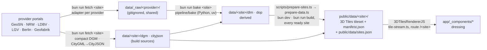

# Data pipeline — the bakes, the build step and the artifact contracts

The developer reference for everything between a provider download and the
files the browser requests. For the plain-language version read the guide
[From download to browser](./guide/en/data-journey.md); for *what maps to
what* see [data-flow.md](./data-flow.md); for standing up another location
see [portability.md](./portability.md).



Two languages, three stages ([ADR 0037](./adr/0037-sites-providers-and-per-site-data.md),
[ADR 0037](./adr/0037-sites-providers-and-per-site-data.md)): **Python**
fetches (`bun run fetch <site>`) and bakes (`bun run bake <site>`) — by
hand, per site; **TypeScript** turns every ready `data/<site>/` into the
tileset the browser streams at `/<site>`, on every `bun dev` / `bun run build`.

## Sites, providers and tiles

Everything about a place that is not data lives in one site config
([ADR 0037](./adr/0037-sites-providers-and-per-site-data.md)): `sites/<id>.ts`,
typed by `lib/city/site.ts` and registered in `sites/index.ts`. Every
script takes the site as its **first argument** (`bun run fetch leipzig`,
`siteFromArgs`); a wrong or missing one stops with the list of known ids.
There is no site variable: one deployment serves every site whose data is
ready at build time, each under its own route (`app/[site]/page.tsx`,
`/dresden`, `/leipzig`, …), and `/` is the start page that lists them.
`REFERENCE_SITE` (`dresden`) is the one whose data is committed, which
`/wissen` describes and the checks measure. A site names its **provider**
(`sites/providers.ts`): the Land (`land`, shown on the start page), its CRS
(25832 or 25833), licence and credit, open products and OSM extract
([ADR 0037](./adr/0037-sites-providers-and-per-site-data.md)).

A site lists its tiles as `{e, n}` cells — the south-west corner in km,
2 km edge (`TILE_KM`), in the provider's CRS. The **first tile is the
spawn tile**; the order of the rest does not matter. `tileIdOf` names a
cell `<UTM zone><e>_<n>_2<tileSuffix>`, and every file name under
`data/<site>/` carries that id; `tileExtentOf` gives its extent. Dresden:

```
        N
  ┌─────────────────┬─────────────────┬─────────────────┬─────────────────┬─────────────────┐
  │ 33408_5658_2_sn │ 33410_5658_2_sn │ 33412_5658_2_sn │ 33414_5658_2_sn │ 33416_5658_2_sn │
  │ Pieschen,       │ Innere Neustadt │ Äußere Neustadt │ Waldschlößchen- │ Dresdner Heide, │
  │ Mickten         │                 │                 │ brücke          │ Loschwitz slope │
  ├─────────────────┼─────────────────┼─────────────────┼─────────────────┼─────────────────┤
  │ 33408_5656_2_sn │ 33410_5656_2_sn │ 33412_5656_2_sn │ 33414_5656_2_sn │ 33416_5656_2_sn │
  │ Friedrichstadt, │ Altstadt        │ Johannstadt ★   │ Elbwiesen,      │ Blaues Wunder,  │
  │ Ostragehege     │                 │                 │ Elbschlösser    │ Loschwitz       │
  ├─────────────────┼─────────────────┼─────────────────┼─────────────────┼─────────────────┤
  │ 33408_5654_2_sn │ 33410_5654_2_sn │ 33412_5654_2_sn │ 33414_5654_2_sn │ 33416_5654_2_sn │
  │ Löbtau, Plauen  │ Hauptbahnhof    │ Großer Garten   │ Striesen        │ Blasewitz       │
  └─────────────────┴─────────────────┴─────────────────┴─────────────────┴─────────────────┘
                                                                                            E
  ★ spawn tile (sites/dresden.ts, first in the list)
```

The spawn tile spans 412 000–414 000 E / 5 656 000–5 658 000 N
(EPSG:25833) — roughly 51.049–51.067° N, 13.745–13.773° E; the site as a
whole covers 408 000–418 000 E / 5 654 000–5 660 000 N, a 5×3 block of fifteen
tiles. No
tile has a role beyond "where you start": which tile is detailed is decided
by camera distance at runtime
([ADR 0024](./adr/0024-site-streams-as-3d-tiles.md)), and collision,
demolish and picking work on every loaded tile.

`bun run site <site>` prints where the site stands — per tile, the files
the build needs that are missing, the optional ones that are off, and the
command to run next — and checks each walk viewpoint against the data (not
inside a building footprint, not on water). `bun run site --all` lists
every site with its size on disk; the build step uses the same report to
decide which sites are ready to serve.

What each site draws from which source — the best one, OSM as the only
one, a stand-in, or nothing, with the reason — is the guide's generated
*Sources by city* page (`docs/guide/{en,de}/sources-by-city.md`,
[ADR 0012](./adr/0012-openstreetmap-for-what-official-data-lacks.md)). `bun run
docs:matrix` (`scripts/docs-matrix.ts`) writes both languages from the
site and provider configs (`lib/city/source-matrix.ts`, pure: one row per
thing the viewer draws, one column per configured site, built ones first);
`scripts/docs-matrix.test.ts` fails when the committed pages differ.
Change a provider's `products`, a site's `treeCadastre` or a source, run
it, commit the pages.

## Stage 1 — fetch and bake (`pipeline/`)

`pipeline/` is a [uv](https://docs.astral.sh/uv/) project:
`pipeline/pyproject.toml` pins numpy, rasterio, pyogrio, shapely, pyproj,
Pillow and zipfile-deflate64 exactly (Python 3.12–3.13), `pipeline/uv.lock`
locks the rest. GDAL comes inside the rasterio and pyogrio wheels, with the
OSM driver — there is no system GDAL, no Java, no bash. `uv` on `PATH` is
the whole setup; `uv run` creates the environment on first use.

```bash
bun run fetch leipzig               # download what the site needs (skips what is there)
bun run fetch leipzig 33316_5690_2_sn   # one tile
bun run fetch dresden --lsc         # ... and the laser scan, where the provider has one (≈380 MB a tile;
                                    #   NRW: four 1 km files, ≈100 MB each, merged)
bun run bake dresden                # every tile of the site, every step
bun run bake dresden 33412_5656_2_sn    # one tile
bun run bake dresden --step canopy  # one step, in the order `all` runs them
                                    #   (pipeline/bake/__main__.py `STEPS`):
                                    #   landcover, islands (OSM squares into
                                    #   the class raster, no raw DLM needed),
                                    #   rail, ndvi, canopy, trees,
                                    #   osm-buildings, doors, passages,
                                    #   plinths, lamps, monuments,
                                    #   furniture, mapillary,
                                    #   lamp-heights, facades, shopfronts,
                                    #   windows, walls, stairs, surface,
                                    #   edges, markings, sport, tram,
                                    #   riverside, traffic, roofs, lowveg,
                                    #   cultivated, skyview, small-buildings,
                                    #   landmarks, structures, roof-colour,
                                    #   dormers
bun run bake dresden --step lowveg --research   # also every hedge/shrub candidate
bun run bake dresden --jobs 3      # each step's tiles three at a time (one
                                    #   process each; a step waits for the
                                    #   one before on every tile)
bun run bake dresden --force        # every step again, even one whose code
                                    #   and inputs did not change (see "What
                                    #   a re-bake runs" below)
bun run test:pipeline               # pytest + ruff check + ruff format --check
```

`scripts/pipeline.ts` turns the site into one JSON spec (provider, CRS,
products, the raw and data folders, the OSM extract, every tile's id and
extent) and runs `uv run --project pipeline python -m bake {fetch|bake}
--spec …`; `bake/spec.py` parses it. The extent and CRS come from the site,
never from the tile name. The modules in `pipeline/bake/`:

| Module | Role |
|---|---|
| `__main__.py` | the CLI; `bake` runs the steps in dependency order, `fetch` the fetch |
| `spec.py` | the site spec from `scripts/pipeline.ts` |
| `common.py` | `Tile` (id, extent, CRS, raw and data folders, the OSM extract, the provider's products), the DLM layers the bakes read, reading vector layers without geopandas, the GeoJSON writer |
| `fetch.py` | the fetch: calls the provider's adapter per product and tile, skips what exists, writes the results into place |
| `providers/{sn,nw,by,hh,be}.py` | one adapter per provider: `dgm`, `dom`, `dop`, `lod2` return the provider's own files covering a tile; `lod2` reads one ring of neighbouring cells around the tile, so a seam building the provider filed next door is seen by the tile that owns its envelope centre — a neighbouring cell is skipped only when the provider has no file for it (a 404 or 410, `fetch.not_published`, or no entry in the listing or archive: past the border); any other failure on it raises, so the LoD2 is not written and the next run tries again (Saxony's LoD2 ZIPs are kept under `downloads/LoD2_CityGML/` and Berlin's and NRW's 1 km LoD2 files under `downloads/lod2/`, shared by the site's tiles; Bavaria's 2 km LoD2 reads the tile's own cells only so far); `dlm` fills `dlm/` |
| `rasters.py` | mosaics a provider's rasters over a tile at 1 m / 20 cm; the DGM compact (DEFLATE, float predictor, centimetres). A height mosaic whose 1–99 % spread is under 0.5 m (`MIN_HEIGHT_RANGE_M`) is refused as broken: Hamburg's DGM was once committed as 0 m everywhere (a mosaic that kept the float-min NoData), and every house floated 5–10 m above it; `test_committed.py` holds every committed DGM tile to a spread of ≥ 2 m |
| `citygml.py` | streaming CityGML (AdV LoD2) → CityJSON, buildings owned by the tile holding their envelope centre (the fetch reads the neighbouring cells, so the rule never drops a building — Bavaria aside, see the adapters' row: Saxony files each building in exactly one 2 km file; the committed Leipzig, Grimma and Meißen CityJSON was fetched before the fetch read the neighbouring cells, so it can still lack buildings at the tile seams until the maintainer re-fetches those sites) |
| `net.py` | downloads (`.part` until complete), single members of remote ZIPs by HTTP range |
| `osm.py` | reads the site's `.osm.pbf` (through its index, `osm_index.py`), with a margin in degrees around the tile, reprojected to the tile's CRS; `in_tunnel` (a way in a tunnel or `location=underground`) and `below_ground` (that, or a negative `layer` / `level`) for what is drawn on the terrain; `read_ways`, the `lines` with every way in a tunnel left out, which each bake that paints a way on the terrain or lets one steer what it draws reads |
| `osm_index.py` | the extract read once into FlatGeobuf files beside it (`<extract>.index/`), so a tile's bbox read takes hundredths of a second instead of a parse of the whole extract; it gives the OSM driver's own answer, features, fields and order, the driver's relation rule included (see "Reading the OSM extract" below) |
| `step_cache.py` | what each step read and wrote on each tile, so the next `bake` skips a step whose code and files did not change (see "What a re-bake runs" below) |
| `landcover.py`, `landcover_osm.py`, `rail.py`, `canopy.py`, `trees.py`, `ndvi.py`, `roof_colour.py`, `osm_buildings.py`, `lamps.py`, `monuments.py`, `furniture.py`, `mapillary.py`, `facades.py` (+ `facade_measure.py`, one panorama measured on one wall; `facade_traits.py`, its trait profiles), `shopfronts.py`, `windows.py`, `walls.py`, `stairs.py`, `surface.py`, `edges.py`, `markings.py`, `sport.py`, `tram.py`, `riverside.py`, `skyview.py`, `lowveg.py`, `cultivated.py`, `small_buildings.py`, `landmarks.py`, `structures.py`, `doors.py`, `passages.py`, `plinths.py`, `dormers.py` | one step each, in the order of the step table (`STEPS`; the table below) |
| `lsc.py` | the laser scan → the 0.5 m rasters `lowveg` and `small-buildings` read (laspy, PDAL's binning rules); `merge_laz` joins a provider's 1 km LAZ into the one scan per 2 km tile (x, y, z, intensity, returns, class), its classes mapped into the AdV scheme by the provider's table (`classes`); every scan's low-return intensities are normalised by its own ground median (see the laser scan under the fetch) |
| `tree_archetypes.py` | the cadastre's (and OSM's) taxon → crown archetype, leaf type, foliage colour and the genus id of the season table (`GENERA`; pure Python; `scripts/eval/kataster-eval.py` reuses it) |
| `cadastre.py` | the municipal tree registers a site can name (`Site.treeCadastre`), as data: each register's WFS query (feature types, output format, CRS) and its field mapping onto the bake's one tree record, plus the completeness check; Dresden, Hamburg, Leipzig and Berlin |
| `landmarks.py` | the `landmarks` step, and the fetch's Wikidata query for a tile's notable buildings and structures, for every provider ([ADR 0036](./adr/0036-lod2-roofs-that-miss-the-scan-are-rebuilt.md)) |
| `rail_osm.py` | the rail layer's four files from the OSM extract where the provider has no Basis-DLM (Hamburg, Berlin): rails, ballast beds, the bridge ways and outlines `rail.py` turns into decks, and OSM's networks for classifying them ([ADR 0012](./adr/0012-openstreetmap-for-what-official-data-lacks.md)) |
| `bridge.py` | what `rail.py` measures on a deck: the roadway and the superstructure ribs in DOM1, the fairway clearance from OSM seamarks, the Wikidata match; and the fetch's Wikidata query, for every provider ([ADR 0041](./adr/0041-line-levels-along-the-whole-line.md)) |

`pipeline/tests/` covers the pure helpers (line merging, deck outlines,
wall heights, coordinate rounding, the class ids the client's palette is
keyed by, the CityGML converter on a fixture, the provider grid, XYZ
gridding, the OSM class mapping, the spec, the monument kinds, the DLM ↔ OSM
fountain conflation and the relief measurement), and runs the `walls` and `stairs`
steps end to end against a synthetic DGM and a small OSM XML file (GDAL's
OSM driver reads `.osm` as well as `.osm.pbf`). CI's `pipeline` job runs it
with ruff after `uv sync --locked`. Fetch and bakes need the network and
the raw downloads and run on the maintainer's machine.

### The layouts

The bakes know no provider. They read two folders (the raw one gitignored,
never committed — no Git-LFS):

```
data/_raw/<provider>/        shared by every site of the provider
  dom1/<tile>.tif            surface model, 1 m (Bavaria: DOM20 averaged)
  dop/<tile>.tif             orthophoto, 20 cm, R G B (+ NIR)
  dop/<tile>.flight.json     the days the orthophoto was flown (the provider's
                             DOP metadata), for the roof colour's sun
  dlm/*.shp                  Basis-DLM, AdV Shape profile — the 16 layers read
  osm/<extract>.osm.pbf      the site's Geofabrik extract
  osm/<extract>.osm.pbf.index/   its index (osm_index.py), rebuilt when the
                             extract, GDAL or the index code changes
  dop/<tile>.roads.npz       the sunlit carriageway texels dop_balance.py
                             reads off the DOP (keyed by the DOP, the class
                             raster and dop_balance.py)
  .bake-cache/<site>/<step>/<tile>.json   what the step read and wrote on the
                             tile (step_cache.py)
  trees/<tile>.geojson       the site's street-tree cadastre, when it names one
                             (+ .meta.json: the request, the date, the count)
  traffic/<tile>.geojson     the site's counted traffic per road section, when
                             it names a source (+ .meta.json, as the cadastre)
  lsc/<tile>.laz             the laser scan (`bun run fetch <site> --lsc`, or by hand; ≈380 MB;
                             NRW, Bavaria: merged from the tile's four 1 km files,
                             in the AdV classes)
  lsc/<tile>/*.tif           its 0.5 m rasters, made by lsc.py on first use
  wikidata/bridges_<tile>.json    Wikidata's bridges around the tile (CC0)
  wikidata/landmarks_<tile>.json  its notable buildings and structures (CC0)
  murals/items.json, photos.json  the murals' Wikidata facts (size, photo) and
                             their Commons photos' size, type, author and
                             licence, per item and per title (CC0; asked once)
  murals/photos/<sha>.jpg    the chosen photos, at a standard thumbnail width
  mapillary/<tile>.v2.json   Mapillary's street lights over the tile, with each
                             image's place and time (`MAPILLARY_TOKEN`)
  downloads/                 statewide packages and the LoD2 files a tile shares with its neighbours, fetched once
data/_raw/glo30/<site>.tif   Copernicus GLO-30, a 30 m surface model, over the
                             site and 10 km around it (EGM2008 heights, read
                             by range out of the public cloud-optimised
                             GeoTIFFs of the AWS Open Data bucket
                             `copernicus-dem-30m`; 15 MB for the seven sites;
                             optional — the sky view then runs the site's
                             edge on level)
data/<site>/
  dgm/dgm1_<tile>_tiff/dgm1_<tile>.tif     DGM1, the build's terrain source
  cityjson/lod2_<tile>.city.json          LoD2, the build's building source
  dlm/, dop/                               the bakes' outputs
  murals/murals.json, murals/<osm-id>.webp the murals on their walls (site step)
  provenance.json                          editions and downloads (Dresden)
```

A tile's other downloads live in a scratch folder only until its products
are written — the products are the cache, and a rerun skips them. Delete a
product to fetch it again. `bun run fetch` exits 1 when a tile's DGM1 or
LoD2, the Basis-DLM (where the provider has one) or the OSM extract
failed, after trying everything else.

**Moving from the old layout** (`data/_raw/dresden/`, before ADR 0037):
`mv data/_raw/dresden data/_raw/sn` keeps the downloads. The fetch now
keeps only the 16 Basis-DLM layers the bakes read; the others in `dlm/`
can be deleted.

### The adapters

| Provider | How `bun run fetch` finds the files |
|---|---|
| Saxony (`sn`) | the batch-download page embeds each product's live share id and file-name template (`batchConfig.products`); one ZIP per 2 km tile. The Basis-DLM is a statewide ZIP of ZIPs (~1.2 GB, kept in `downloads/`). GeoSN's link service (see [Provenance](#provenance)) still names a retired LoD2 share, so it is not used |
| NRW (`nw`) | 1 km files named with their acquisition year; each folder's `index.json` is read and the newest year taken. The Basis-DLM (4.7 GB) is never downloaded whole: its 16 layers are read out of the remote ZIP by range. The laser scan (`--lsc`) is four 1 km LAZ per tile, merged into one |
| Bavaria (`by`) | predictable `download1.bayernwolke.de` URLs: DGM1, DOM20, DOP20 per km, LoD2 per 2 km; the Basis-DLM layers by range (the package uses Deflate64). The laser points (`--lsc`) are four 1 km LAZ per tile from `geodaten.bayern.de/odd_data/laser/<e>_<n>.laz`, merged into one, their classes mapped to AdV (`by.LSC_CLASSES`) |
| Hamburg (`hh`) | one ZIP per product for the whole city, 1 km tiles inside, read by range; DOP per district, the district found by its directory. Dated URLs in `providers/hh.py`. Its committed DGM was re-fetched on 2026-09-30: the first one had come out 0 m everywhere (see `rasters.py` above), and every Hamburg bake was run again on the real terrain |
| Berlin (`be`) | INSPIRE ATOM: 2 km XYZ heights gridded to GeoTIFF, 1 km LoD2 ZIPs, TrueDOP JPEG 2000 per district by range. Untested so far |

Every provider also gets, per tile, **Wikidata's bridges**: one SPARQL
query for the bridges Wikidata places within 500 m of the tile (class, main
span, length, the number of spans `P1314`) into
`wikidata/bridges_<tile>.json` (`bridge.fetch_wikidata`; the file carries
`"version": 2`, and one without it is fetched again);
and **Wikidata's landmarks**: one SPARQL query per tile (`wikibase:box`
over the tile, instances of a subclass of *architectural structure*
`Q811979` with at least two sitelinks, the top 80 by sitelinks; their
German label, position, height `P2048`, materials `P186` and whether they
are a building, `Q41176`) into `wikidata/landmarks_<tile>.json`
(`landmarks.fetch_wikidata`), and whether each still stands — `P576`,
the date it was dissolved or demolished, and `P5816`, its state of
conservation — asked apart (`fetch_status`), so an older cache is
completed in place. A dense centre's box that times out at the
endpoint (a 504) is asked again in quarters, two levels deep. The bakes
read both files, never the network. Per site, **the murals** OSM maps
(`tourism=artwork`, `artwork_type` mural · mosaic · graffiti · sgraffito,
a node or a way, read through the extract's index over the site's extent):
for those with an item, its size `P2049`/`P2048` and photo `P18` from
`Special:EntityData` (the SPARQL endpoint and the Commons API answer the
container with 429s; one request per 1.5 s, `Retry-After` honoured),
then each candidate photo's size, type, author and licence from the Commons
API (50 titles a request, renamed files followed to their new title; a
title without an answer is asked again next time), and the photo the rule
picks downloaded at a standard thumbnail width (upload.wikimedia.org
refuses the originals and odd widths) into `murals/` (`murals.fetch`,
`fetch.fetch_murals`; optional: a failed download or fetch is noted, the
rest goes on). Per tile too, **the days its
orthophoto was flown** (`dop/<tile>.flight.json`; GeoSN's download-link
service, the metadata table of Hamburg's DOP edition, Bavaria's and NRW's
DOP info services), and once for the site **the GLO-30 window** around it
(`fetch_glo30`). And **every download is
checked** before it takes its cache name (`net.download`): the byte count
against Content-Length, a ZIP's CRCs, and Geofabrik's published md5 for the
OSM extract. A download that fails a check is deleted, so the cache never
holds a broken file; a ZIP cached before the checks is tested once.

Two inputs are not the provider's alone:

- **The street-tree cadastre** (`Site.treeCadastre`, fetched by `bun run
  fetch` for every tile): the city's register over the tile plus 10 m, as
  one GeoJSON FeatureCollection in `trees/<tile>.geojson` (the feature
  types merged). The registers (`cadastre.py` `REGISTERS`, each a WFS 2.0
  query plus a field mapping; `lib/city/site.ts` `TREE_REGISTERS` names
  the same ids):

  | Register | Service, feature type(s) | CRS | Licence | Fields read |
  |---|---|---|---|---|
  | `dresden` | `kommisdd.dresden.de` `cls:L1261` | 25833 (position in `gis_x_utm`/`gis_y_utm`, the geometry is WGS84) | dl-de/by-2-0 | `art_botanisch`, `art_deutsch`, `baumhoehe_akt`, `kronendurchmesser_akt`, `stammdurchmesser_akt` (diameter) |
  | `hamburg` | `geodienste.hamburg.de/HH_WFS_Strassenbaumkataster` `de.hh.up:strassenbaumkataster` (only `application/geo+json`) | 25832 (MultiPoint) | dl-de/by-2-0 | `sorte_latein`/`art_latein`/`gattung_latein`, the German three, `kronendurchmesser`, `stammumfang` (circumference), `pflanzjahr`; **no height** |
  | `leipzig` | `geodienste.leipzig.de/l3/OpenData/Baeume/wfs` `OpenData:Baeume` | 25833 | dl-de/by-2-0 | `ga_lang_wiss`, `ga_lang_deutsch`, `baumhoehe`, `kr_durchm`, `st_durchm` (else `st_umfang`), `pflanzjahr`; `gefaellt_am` set → skipped |
  | `berlin` | `gdi.berlin.de/services/wfs/baumbestand` `baumbestand:strassenbaeume` + `baumbestand:anlagenbaeume` | 25833 | dl-de/zero-2-0 | `art_bot`, `art_dtsch`, `baumhoehe`, `kronedurch`, `stammumfg` (circumference), `pflanzjahr` (text) |

  None of the services needs paging (their CountDefault exceeds a tile):
  one request per feature type, trusted only when the feature count
  equals the server's `numberMatched` summed over the types (a hits
  request first; recorded in the sidecar). Berlin's root CA is missing
  from the system bundle: its requests add certifi's bundle to the default
  trust (verification stays on). A site without a cadastre runs the
  `trees` step on its OSM trees alone.
- **The laser scan, only with `--lsc`** (`Provider.products.lsc`: Saxony,
  NRW and Bavaria). Saxony: GeoSN's LSC product, one ≈380 MB LAZ a tile, unpacked
  as `lsc/<tile>.laz` (Dresden, Meißen, Grimma, Leipzig). NRW: the
  "3D-Messdaten" (`hm/3dm_l_las`, dl-de/zero-2-0), four 1 km LAZ of
  ≈100 MB per tile, found by the folder's `index.json` like every NRW
  product and merged into `lsc/<tile>.laz` (`lsc.merge_laz`), carrying
  only what the rasters read. Bavaria: the LDBV's classified laser points
  (CC BY 4.0, `geodaten.bayern.de/odd_data/laser/<e>_<n>.laz`, LAS 1.2
  point format 1 without a CRS record — EPSG:25832; München's flight
  2022), four 1 km LAZ of ≈105 MB per tile, merged the same way.

  *Classes.* The rasters read the AdV scheme GeoSN's scan uses
  (`lsc.ADV`): 2 measured ground; 8 (water) and 30 (under buildings),
  synthetic ground — DGM1 fill, read into the DTM only; 20 everything
  standing on the ground, vegetation, roofs, cars and fences alike.
  Bavaria classifies differently, so `providers/by.py` maps its classes
  into that scheme while merging (`merge_laz(classes=…)`, one table per
  1 km file, by its year):

  | LDBV class | meaning | → AdV |
  |---|---|---|
  | 2 | ground | 2 |
  | 9 | water | 8 (DTM only) |
  | 23, 24 | synthetic ground | 30 (DTM only) |
  | 6 | building | 20 |
  | 20 | "object point, e.g. vegetation" (there are no 3/4/5) | 20 |
  | 22 | bridge up to 2020 / cellar entrance since 2021 | 20 up to 2020; dropped after (on 691_5334, 2022: 73 k points, median 0.1 m *under* the DTM) |
  | 0, 1, 7 | never classified, unclassified, noise | dropped (a few hundred points a km²) |

  Buildings join the vegetation in 20 on purpose: GeoSN's 20 holds both,
  and every rule downstream was measured on that — the small-structure
  bake *needs* the sheds' roofs in the surface (Bavaria classifies them
  6), and the hedge and tree bakes tell vegetation from the rest by LoD2,
  land cover, NDVI, the echo ratio and the low returns' intensity, never
  by class. Bavaria's 6 is not used as a building mask beyond LoD2: that
  would hide exactly the sheds LoD2 lacks.

  **NRW is not AdV 2/20 either.** On Unna's 32408_5710 (66.7 M points,
  2026-10-01): 1 = 22 %, all of it multi-echo, 1.7–22 m above ground — the
  crowns' non-last echoes; 20 = 26 %, 18 % multi-echo (roofs and last
  echoes); 17 bridge, 18 noise (half below ground), 24 ≈ 1 m below
  ground, 26 synthetic ground (intensity 0). `providers/nw.py` merges with
  the table `LSC_CLASSES = {2: 2, 26: 30, 1: 20, 20: 20, 17: 20}` (noise
  and below-ground dropped). Read as GeoSN's, the rasters had dropped
  class 1: Unna's re-bake with the table found 14 457 scan trees outside
  the canopy mask where it had found 2 385, and 897 small structures where
  it had found 1 596 — the gaps in the crowns had read as low roofs.

  *Intensity.* The low-vegetation cue (`intensity ≥ 1250`) was measured on
  GeoSN's flight over Dresden; two sensors' intensities are not calibrated
  against each other. `lsc.rasterise` therefore scales every scan's
  low-return intensities by `REFERENCE_GROUND_INTENSITY / the median
  intensity of its own measured ground (class 2) in the tile`: the
  reference, **1352**, is that median on Dresden's spawn tile 33412_5656
  (34.1 M ground points, p10/p90 958/1637, measured 2026-10-01), so that
  tile rasterises with a factor of exactly 1 — its five rasters came out
  identical to the previous code's, byte for byte. The factor is printed
  and written into `lowint_050.tif`'s tags (`ground_intensity_median`,
  `intensity_scale`). Bavaria's ground medians are 1436–1493 per 1 km
  file (factor ≈ 0.92); NRW's raw 16-bit ground medians are 50 429 and
  54 852 on Unna's two tiles (factors 0.0268 and 0.0246; the hand-set 1/16
  that preceded the normalisation is gone). *Assumption:* the same ground — asphalt and lawn in the
  mix a city has — reads equally bright to every sensor; the mix differs
  from city to city, so this is a first-order gain correction, not a
  calibration.
  A failed download is a note, not an error (the hedge step then goes OSM-only);
  the LAZ can also be put there by hand. On 2026-09-25 the GeoSN
  portal's link service named the share `…/rqcqdt8QMcLFUvC/lsc_<tile>_laz.zip`,
  but the share answered 503 (`NotFound`).

**Every OSM input comes from the local extract** (ADR 0037 tightening
[ADR 0012](./adr/0012-openstreetmap-for-what-official-data-lacks.md)):
walls, stairs, lamps, fountains, street furniture, platforms, the bridge
structure and, without a DLM, the land cover. There are no Overpass
queries — a re-bake is reproducible from the recorded extract. If
Geofabrik is unreachable the fetch says so and carries on; put the
extract at the path it names. The *committed* Dresden lamp, platform and
bridge-structure data still comes from the old Overpass bakes; the next
re-bake moves it (see [Provenance](#provenance)).

### Reading the OSM extract

GDAL's OSM driver has no index: every read parses the whole extract,
whatever its bbox and filter (1.5–5 s for a city's BBBike extract, three to
four times that for Unna's Regierungsbezirk), and a tile's steps read it 10
to 24 times each. `osm_index.py` reads the extract once (about 35 s for
Dresden's) into FlatGeobuf files beside it, which GDAL reads by bbox
through their R-tree, with `where` evaluated by the same OGR SQL engine (an
SQLite store such as a GeoPackage would compare `=` case-sensitively where
OGR SQL does not). `points`, `lines`, `multilinestrings` and
`other_relations` are one file each. `multipolygons` needs the driver's
relation rule kept: a tagged relation the filter turns down is never built,
so its closed outer ways stay standalone areas (a building way that is also
the outline of a site's multipolygon comes back under `building IS NOT
NULL`, not under a filter the site passes). The index keeps the whole
layer, every area way no tag-less relation absorbs, and which relation
absorbs each of the others, and applies the rule per read. With
`BAKE_OSM_CHECK=1` every read is made from the extract too and must match.

### What a re-bake runs

Each step's run on a tile records what it read (Python's own opens through
an audit hook, GDAL's through `rasterio.open` and `pyogrio.raw.read`, a
shapefile with its sidecars), what it looked for (`os.stat`,
`os.path.exists`), which folders it listed and what it wrote, with content
hashes, in `data/_raw/<provider>/.bake-cache/<site>/<step>/<tile>.json`.
The next `bake` skips that step on that tile when the step's code (its
module and every bake module it imports, and `uv.lock`), the spec, every
file it read or looked for and every file it wrote are as recorded. A
change to one step's code, or to one input, re-runs that step and the steps
that read what it wrote; everything else is a check of file sizes and
times (a file's hash is taken again only when its size or time moved).
A step that reads the clock (the cadastre's young trees are young by the
year) carries the year in its key.

Some steps rewrite what an earlier one wrote: `islands` the land cover's
class raster, `lamp-heights` the lamps' and Mapillary's points. So the
file on disk is the last writer's, and a step is judged against what a
full run would see (`Ledger` in `step_cache.py`): before step k a file
holds what its last writer before k wrote, as that writer's manifest
records it, and a step's recorded output must lead, through the later
writers' recorded runs (each read what the one before it wrote), to what
is on disk. The land cover then skips while the islands' raster is what
the islands made of its own, and the islands skip when the land cover did. A
step that runs while a file it read holds a later writer's output (the
islands with new code, the land cover not) has that file's earlier
writers run first, so it never reads its own output in their place, and
the later writers of what they put back run again after it, judged like
any step (a bake of `furniture` alone that restored the lamps runs
`lamp-heights` after it, or the posts would lose their heights). All
tiles of a step are judged before any of them runs.

A site-wide measurement a step keeps for the process (the NDVI's
anchors, the flight's colour cast, a roof's sun reading, the city's bin
colour) is a `step_cache.memo`: what making it read is added to the
manifest of every tile that takes it from memory, at the state it was
read in — the colour cast a `bake all` measures in the land cover, before
it rewrites the class rasters, leaves `sport` and `roof-colour` to run
again on the next bake, measured anew. What a step handed in to it counts
too: a roof's sun reading made from the orthophoto and LoD2 its own tile
had open lists them for the peer tiles that pool it. The roads' texels kept beside the
DOP are no step's file (`step_cache.quiet`); the DOP and the class raster
they come from are. `--force` runs every step and records it;
`BAKE_CACHE=0` runs every step and records nothing.

With `--jobs N` those measurements are made once in the parent before the
workers fork (`warm` in `__main__.py`), so the workers share them instead of
each making its own; the roofs' sun readings, a few seconds a tile, are
made N at a time there (`site_readings`), first the step's tiles', then
their flight's where a tile's own shadows do not fix its sun.

### The steps

Each step writes into `data/` in the site's CRS (2 decimals for lines and
polygons, 1 for points) with a named-CRS member; the loaders never
reproject. Order matters where noted: `landcover` writes the class raster
that `canopy`, `trees`, `lamps` and `furniture` gate on; `rail` runs next
and writes the bridge decks before `canopy` (without a DLM it keeps the
crowns off OSM's decks), `furniture`, `tram`, `lowveg` and
`small-buildings` read them; `tram` reads the furniture (its own tile's
and its neighbours'); `markings` reads the kerb lines `edges` writes (its
kerb bit); `lowveg` runs after the rest, thinned against the
canopy and the cadastre, then `cultivated` (an orchard tree gives way to a
measured one, canopyx included) and `small-buildings` (the same scan
rasters; walls, bridges, monuments and stop shelters mask it), `skyview`
after the tree bakes (its crowns are theirs), then `landmarks` and
`structures` (the relief is measured on the landmarks' objects only), and
`roof-colour` and `dormers` after them (the buildings LoD2 lacks are read
too; a crown over a roof is no dormer). Steps that
read a neighbour's files (`markings`, `cultivated`, `tram`, `skyview`,
`small-buildings`, `structures`) find the neighbours by their committed
DGM (`Tile.neighbours` in `common.py`); run them for every tile.

| Step | Reads | Writes (`data/…`) | Notes |
|---|---|---|---|
| `landcover` | `dlm/*.shp`, or without a Basis-DLM the OSM extract (`landcover_osm.py`); the OSM extract, when there, for the islands | `dlm/landcover_<t>.png` (class ids 0–9, one byte, 4096² over the tile), `dlm/landcover_<t>.json` (tile, CRS, bounds, size, legend, and `water`: the water bodies, below), `dlm/vegrows_<t>.geojson` (`kind`: hedge / treerow) | Class ids only — the colours are painted in the browser ([ADR 0010](./adr/0010-opaque-clay-buildings-only.md)). The layer → class table is data at the top of the module (`CLASSES`, `burn_order`, `ROAD_HALF_WIDTH`). Classes burn lowest priority first, so water (8) wins. Roads are centrelines buffered by the surveyed width `BRF`, else by OSM's carriageway where a car way runs with the axis (`road_widths.py`: its `width:carriageway` or `width`, else its lanes × 3 m plus the parking on the carriageway, in 20 m pieces, a half-width of 1.5–12 m), else by class `WDM`, without a stretch that runs along a DLM tunnel (> 15 m within 2 m of `ver06` `BWF=1870`, `common.above_ground`; the OSM fallback skips every way in a tunnel, `osm.read_ways`). With the DLM, the OSM islands (see `islands`) are then carved out of the road class. Arable land (9) is the DLM's farmland whose `VEG` says field (1010, 1011, 1013), and OSM's `landuse=farmland` without a DLM. Then `water.bodies` re-classes the dry shore in the raster and writes the bodies into the legend (*The legend's water member*, below). With the DLM and an extract, the `vegrows` hedges within 2 m of an OSM hedge are dropped (`hedges.without_mapped`); the OSM fallback writes tree rows only (`natural=tree_row`). Fails if nothing rasterised |
| `rail` | `ver03_f`, `ver03_l`, `ver06_f`, `ver06_l`, `ver01_l`, `ver02_l` (without a Basis-DLM: OSM `railway=*` and `bridge`-tagged ways, `man_made=bridge` outlines); DGM1 + DOM1 of the tile **and its neighbours**; OSM's tracks on every site (`railway=rail/light_rail/subway/narrow_gauge`, `power=catenary_mast`), `man_made=bridge`, `seamark:type=bridge`, `railway=platform`; `wikidata/bridges_<t>.json` | `dlm/railarea_<t>.geojson` (ballast polygons), `dlm/rail_<t>.geojson` (lines with `tracks`, `electrified` 0 none / 1 overhead / 2 third rail, `bridge`, `layer`, gauge `g`, `paved`, the mapped masts `m` as [station, left offset]), `dlm/bridge_<t>.geojson` (polygons with per-vertex `deck`, `kind`, `name`, `structure`, and `axis` (the centreline, a polyline), `line` (deck height per 2 m), `ribs` (`offset`, `rise` per 2 m), `fairway`, `clearance`, `depth`, `wikidata`, `span` where measured or known; `water` the [from, to] stations over the class raster's water, `spans` Wikidata's number of spans (`P1314`), `piers` a masonry bridge's bastion stations in DOM1 (where Wikidata's count agrees), `under` the passages the terrain opens under it as [{`c`, `y`, `h`}]), `dlm/platform_<t>.geojson` (`h` the edge height where OSM maps it, `k` the trains it serves) | Ballast: `OBJART=42010` made valid, unioned (shapely), cut to the baked tracks' own beds (`ballast(tile, lines)`, `rail_osm.beds`; none on a bridge or a paved track; 4.5 m wide, 4 m more per further track, the union closed by 4 m with mitred joins and simplified 0.1 m) and clipped; credited to OSM too when the extract is there. Rails: OSM's every track above ground on every site (`rail_osm.rails`; none `covered` for more than 30 m; `electrified` from the tag, else the nearest DLM line's `ELK`, a DLM U-Bahn its third rail; `paved` where `embedded` or a service track between paving; the `power=catenary_mast` points within 12 m as `m`), and the DLM's lines only where OSM maps no track within 6 m, each rest ≥ 20 m (`rail_osm.claimed`): heavy rail only (`SPW=1000`; a line whose `BKT` is tram (1201) alone is skipped even at standard gauge — Bavaria files Munich's trams so), fragments merged at 1 m; a stretch that runs within 2 m (`TUNNEL_HALF_M`) of a DLM tunnel (`ver06_l`/`ver06_f`, `BWF=1870` "Tunnel, Unterführung") for more than 15 m (`TUNNEL_OVERLAP_M`) is underground and cut out, a shorter overlap is a surface track crossing over one and stays (a 6 m reach took Munich Hauptbahnhof's surface tracks, which run over the S-Bahn tunnel). Platforms: none below ground (`osm.below_ground`); `h` from OSM's `height`, `k` from the tracks they serve (the viewer sets them on the track's level, `lib/city/platform-level.ts`). Decks: every `ver06_l` centreline (`BWF=1800`), snapped to the `ver06_f` footprint it runs on (half its length within 1 m), else buffered as wide as DOM1 sees the deck (`band`: its measured sides, a bridge beside it stopping them, the side DOM1 lost mirrored, 3–40 m in all), else the mapped width (the DLM's `BRF` + 2 × 2 m, OSM's `width` or `lanes`), else the kind's; a footprint or a merged deck carrying rails and a road is split per network (`split_nearest`, `shared_decks`; a share under 20 m² is no deck); the axis is that DLM line clipped to the outline and run on to its ends, else the outline's minimum rotated rectangle's long axis through its middle; every deck that touches the tile is written (the viewer draws it on the tile that owns its centre), its ground a DGM/DOM mosaic 700 m around the tile so both tiles' copies agree; deck height = the roadway DOM1 measures along the axis, held within −6/+4 m of the DGM abutment ramp and grade-limited from midspan out (8 %, rail 4 %), then fitted as a straight ramp between its ends plus one upward camber (never sagging); `kind` from the network that runs on it: the DLM rail (trams aside), road or path line following the axis within 30° for the most metres within 8 m (paths 5 m), rail first on a tie (`along`); a footprint no centreline runs on carries the lines that leave it onto ground within 2 m of the deck's top 4 m past its edge, and its axis follows the longest of them (`carried`); else the networks under its points, rail first; ribs (only where the class stands above the deck: arch, truss, suspension, cantilever, cable-stayed): DOM1 above the deck, per half of the cross-section, opened (7 m) and closed (11 m), kept ≥ 3 m high for ≥ 25 m; `depth` from the fairway clearance over the DGM's water (only a cap: the viewer reckons a deck's depth from what carries it, `lib/city/bridge.ts` `deckDepth`); `under` from the ways under a deck and the humps the DGM leaves under it (`bridge.way_passages`, `hump_passages`); `structure` (and `spans`) from Wikidata when a deck matches an item (OSM `wikidata` tag, else its name within 150 m), else the nearest OSM bridge outline ≤ 60 m, else the OSM bridge ways on the deck (`bridge:structure`, else an arch for a `start_date` before 1850: masonry, no superstructure looked for); a deck with no DLM name takes its OSM ways' `bridge:name`, else a `name` ending in -brücke, -steg, -viadukt (`rail.bridge_way`). **No Basis-DLM (Hamburg, Berlin): the same four files from the OSM extract** (`run_osm`, `rail_osm.py`): rails = `railway=rail/light_rail/subway/narrow_gauge` out of tunnels and off the underground, with `tracks` (1–8) and `electrified`, clipped and merged at 1 m; ballast = those not on a bridge buffered by their bed (4.5 m for one track, 4 m more per further one), dissolved; decks = every `bridge`-tagged `highway`/`railway` way ≥ 4 m (not proposed, under construction, abandoned …), on the `man_made=bridge` outline it runs on, else buffered at its `width` (1–60 m), else `lanes` × 3.25 m + 2 m, else the kind's width, and — OSM draws a carriageway, its pavements and a cycle track as separate ways — a way on an outline already claimed adds nothing, the loose buffers on one `layer` are merged into one deck (`decks(..., merge=True)`, `merged_decks`: first name, `bridge:name` before `name`; rail over road over path; the longest way the axis); the kind of an unclaimed outline from OSM's rail/road/path ways 0.012° around the tile (`Ground(tile, networks)`). Heights, ribs, depth, structure as above. Hamburg, 2026-10-01: 348 decks, 81 km of track (one way per track), 0.27 km² ballast over four tiles. No DOM1: decks use the DGM ramp, no ribs. No `.osm.pbf`: bridges without structure or clearance, the platform file already there stays. No Wikidata file: the OSM structure.** Every other output is written, even when empty |
| `canopy` | DOM1, the committed DGM1, `veg02_f`/`veg03_f`/park areas (and `veg02_f`'s forest kind `VEG`, without a DLM OSM's `leaf_type`), the class raster, OSM `building=*` outlines, the baked NDVI (`ndvi` runs first); the tree rows (`vegrows_<t>.geojson`) and the laser scan's crowns (`canopyx_<t>.geojson`, a previous `lowveg` run's); without a laser scan also the LoD2 CityJSON | `dlm/canopy_<t>.geojson` (points with `h`; `l: "e"` an evergreen, `ls: "dop"` when the photo told it, `pine: 1` an evergreen whose top DOM1 shows flat, `row: 1` a tree row's tree, `c: 1` a crown over a carriageway; the `rows` member, the tree rows it placed) | `nDOM = DOM1 − DGM1` in numpy. One tree per 7 m cell at the tallest texel between 3 and 45 m, only inside forest, copse or park, never on a path or water (classes 6, 8), a carriageway or a track bed (`ways.py`: the DLM's road centrelines at their width or, without a DLM, OSM's roads; the baked rails by their track count and every OSM track above ground; each + 0.5 m), nor within 10 m of a DLM bridge (`ver06_l`/`ver06_f`, `BWF=1800`; without a DLM the decks `rail` baked from OSM, `bridge_<t>.geojson`): where a bridge lands on a park bank its steel is as tall in the nDOM as a crown (the Blaues Wunder's pylons were two trees); nor on a building's roof: inside an OSM building outline shrunk by 1 m, no more than 2 m above its roof (the upper quartile of the outline's nDOM; `roof_mask` — a stadium's stands, a fair's halls and glasshouses the DLM files as park or sports ground). A provider without a laser scan (`products.lsc` false) adds the texels outside that mask the DOP shows green (the baked index ≥ 77 of 255 — NDVI 0.3 on Dresden's scale, the GLI without infrared —, nearest-sampled from its 1024² onto the 1 m grid) and DOM1 rough, off every LoD2 outline grown by 1 m (`green_mask`: the courtyard and garden trees no scan step finds there). Every provider adds the crowns on road and railway land beyond the traffic: rough DOM1 blobs of ≥ 15 m², 3–45 m, off the LoD2 outlines (`verge_mask`; the DLM files a road's or railway's land to its fences, with its verges, embankments and forecourts) — never a bare plane there (`bare_planes`: a 3 × 3 plane-fit residual ≤ 0.25 m on at least half of the 5 × 5 around, the index < 0.1; a gravel heap, a shed roof). A crown in a needle forest (`VEG` 1200, OSM `leaf_type=needleleaved`) is an evergreen; in a mixed one (1300, `mixed`) where the index at its peak (3 × 3 max) reads 0.35 or more and the site's flight is leaf-off — its broadleaf-forest crowns' median below 0.30, at least 200 of them (`leaf_types`); an evergreen whose top DOM1 shows flat is a pine (`crown_form.py`). The tree rows' trees (`row_trees`): DOM1's crown peaks within 3 m of the row's line, projected onto it, as tall as measured, thinned tallest-first 3 m apart, none within 4.5 m of a canopy or scan crown; the viewer then plants only the rows' hedges. A tree whose crown reaches over a carriageway carries `c: 1` (`lib/city/tree-placement.ts` `crownBase`: at least 3 m clear). **No DOM1: skipped with a note** (the viewer plants the rows every 9 m) |
| `ndvi` | DOP bands 1 (red) and 4 (NIR); bands 1–3 where there is no NIR; for the flight's scale, the DOP, DOM1, DGM1, the carriageways (DLM road centrelines at their width, else OSM's roads) and the OSM lawns of **every tile of the site** | `dlm/ndvi_<t>.png` (one byte, 1024², `clamp(NDVI on Dresden's scale, 0, 1)·255`) | Reads the whole DOP resampled to 1024², so it assumes the DOP covers the tile exactly. **One scale for every flight** (2026-10-20): the raw index's medians on the site's low carriageways and low mown lawns (DOM1 within 0.5 m of the DGM, ≤ 50 000 texels a tile, pooled over the site) go to Dresden's, −0.298 and 0.332 (`REF_ROAD`, `REF_LAWN`), by one line; a site with fewer than 2 000 texels of either, or less than 0.05 between them, keeps the raw index (as does a site without an OSM extract). Measured: Meißen −0.37 / 0.41, Grimma −0.19 / 0.16, Leipzig −0.15 / 0.12, Hamburg −0.07 / 0.14, Unna +0.02 / 0.22 (raw NDVI), München 0.20 / 0.43 (the fitted GLI). The anchors read ≈ 16 s a tile, once per run for the whole site, so a one-tile run reads the site's every DOP. **An RGB DOP (Bavaria)**: the Green Leaf Index GLI = (2G − R − B) / (2G + R + B) on the NDVI's scale, clamp(3.3 · GLI + 0.14, 0, 1) · 255 (`_gli`; the line fitted on Unna's two summer RGBI tiles: r ≈ 0.7 against the NDVI, 85 % agreement on NDVI > 0.3; r 0.75–0.86 on Hamburg's tiles) — München's four tiles, 2026-10-01. Fewer than three bands: skipped. **No DOP: skipped** |
| `roof-colour` | DOP bands 1–3, the days it was flown (`dop/<t>.flight.json`, the fetch's; every tile's of the site), the committed CityJSON, the DGM (the sun's fit), the rebuilt roofs (`dlm/roofs_<t>.geojson`), the scan's small structures and the structures beyond LoD2 (`dlm/smallbuild_<t>.geojson`, `dlm/structures_<t>.geojson`), DOM1 where fetched, the class rasters of every tile of the site (the flight's cast) | `dop/roofcolor_<t>.json` (`meta` with the fitted `sun`, `sun_from` (`own` or `pooled`), the `flight` days, `light_ratio`, `overcast`, `lean_sun`, the `balance` factors and `lean` nodes `[x, y, kx, ky]`; `roofs: {id: [r,g,b]}`, linear RGB; `faces: {id: [[geometry, surface, r, g, b], …]}`, the faces whose own colour differs from their building's by > 6 sRGB steps, keyed by the loader's `geometryid`/`boundaryid`; `parts: {id: [[part, z, r, g, b], …]}`, the same for a rebuilt roof's parts, by their index among the object's in the roofs file and their level (the build drops a colour whose level no longer matches); `scan` / `gaps`: `[[index, z, r, g, b], …]`, a small structure's or a structure's roof by its index in its file and its `z`, with `meta.scan_sampled` / `meta.gaps_sampled`; the build takes a row whose index and `z` match its feature's within 5 mm, `appendedRoofColour`, else the slate palette) | The photo taken to Dresden's colour balance first (`dop_balance.py`: the site's sunlit carriageways — the class raster's roads, the brighter half, pooled over its tiles — scaled to Dresden's chromaticity per channel in linear RGB, brightness kept; identity under 5 000 texels), then on to grey (`dop_balance.neutral_gains`: Dresden's own carriageways are 5 % green; the same per-channel gains, applied to every roof's median, take a sunlit road to neutral, so a sandstone dome or a slate roof keeps the photo's tint without the flight's cast); the texels in shadow (dim and blue, `dop_light.shadow_mask`); the flight's sun fitted to them (`estimate_sun`: the LoD2 roofs over the DGM at 2 m cast shadows on the ground within 25 m of a roof; searched along the flight day's solar path, every 10 min of the day and then every 2 min round the best, at the elevation the clock gives; a fit whose shadows hardly prefer their sun to the opposite one (contrast < 2.8) takes the sun the flight's sure tiles agree on together (`pooled_sun`), else none; without flight days a 10°/5° grid over the sky, then 2°/1°); a flight whose sun-and-sky light over the sky's alone is under 2 (`OVERCAST_RATIO`) is overcast: no face scaled by its slope, none dropped as turned from the sun; the image's lean of the roofs off their outlines (`dop_lean.py`: per tall building, ≥ 10 m, the correlation of its faces' expected shading with the image for each shift, all shifts at once by FFT; per 125 m node the one lean, metres per metre of height, the buildings within 250 m agree on best; per building the node within 300 m its own map likes best), each roof vertex shifted by the lean times its height over the building's foot (a part raised more than 2 m over its building's foot and the DGM under it — a dome on its drum — is shifted from that foot, takes its building's lean and measures none, `bases`); a building part nowhere in sun, or lit on under a quarter of its roof and read the shadow test's blue there, takes its building's roof (`meta.parts_carried`); per face: rasterise its RoofSurface ring, a face the sun meets at a cosine under 0.17 counting as shadow, erode 3 px inward (the orthophoto leans buildings), the per-channel median of ≥ 12 sunlit texels each scaled to a flat roof in that sun (`incidence_gain`, 0.7–1.4), when a quarter of the face is lit; a rebuilt roof is read by its parts (a measured surface's texels each by their own normal), not its LoD2 faces; a face over 4 m above the ground only where DOM1 shows its roof (at least half way up); per building the same over all its faces (eroded 5 px; the plain median where < 12 are lit). Keyed by CityObject id. A shed or a structure (2026-10-21): its outline at its top (a pent shed's plane from `hc`), sunlit texels only, the nearest lean node; none in shadow. Runs after `structures` (a re-bake of `small-buildings` or `structures` re-bakes `roof-colour` after it, or its rows stop matching). **No DOP or CityJSON: skipped**; no DGM or too little shadow: no slope scaling |
| `osm-buildings` | the committed CityJSON (GroundSurface rings, else the roof rings, as footprints); OSM points with `shop=*` or `amenity=cafe/restaurant/bar/pub/fast_food/ice_cream/biergarten`, building multipolygons carrying them or `heritage=*` | `dlm/osmbuild_<t>.json` (`attribution`, `context` — the tile's walls, `brick` or `render` —, `meta` with the counts incl. `objects_context`, `objects: {id: {shop?: 1, heritage?: 1, material?, colour?, roof_colour?, context?, name?, addr?, levels?, storey?}}`, `meta.objects_storey` the count of `storey`) | A shop point marks the footprint it lies in, else the nearest within 3 m (entrances sit on the facade line); points tagged on another floor (`level` without a 0) are dropped. An OSM outline marks the objects it covers ≥ 50 %. A marked part marks its root Building too. Plan 050: building and `building:part` outlines with `building:material` / `building:facade:material` / `facade:material` (normalised to glass, metal, brick, stone, concrete, wood, plaster), `building:colour` and `roof:colour` (a CSS name or hex → `#rrggbb`) give the objects they cover ≥ 50 % a `material`, `colour`, `roof_colour`; buildings first, then parts, so a part's own tags win. **Context** (ADR 0012; outlines read 0.005° ≈ 350 m around the tile): every outline whose material is brick votes 1, plaster/stone/concrete/wood 0, glass and metal not at all; an object's vote is the 1 / (d + 50 m)-weighted mean of those within 300 m when there are ≥ 6, else the tile's (the mean of all, when ≥ 20; else `render`), brick at ≥ 0.5; written per object only where it differs from the tile's and the object has no `material` of its own. Mapped wall materials, 2026-10-01: Hamburg 106 brick / 11 plaster, Unna 45 plaster / 0 brick, Munich 272 plaster / 38 brick, Dresden 866 plaster / 246 brick. Per tile 264–323 objects with a shop, 28–478 listed (the Altstadt tile carries the most). `name`, `addr`, `levels` (for the inquiry card, ADR 0042) come from the building outline covering most of a footprint (≥ 50 %), the address else from the `addr:housenumber` points on it, grouped by street; they stay on the object, never its root (Dresden's spawn tile: 2 363 of 4 404 addressed, 444 named; the other sites' files predate them and carry none until re-baked). `storey` (2026-10-21), on an object OSM counts no storeys of (no `levels`, or levels giving a storey outside 2.4–5.5 m): the median of eave ÷ `building:levels` over ≥ 3 mapped LoD2 objects within 200 m with its roof form (flat or pitched, as the build's `markFlatRoofs` reads it) and an eave within max(3 m, 35 %) of its own, itself never one; else the tile's median of its roof form (≥ 10 mapped); the build counts its storeys from its eave with it (`neighbourStorey`). **No extract or CityJSON: skipped** |
| `doors` | the committed CityJSON (footprints as for `osm-buildings`), OSM points with `entrance=*`, the committed DGM1 | `dlm/doors_<t>.geojson` (points on the wall, `attribution`; `of` the LoD2 object, `kind`, `nx`/`ny` the outward normal, `w`, `h`, `z` the sill's ground) | Snapped onto the nearest footprint edge within 3 m; dropped when tagged on another floor, on a party wall, on an edge too short for a 0.7 m door, on a wall too low for it plus 0.6 m. Size by `entrance` kind, `width`/`height` where plausible. Only the tile's own; one per 1.2 m. Dresden: 6 628 on fifteen tiles. **No extract or CityJSON: skipped** |
| `passages` | the committed CityJSON (footprints as for `osm-buildings`), OSM ways with `tunnel=building_passage`, the committed DGM1 | `dlm/passages_<t>.geojson` (the axis through the walls as a LineString, `attribution`; `osm` the way ids merged, `kind` the highway (`railway` for a track), `w` and `wFrom` its width and whether from `width` or the kind, `h` OSM's clear height or null, `z` the ground per axis vertex, `of` per LoD2 object the passage's strip reaches the ceiling's plan, the walls along it (and across it at a shut end) and its portals) | Ground-floor ways only (a `level` without a 0 or a `layer` above 0 skipped), chains merged end to end; the stretches inside the footprints joined across gaps under 2 m, at least 1 m long, run on 0.6 m past either wall, simplified 0.3 m — but a way that ends inside the footprints more than 0.6 m from their joint outline ends there, shut by a wall across it (`sides`); a bend over 60° or a stretch meeting no outline dropped; width 1.5–12 m from `width`, else 3.5 m a drive, 4.5 m a track (a `railway`, a single track's structure gauge), 2.5 m a walk; height 2–10 m from `maxheight:physical` / `maxheight`; the ground the lowest DGM1 sample within 1 m of each vertex. Dresden: 482 on fifteen tiles. **No extract, CityJSON or DGM: skipped** |
| `plinths` | the committed CityJSON (footprints as for `osm-buildings`, heights as for `doors`), the committed DGM1 | `dlm/plinths_<t>.geojson` (one MultiLineString per LoD2 object, each line a level piece walked with the street to its right; `g` the lowest ground under each, `top` its top) | The footprint edges' open stretches (no party wall, ≥ 1.5 m, objects ≥ 5 m tall), the DGM1 0.6 m in front, smoothed over 3 m, cut where the ground spans more than 0.45 m; top 0.9 m over the piece's highest ground; runs end on the footprint's vertices (the building bake mitres them); a stretch another object's run already covers (within 0.25 m, the same way) is left to it, the tallest object first. Dresden: about 176 000 pieces on fifteen tiles. **No CityJSON or DGM: skipped** |
| `lamps` | OSM `highway=street_lamp` and `highway` lines (`bridge`), OSM `barrier=wall/retaining_wall/city_wall` (a wall lantern with no facade near) and the committed DGM1 (its sides), the class raster, every tile's `bridge` file (`rail` runs first) | `dlm/lamps_<t>.geojson` (points, `h` = 5 m until `lamp-heights`; `deck`, m, on a lamp standing on a bridge; `wall`, the bracket's foot on the facade or wall, on a lamp OSM puts on a wall, and `on: "wall"` where a mapped wall holds it; `bent` on a post OSM tags `lamp_mount=bent_mast`) | Only the lamps the tile owns (west and south edges in, east and north out), so a seam lamp stands once when both tiles are dressed; the viewer applies the same rule (`ownsPoint`) to older files. A lamp inside a road or path deck stands on it (`deck`, its top there) when its nearest highway within 15 m is a bridge or the class below is railway or water — at the deck's nearer side, 0.4 m in across its axis, when it is mapped within 2 m of a street's line there (the lanes); other lamps over railway (5) or water (8) are dropped. A lamp tagged `lamp_mount=wall` or `support=wall_mounted` (not on a wire) within 1.5 m of an OSM building outline hangs on it: the point 0.5 m out of the facade on the side no building covers, `h` 3.5 m, `wall` the facade point; with no outline near, on a mapped `barrier=wall/retaining_wall/city_wall` within 1.5 m (`on: "wall"`, `Walls`): on its low face where the DGM 2–4 m either side differs by ≥ 0.5 m, `h` min(3.5 m, the step − 0.5 m) in 0.5 m steps, else (a freestanding wall at its tagged height or its kind's default) on the nearest street's side; a wall under 3 m holds none and the lamp stays a post. `lamp-heights` leaves it. No `.osm.pbf`: skipped with a note, the file already there stays |
| `monuments` | Basis-DLM `sie03_p` (`OBJART=51009`, `BWF` 1750 Denkmal · 1770 Säule/Stein · 1780 Brunnen, with `NAM`); OSM `amenity=fountain` (points + basin outlines), `historic=memorial|monument` and `tourism=artwork` points (`memorial`, `artwork_type`, `height`, `material`, `artist_name`; Stolpersteine and anything underground left out); Wikidata's monuments, sculptures and memorials with a material (`P186`, `data/_raw/<provider>/wikidata/monuments_<t>.json`, written by the fetch); OSM `place=square` and pedestrian areas and the `highway` lines (what a monument faces); the LoD2 footprints; DOM1 + the committed DGM1, the laser scan's rasters where on disk; every tile's `canopy` and `ndvi` files (whether the site was flown leaf-off) | `dlm/monuments_<t>.geojson` (`kind`: fountain / statue / stone / column; `name`, `source`; `form`: statue / bust / sculpture / stele / stone / obelisk, `height` (m), `material` (German), `artist`, `wikidata` (the item a material came from); fountains `style`: basin / pool / splash, `figure`; `relief`: `west`, `north`, `cols`, `rows`, `dm` — the measured body, heights above ground in dm on the 1 m grid; `form: column` where a slim shaft was measured; `cover` a winter housing; `hm` the height measured in the open (m); `hs: "lsc"` measured on the laser scan; `a` the bearing it faces; `r` a small fountain's radius) | The DLM is the official list and names; it does not say which monument is a fountain nor how big a basin is. A DLM point within 6 m of (or inside) an OSM fountain *is* that fountain — it keeps the DLM name (Albertplatz: "Stilles Wasser", "Stürmische Wogen"); a DLM name with *…brunnen*/*Tränke* is a fountain without a partner; every other OSM fountain is added (`source: osm`). An outline becomes a Polygon ring: the rim, its hole the water (inset 0.35 m); outlines under 1 m² become points. `relief`: for each monument and each fountain a DLM monument stands in, the nDOM patch above 0.7 m — inside the basin's water, or grown from the tallest cell within 2.5 m of the point — kept only when it ends within 6 m, stays ≤ 60 cells and below 8.5 m and touches nothing taller (a tree crown or a facade); 27 of 174 pass. `form`: a non-fountain DLM monument takes the OSM memorial or artwork of its name within 15 m, else the nearest (never a plaque); a DLM name with *Obelisk*/*Stele*/*Büste* sets it; OSM statues, busts, sculptures, steles, stones and obelisks the DLM lacks are added (`source: osm`) unless inside a LoD2 footprint or within 3 m of one kept. `material`: OSM's, else Wikidata's — the item of the monument's name within 40 m, else the nearest within 10 m, each item once. Only what the tile owns (representative point). Since 2026-10-21: an OSM memorial or artwork outline ≤ 1000 m² stands at its representative point unless a node lies inside (larger ones are left out); a war memorial or a bare `historic=monument` takes its form from its measured top (`default_form`: < 1.5 m stone, < 3 m stele, else statue; a slim shaft a column); a monument named column or obelisk is read as a slim shaft over 8.5 m (`slim_column`: ≤ 24 cells above 0.3 of its top, 12 unformed, its ring ≤ 0.45 of the top at the median, under half in a LoD2 footprint); on a site flown leaf-off (the canopy's median NDVI < 0.4) a box-shaped relief is a winter housing (`cover`, no relief); without a relief `hm` is the tallest cell within 1.5 m where 80 % of the 2.5–4.5 m ring stays under 0.7 m, raised to the form's least, none above its most; `a` faces the centre of its square, else its nearest way; a drinking fountain or stone block node is `r` 0.5 m; a point fountain inside a LoD2 footprint moves out within 3 m or is dropped. **No Basis-DLM: skipped, the file already there stays. No `.osm.pbf`: DLM monuments only. No DOM1: no reliefs (markers)** |
| `furniture` | OSM `leisure=playground` areas and `playground=*` equipment (points, ways, areas); OSM points `amenity=bench/waste_basket/bicycle_parking/post_box/shelter/clock/drinking_water`, `leisure=picnic_table`, `barrier=bollard`, `advertising=column`, `highway=traffic_signals`, `highway=crossing` with `crossing=traffic_signals` or `crossing:signals=yes`, `emergency=fire_hydrant`, `highway=bus_stop` / `public_transport=platform` with `shelter=yes`; bench ways; every `highway` line (with `lanes`); a bin's `colour`; the OSM building outlines when a wall clock is mapped; the class raster, every tile's `bridge` file; DOM1 + DGM1, the NDVI and the canopy (empty playgrounds) | `dlm/furniture_<t>.geojson` (points with `k`: bench / picnic / bin / bike / bollard / postbox / shelter / stop / column / signal / hydrant / hydrantsign / clock / wallclock / water / pedsignal; `arm` a signal on a mast arm; `c` a bin's colour; `lit` on a lit column; `a` the bearing it faces, degrees from north; `l` a bench way's length; `back: false`; `n` a stand's hoops; `h`, `metal` a bollard's tagged height and material; `deck` the top of the bridge deck a piece stands on, m; Polygons `k: playground` and sandpit areas; equipment points `k`: swing / slide / sandpit / climb / springy / seesaw / roundabout / playhouse, `src: "dom"` on those measured on an empty playground) | `a`: OSM `direction` on a bench (degrees or a compass point), else towards the nearest highway line within 25 m, across it when the object stands on it (< 0.5 m); a bench way stands at its midpoint facing the path side, length clamped 1–8 m. `n` = ⌈`capacity` ÷ 2⌉, 1–12. Dropped: `bicycle_parking=wall_loops`, `amenity=shelter` other than public transport, stops without `shelter=yes`, `indoor=yes`, `location=indoor/underground`, `level` < 0, classes 5 and 8, under a bridge deck; a shelter within 8 m of another. On a road or path deck (the lamps' rule: its nearest highway within 15 m a bridge, or water or railway below) a point piece stands where it is mapped, `deck` the deck's top there (the `line` along its `axis`), a kerbside one (bench, picnic table, bin, stand, post box, shelter, stop, column, drinking fountain) within 2 m of a street's line at the deck's nearer side as a lamp is (`ON_DECK_KERB`); so does a hydrant sign, and a signal there goes to its carriageway's kerb — on the right of the traffic it faces when directed, else the nearer side —, the street's `width` (else its class's half-width) + 0.6 m from its line, or the deck's edge where nearer (2026-10-21; before, a signal or hydrant sign on a deck was dropped); a wall clock there hangs on a facade within reach, else it is dropped. Playgrounds under 20 m² and equipment kinds without a model (mounds, table football, …) are left out; on a playground OSM maps empty, the surface model's blobs stand (2026-10-21, `src: "dom"`: DOM1 − DGM1 1.2–4 m, 2–40 m², ≥ 1 m inside the outline, touching nothing taller, NDVI < 0.3, no canopy tree within 1.5 m, the largest eight; a long narrow one a swing, any other a climbing frame). A bench without a `direction` with water within 12 m on the side away from its way (±60°) faces the water, and so does a playground's piece. A bin's `c` is its own colour, else the site's where ≥ 20 bins are tagged and ≥ 60 % agree. A signalled crossing stands a `pedsignal` at each kerb end of its crossing way (one within 2.5 m of another); a directed signal on a road of ≥ 3 lanes is an `arm`; an approach whose junction lies within 40 m past its stop line repeats its signal at the far kerb. A carriageway is its `width`, else `lanes` × 3.25 m (≥ 2), else its class's. Plan 030: a traffic signal on the road class moves to the kerb (walking ≤ 15 m in 0.5 m steps until the class is no longer road, then 0.6 m on; where the road class reaches farther all round, searched to 30 m, then taken from the way's carriageway) on the right of the traffic its `traffic_signals:direction` names along the way through it, facing that traffic; without a direction to the nearest kerb (16 bearings); an underground hydrant's sign on the road likewise to the nearest kerb; a wall clock to the nearest OSM facade ≤ 3 m, facing out of it (else dropped); tower clocks and sundials dropped; a bus stop without a shelter becomes a `stop` sign unless a shelter stands within 8 m. Columns, hydrants, bins and bollards carry no `a`. Only what the tile owns. No `.osm.pbf`: skipped with a note, the file already there stays |
| `mapillary` | the tile's Mapillary street lights cached by `bun run fetch` under `<raw>/mapillary/<t>.v2.json` (`object--street-light`, each with the images that saw it as `[lon, lat, captured_at]`; needs `MAPILLARY_TOKEN`, only for a site with `mapillary: { objects: true }` — Dresden, Grimma, Meißen, Unna; the first fetch's `<t>.json`, without images, is not read); the tile's `lamps` file, the class raster, the `bridge` file, the committed CityJSON (footprints), the OSM `highway` lines (the roads in a tunnel) | `dlm/mly_<t>.geojson` (points with `k`: lamp; credited to Mapillary, CC BY-SA 4.0) | What OSM lacks and was seen well: seen since 2020, by an image within 25 m of where it was placed and by one taken by day (the sun above −12°: at night the detector takes headlights and lit signs for lamps), the two detectors' copies merged within 4 m, none within 8 m of an OSM lamp, none inside a LoD2 footprint, none nearer a road in a tunnel than any way on the ground (within 20 m: the tunnel's lighting), one on the road class moved to the nearest kerb (furniture.py's `Gate`), none on classes 5/8 or a bridge deck, kept ones ≥ 7 m apart, only what the tile owns. Its litter bins are not taken (`object--trash-can` is mostly household bins put out for collection). Its own file, never merged into OSM's (ODbL and CC BY-SA do not mix). No v2 cache: an empty file, the lamps are OSM's alone. Runs after `lamps` |
| `lamp-heights` | `dlm/lamps_<t>.geojson` and `dlm/mly_<t>.geojson`, DOM1, the committed DGM1, OSM `highway=*` lines (`name`) | the same two files, each post's `h` (m, 0.5 m steps) and `hs`: "street" or "class", and `arm`: the bearing (degrees) to the nearest carriageway line within 15 m (streets before service ways) for a post ≥ 7 m or `bent` | A reading: the highest DOM1 − DGM1 texel within 1 m of the lamp, 3–14 m, alone (no more than 5 m² within 2 m over half its height — a crown over the lamp is high over metres) and the ground 3–5 m around clear (median under 1 m). A lamp's street: the nearest highway within 25 m by name (else the way) and kind (main, mid, residential, walk). A street with three readings gives all its lamps their median; else the tile's kind of street with ten; else 5 m. Hung lamps keep 7 m. `arm` (`arm_of`, 2026-10-21): none under 7 m unless `bent`, none within 0.5 m of the line, none with no carriageway in reach; set without DOM1 too. Re-baked 2026-10-20: Dresden's 9 256 posts 2 279 by their street, 6 500 by their kind (a tenth under 4.5 m, a tenth over 6.5 m), Leipzig's 835 (83 at 8 m or more: its primary roads read 10 m), Hamburg's 1 899, Meißen's 700; Munich's on one tile, Grimma's and Unna's on a few streets — the rest keep 5 m. **No DOM1: the lamps keep 5 m** (and get their `arm`) |
| `facades` | the per-image measurements `bun run fetch` caches under `<raw>/mapillary/facades/<t>.jsonl` (needs `MAPILLARY_TOKEN`, only for a site with `mapillary` set — every committed site but Unna, where Mapillary has no panorama): it searches the tile's panoramas (30 m margin, since 2016; a cell the API keeps answering 500 on is asked for in quarters, as a full one is), plans the LoD2 outer walls (≥ 6 m long, eave ≥ 6 m, not facing another footprint) and per wall the panoramas within 30 m with a free line of sight and ≤ 60° off its normal (≤ 3 sequences × 2 images), then per image asks for its computed pose and its segmentation, downloads the 2048 px thumbnail, rectifies it onto each wall at 20 px/m (`facade_measure.py`), records `open`, `dark`, `gf_open` and deletes the image (none is kept; a tile's are ~1 GB; a rerun skips what is measured); the tile's `object--sign--store` map features (`<t>.signs.json`); the committed CityJSON | `dlm/facades_<t>.json` (`{"attribution", "buildings": {gml:id: [busy, dark, shop]}}`, credited to Mapillary, CC BY-SA 4.0) | A wall is the median of its sequences' medians; a Building (the LoD2 tree's root) the length-weighted median of its measured walls: busy 1 below 0.35 open, 2 below 0.7 or with fewer than two sequences on every wall, else 3; dark 1 below 0.15, 2 below 0.25, else 3; shop when a store sign stands ≤ 4 m from one of its walls or a measured ground floor is more than 80 % open. Unmeasured buildings have no entry (0, "not seen", at runtime). No cache: an empty file. Its own file, never merged into the OSM or LoD2 tables. Runs after `mapillary`. The `shopfronts` step after it drops a bay crossed by an OSM `tunnel=building_passage` / `covered=arcade` way (4 m inside the wall to 1 m out; 2026-10-21); without the facade cache it only refilters the committed file |
| `windows` | the trait profiles `bun run fetch` caches beside the facades' measurements, `<raw>/mapillary/facades/<t>.v3.jsonl` (`facade_traits.py`: per image and LoD2 wall, over the upper storeys from 3.6 m to 0.3 m under the eave, column and row profiles in 0.1 m bins of how dark the wall is and how much is an opening, its edges, its fine texture, the openings' surround, the ground floor's rows; needs `MAPILLARY_TOKEN`, only for a site with `mapillary` set — measured for Dresden so far); the committed CityJSON | `dlm/windows_<t>.json` (per Building, per wall: its frame as in `shopfronts`, images and sequences, every trait, the `model`; the tile's ρ table; credited to Mapillary, CC BY-SA 4.0) | Only what does not move with the camera (two drives' poses differ by ~0.6 m): the column profile's period (the window axis) and its peak (a regular or loose grid), the row profile's (the storey), the openings' width and proportion, ornament. A wall's value is the median of its sequences' medians; a feature drives the `model` only where it reached Spearman ρ ≥ 0.6 between two sequences over ≥ 30 walls of Dresden's tiles pooled (`RELIABLE`, fixed in the code); a wall gets a model where ≥ 2 images agree on an axis of 1.8–4.8 m. The building bake draws every house's windows from it — its own walls', a neighbour's or its type's rhythm (`lib/city/windows.ts`, ADR 0010). No traits: an empty file. Runs after `facades` |
| `walls` | OSM `barrier=retaining_wall/city_wall/wall`, `man_made=embankment`, `natural=cliff`; `barrier=fence/handrail`; `barrier=gate/lift_gate/swing_gate/cycle_barrier` points; OSM buildings, `railway=*`, `leisure=pitch`, `amenity=school`, `landuse=industrial`; raw DOM1 (or the laser scan's 0.5 m `dsm_050` where every tile read has one: München, Unna) for the tiles within 150 m, the committed DGM1, NDVI and class raster, OSM `highway=steps` | `dlm/walls_<t>.geojson` (lines with `kind` (`quay` for a measured quay), `h`, `mat` (stone, concrete, brick, metal, wood; none on a cliff or embankment); then the fences, `kind: "fence"` with `type` railing/mesh/picket/rail and `h`; then the gates on a wall or fence line, points with `kind: "gate"`, `w`, `on`, `type` for a lift gate, swing gate or cycle barrier, and `seam` on a neighbour's gate; a terrain bake input, not served) | Both the `lines` and `multipolygons` layers — GDAL routes closed ways with an area key into the latter; polygons contribute their outer ring. Heights from `height`/`est_height`, clamped 0.5–30 m; an untagged `wall`/`city_wall` measured every metre in the surface model (the highest cell within 1 m of the line, crowns at NDVI ≥ 0.45 left out, over the lower ground 1.5 m either side; a station counts with one side open, no OSM building within 1 m, under its class's cap: wall 6, noise barrier and flood wall 8, historic city wall 15 m): the median with ≥ 3 stations and ≥ 30 % counting, else noise barrier 4, flood wall 2.5, historic city wall 6, a plain wall the tile's measured median (≥ 10 walls) or 1.5; the other kinds per kind (retaining_wall 3, embankment 2.5, cliff 3). Then the quays (since 2026-10-21): every metre along the class raster's water outline where the DGM climbs ≥ 1.5 m within 2.5 m of the water, ≥ 1 m in its steepest metre and three quarters of the way to 6.5 m, NDVI < 0.2; a majority over five stations, runs ≥ 8 m; none within 7 m of a mapped holding wall, within 3 m of a freestanding one that rises 70 % of the climb, or within 2 m of a flight of steps; `h` the median rise, `mat` the site's majority, and the provider's credit beside OSM's in `attribution` (transformations.md, *Walls*). `mat`: `material`/`wall:material`, `wall=*`, a historic city wall stone, else the site's majority of tagged walls (≥ 8), else concrete. Clipped to the tile as lines: an area's outer ring first, then the ring cut at the tile edge (clipping the polygon first closed the ring along the seam). Fences: `fence_type` → the panel (untagged: railing), `height` when 0.3–4 m, else 2.0 m where half its length lies within 15 m of an above-ground rail track or within 3 m of a pitch, school or industrial site, else 1.2 m (handrail 1.0). Gates: those the tile owns within 0.5 m of a wall or fence line, snapped onto it, and a neighbour's whose gap reaches into the tile (`seam: true`: it cuts this tile's piece too); `width` when 0.5–12 m, else 1.2 m (lift gate 4 m); gates on no line are dropped, and so is a gate whose line of its kind (`on`) the written file does not carry within 0.5 m (`on_written_lines`). Walls first, in their old order (the terrain study addresses them by index). **The committed walls were re-baked on 2026-10-21** (PR #173, from the extract the fences and gates come from; until then they were the Geofabrik bake of 2026-06-15, kept verbatim for the terrain study's indices): OSM's newer walls are in (292 → 297 on 33412_5656), so an index the terrain study recorded before may now name another wall. No `.osm.pbf`: skipped with a note, the file already there stays |
| `stairs` | OSM `highway=steps` (+ `area:highway=steps` outlines, `barrier=wall/retaining_wall/city_wall`, areas on `layer` ≥ 1, buildings, mapped fences and handrails, `highway=pedestrian` and `area:highway` outlines, `surface`), the committed DGM1 | `dlm/stairs_<t>.geojson` (lines bottom → top with `w`, `n`, `z` = [bottom, top] landing heights, `walled` (the sides an OSM wall or building runs along), `rail` (the handrails' sides), `mat`), `dlm/terraces_<t>.geojson` (polygons with a level `z`) — both terrain bake inputs, not served | Landings: the DGM 1 m beyond each end, 3×3 m median. Width: `width`, else outline area ÷ axis length, else the gap between the walls either side (within 15 m, minus 0.3 m each side, the axis re-centred) when both edges of that gap climb ≥ half the axis's rise, else 1.5 m — 2.5 m where its middle lies within 1 m of a pedestrian area (0.8–30 m). A side is `walled` where an OSM wall or building lies within 1 m at two of its three quarter points; `rail` from `handrail`, `handrail:left|right` (turned with the axis), less a side a mapped fence or handrail runs along; `mat` from `surface` (paving/asphalt concrete, sett stone, metal grid metal, unpaved wood), else the site's majority. A flight with less than half its tagged rise in the DGM (`step_count` × `step:height`, 15 cm untagged), an `incline` and its top ≤ 3 m from a raised area (no building, `man_made`, `landuse`, bridge, railway or public-transport area) takes the tagged rise from its lower landing; the area becomes a terrace at the highest such top (its outer rings, holes filled). Steps: `step_count` if its riser is 8–25 cm, else rise ÷ 16 cm. Left out: indoor, underground, `level` < 0, tunnel, bridge, rise < 30 cm. Unclipped (the viewer stands a flight on the tile that owns its middle). No `.osm.pbf`: skipped with a note, the file already there stays |

| `trees` | `trees/<t>.geojson` (the cadastre), the OSM extract (`natural=tree`), the class raster, DOM1 and the committed DGM1 (the surface check; a register-less site's heights), `pipeline/bake/tree_allometry.json` | `dlm/trees_<t>.geojson` (points with `h`, `d`, archetype `a` (0 round, 1 oval, 2 columnar, 3 conifer — the cone —, 4 weeping, 5 small, 6 pine, 7 bush), leaf type `l`, optional foliage `c`, globe `g`, forest/copse `f`, genus `gn`, trunk diameter `t` in cm, planting year `y` (the register's own, else its record's year less the age it records, `planting_year`; 1500 … this year), `s: "osm"` for an OSM tree; `genera` and `attribution` members); `dlm/treefacts_<t>.json` (the inquiry card's facts, columns aligned with the trees file: `names` [German, botanical], `places`, `dates` tables and the `name`, `place`, `nr`, `age`, `date`, `known` columns, −1 unknown; `known` bit 1 height, 2 crown, 4 trunk measured; place, number, age and date where the register's field mapping names them, `cadastre.py` — Dresden's so far) | Read through the register's field mapping (`cadastre.Fields`). Only the trees the tile owns (the register's position, west and south edges in); trunk stumps, felled trees and stands mapped as one point dropped. A register without a height field (Hamburg's) takes each height from its genus and trunk (`allometry.py`: per genus the median heights of Dresden's and Leipzig's measured trees by trunk class, made non-decreasing, shipped as `tree_allometry.json`; a median absolute error of about 2 m across the two registers), else from its crown, else the genus median — not from Hamburg's surface model, matched from a leaf-off flight, which reads its street trees 10–40 % low. Then the surface model at each trunk (`surface_check`): a register tree it must see (8 m tall, not planted within 6 years) where it shows nothing above 2 m and the orthophoto is bare is gone and left out; a height it exceeds by max(5 m, 30 %) is stale and becomes the model's where that fits the crown and trunk; a conifer of no known genus takes its form from it. Taxon → archetype, leaf type and foliage colour by `tree_archetypes.py`. A missing height or crown imputed from this tile's genus median height / archetype crown-to-height ratio, then clamped (1.5–40 m, 0.8–30 m, crown ≤ 1.6 · h). A trunk diameter over 15 cm per metre of the tree's height, or over 4 m, is a typo and dropped (not clamped). Then the OSM trees clear of every cadastre tree of the cached WFS answer by max(3 m, that tree's crown radius — capped at 15 m, a wider one is a typo), its 10 m margin across the seams included (the cadastre wins): classified from `species`/`taxon`/`genus` (then `species:de`/`genus:de`) when it names a genus `tree_archetypes.py` knows — German names mapped by their last word ("Gemeine Fichte", "Winter-Linde"), a lower-case genus capitalised, an unambiguous bare epithet (`hippocastanum`) read; a family or an English name is no taxon — or, failing that, `leaf_type`/`leaf_cycle` (round or conifer); a `leaf_type` that contradicts the taxon wins, `leaf_cycle` sets the leaf type; neither → dropped. Their `height`/`diameter_crown`/`circumference` tags are read, the gaps filled from the cadastre's statistics. Features sorted by position. Last re-bake 2026-09-25 on all fifteen tiles (the WFS caches of that day, BBBike extract of 2026-09-19): 56 185 cadastre trees (51 523 with a trunk diameter), 3 453 OSM trees (88 / 50 / 176 / 592 / 854 / 252 / 220 / 368 / 346 / 121 / 152 / 88 / 83 / 63 / 0 in tile order 33408_5654 … 33416_5658; 298 with a genus). `f = 1` where the tree stands in DLM forest/copse (classes 2/3): such a tree vetoes no canopy tree. Analysis: `scripts/eval/kataster-eval.py`. That re-bake against the previous commit: the same cadastre trees with the same positions and properties but for 63 implausible trunk diameters dropped; the OSM trees the same but for one added (tagged only `genus:de`), one claimed by a cadastre tree across the seam, and 10 that gained their genus (bare `hippocastanum`, lower-case genera). Dresden re-read 2026-10-01 for the tree facts (all fifteen tiles): 626 trees new on 33414_5656, 446 records updated; the ten laser-scan trees the new ones claim were thinned out of `canopyx` with lowveg's `cadastre_filter` (its last step, which needs no laser scan). Dresden's `y` was written 2026-10-07 from the committed facts files (43 471 trees; the same rule, no re-read); the other registers' planting years arrive with their next bake. **No cadastre** (München, Unna, Grimma, Meißen): the OSM trees alone, their heights measured in DOM1 (`measure_heights`), the files written on every tile |
| `lowveg` | the laser scan (`lsc/<t>.laz` → 0.5 m rasters under `lsc/<t>/`, `lsc.py`: ground idw/min/count, surface max/count, non-ground count and multi-echo count, the mean intensity of the low returns 0.25–4 m above ground); OSM `barrier=hedge` lines, `natural=scrub/shrubbery` areas, `natural=shrub` nodes; the class raster, NDVI, walls, bridges, canopy and cadastre trees; the committed CityJSON and DGM1 | `dlm/lowveg_<t>.geojson` (the hedge LineStrings `h`/`w`, `src` `osm`/`osm+lsc`/`osm+dom`/`lsc` — only what renders), `dlm/canopyx_<t>.geojson` (the scan's crown peaks `h`/`r` the canopy leaves out, `r` each peak's watershed share of the crown mass as a disc — the canopy's and the cadastre's trees keep theirs —, minus those within max(4 m, crown radius) of a cadastre tree) | Needs scipy, scikit-image and laspy (lazrs), all in the uv environment. `lsc.py` streams the LAZ in chunks and bins it by PDAL's `writers.gdal` `binmode` rules, read from PDAL's `GDALGrid.cpp` (a point in the cell containing it; `idw` is the cell's first point in file order, because bin mode passes every point at distance 0; empty cells filled from the non-empty ones within the window, weighted by 1 / the Chebyshev distance in cells; the bands in PDAL's fixed order min, max, mean, idw, count, so the low returns' height above ground is over the DTM's band 2, `idw`), writing the band names PDAL wrote — a folder PDAL made reads as it is. Closed hedge ways (a garden ring) come through GDAL's `multipolygons` layer and are taken as their rings. Method and thresholds: the ledger's "Low vegetation". The scan's own hedges ship where they pass `hedges.scan_hedge_ok` (≥ 6 m long, ≥ 4× as long as wide, 80 % of the axis ≥ 1.5 m from any crown over 3 m, median NDVI ≥ 0.12 where the raster exists; 2026-10-21). **No LAZ: OSM only** — mapped hedges at DOM1's height where there is one (the median along the line of the highest nDOM within 1 m, samples over 3 m ignored, clamped 0.5–3 m; dropped under 0.4 m; `osm+dom`), else at their `height` tag or 1.5 m, no `canopyx`; every committed tile has its scan (2026-09-25), so `tile-data.test.ts` holds all of them to a `canopyx` file. Checked 2026-09-25, before the scans: from the BBBike Dresden extract the three OSM-only neighbours came out identical to the committed files (54 / 94 / 45 hedges); `scripts/eval/compare-bakes.py` compares a re-bake with the committed files (and two raster folders). On 33412_5656 with the LAZ, `lsc.py`'s rasters match PDAL's cell for cell (the low-return intensity but for ~400 of 2 M cells, points on the 0.25 / 4 m bounds), and with the inputs of the first bake the scan trees and hedges come out identical; with the current bridges and land cover the scan trees are 5 788 (5 739 before). `--research` also writes every candidate (scan-only hedges, shrubs) to `lsc/lowveg_all_<t>.geojson`, never committed. No `.osm.pbf`: skipped with a note |
| `small-buildings` | the laser-scan rasters (as `lowveg`: surface max, ground idw — the DGM1 where empty —, the multi-echo count) of the tile and of its neighbours within 40 m; the class raster, NDVI, DOP bands 1–3 (luminance at 0.5 m), the committed CityJSON (every surface, +1 m), walls (not fences, +0.75 m), bridges, monuments and furniture shelters, the neighbours' too; OSM pedestrian areas (`highway` / `area:highway=pedestrian`) and `highway=pedestrian` lines, `place=square`, `amenity=marketplace`, `landuse=construction`, `amenity=parking` (surface or untagged), building outlines | `dlm/smallbuild_<t>.geojson` (Polygons — the minimum rotated rectangle, 4 corners + the closing one — with `z`, the lowest ground under it — the cells under the rectangle and the DGM1 at its corners —, `h`, the fitted top's median above `z`, and `hc`, the heights above `z` at the four corners when the top tilts > 8°; a city-mesh bake input, not served) | Plan 034. Band 2–6.5 m above ground, off classes 5/7/8; the core = cells with no multi-echo return in their 3 × 3 window (a roof's edge splits the pulse, so a blob-wide rule found 4 blobs on the spawn tile); cores ≥ 4 m², grown back one cell within the band, kept at 6–150 m² when the top fits a plane (residual < 0.35 m, tilt ≤ 35°), fills > 60 % of its rectangle, is ≥ 2 m wide, has a median NDVI ≤ 0.25, is no sliver along the LoD2 (aspect ≥ 3 with ≥ 20 % of its rim on the mask), and in the photo's shadow (DOP luminance median < 45; 2026-10-21) fits its plane to < 0.2 m and fills > 75 %, stands on ground that falls ≤ 1.5 m under its rectangle and does not touch the edge of what was read (the 40 m margin, or the site's rim). Of two rectangles overlapping by > 0.5 m² the smaller goes. Everything is decided over the margin and written by the tile that owns the rectangle's centroid, so a shed on a seam is kept once (before, a blob touching the tile's edge was dropped on both sides). Then the OSM context: nothing inside the excluded areas or within 6 m of a pedestrian street's line (the flight, 27–30 Nov 2024, caught the Christmas markets), nothing within 3 m of a monument or stop shelter, nothing vehicle-sized (2–2.8 × 4.5–18 m, < 4.2 m) unless an OSM building outline confirms it. 1–1 485 per tile, 6 625 in all (2026-09-26; 6 783 before the seam, ground and overlap fixes). **No LAZ: skipped, the file already there stays. No `.osm.pbf`: skipped** |
| `landmarks` | `wikidata/landmarks_<t>.json` (the fetch's), the committed CityJSON (footprints, the building tree, heights), OSM multipolygons tagged `wikidata=*` | `dlm/landmarks_<t>.json` (`attribution` "Wikidata (CC0); © OpenStreetMap contributors (ODbL)", `landmarks: [{id, name, x, y, links, objects, z?, h?, height?, material?}]`, most sitelinks first; a city-mesh bake input, not served) | Plan 050. An item's LoD2 objects: those an OSM outline tagged with its id covers ≥ 50 %, else, for a building, the LoD2 building under its point (root and every part), else the nearest within 10 m, within 25 m where OSM names it alike; an item Wikidata knows as demolished or destroyed (`gone`: `P5816`, or `P576` with no state saying it stands) only through an outline tagged with its id. An item that matches nothing drawn (a district, a street, a harbour) is left out; most sitelinks first, those with ≥ 8 % (`NOTABLE_SHARE`) of the tile's most notable item's sitelinks and ≥ 2 (`MIN_SITELINKS`), at most 40 (`MAX_PER_TILE`, a safety cap), owned by the tile under its point, so a small town's landmarks count as much as a metropolis's (an absolute sitelink floor gave Unna one) and a dense old town keeps its second rank (a fixed 12 cut Dresden's Congress Center; the committed files predate the floor). `z`/`h` the objects' ground and drawn top; `height` Wikidata's; `material` Wikidata's `P186` read as a wall material. **No Wikidata file: an empty list. No CityJSON or `.osm.pbf`: skipped** |
| `structures` | DOM1, the DGM1 and the LoD2 roofs (burned, `skyview.Roofs`) of the tile and its neighbours over a 60 m margin at 1 m; OSM `man_made=chimney/tower/mast/communications_tower/water_tower/lighthouse` (points and outlines, `height`, `diameter`, `name`), building outlines and `building:part`s (not `roof`, `carport`, `construction`, `ruins`, underground or `layer` < 0; `height`, `building:levels`, `start_date`, `min_height`, `building:min_level`), the roofs on posts (`building=roof`/`carport`, `amenity=shelter` but not `shelter_type=basic_hut`); `dlm/landmarks_<t>.json`; the NDVI (`ndvi` first: no crown on a measured roof) | `dlm/structures_<t>.geojson` (`attribution` ODbL; `kind` chimney / tower / mast / communications_tower / water_tower / lighthouse as a Point with `z` (lowest ground), `h`, foot radius `r`, top radius `rt`, `name?`; `building` as a Polygon with `z`, `h`, `name?`, `src: "osm"` where the height is OSM's, `base` (m over `z`) where OSM lifts it off the ground, `parts` (`[{coordinates, z, surface?}]`, its measured roof: each part an outline at its roof's absolute `z`, a face's `surface` as `roofs.py` writes a rebuilt roof's); `roof` as a Polygon with `z`, `h` (its top over `z`), `name?`; `relief` as a Polygon per connected patch with `z` (the host's highest LoD2 roof), `h` (the grid's maximum), `of`, its LoD2 host, and `grid` — `x`, `y` (the north-west corner), `res` (1 m), `cols`, `rows` and `z`, the heights above `z` row by row from the north, −1 outside the patch, and `floor`, per cell where its walls end, m relative to `z` (≤ 0, at least 0.5 m under the cell's top; 0 outside) (`HeightField` in `lib/city/features.ts`); a city-mesh bake input, not served) | Plan 050. `gap = DOM − max(DGM, LoD2 roof)`; **nothing from the surface model alone** — OSM names what the gap is (Leipzig's centre had dozens of 50–95 m crane spikes). A tower, lighthouse or water tower (`BUILT_TOWERS`) whose foot lies under a LoD2 roof is LoD2's own and skipped (a church's tower was lathed inside itself). A column is kept when the gap within 6 m of a point (2 m of an outline) reaches 5 m and the structure ≥ 8 m: axis at the gap's peak, height from the DOM (OSM's `height` when the DOM undershoots it by > 25 %: a lattice mast), radius from the outline, `diameter` or the gap blob, a chimney at least h/24 (a 1 m DSM sees a slim shaft too thin: Unna's 48 m Lindenbrauerei chimney measured 1.7 m across), clamped per kind. A building: OSM outline or part ≥ 40 m², LoD2 under < 20 % of it, ≥ 60 % of its cells ≥ 2.5 m above ground; a flat roof at the 60th percentile — or OSM's height (`height`, else `building:levels` × 3.2 m) where the model measured under 60 % of it and at least 1.5 storeys short, or did not fill it (`src: "osm"`), unless OSM dates it before 2010, the model does not fill it and OSM maps under two storeys, or DOM1 covers < 95 % of the outline; outlines overlapping one taken by more than half left out; `base` from `min_height`, else `building:min_level` storeys; a building the model measured (not `src: "osm"`, no `base`) gets `parts` where its roof, read as `roofs.py` reads one (`shaped_roof`, the NDVI's crowns left out), holds two levels or more or a face and misses the scan on at most `roofs.KEEP_SHARE` (30 %) of its cells, a part under `roofs.GROUND_M` over the ground left open (2026-10-21). A roof on posts: ≥ 12 m², LoD2 under < 20 %, ≥ 60 % of its cells ≥ 2 m up, their middle half within 1 m, at most 4.5 m (carport), 6 m (shelter) or 16 m (roof) over the ground, its top at the 60th percentile. The relief: a landmark object whose DOM stands ≥ 3 m above its highest LoD2 roof on ≥ 60 m² (and ≥ 2 % of its footprint) gets that excess as a height field per connected patch ≥ 6 m², smoothed as half the cell plus half a Gaussian (σ = 1 cell, `RELIEF_SMOOTH`) normalised over the patch (until 2026-09-30: slabs in ≥ 2 m bands, at most 8 — a truncated spire became a stepped pyramid). Before the excess is taken, a DOM cell more than 1 m (`VOID_M`) below the LoD2 roof under it is a void (a sound opening, glass, dark slate — the laser saw the ground) and is filled from the nearest measured cell (`fill_voids`, an EDT). `floor` = the lowest LoD2 roof among the 3 × 3 cells around each cell (roof cells only, so the footprint's edge does not pull a wall down to the ground), sunk 0.3 m (`FLOOR_SINK_M`): Unna's Stadtkirche tower, which LoD2 folds into the nave's gable (ridge ≈ 137 m, eaves ≈ 122 m), stands on the slope instead of hovering at the ridge. Owned by the tile holding the anchor. Per tile 0–95 (2026-09-28, before the landmarks were baked: 386 columns and 920 buildings on the seven committed sites, Dresden 180 / 370; 2026-10-21: 866 buildings, Leipzig's 50 and Hamburg's 21 of them at OSM's height, and 289 roofs on posts). **No DOM1: an empty file. No `.osm.pbf`: skipped** |
| `dormers` | DOM1 and the LoD2 roofs (burned, as for `structures`) over the tile and a 60 m margin at 1 m; the committed CityJSON (footprints); the tile's tree points (`canopy`, `canopyx`, `trees`, `lowveg`) | `dlm/dormers_<t>.geojson` (points, `attribution` the provider's; `of` the LoD2 object, `ax`/`ay` downslope, `w` across and `d` along the slope, `z` the LoD2 roof at the centre, `top` the measured top, `slope` in degrees; `tf` a shed dormer's fall in degrees, its `top` then the line it falls from; `DormerFeature`; a city-mesh bake input, not served) | On LoD2 roof cells one cell in from the roof's edge and pitched 25–62°, the excess `DOM − roof` less its own 9 m median (a roof LoD2 drew off by more than 0.4 m there is skipped); blobs ≥ 0.7 m over it, 3–30 m², no side over 8 m, filling ≥ 40 % of their box, the 80th percentile 0.9–3.5 m over the roof and at most 0.2 m over the object's ridge, no tree point within 2 m. The downslope direction is the median roof gradient in a ring around the blob. A shed dormer (2026-10-21): DOM1 every 0.5 m along the axis through the centre, over the blob and up to 3 m behind it while ≥ 0.3 m over the roof, the front 1.5 m left out, fitted by a line through ≥ 3 samples over ≥ 1 m; a fall of 8° to the main slope − 8° is `tf`, its top where its roof meets the main roof. Owned by the tile holding the centre; the host is the smallest footprint holding it. Dresden: 10 514 on fifteen tiles, 862 on the spawn tile. **No DOM1 or CityJSON: an empty file** |
| `roofs` | DOM1 of the tile and of its neighbours within 250 m (the raw rasters), the committed NDVI, the committed CityJSON | `dlm/roofs_<t>.geojson` (Polygons with the LoD2 object `id` and the roof `z`, absolute; a face also `surface` — `x`, `y` (the north-west corner), `res` (1 m), `cols`, `rows` and `dz`, the heights in cm from `z` row by row from the north, reaching two cells past the outline (`MeasuredSurface` in `lib/city/features.ts`); a city-mesh bake input, not served) | ADR 0036. Each building's (`31001_*`) roof burned at 1 m with its vertices' own heights, cells under another object's higher roof left out; a candidate at ≥ 150 m² with > 40 % of its cells (one inside the edge, NDVI ≤ 0.3) > 2 m off DOM1, unless its form holds (`form_holds`: it rises ≥ 3 m, Pearson r ≥ 0.85 with the scan, ≤ 20 % off once shifted by its median offset, that offset under its own rise — the Frauenkirche's modelled dome). With > 20 % to 40 % off (since 2026-10-21): only where the scan rises < 0.15 m/m under ≥ 60 % of the missed cells, steps aside (`level_share` — a low hipped roof modelled over a department store's flat one), and not where the LoD2 rises > 0.15 m/m on ≥ half the cells and the scan on ≥ half of those (`pitch_holds` — a narrow gable or vault a rebuild would flatten). The decision, on the flat model: DOM1 3 × 3-median filtered, cut into 1 m bands, pieces < 20 m² into the neighbour closest in height, neighbours < 1.5 m apart merged (the closest pairs first), each region at its median; kept when it misses on ≤ half the LoD2's share and ≤ 30 %, not where the scan sees open ground on > 15 % of the footprint. What is written (since 2026-10-03): the faces first — cells rising > 0.15 m/m (`SLOPE`) over a disk 10 m across (`FACE_M`, a binary opening: narrower, the scan's blur rounds a slope into a blanket — the Bellevue's slab — and its levels read better) or > 0.5 m/m (`STEEP`) over a disk 5 m across (`STEEP_FACE_M`, since 2026-10-20: a mansard's or hipped roof's flank, the Schauspielhaus's), ridges and valleys closed (3 × 3), never beside a > 2 m neighbour step (`STEP_EDGE_M`) — the rest banded and merged as above; faces never merge by height; a part that holds no disk 7 m across (`NARROW_M`) joins its closest-height neighbour when that lies within 3 m (`NARROW_DZ`, since 2026-10-19; a strip with no interior cell before), unless the drawn roof then misses on more than half the LoD2's share or 30 % (since 2026-10-21: a hall's monitor roofs stay strips; where the faces still miss more, the flat model is drawn). A face's surface: the scan on its face cells, two edge-preserving Gaussian passes (σ 1 cell, 1 m in height), carried past the face on its local plane (≤ 4 cells, `extend_face`). Polygonised from the labels smoothed by a 2 m majority (`_majority`, twice), `coverage_simplify` 2 m, clipped to the footprint; parts lower than 2 m dropped. 1 081 objects, 2 755 parts (222 faces) on Dresden's tiles (2026-10-21; 886 objects, 2 227 parts before the band below 40 %); baked on every site's tiles like every other step. **No DOM1: skipped, the file already there stays** |
| `islands` | the committed class raster; OSM pedestrian / island / fountain areas, parks and lawns | the class raster in place (+ the legend's `attribution`) | The same `carve_islands` the `landcover` step runs when an extract is there: road texels (7) under OSM pedestrian areas, `area:highway` footway/pedestrian/traffic-island and fountain basins become 4, under parks and lawns 1 (lawn over walk). Idempotent; for sites whose raw DLM is not at hand |
| `edges` | the committed class raster; the NDVI and paving rasters, the baked rails and the OSM tracks and `highway` lines when present (`rail` runs first); DOM1, the committed DGM1, the DLM's `ver01_l` and OSM's paved areas (verges only); OSM `highway=crossing` and `kerb=*` nodes, crossing ways, driveways and service ways (the lowered kerbs) | `dlm/edges_<t>.png` (8-bit greyscale 4096 × 2048 = two bytes per texel of a 2048² raster, interleaved: R, G = 128 + 20 · the signed distance (m) to the road edge / the meadow edge, positive inside, ±6.35 m), `dlm/edges_<t>.json` (legend, `scale`), `dlm/kerbs_<t>.geojson` (lines, the road on their left, `low`: [[from, to, h], …] the lowered stretches in metres along the line; a terrain bake input, not served) | Distance by growing the mask ring by ring (octagonal metric), three 3×3 box passes, averaged 4096 → 2048. The meadow mask counts urban green: NDVI (upsampled, blurred) > 0.3 on classes 0/4 and on class 5 off the track beds (`ways.track_beds` + 0.5 m), not paved per the OSM raster; and the verges (`verge_green`: class 7 beyond the carriageways, track beds and OSM-paved ways and areas, green low ground or a wood ≥ 8 m across with ≥ 20 % green, ≥ 25 m²), which are off the road field too. Kerb lines: marching squares on the road field's 0 level, segments beside water or railway dropped, and those whose nearest OSM carriageway within 20 m runs out of town (`motorway`/`motorway_link`; `maxspeed:type`, `source:maxspeed`, `zone:traffic` or `zone:maxspeed` naming rural or motorway; else a numeric `maxspeed` ≥ 70 with no urban zone), merged, simplified 0.15 m, shorter than 3 m dropped. Lowered stretches (`kerb_drops.py`): 3 cm (flush for `kerb=flush|no`) ±1.5 m at a `highway=crossing` node's nearest kerb either side (square to the road, within 15 m), where a crossing way meets a kerb, at `kerb=lowered|rolled` nodes snapped within 3 m, across driveways and untagged `highway=service` (half their width, ≥ 1.5 m); `kerb=raised|regular` vetoes within 3 m. Runs after `surface`; without DOM1 or the DLM's road axes no verges (a note), the rest needs no raw data |
| `sport` | OSM `leisure=pitch` / `track` multipolygons (`sport`, `surface`, `indoor`, `covered`, `location`) and `leisure=track` lines (`width`); for an untagged surface the DOP (balanced by the site's cast, `dop_balance.py`), the calibrated NDVI (`ndvi` runs first), DOM1 and the DGM | `dlm/sport_<t>.json` (tile, CRS, bounds, encoding, the surface / marking / shape ids, attribution, and `grounds`: one row per ground, `[cx, cy, angle, p1, p2, p3, surface, marking, shape]`, the centre in m from the tile's north-west corner), `dlm/sport_<t>.png` (8-bit greyscale 8192 × 2048 = four bytes per texel of a 2048² raster, interleaved: R = 1 + the row on top — every outline grown 1.5 m, then the exact outlines —, G = 1 + a second row, outlines grown 4 m with the first row winning, B = 255 inside an exact outline, A = 0) | Grounds touching the tile, outdoors only; playgrounds are the `furniture` step's. Surface: the tag (`SURFACE_OF`), else the photo's (`photo_surface` over the outline shrunk 2 m, ≥ 150 m², half its texels in sun, a quarter at most 2 m over the DGM: NDVI ≥ 0.2 grass; linear b/g > 1, r/g < 1.4 hard; r/g ≤ 0.9 turf, none without infrared; r/g ≥ 1.4 tartan at b/g ≥ 0.8, else clay for tennis, cinder; else at b/g < 0.88 clay for tennis, cinder, else hard; not a track; a sand ground only grass), else the first sport's usual one (`SPORTS`); lines by the first sport; a football pitch on a sealed surface shorter than 50 m draws as a court. Shape: the minimum rotated rectangle when the area fills ≥ 85 % of it; a track with a radius ≥ 15 m that fills less is a capsule (half straight, outer radius, the band's width solved from the area); else the mapped outline. Burn order tracks, then pitches largest first, so a court inside a larger ground wins; at most 255 rows. Tracks mapped as a line are buffered by their `width` (else six lanes, 7.32 m). A tennis ground over 1000 m² is written as round(area / 650) court rows (2026-10-21). No `.osm.pbf`: skipped with a note, the files already there stay |
| `cultivated` | OSM `landuse=allotments/orchard/vineyard` (an orchard's `trees=*`, else `produce=*`) and `leisure=garden` multipolygons, `natural=tree` points, the `highway` lines (a colony's paths); DOM1 (an orchard's trees), the DOP of every tile a vineyard touches (its rows); the committed DGM1 (every tile's), class raster, and the `canopy`, `canopyx` and `trees` files of the tile and its neighbours | `dlm/cultivated_<t>.geojson` (`k`: colony / parcel / orchard / vineyard polygons, clipped; `tree` points with `h`, `d`, `src` dom/osm/grid, the genus `g` or `l: "e"`, the tile's own, none a measured tree stands in for; a vineyard with `dir`, `gap` and `src`, how its rows were told; `row` lines; `attribution`), `dlm/cultivated_<t>.png` (8-bit greyscale 4096 × 2048 = two bytes per texel of a 2048² raster, interleaved: R = 128 + 20 · the signed distance (m) to the edge of the garden land — the colony less its paths, roads, rail, water and a 0.5 m seam along each mapped parcel's border — positive inside, 1..255, 0 farther outside; G = 1 + the plots' axis over 0–180° in 0..126 of the colony — its mapped paths' prevailing direction once 40 m of them are mapped, else its long axis — or the long axis of the mapped parcel the texel lies in or nearest to, within 8 m; 0 none). prepare-data publishes it cropped to the texels that carry a colony (`cultivatedCrop` in the fine terrain's extras) plus a half-resolution twin for phones (`cultivatedLow`) | A garden is a colony's parcel when half of it lies inside (and it is under half the colony). Orchard trees: DOM1's crown peaks inside, 2–12 m up, as tall as measured, the crown 0.85 × the height (2–9 m), off every LoD2 outline; without DOM1 the mapped `natural=tree` inside, else a grid 8 m apart along the minimum rotated rectangle's long axis, centred, at least 1 m inside; the genus from the orchard's `trees=*`, a Christmas-tree plantation's evergreen; a tree of the `canopy`, `canopyx` or `trees` files (any tile's) within 4 m — or within its own crown radius, when wider — takes an orchard tree's place, so the step runs after `lowveg`. Vine rows (`vine_layout`): their direction and spacing from the orthophoto (`dop_rows`: the strongest wave of 1.5–3.6 m in the spectrum of 40 m windows 20 m apart, the direction most windows agree on within 15°); else, by the DGM's mean gradient over the whole vineyard read from every committed DGM it touches (this tile's alone kinked the rows at a seam), down the fall line under 25 % slope and along the contour above, 2.3 m apart. The distance is measured on a 0.5 m grid (EDT) and averaged onto the raster, so its LINEAR sample has no staircase. ≈20 s per tile. No `.osm.pbf`: skipped with a note, the files already there stay |
| `markings` | OSM `highway=crossing` and `highway=traffic_signals` nodes, `highway=*` lines (`lanes`, `oneway`, `lane_markings`, `cycleway*`); the committed class raster, and its neighbours' within 64 m of the tile; `kerbs_<t>.geojson` (`edges` first; without it no kerb bit, a note) | `dlm/markings_<t>.json` (tile, CRS, bounds, encoding, kinds, attribution, and `markings`: one row per crossing or stop line, `[cx, cy, angle, halfLength, halfWidth, kind]`, the centre in m from the tile's north-west corner, the axis across the road), `dlm/markings_<t>.png` (8-bit greyscale 8192 × 2048 = four bytes per texel of a 2048² raster, interleaved: R + 256·A = 1 + the row whose outline grown by 1 m reaches the texel, a texel within 0.75 m of a rectangle the nearest one's; G = lane bits, 1 a cycle lane along this side's kerb (2 its line solid, 128 it lies at 2.25 m), 4 a centre-line road (16 solid, 32 lane lines too), 8 a kerb line within 2 m + a texel's diagonal (the ground's kerb band; along the kerb lines less their lowered stretches), 64 a red cycle surface; B = 128 + 20 · the signed distance (m) to the carriageway's middle), `dlm/markings_low_<t>.png` (the same at 1024², a 1.45 m core; phones) | Crossings and signals the tile owns, and a neighbour's whose painted rectangle (grown by the raster's fringe) reaches into the tile — paint only, like a seam gate; the run counts them as `seam` (13 over the site, 2026-09-26). Every row is measured on the class raster of the tile and its neighbours (64 m around it), so a carriageway is no longer cut at the seam (8 rows had been, down to 0.12 m half-lengths) and both tiles measure a seam crossing alike. The carriageway is the contiguous class-7 run along the road's normal, sampled at the node and 5/10 m along the road (a stop line: 4/8 m back along the approach); the narrowest valid run wins unless the node's own is within 1.5 m of it; runs over 30 m are not painted. Lane side per texel: the nearest motor way (EDT over the rasterised ways) and which side of its digitised direction the texel lies on. Centre offset: half the difference of the distances to the kerb texels on the way's two sides; junctions (≥ 3 segment ends of non-service roads) cleared by 12 m. Overlapping rows of one family (crossings; stop lines) within 30° of one axis merge (a zebra over a *Furt*), so a crossing OSM maps twice keeps its paint; the run logs the rows still clipped (only where another row paints) and losing paint (none). ≈12 s per tile. No `.osm.pbf` or class raster: skipped with a note, the files already there stay |
| `skyview` | the committed DGM1 of the tile and of every committed neighbour, and the CityJSON (with the rebuilt roofs, `dlm/roofs_<t>.geojson`) of every one that has it (the margins; a DGM without LoD2 is bare ground to the bake); the drawn crowns (the committed `canopy`, `canopyx`, `trees` and `vegrows` files, as wide as the viewer draws them — so it runs after the tree bakes); `data/_raw/glo30/<site>.tif` beyond the site, when cached | `dlm/svf_<t>.png` (1024², one byte, 255 · the sky-view factor within 150 m; cells under a roof carry the nearest open cell's value), `dlm/horizon_<t>.png` (8-bit greyscale 1024 wide × 2048 = eight RGBA planes of 256² stacked north-to-south, the bytes interleaved: planes 0–3 the far band, the horizon angle of occluders 80 m–10 km away (past 1 500 m the far terrain alone) at 0–45° over 0–255; planes 4–7 the near band, 8–80 m away at 0–90°; plane p, channel c = azimuth 4 (p mod 4) + c, clockwise from north in 22.5° steps; cells under a roof carry the nearest open cell's angles), `dlm/horizon_<t>.json` (the legend with both bands — the far one's `terrainFarM` with the far terrain —, `beyond` (the far terrain's source and offset) and the `attribution`, the provider's and GLO-30's credit; with the far terrain also `valley`: `reachM`, the tile's low ground `floorM` and its place `at`, the rim's height per azimuth `rimM`, 16 values or null; read by the build into the tileset's `extras.ground`, not served) | Height field: the DGM averaged onto the grid, every LoD2 ring that is not a wall triangulated (shapely's constrained Delaunay) and burned at its plane's height — an object `roofs` rebuilt by its flat parts from `dlm/roofs_<t>.geojson` instead (ADR 0036; `roofs` runs first) —, max over triangles, fully vectorised; for the horizon the roofs are burned at 2 m and max-pooled to 8 m. The observer is the bare ground. The sky view's crowns let half the sky they cover through (`CROWN_TRANSMISSION` 0.5); the horizon leaves them out. Beyond the committed tiles the ground is GLO-30, smoothed (3 × 3 cells) and moved onto the DGM1 by the median of their difference over the open ground both cover (`glo30.align`); without the cache the site's own edge runs on level outward (`extend_edges` — one mean for the whole edge stood a wall up to 25° too high over a sloping site's low side). The valley's rim (`glo30.tile_floor`, `glo30.rims`): the tile's low ground, its DGM1 averaged over 30 m cells and ≈ 150 m, and per 22.5° sector within 5 km of it the high ground's height in GLO-30. Rays march one cell per step in 16 azimuths (shifted arrays). ≈25–40 s per tile. The plan's 4 m horizon was 1.86 MB for the far band alone — past its 1.5 MB cap — so it is 8 m (far band ≈0.6 MB, both bands 1.13–1.23 MB). Reproducible from the repository and the GLO-30 cache |
| `tram` | OSM `railway=tram` lines, `power=catenary_mast` points, `building` outlines (all within 30 m of the tile), `railway=tram_stop` points and the platforms (`public_transport=platform`, `railway=platform`: points, lines, areas); the class raster, the NDVI raster and the committed `furniture` and `lamps` files of the tile and of its neighbours within 33 m | `dlm/tram_<t>.geojson` (`k: track` lines cut at the tile edge with `bed` street / grass / ballast, `bridge: 1`, `layer`, `g` = the OSM `gauge` in m where tagged (600–1700 mm), `s` = the distances (m) along the line where a span or arm holds the contact wire; `k: mast` points; `k: pole` points, the side and centre poles (`lamp: 1` on a street lamp's post); `k: span` / `rosette` / `arm` two-point lines between their anchors, `x` = the fractions along a span where it crosses a track; `k: stop` points with `name` and `a`, the bearing to the track) | Fragments with the same bed, bridge, layer and gauge chained at 1 m (rail.py `merge_lines`). A way in a tunnel (`osm.in_tunnel`) is skipped. Bed per OSM way from its 2 m samples on the tile: street when ≥ 70 % lie on pavement — the road (7), path (6: pedestrian zones, squares) or built-up (4) class (`PAVED`; with the road class alone Munich's trams across its squares got a gravel bed) —, grass when ≥ 50 % lie on the meadow class (1) or NDVI > 0.3, else ballast. Masts: only those within 15 m of a tram track (the rest are the railway's), each written by the tile that owns it. Spans: mast pairs ≤ 28 m apart whose line crosses a track, shortest first, each mast once; an unpaired mast gets an arm over the nearest track ≤ 10 m (to a parallel track ≤ 4.5 m further, if any; 0.3 m overshoot). Rosettes and poles: where a track runs > 45 m from every mapped mast, a support where it crosses a 30 m grid line along its run's main axis (not on a bridge, not in a cutting): a span between the nearest facades either side (≤ 15 m out), and where a side has none a side pole at the street's edge (the first change of the class raster beyond the outermost track, 0.5 m past it, else 3 m beside the track; a mapped street lamp within 3 m is the pole), the span at most 40 m; a centre pole between a double track only where its central strip is wider than 1.5 m, an arm over each track. A support is written by the tile that owns its midpoint (an arm: its mast). Stop signs: a `tram_stop` node lies on the track, so its sign stands on the nearest platform ≤ 25 m (an area's edge, a line's nearest point), facing the track, only on the tile that owns that point; none within 8 m of a furniture shelter or stop sign (the neighbours' too: a tile's furniture file holds only what it owns) or of another tram stop's sign (decided over every stop around the tile, so both sides of a seam agree); a stop with no platform gets none, nor one whose platforms are below ground or another mode's only. Runs after `furniture` on every tile. No `.osm.pbf`: skipped with a note, the file already there stays |
| `riverside` | OSM `man_made=pier` (lines and areas), `man_made=groyne` lines, `route=ferry` lines; the class raster, the committed DGM1, DOM1 | `dlm/riverside_<t>.geojson` (`k: pier` polygons with `deck`; `k: pontoon` polygons with `len`, `bank`, the freeboard `fb` and `finger` on a finger pier; `k: groyne` lines with `w`, the water beside them; `k: ferry` lines, a ferry with the route's `name`) | A pier way is buffered by its `width` (1–30 m, else 3 m; flat ends). Floating: `floating=yes`, or more than 25 m of the pier over the water class. A pier's deck: DOM1's median over the part of it on the water or the low ground beside it, read off the cells the deck shows in (0.3–2.5 m over the water or the ground); without DOM1, or for a pier wholly on the bank, the bank's DGM at its landward end + 0.4 m. A pontoon is cut to its largest part on the water class (the class raster polygonised in a window around it) — its height is read at runtime from the ground the water sheet lies on, plus `fb`: DOM1 over the hull against DOM1 over the open water 3–12 m out (never the DGM's water, another day's), 0.4–1.5 m, 0.9 m without DOM1; a fixed pier wholly on the water touching a pontoon, or one DOM1 has under the DGM's river surface, floats too (`finger`). A pier or pontoon is drawn only where a quarter of its cells show something ≥ 0.3 m over the water; `bank`: the nearest dry point within 30 m of its outline, unless a fixed pier comes within 1 m. Groynes are cut to where the DGM along the axis stands ≥ 0.3 m over the water beside it (the DGM's median over the water class 3–15 m out, `w`; a stretch under 4 m dropped). Ferry routes are cut at the tile edge and to their stretches over the water (2 m samples, ≥ 10 m). A pier or pontoon is written by the tile owning its representative point. No `.osm.pbf`: skipped with a note, the file already there stays |
| `traffic` | `traffic/<t>.geojson` (the site's counted traffic, its source named by `Site.dataLayers.traffic`: `traffic_sources.py`); the `bridge` files of the tile and its neighbours (`rail` runs first) | `dlm/traffic_<t>.geojson` (LineStrings with `t` the vehicles per day, `f` / `b` along / against the line where counted, `hf` / `hb` their heavy-goods share 0..1, `y` the year counted, `m` man / loop / detector / estimate / census, `sp` 1 a total split evenly between the directions, `n` the street, `br` 1 on a bridge: ≥ 10 m of the section inside one road deck, within 30° of the deck's axis (`on_deck`; the name, "…brücke", only on a tile without a bridge file); `attribution`) | A data layer, drawn only when switched on (`traffic-layer.ts`). Each section is cut to the tile (pieces under 2 m dropped, simplified 0.2 m); a direction counted −1/−2/0 is absent, a section with neither direction nor total dropped; the weakest method of the two directions names it; a heavy share over 1 (a typo or two) is clamped. Sorted by section id. 1 – 209 sections a tile, 2 082 in all (2026-10-01). **No raw file: skipped with a note, the file already there stays**; a tile without counted roads writes an empty collection |
| `transit` (site-wide, last) | `data/_raw/gtfs/nv_free.zip`, shared by every site (cut once to the site's trams and cached beside it as `trams_<extent>.json`, ≈ 30 s: 2 GB of stop times streamed), every tile's `dlm/tram_<t>.geojson` tracks | `transit/trams.json` (`routes`, `agencies`, `routeAgency`, `patterns` — the path in decimetres, `at` the stops' distances along it, `bridge` vertex ranges on a deck —, `profiles` — arrival and departure per stop after the trip's start —, `days` — weekday / saturday / sunday: the date and `[profile, start second]` per trip, sorted; `attribution`) | Run once for the site, where it names trams (`bun run bake <site> --step transit`; `all` runs it after the tiles). GTFS route types 0 and 900–906 stopping within 500 m of the site. The days: per kind (Tuesday–Thursday, Saturday, Sunday) the date with the most tram trips in the next 21 days (a holiday's reduced service loses). Each leg between two stops on the site: of the track nodes within 60 m of each platform (12 nearest), the pair with the shortest way along the tracks plus 3 × their distances to the platforms — the track beside the platform wins; none shorter than 2.5 × the straight distance (≥ 50 m) → the leg is dropped and the trip runs on in pieces. A stop left from another track than the one arrived on is joined along the tracks (≤ 12 vertices). Path simplified 0.25 m, every stop's vertex and every bridge end kept; the stops' distances measured on the simplified path. 2026-10-01: 12 lines, 127 patterns, 264 profiles, 2 598 / 2 002 / 1 629 trips, every leg on the site placed. The trams' operators from the feed's `agency.txt` (`agencies`, their `agency_name`; `routeAgency` per line): the viewer's livery and car length (`lib/city/tram-timetable.ts` `operatorOf`). **No feed: skipped with a note, the file already there stays** |
| `murals` (site-wide, last) | the fetch's `murals/` caches (items, photos, the chosen photo), the OSM extract (`tourism=artwork` murals over the site), the committed CityJSON and DGM1 of the tile that owns each mural and of its neighbours | `murals/murals.json` (per mural: OSM `id`, `name`, `kind`, its `tile` and LoD2 `building` — the root's CityJSON key, the table's `buildingId` —, `path` 3 cm in front of the wall with its outside on the right, `bottom` and `top` above sea level, `size`, `how` it is shown — `whole` or the `band` of a way's whole length —, the WebP's `image` and `px`, the `photo`'s Commons title, author, licence and page; `attribution`) and one `<osm-id>.webp` per mural (64 px a metre, at most 3 840, quality 85); the WebPs of murals gone are removed | Run once for the site (`bun run bake <site> --step murals`; `all` runs it after the tiles). The rule (`pipeline/bake/murals.py`, transformations.md *Murals as photographs*): a size (OSM `width`/`height` or a way's length, else the item's), a free photo (OSM `image` / `wikimedia_commons`, else `P18`) whose aspect fits within 15 % — for a way, a wider one that shows at least half the height gives the band of its whole length —, a wall: the LoD2 footprint within 3 m (a way along the ring between its ends, a node centred on the straight stretch nearest it), its height OSM `min_height` or a storey up (3 m) over the highest DGM1 0.8 m in front, lower where the wall lacks room, none where the mural stands over 1 m taller than its wall. 2026-11-01: Dresden 2 of 37 mapped murals (the Fürstenzug, *Der Weg der Roten Fahne*); Leipzig 0 of 4, Hamburg 0 of 24, München 0 of 15; Meißen, Grimma, Unna none mapped. **No extract: skipped with a note, the file already there stays** |
| `surface` | OSM `highway=*` lines (`surface`, `width`, `footway=sidewalk`, `sidewalk:*:surface`, `footway:surface`, `parking:{left,right,both}` + `:orientation`, `service=parking_aisle`) and `highway` / `area:highway` / `amenity=parking` / `amenity=parking_space` multipolygons | `dlm/surface_<t>.png` (8-bit greyscale 8192 × 2048 = four bytes per texel of a 2048² raster, interleaved: R = park · 64 + walk · 8 + road, G = the way's bearing, 1 + bearing over 0–360° → 1–254, 0 = unknown (on arable land the field's long axis, which the furrows follow), BA = the along-street offset (13 bits), A's bits 5–6 the street parking's place (carriageway, half on the kerb, on the kerb) and bit 7 whether its bays are painted; greyscale because the viewer decodes data PNGs itself, `lib/city/png-raster.ts`), `dlm/surface_<t>.json` (tile, CRS, bounds, size, encoding, the surface and parking ids, attribution) | Two materials per texel because an OSM road buffer (half-width per `highway` class, else `width`) reaches past the DLM's carriageway: the viewer reads `road` on class 7 and `walk` elsewhere. Roads burn least important first (a primary wins its junctions); walks burn parking and pedestrian areas, then the roads' sidewalk bands (kerb to +3 m on the tagged side), then the ways. Direction: the car parks' long axes first, then every way's segments — the road's reach with its pavement (an aisle's reach covers its bays, 5.5 m), then walkways, then the carriageways (a crossing does not turn the road). Parking: car parks on the ground (not underground, multi-storey, rooftop, garages) = 3 and asphalt when they carry no `surface`, the road half on each tagged side = 1 (parallel) or 2 (perpendicular/diagonal), painted only where OSM says the bays are marked (`parking:<side>:markings`), then the aisles cleared. A path with no `surface` takes its kind's usual one (`path_defaults`); a sidewalk band reaches 1–8 m by its tags, else 3 m (`band_depths`). Surface values → ids in `SURFACE_OF`. No `.osm.pbf`: skipped with a note, the file already there stays |

The OSM-derived files (`lamps`, `furniture`, `walls`, `stairs`, `rail` — on every site since its tracks are OSM's —, `bridge`, `platform`, `tram`, `riverside`, `lowveg`, `cultivated`, `structures`, the `markings` table) carry
`"attribution": "© OpenStreetMap contributors (ODbL)"` as a foreign member;
`monuments` carries both credits (`Quelle: GeoSN, dl-de/by-2-0; © OpenStreetMap
contributors (ODbL)`), and the paving raster carries the OSM credit in its
legend JSON; `trees` carries the register's credit (`Site.treeCadastre.credit`,
e.g. "Stadtbäume: Landeshauptstadt Dresden, dl-de/by-2-0") and "©
OpenStreetMap contributors (ODbL)" (the OSM credit only when OSM trees were
added), `canopyx` and `smallbuild` the provider's credit (laser scan: GeoSN, Geobasis NRW, Bayerische Vermessungsverwaltung), `lowveg` both
where the scan measured the heights, and `landmarks` "Wikidata (CC0); ©
OpenStreetMap contributors (ODbL)" (Wikidata needs no credit; it is given
anyway).
(The committed platform files predate that and carry none; the HUD footer
has the credit either way.)

### The land-cover legend

The ids are the bake's; the colours are `lib/city/landcover.ts`, the one
palette the terrain, the minimap and the `/wissen` picture paint with.
Changing a colour is a look change, not a re-bake.

| id | class | Basis-DLM source | palette (sRGB) |
|---|---|---|---|
| 0 | background | — | 230 224 209 |
| 1 | farmland / meadow | `veg01_f` (not arable) | 197 211 170 |
| 2 | forest | `veg02_f` | 150 176 138 |
| 3 | copse | `veg03_f` | 175 195 158 |
| 4 | built-up | `sie02_f` | 228 219 203 |
| 5 | railway | `ver03_f` | 178 169 160 |
| 6 | path | `ver02_l` buffered 1 m | 224 205 168 |
| 7 | road | `ver01_f` + `ver01_l` buffered | 200 200 206 |
| 8 | water | `gew02_f`, `gew01_f`, `gew01_l` buffered 1 m, not where piped (`HDU_X`, `ver06` `BWF` 2010–2012) | 164 192 209 |
| 9 | arable | `veg01_f` whose `VEG` is 1010 Ackerland, 1011 Streuobstacker or 1013 Spargel (OSM `landuse=farmland` without a DLM) | 204 186 154 |

Water coverage is no longer a baked channel: the browser derives it from
class 8 when it paints the splat (`app/_components/landcover-splat.ts`, a
3×3 tent — the soft shoreline). `lib/city/landcover.test.ts` checks every
committed legend names the same classes; `test_bakes.py` checks the bake's
ids are the palette's order.

### The legend's water member

`water.py` (2026-10-21) writes the tile's water bodies into the legend as
`water`; positions are EPSG metres, edge runs in DGM cells (W→E or N→S):

- `bodies`: one row per body, `{level, range: [p5, p95], m2, at: [x, y],
  lab?: [L, a, b], core?, edges?: {n|s|e|w: [[from, to, z]]}}` — `level`
  the mode of its surface (5 cm bins), `lab` and `core` its open water's
  colour and how many cells it was read from, `edges` the runs where it
  meets the tile's edge (the build joins a body across tiles by them).
- `shore`: `{meadowM2, sandM2, bankM2}`, the dry shore re-classed.
- `foam`: `[{line: [[x, y], [x, y]], drop, down?: [dx, dy]}]`, at most 16.
- `lifts?`: `{png, levels, m2}` — `png` a base64 8-bit index raster at the
  DGM's size (0 none, else 1 + the row in `levels`, metres in 5 cm), the
  area raised. A terrain-bake input (`raiseWater`, both levels).
- `tint?`: `{n: 64, cells}` — `cells` base64, 0 none, else 1 + the body's
  row.

At build the tints are pooled across the site (`siteWaterTints`) into the
terrain extras' `water.tint.colours`; the foam goes into the fine level's
extras.

### Checked against the committed artifacts

The committed `data/` was **not** re-baked by the Python pipeline. Its
outputs were compared with the committed files on the spawn tile, from
fresh GeoSN downloads:

| Output | Result |
|---|---|
| NDVI | byte-identical |
| land cover | 99.95 % of texels agree |
| roof colours | 3658 of 3668 buildings identical |
| bridges | 3 = 3 |
| canopy | 5104 trees vs 5118 committed |
| ballast | none vs one small corner sliver committed |

The differences trace to the newer Basis-DLM edition on the portal, not to
the port. The OSM steps (walls, lamps, platforms, bridge structure) were
not run against the committed files: Geofabrik was unreachable from that
environment.

## Stage 2 — the build step (`scripts/prepare-data.ts`)

`scripts/prepare-sites.ts` runs ahead of `next dev` and `next build`
(`bun dev`, `bun run build`). It picks every site whose data is ready (the
`bun run site --all` report; or only the ids it is given,
`bun scripts/prepare-sites.ts leipzig unna`), runs
`bun scripts/prepare-data.ts <site>` for each — one process per site,
several side by side, each line prefixed with the site's id (see *Bakes
side by side* below) — then writes the index
**`public/data/sites.json`** (`{ version: 1, sites: [{ id, map, stats }] }`,
`lib/city/site-index.ts`) — what the start page lists and what
`app/[site]/page.tsx` prerenders from (`generateStaticParams`, through
`app/_lib/built-sites.ts`; an unknown or unbuilt site is a 404) — and
prunes the folders of sites no longer built (and the old flat single-site
layout). A fresh clone (and CI) has every committed site's data —
Dresden, Grimma, Hamburg, Leipzig, Meißen, München, Unna — so all seven
are served; Berlin, configured but not fetched, is left out.

`prepare-data.ts <site>` turns `data/<site>/` into an **OGC 3D Tiles 1.1**
tileset under `public/data/<site>/`
([ADR 0024](./adr/0024-site-streams-as-3d-tiles.md)), which
3DTilesRendererJS streams (`app/_components/tile-stream.ts`). Four steps:

1. **Side files.** Each tile's rasters and feature collections
   (`tileArtifacts` in `lib/city/tile.ts`) are published as committed,
   plus three downsampled class rasters (NEAREST, single band,
   `scripts/downsample-raster.ts`, sharp): `landcover_<t>.r2048.png` for
   a phone's fine terrain, `landcover_<t>.r1024.png` for the coarse
   terrain on every tier, and `landcover_<t>.r512.png` for the
   minimap (it paints 256² a tile). Which files a tile has, where the
   viewer finds each (`dressing`, `coarse`, `ask`) and which
   carry the ODbL credit (`osm`, checked by `features.test.ts`) is one
   table, `tileArtifacts` in `lib/city/tile.ts`; the extras' types derive
   from it. Only class rasters are resized; no
   raster whose alpha carries data goes through an image tool any more.
2. **Content.** Per tile, three glTF files (below), each naming its side
   files in the glTF scene `extras`.
3. **Tilesets.** `tileset.json` over every tile of the site and
   `tileset-spawn.json` over the spawn tile alone (`lib/city/tileset.ts`,
   `buildTileset`). The client picks the full one unless the scene budget
   keeps to the spawn tile — the `lite` profile of the headless e2e
   (`city-walk-client.tsx`). Both name the site's **ground plate**
   (`extras.plate`: `plate.bin.gz`, every tile's 33² heights in
   decimetres as int16, then their classes as uint8, rows from the north;
   `bakePlate`, `lib/city/ground-plate.ts`), which the viewer draws under
   every tile with no terrain on screen.
4. **Publish** (below).

### The tree

Per site tile, in the site's recentered data frame (Z-up, like every 3D
Tiles frame), all three nodes sharing the tile's bounding box:

```
root                                    refine ADD
└ tile            (no content)          refine ADD      error 100 000
  ├ buildings far city_<t>_far.glb.gz   refine REPLACE  error 4 (FAR_CITY_ERROR)
  │ └ buildings   city_<t>.glb.gz                       error 0
  └ terrain L1    terrain_<t>_l1        refine REPLACE  error 40 (COARSE_TERRAIN_ERROR)
    └ terrain L0  terrain_<t>_l0                        error 0
```

The buildings load whenever the tile is in view: far off the same glTF
with every vertex its shape does not need dropped (meshopt's simplifier,
0.5 m at most, `FAR_CITY_SIMPLIFY`: a sixth of the triangles and half the
bytes — what goes is small roof detail and the per-vertex facade detail,
the 2 m samples of the ground in front of the walls and the doors), near as baked; 4 m switches
within ≈ 260 m of the tile (≈ 200 m on a portrait iPhone), so the tile the
camera stands in always has its baked buildings and none does from the
air. Both levels carry the same object table and dress the same way. The terrain refines from
the 512² grid to the fine TIN (±0.15 m) by screen-space error — at the renderer's 16 px target, 40 m
switches at ≈ 2.6 km from the tile for a viewport 1080 CSS px high
(≈ 2.1 km on an iPhone in portrait; `docs/rendering.md`, "The frame
budget"). Only L0 is
*dressed*: vegetation, lamps, monuments, rails and the water and mist sheets
are built when a fine terrain tile arrives and leave with it. The root's
`extras` carry what the viewer needs before any content: the site id, the
EPSG code, the recenter offset `(cx, cy)` and per tile its id, extent and
minimap raster (the 512² one), and `ask`: the files only the inquiry
card fetches, when something is asked (the table's `ask` column,
ADR 0042);
and `landmarks`: the site's twelve most notable (`siteLandmarks`: id,
name, position, sitelinks, height — the taller of drawn and Wikidata's),
which the HUD lists (plan 050); and `ground`: the site's 2nd and 90th
ground-height percentile over every tile's coarse level sampled on a
32 × 32 grid (`groundRelief`) and, where the horizon legends carry the
valley's rim (`valleyRims`, from `horizon_<t>.json`'s `valley`), a third
value, the valley's depth — per tile the lower side's rise from its low
ground across its deepest axis, the site's deepest tile (`valleyDepth`) —
from which the viewer sets the valley haze's depth
(`lib/city/valley-fog.ts`; without the third, from the percentiles).

### The glTF content

Standard glTF 2.0 binaries, written by `scripts/tile-glb.ts` with
glTF-Transform: `KHR_meshopt_compression`, `KHR_mesh_quantization`
(16-bit positions, 8-bit normals, the dequantisation on the node), Y-up
(data `(x, y, z)` → glTF `(x, z, −y)`). glTF-Transform writes meshopt
only as `EXT_meshopt_compression` with its first attribute codec (v0);
the writer's last step (`scripts/khr-meshopt.ts`) renames it KHR and
re-encodes each attribute stream in meshopt's v1 codec where that gzips
smaller — the buildings' streams, not a TIN's positions. Over Dresden's
60 glbs: 132.9 → 126.9 MB gzipped (−4.5 %; near buildings −6.1 %, far
buildings −4.3 %, terrain −2.4 %), decoded to the same bytes. three's
GLTFLoader reads both names; `simplifyGlb` hands a written glb back to
glTF-Transform under the EXT name (`toExtMeshopt`). Pre-gzipped at level 9 as
`.glb.gz`, because static hosts do not compress binary types; the client
inflates them with `DecompressionStream` when the gzip magic is there (a
host that adds `Content-Encoding: gzip` has the browser do it first). They
open in any glTF or 3D Tiles tool that reads `KHR_meshopt_compression`
(three.js, gltfpack; glTF-Transform after `toExtMeshopt`).

| File | From | Via | Contents |
|---|---|---|---|
| `rail_<t>.geojson`, `tram_<t>.geojson` (published) | the committed files, every tile's DGM, rail, tram and bridge files | `scripts/line-levels.ts` (`siteLineLevels`), `lib/city/line-levels.ts`, `lib/city/levels.ts` | The committed lines, each with its runs off the ground (`lv`: first and last sample at the layer's spacing — rail 4 m, tram 2 m —, `d` deck / `s` span / `c` cut, the level at both ends) where it has any: the level decided along the whole line within its grade, with 450 m of context past each end of a tile's piece ([ADR 0041](./adr/0041-line-levels-along-the-whole-line.md)). Solved on the native DGM once per site, cached on all those files (≈ 18 s for Dresden) |
| `terrain_<t>_l0.glb.gz`, `terrain_<t>_l1.glb.gz` | `data/<site>/dgm/…/dgm1_<t>.tif` (+ `.tfw` when there is no embedded georeferencing), `data/<site>/dlm/walls_<t>.geojson`, `data/<site>/dlm/stairs_<t>.geojson`, `data/<site>/dlm/terraces_<t>.geojson`, `data/<site>/dlm/kerbs_<t>.geojson` | `scripts/bake-tiles.ts` (`readDgm`, `tinTerrainMesh`, `terrainMesh`, `stairMesh`), `scripts/bake-terrain-tin.ts` | **L0** is an error-bounded TIN of the DGM read at its native 1 m ([ADR 0030](./adr/0030-terrain-tin-and-wall-snap.md)): the terraces lifted and the ground lowered under each flight of stairs ([ADR 0030](./adr/0030-terrain-tin-and-wall-snap.md), `lib/city/stairs.ts`; ±0.15 m deeper, the TIN's tolerance), the passages a line's level cuts through the fill under a drawn deck opened ([ADR 0041](./adr/0041-line-levels-along-the-whole-line.md), `lib/city/passages.ts`; from every tile's rail, tram and bridge files, so the key covers them), and the ways and humps under a deck the bridge bake found (its `under`, `deckPassages`: opened to their own level, without the line passages' 0.15 m floor, square ends), **no wall burn**, then Delatin refines until every grid point lies within ±0.15 m (`FINE_TIN_MAX_ERROR`): 0.30–0.49 M triangles, 1.6–2.0 MB gzipped per tile (the 1024² grid it replaced: 2 M, 2.15–2.45 MB), about 8 s per tile to bake. A 30 m skirt, baked normals, reordered for meshopt; `extras.tin` (`maxError`, `triangles`) tells the runtime to index the triangles for ground height (`lib/city/terrain-tin.ts` `TinIndex`). A DGM with NoData keeps the grid. **L1** is the DGM resampled bilinear to 512² (NoData = NaN), the OSM walls burned in as breaklines ([ADR 0030](./adr/0030-terrain-tin-and-wall-snap.md), `lib/city/terrain-conflate.ts`), the terraces and stairs as above, the grid plus a 30 m skirt; its first n·n vertices are the grid, row 0 = north, and the runtime samples ground height from them. L0 also carries a `stairs` node — the flights the tile owns as treads, risers and cheeks with 8-bit `COLOR_0` shades (`bake-tiles.ts` `stairMesh`) — and a `walls` node, the tile's wall ribbons standing on every tile's fine TIN, the earth-retaining ones snapped to the step it measures (`wallMesh`, `lib/city/walls.ts`, `lib/city/wall-snap.ts`), a `kerbs` node, the kerb stones on the tile's kerb lines (`kerbMesh`, `lib/city/kerbs.ts`), and a `fences` node, the fences (one quad per ≤ 2.5 m panel with `TEXCOORD_0` packing the pattern code and the distance along it, 16-bit) cut at their gates, a leaf or boom in each gap, the gates on freestanding walls cutting those ribbons too (`fenceMesh`, `lib/city/fences.ts`; 13.5–41 k triangles, 44–115 kB gzipped per tile), so L0's cache key covers every tile's terrain inputs ([ADR 0030](./adr/0030-terrain-tin-and-wall-snap.md)). `extras`: `kind`, `tileId`, `level`, `n`, `bounds`, `minElevation`, the level's class raster (`landcover`: 4096² for L0, 1024² for L1), `landcoverLow` (a phone's: 2048² for L0, the same 1024² for L1), `ndvi`, the sports grounds (`sport`, `sportTable`), and on L0 the paving and edge rasters (`surface`, `edges`) and the `dressing` file names |
| `city_<t>.glb.gz` | `data/<site>/cityjson/lod2_<t>.city.json` + `data/<site>/dop/roofcolor_<t>.json` (optional) + `data/<site>/dlm/osmbuild_<t>.json` (optional) + `data/<site>/dlm/smallbuild_<t>.geojson` (optional; appended as boxes, `appendScanStructures`, `lib/city/small-buildings.ts`) + `data/<site>/dlm/roofs_<t>.geojson` (optional; the objects' LoD2 triangles replaced by the measured parts — flat prisms, faces as an error-bounded TIN of their surface shading with normals smoothed over it (creases > 30° kept; every other vertex of the mesh shades flat), `withMeasuredRoofs`, `scripts/measured-roofs.ts`) + `data/<site>/dlm/structures_<t>.geojson` (optional; columns lathed, buildings extruded, relief height fields as surfaces (`reliefMesh`; a relief without a `grid` builds nothing), `appendGapStructures`, `lib/city/structures.ts`) + `data/<site>/dlm/doors_<t>.geojson`, `plinths_<t>.geojson` and `dormers_<t>.geojson` (optional; doors on their host's wall, `appendDoors`, `lib/city/doors.ts`; plinths as a stone band on it, `appendPlinths`, `lib/city/plinths.ts`; dormers on their host's roof, one object per host, `appendDormers`, `lib/city/dormers.ts`) + `data/<site>/dlm/passages_<t>.geojson` (optional; cut through the walls of the buildings they run through and lined, last of the bake, `withPassages`, `lib/city/building-passages.ts`) + `data/<site>/dlm/landmarks_<t>.json` (optional; folded into the OSM facts, `withLandmarks`) | `scripts/bake-city-mesh.ts` (runs `cityjson-threejs-loader` once; then `cityMesh`) → `tile-glb.ts` `writeMeshGlb` + `addPropertyTable` | One welded mesh per tile. `_FEATURE_ID_0` per vertex (`EXT_mesh_features`) into an `EXT_structural_metadata` property table, one row per object: `tint`, `roof` (DOP colour folded in), `baseZ`, `eaveH`, `storeyH`, `glow`, `rough`, `flags` (shop 1 + heritage 2 + glass 4 + metal 8 + landmark 16; a part takes its root's), `building`, `root` (the demolish tree), `source` (0 LoD2, 1 the laser scan's small structures, 2 the structures beyond LoD2 — a relief copies its host's row, root included; 3 a door; 4 a host's dormers; 5 a host's plinth; 6 a shopfront; 7 a passage's lining); `tint` and `roof` take OSM's mapped colours in the clay's register (`building-tint.ts` `osmColourTint`); `_FACADE` (snorm16 vec4, `lib/city/windows.ts` `facadeAttribute`) gives each wall vertex its place on its wall for the windows and flags a roof vertex (−1 in its third, `FACADE_ROOF`), whose other three slots hold its face's own roof colour where the bake read one (`roofcolor` `faces`; zero: the object's). the fact columns (ADR 0042, `lib/city/object-facts.ts`): `buildingId`, `name`, `addr` (STRING), `function`, `roofType`, `created`, `drawn` (how the bake drew the object and from what, `lib/city/drawn-facts.ts`) (ENUM of the codes the tile uses, `NONE` = none), `height`, `roofPitch`, `area`, `levels` (FLOAT32, noData = default = −1). `extras`: `kind`, `tileId`, `footprints` (read from the CityJSON before the loader parses it — the loader rewrites a Solid's semantics in place) |
| `city_<t>_far.glb.gz` | the same | the same glTF, simplified (`simplifyGlb`, `FAR_CITY_SIMPLIFY`) | the far buildings: the same object table, a sixth of the triangles |
| `footprints_<t>.json` | the same parse | `cityMesh` | per-object 2D footprints for the minimap, `[object][polygon][vertex] = [x, y]` |

Scene `extras` name the tile under **`tileId`, never `tile`**: the renderer
writes `userData.tile` itself. Every tile is recentered on one offset: the
spawn tile's CityJSON loader matrix (the centre of its vertices' bounding
box, which `cityFrame` reads without parsing a building, so no bake parses
the spawn tile twice), reused for the rest; the EPSG code
comes from the CityJSON's `metadata.referenceSystem` (25832 or 25833).

The client reads the property table with a GLTFLoader plugin of its own
(`app/_components/gltf-content.ts`, the reader `lib/city/property-table.ts`,
which answers as 3DTilesRendererJS's `PropertyTableAccessor` did; that
library's metadata extension also reads property textures, through a
classic WebGLRenderer that would ship all of three's WebGL with the viewer)
and packs it into a float texture the clay shader reads per object;
demolish filters the index buffer. That half is in
[rendering.md](./rendering.md).

### The site's map picture

`site-map.webp` (`SITE_MAP_FILE`, `lib/city/site-index.ts`) is not a viewer
artifact: the site's class rasters painted with the viewer's palette into
one 1600² map (`scripts/bake-wissen-hero.ts`). The start page shows each
city's on its card (`sites.json` names its hashed path), and the `/wissen`
pages show the reference site's
([ADR 0021](./adr/0021-docs-published-under-wissen-with-prerendered-diagrams.md)),
both through `next/image`. Skipped with a log line if a class raster is
missing; the card then goes without.

### The city in numbers

`site-stats.json` (`SITE_STATS_FILE`, `lib/city/site-stats.ts`; not
hashed, not a viewer artifact) is what the start page orders its cards
by: the area, the green (forest, copse, farmland) and water shares of the
land cover (the class rasters at 512²), tree crowns per km² (the canopy
and the laser scan's extra crowns — the same measurement in every city
with a surface model; the street-tree registers are left out, since only
some cities have one), LoD2 buildings per km² with their median and
tallest height (`measuredHeight`, else the span of the building and its
parts), the share of the ground under a footprint, the ground's relief
(the tileset's `extras.ground`) and the number of landmarks.
`prepare-sites.ts` folds it into each `sites.json` entry as `stats`; the
start page (`app/_components/city-grid.tsx`) offers *Empfohlen* — the
reference site first, then by name — and one ordering per figure, each
card showing the figure it is ranked by.

### Bakes side by side

A bake is single-threaded, so `prepare-sites.ts` runs several
`prepare-data.ts` processes at once, within two limits
(`scripts/warmers.ts` `bakeLimits`, logged first): as many as the cores
(`os.availableParallelism()`), and their peaks together within 80 % of the
memory — the machine's, or the container's limit where it sets a lower one
(`process.constrainedMemory()`). Each site is first asked whether it is
cached (`--if-cached`, counted at 1.6 GB: a warm site publishes there and
is done); a site that must bake is baked tile by tile, by warmers (below),
largest site first. `PREPARE_JOBS=<n>` sets the number of bakes at once,
`PREPARE_MEMORY_GB=<gb>` the memory they share (as on a smaller machine:
the bakes still keep to 80 % of it).

**Warmers** (off with `PREPARE_WARMERS=0`). One tile per process:
`prepare-data.ts <site>` runs as **warmers**, which only fill the cache,
before one plain run finds everything cached and publishes. A tile warmer
counts as 3.2 GB (its buildings are the peak: München's heaviest tile
`32690_5334` 2.40 GiB on 2026-10-31, the others 0.4–2.2 GiB; Vercel's
Bun 1.3.14 took about 15 % more for a whole site), every other bake as
1.6 GB (a ground warmer 0.6 GiB at most, a site's publishing run 1.12 GiB,
Dresden's).

0. `--if-cached`: the plain run, which publishes when every entry is
   cached — a warm build runs no warmer — and stops at the first entry it
   would bake (exit 3), when the warmers follow;
1. `--warm-ground=<first tile>`, alone: the site-wide values every later
   process reads — the frame, the line levels — and that tile's fine
   ground;
2. `--warm-ground=<tile>` for each other tile, side by side: its fine
   ground (a cache entry of its own, below);
3. `--warm=<tile>` for every tile, side by side: its side files, its
   buildings and both terrain levels, the fine level's walls, kerbs,
   stairs and fences on the cached grounds (a ground it has to build
   itself logs `ground <tile>: built`, which step 2 leaves none to);
4. the plain run: all cache hits; it publishes.

Each step waits for the one before it. A warmer publishes nothing — no
file under `public/data/`, no manifest, no prune — so it can never remove
what another process wrote. One tile per warmer because a process's memory
grows with every tile it bakes: a whole cold site in one process peaks
near twice its heaviest tile (München 4.47 GiB), so Vercel's 4-core,
8.6 GB builder holds one cold site at a time but two tiles, CI's 16.8 GB
runner four. A slot that frees late still finds a tile to take. Anything
new that is computed from every tile must be cached by step 1, or every
warmer computes it again.

Measured cold on 2026-10-31, all seven sites on a box held to Vercel's
builder (4 cores, `PREPARE_MEMORY_GB=8.6`): one process per site, one cold
site at a time (`PREPARE_WARMERS=0`, the default until then), 11:07 min;
the warmers 5:19; with the buildings' bake made faster (below) 4:40. Until
then the warmers were opt-in and split Dresden alone: on 2026-10-10 two
cold sites still fitted side by side on Vercel's builder, the parallelism
two tile warmers give, and they showed no gain there. By 2026-10-31
München's cold peak in one process had grown to 6.1 GiB (Dresden's 5.05):
the buildings' bake appends six kinds of parts (scan structures, gaps,
plinths and bands, shopfronts, doors, dormers), each copying the vertex
stream and leaving its parts' plain arrays behind, and Bun's lazy
collector let them pile up — past what the 8 GB builder holds beside its
own build, where München went silent at its second tile until the
45-minute limit. A collection after each append, after the mesh, before
the far glb and after it (`bake-city-mesh.ts` `appendBeyondLod2`,
`prepare/city.ts`) brings München to 4.47 GiB and Dresden to 3.81, the
bytes unchanged.

**Where a tile's time goes.** The buildings are nearly all of a cold
bake (the ground and side files a few seconds a tile). München's heaviest
tile (3.7 M triangles, 33 s on 2026-10-31): the walls' rays — where a
door, a band or a shopfront meets its host's wall — 4.8 s, the rounded
normals 5.3 s, gltf-transform's welds 3.1 s, meshopt's simplifier for the
far glb 3.2 s, quantising, writing and gzip ≈ 4 s. Two of those are ours
and now cheap, the bytes unchanged: a wall ray tries only the host's
triangles whose box its reach meets (`doors.ts` `trianglesOnRays`), and
`rayHit` reads the mesh without allocating; the rounded normals bucket
only the vertices that take part, and a point's corners are read in one
pass (`crease-normals.ts`). Every tile 15 % faster, its peak 15–25 %
lower. The welds are ours too, the same vertices in the same order
(`scripts/glb-weld.ts` `weldExact`): gltf-transform's table copies every
vertex byte by byte into a scratch buffer to hash it, ours reads each
attribute as 32-bit words through Murmur3's mixing (a plain multiply
never carries the empty low bits of whole-metre floats and axis normals
into the bucket: five times slower on such a grid). Since a vertex goes
to the first equal one and the merged vertices are numbered as they first
occur, the remap does not depend on the hash; gltf-transform's
`compactPrimitive` applies it. A primitive whose attributes are not whole
words, points or morph targets go to `weldPrimitive`; a document with an
empty primitive or mesh, or primitive restart, to `weld`. 3.1 → ≈ 1.5 s on
that tile. The rest is libraries
whose work is already compact: the simplifier is meshopt's WASM, gzip is
native, and gltf-transform's quantising and writing (≈ 2 s) are not worth
a copy that has to match their rounding, bounds and pruning byte for byte.

### Cache and publish

**Cache.** Baked outputs are cached in `.cache/prepare-data/` (gitignored;
on Vercel in `.next/cache/prepare-data/`, since its build cache keeps only
`node_modules` and `.next/cache` from one deployment to the next),
one entry per output, under a key over the **contents** of its input
files, the bake's own sources and the values it depends on (the recenter
offset, the `extras` it names). The sources are found in two steps. The
**entries** are one table, `scripts/bake-entries.ts`: each artifact names
the bake modules that make it (`ground` for the shaped ground, one row per
artifact kind). From those entries `scripts/bake-sources.ts` walks the
relative and `@/` imports, so every module an entry imports, at any depth,
is in the key — and only those (`scripts/cache-keys.ts` composes the key).
`prepare-data.ts` itself is only the order of the steps and is in no key:
each step's bakes live in a module of `scripts/prepare/` that is the first
entry of its artifacts' rows (`side-bakes.ts`, `lines.ts`, `frame.ts`,
`ground.ts`, `city.ts`, `landmarks.ts`, `terrain.ts`, `plate.ts`,
`hero.ts`, `stats.ts`),
so an edit there re-bakes that step's artifacts and those of the steps
that import it (the grounds' module is walked by the buildings, both
terrain levels, the crowns and the plate; the lines' by every bake that
reads the beds), and an edit to the orchestration (a new artifact, a log
line) re-bakes nothing. Three kinds of module are in no walk unless they
are its entry (`KEY_STOPS`), and neither is what only they import: the
plumbing (`prepare/context.ts`: the site, the mode, the log, the cache,
the gzip level), which every key carries whole instead and whose imports
reach every site's config; the steps whose exports reach other bakes only
as values the keys carry (`KEY_VALUES`: the frame's offset, the side
files' published names in the `extras`; the test pins what each exports,
the side files' step bakes nothing itself, and the buildings, which place
every tile in the spawn tile's frame, list the frame among their entries), so the buildings' bake, which the frame reads,
does not re-bake the grounds, nor the lines the side files publish the
canopy; and `bake-entries.ts`, whose rows reach their keys as what they
walk, so editing one row re-bakes that row's artifact alone. A module a step calls for an artifact must be one of that
artifact's entries or reachable from one, or a change to it leaves the
cached artifact stale. `scripts/bake-entries.test.ts` holds
`prepare-data.ts` to calling no cache itself, every step module it imports
to being an entry or a value module, every other module it or a value
module imports to being reached from some entry or named with the reason
it needs no re-bake (what is published uncached every run), and the
plumbing to importing nothing that bakes.
Whether a module is reached from the entries of the artifact that needs
it, the test cannot know. The hashed names, the manifest and the prune
are `scripts/publisher.ts`. Every key also carries `prepare/context.ts`,
the site's own config, `sites/providers.ts` and `patches/`, and — not the
whole `bun.lock` — the
lockfile's entries for the packages its modules import and everything those
depend on (`lockedVersions`; the `@types/` packages left out: the glTF
tools', three's, geotiff's, sharp's versions shape the output). Another
site's config re-bakes nothing; a palette colour re-bakes only the map
picture; a bump of a package only the viewer imports (React, Next.js,
3DTilesRendererJS) re-bakes nothing, and a building module's change no
terrain (`bake-tiles.ts` meshes the ground, `bake-city-mesh.ts` the
buildings).
A changed input, a changed bake or a renamed side file re-bakes; a checkout
or a touch alone does not; anything else is a cache
read. Every site shares the directory, and it keeps one entry per name: a
tile's names are unique across sites, the site-wide ones (the frame, the
map picture, the stats) carry the site's id. An entry is written whole
(`scripts/bake-cache.ts`): to a part file, renamed into place, the name's
stale keys dropped first — never the entry itself nor another process's
part file — so processes baking side by side never read half an entry nor
delete each other's.

**Shared cache.** Vercel restores each branch's build cache from that
branch's last build (production's for a new branch), so branches rebased
onto the same main each baked the same entries cold, side by side. Behind
the local cache sits one every branch shares (`scripts/shared-cache.ts`):
Vercel's Remote Cache, the artifacts API Turborepo uses, under a hash of
the entry's name, its key, the runtime that baked it (Bun's version and
the platform: a branch that bumps Bun bakes under addresses of its own)
and its scope. A local miss is fetched from it before it is baked (a
preview asks both scopes at once), and a baked entry is uploaded at the
run's end (read back from the local cache, four at a time; a 13 MB entry
takes under half a second then). Never beside the bake: its peak leaves
no memory for a queue of bytes, and beside it Vercel's builds went
silent in München; the price is that a run that dies shares nothing it
baked. So a key is baked once for all branches. Production trusts only
itself: its builds store under the production scope and read only that;
a preview reads production's, then the previews' scope, and stores under
the previews'. A key that misses an input thus never brings an unmerged
branch's bytes to production; production bakes the keys a merged branch
changed once more itself. Each entry is stored behind its SHA-256, and
one whose bytes do not match is a miss. Only Vercel's builds use it (the
token is `VERCEL_ARTIFACTS_TOKEN`, which Vercel's build passes; the scope
comes from `VERCEL_ENV`), and it is never fatal: a failed request reads
as a miss; a request is given up 30 s plus its size at 1 MiB/s after it
starts, whether or not the fetch heeds its abort (a run exits once done,
an open socket left behind); three failures in a row end the run's use
of it; two uploads cut off end the run's uploads (the link is down or
crawling); an entry refused for its size, or whose local copy cannot be
read back, is skipped alone. `BAKE_SHARED_CACHE=0` turns it off;
`BAKE_SHARED_CACHE_API` points it at a stand-in API for a local trial
(ignored on Vercel, so the token goes nowhere else). Each run logs whether it is
on, how long each upload over 8 MB took, and what it fetched and stored.
Two branches starting in the same minute still bake the same key twice:
neither has stored it yet.

Each tile's **fine ground** is an entry of its own
(`ground_<t>.bin`, `scripts/ground-pack.ts`: the TIN, or the shaped grid
where the DGM has NoData, as its typed arrays), keyed on the tile's
terrain inputs, its passages and the ground bake: every fine level's
walls, kerbs, stairs and fences stand on every tile's fine ground, so a
process reads the other tiles' grounds from the cache — each tile's
heights only once a point asks — instead of refining their TINs again,
and the fine level's mesh is rebuilt from the same entry (`tinMesh`,
`gridMesh`; ≈ 6.7 MB a Dresden tile; the cache of all seven sites
≈ 420 MB). A cold run of all seven sites takes 235 s on Vercel's
builder (above); a warm one ≈ 3 s for Dresden, ≈ 10 s for all seven. CI
keeps the directory between runs (`actions/cache` in the e2e job): any
earlier entry is a sound start, since every artifact is keyed by what it
was baked from. Most of a cold Dresden is its buildings (≈ 390 of its 540
CPU seconds: the doors' rays, the footprints' union areas, glTF-Transform's
weld and quantisation, the gzip), then the fine grounds (≈ 140, the line
levels' ≈ 20 among them: Delatin and the DGMs' LZW).

**Publish.** Each file is written to `public/data/<site>/` as
`<stem>.<8 hex of sha1>.<ext>` (`.glb.gz` keeps both suffixes);
`manifest.json` (`{ version: 1, files: {logical: hashed} }`) maps every
name, but the viewer looks up only the tileset in it: the tileset names
the hashed content, and the content's `extras` name the hashed side files
(the map picture is looked up the same way). The viewer fetches
`/data/<site>/manifest.json`; every other URL resolves relative to the
tileset's. Files the manifest no longer references are pruned, and no
unhashed name but the manifest's own is published, so **the client never
requests another**: a manifest that does not arrive is retried for 20 s, then the copy the
browser cached last will do, and without either the boot says so and
offers to try again — it no longer falls back to
`/data/<site>/tileset.json`
([ADR 0048](./adr/0048-network-failures-are-retried.md)).
`next.config.ts` serves `/data/*` as `public, max-age=31536000, immutable`
and each `/data/<site>/manifest.json` and `/data/sites.json` as `no-cache`
([ADR 0024](./adr/0024-site-streams-as-3d-tiles.md)).

A `required` side file that is missing fails the build
(`prepare-data: missing source file data/<site>/dlm/… — run bun run fetch <site> and bun run bake <site>`) rather than becoming a
404 on every client; so do a missing DGM GeoTIFF or CityJSON. A missing
optional one is logged and the feature is off.

## The contracts the browser relies on

| Contract | Module | Checked by |
|---|---|---|
| The site: tiles, CRS, grid, tile ids and extents | `lib/city/site.ts`, `sites/*.ts` | `tile.test.ts` pins Dresden's ids, spawn first |
| Every side file of a tile, its `required` flag (land cover, its 2048², 1024² and 512² variants, veg rows) and its source | `lib/city/tile.ts` (`tileArtifacts`) | `tile.test.ts`; `prepare-data.ts` publishes exactly this list and names it in the glTF `extras` — add an artifact there and nowhere else |
| The tileset tree and its `extras` | `lib/city/tileset.ts` (`buildTileset`, `parseTilesetExtras`) | `tileset.test.ts` |
| glTF encoding: meshopt, quantisation, Y-up, the property table | `scripts/tile-glb.ts` | `tile-glb.test.ts` |
| DGM → terrain grid, `.tfw` fallback | `scripts/bake-tiles.ts` | `bake-tiles.test.ts` (reads the committed spawn-tile DGM) |
| The per-object table and its texture packing, demolish | `lib/city/city-mesh.ts` | `city-mesh.test.ts` |
| Class ids ↔ palette | `lib/city/landcover.ts`, `pipeline/bake/landcover.py` | `landcover.test.ts` (every committed legend), `test_bakes.py` |
| The 2048², 1024² and 512² class rasters keep exact ids | `scripts/downsample-raster.ts` | `downsample-raster.test.ts` |
| GeoJSON feature shapes per kind | `lib/city/features.ts` | `features.test.ts` reads **every committed file** of every tile: a bake that renames a property fails there, not as an empty layer |
| Terrain TIN (the fine level) | `lib/city/terrain-tin.ts` (`tinFromMesher`, `buildTinGeometryData`, `TinIndex`), `TerrainExtras.tin` | `terrain-tin.test.ts`, `scripts/bake-terrain-tin.test.ts` (every grid point within the tolerance; the committed spawn DGM at its native 2000²) |
| Optional-artifact fetch policy | `app/_components/fetch-optional.ts` | 404 / network / parse → `null`/`[]` (feature off); **abort always rethrows** so a torn-down instance stops building from partial data |

GeoJSON allows `properties: null` and `MultiPolygon` geometries; every
loader guards both (the rail loader once dropped two of three ballast
polygons on a tile for lack of it).

## Measuring what the browser downloads

The guide's size figures come from this procedure. After
`bun scripts/prepare-data.ts dresden`, sum the published files per tile, taking
PNG/WebP/`.gz` at face value and gzipping JSON/GeoJSON at level 6 (what a
static host sends):

```bash
bun scripts/prepare-data.ts dresden
python3 - <<'PY'
import os, gzip, json, re
d = "public/data/dresden"; man = json.load(open(f"{d}/manifest.json"))["files"]
tot = {}
for logical, hashed in man.items():
    p = f"{d}/{hashed}"; raw = os.path.getsize(p)
    packed = logical.endswith((".png", ".webp", ".gz"))
    wire = raw if packed else len(gzip.compress(open(p, "rb").read(), 6))
    m = re.search(r"\d{5}_\d{4}_\d+(?:_[a-z]+)?", logical)
    t = tot.setdefault(m.group(0) if m else "(site)", [0, 0])
    t[0] += raw; t[1] += wire
for tile, (raw, wire) in sorted(tot.items()):
    print(tile, f"raw {raw/1e6:.2f} MB", f"wire {wire/1e6:.2f} MB")
PY
```

Measured 2026-09-25 on the current build (Dresden, gzipped wire sizes):

| Per tile | Wire |
|---|---|
| buildings `city_<t>.glb.gz` | up to 1.9 MB (33416_5658, all forest, holds one building) |
| fine terrain L0 (the TIN, with walls, stairs and kerb stones) | 1.3–3.6 MB |
| coarse terrain L1 | 0.41–0.65 MB |
| minimap footprints | up to 0.08 MB (0.34 MB raw) |
| class raster 4096² / 2048² | 0.15–0.29 MB / 0.06–0.11 MB |
| NDVI 1024² | 0.32–0.77 MB |
| paving raster 2048² (fine level only) | 0.25–0.97 MB |
| edge raster 2048² (fine level only) | 0.03–1.97 MB (the forest tiles are the bottom, the southern row the top) |
| canopy, packed (`canopy_<t>.pts.gz`, `lib/city/point-pack.ts`: 12 bytes a point — stride 5, 20 bytes, once a crown is an evergreen (a pine among them) or reaches over a carriageway (the `flags` float) —, x/y relative to the tile's south-west corner, pre-gzipped) | 0.03–0.40 MB (0.06–0.98 MB raw; the forest tiles 33414_5658 and 33416_5658 are the top). Until 2026-10-03 GeoJSON: 0.04–0.53 MB on the wire but 0.6–9.5 MB to parse in one task (≈ 96 ms in V8 for 33416_5658; unpacked into the same features now ≈ 13 ms) |
| street furniture GeoJSON | up to 0.02 MB (0.19 MB raw; the forest tile 33416_5658 has seven pieces); with plan 030's signs and fixtures 0.01–0.03 MB (0.07–0.25 MB raw) on the four first tiles |
| street-tree cadastre + OSM trees GeoJSON | 0.01–0.07 MB (0.1–0.9 MB raw; none on 33416_5658, all forest; the four first tiles with OSM trees 0.04–0.07 MB) |
| scan trees, packed (`canopyx_<t>.pts.gz`, 16 bytes a point with the crown radius) | 0.02–0.07 MB (0.05–0.14 MB raw; GeoJSON until 2026-10-03, 0.4–1.1 MB raw) |
| coarse crowns (`crowns_<t>.crw.gz`, `lib/city/coarse-crowns.ts`: 20 bytes a crown — the world x/z as the fine level's matrix holds them, scale or the register crown's extents, turn, NDVI, genus, season offset; a third of the fine level's trees, chosen by where each stands, built by prepare-data from the tile's tree files on its fine ground, `scripts/coarse-crowns.ts`; fetched with the coarse level's other side files) | 0.04–0.29 MB (0.07–0.56 MB raw; 3 700–27 900 crowns, 136 000 over Dresden's fifteen tiles) |
| OSM hedges GeoJSON | ≤ 0.005 MB |
| trams GeoJSON (the four first tiles) | 0.003–0.017 MB (0.01–0.09 MB raw) |
| riverside GeoJSON (the four first tiles) | ≤ 0.004 MB (≤ 0.02 MB raw) |
| everything else (veg rows, lamps, monuments, walls, rail, bridges, platforms) | ≈ 0.01–0.04 MB together |
| **tile total** | **4.0–9.7 MB** (phones, without the 4096² raster: 3.8–9.4 MB) |

The whole Dresden site is ≈ 98.9 MB on the wire (≈ 95.6 MB for a phone),
the spawn tile alone — the `lite` profile — ≈ 6.4 MB. A visit fetches
less: streaming loads a tile's content only when it is in view, and a far
tile stops at its coarse terrain (≈ 1.3–3.3 MB per tile: buildings,
footprints, the coarse terrain with its 1024² raster and the NDVI).
Before the tileset a desktop visit loaded the then four-tile site whole
at boot, ≈ 10.6 MB; the growth is quantised meshes instead of a heightfield blob
(≈ 1.4 + 1.5 + 0.4 MB of buildings and terrain per tile now vs
≈ 1.0 + 1.1 MB). Sources on disk that are never served: the DGM
GeoTIFF (12.9–15.6 MB/tile) and the CityJSON (2.7–13.6 MB/tile).

## Provenance

`data/dresden/provenance.json` is the machine-readable record for Dresden:
for every tile and GeoSN product the provider's currency field ("Stand")
and the download URL, plus what is known about the OSM inputs. The guide's
[dataset table](./guide/en/data-sources.md#dataset-editions-in-use) (and its
German twin) is the prose version. Update both when a source is
re-downloaded. A site committed later gets its own
`data/<site>/provenance.json` in the same shape.

**Where the GeoSN values come from.** The portal's download app
(`geoviewer.sachsen.de/mapviewer/resources/apps/produktdownload/`) reads an
ArcGIS map service that carries one feature per 2 km tile and product with
the fields `Produkt`, `Kachel` (the tile as `<easting km><northing km>`,
e.g. `4125656`), `Download` (the ZIP on `geocloud.landesvermessung.sachsen.de`)
and `Stand`. Layers: 1 LSC · 2 LoD1 · 3 LoD2 (`Download_CityGML`,
`Download_DXF`, `Download_Shape`) · 4 DOM1 · 6 DGM1 · 7 DOP_RGB · 17
DOP_RGBI · 18 P10 · 8–16 DTK sheets. It is the best source of the
`Stand`, but its share ids go stale (LoD2 pointed at a retired share in
2026-09), so the Saxony adapter takes its links from the batch-download
page instead. This queries the whole Dresden site for one layer, with the
`Stand`:

```bash
L=17   # 6 = DGM1, 4 = DOM1, 3 = LoD2, 17 = DOP_RGBI, 1 = LSC
curl -sS -G "https://geodienste.sachsen.de/ags-relay/ArcGISServer/guest/arcgis/rest/services/geosn/rest_geosn_downloadlinks/MapServer/$L/query" \
  --data-urlencode 'geometry={"xmin":410000,"ymin":5656000,"xmax":414000,"ymax":5660000,"spatialReference":{"wkid":25833}}' \
  --data-urlencode 'geometryType=esriGeometryEnvelope' --data-urlencode 'inSR=25833' \
  --data-urlencode 'spatialRel=esriSpatialRelIntersects' --data-urlencode 'outFields=*' \
  --data-urlencode 'returnGeometry=false' --data-urlencode 'f=json' \
  | python3 -c 'import json,sys; [print(f["attributes"]) for f in json.load(sys.stdin)["features"]]'
```

The ZIPs themselves are on public Nextcloud folders (one token per product
and format); the tokens can rotate. The batch page
(`www.geodaten.sachsen.de/batch-download-4719.html`) carries the live
token and file-name template per product in `batchConfig.products`, which
is what `providers/sn.py` reads. The
Basis-DLM is one statewide package replaced quarterly under the same URL
(`basisdlm_sn_shape.zip`, 1.23 GB, `Last-Modified` 2026-07-28 when
checked; `BASIS_DLM` in `providers/sn.py`), so its edition must be noted at
download time: `curl -sI -r 0-0` on the URL prints the file date, and the
ZIP carries a metadata file.

**Where the OSM values come from.** The pipeline reads the Geofabrik
extract in `data/_raw/<provider>/osm/`; its timestamp is printed by
`osmium fileinfo -e <file>.osm.pbf` (`osmosis_replication_timestamp`).
The committed walls came from such an extract; the committed lamps,
platforms and bridge structures came from Overpass queries in the old bash
bakes, whose cached responses carried the data timestamp in
`osm3s.timestamp_osm_base`. `data/dresden/provenance.json` records both sources.
No raw file is committed, so the record keeps git dates as bounds until
someone reads the timestamps.

**Licences.** Per provider in `sites/providers.ts` (`licence`, `credit`):
*Datenlizenz Deutschland – Namensnennung 2.0* for GeoSN and Hamburg,
*– Zero 2.0* for NRW and Berlin (credited anyway), CC BY 4.0 for Bavaria;
ODbL for OSM. The HUD footer (`scene-sidebar.tsx`) shows
`siteAttribution(site)`: the provider's credit and the OSM line, which
names the land cover when OSM supplies it.

## Regenerating or adding a tile

```bash
bun run fetch dresden 33412_5656_2_sn   # fetch what is missing for the tile
                                        # (--lsc: the laser scan too)
bun run bake dresden 33412_5656_2_sn    # bake all steps
bun run bake dresden 33412_5656_2_sn --step rail   # or one step again
bun scripts/prepare-data.ts dresden     # tileset + publish → public/data/dresden
bun run test                            # features.test.ts checks the new files,
                                        # tile-data.test.ts that none is missing
```

**Every tile carries the same files.** Most artifacts are optional at
runtime — a missing one is left out by `prepare-data` and its layer stays
off — so a step that ran on some tiles only would ship as a quietly poorer
part of the city, and did: tiles added before a new step landed on main
lacked its sports grounds and street furniture until they were baked again.
`lib/city/tile-data.test.ts` fails instead. For every site whose data is on
disk it holds every tile to every kind of file *any* of that site's tiles
has under `data/<site>/dlm/` and `data/<site>/dop/` (so a new step's output
counts without being listed anywhere), to every entry of `tileArtifacts`
and to the build sources, and it names files left over for a tile outside
the site. A step that finds nothing on a tile still writes its file, empty
(the cadastre on the Dresdner Heide), so "baked, nothing here" never reads
as "not baked". After merging a branch that adds a step, `bun run test`
therefore lists the tiles to run `bun run bake <site> <tile> --step <step>` on.

A new tile is a new cell in the site's `tiles` in `sites/<id>.ts` (the
first stays the spawn tile); `bun run fetch <site>` brings its DGM and LoD2 like
everything else. A new place is a new site file and, in a new Land, a new
provider and adapter; what exists for that, and what is missing, is in
[portability.md](./portability.md).
