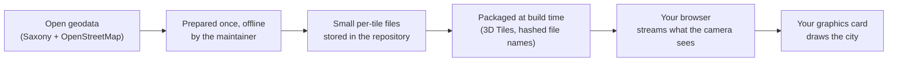
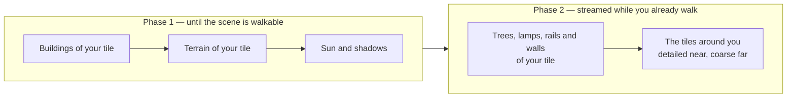

# How the city walker works

*Deutsch: [So funktioniert der Stadtspaziergang](../de/how-it-works.md)*

This page explains, without assuming any background in geodata or 3D
graphics, what you are looking at when you open the viewer, where it all
comes from, and how much of it is "real". Terms in **bold** are explained in
the [glossary](./glossary.md).

## What you see

A stylised, walkable 3D model of the centre of Dresden: fifteen tiles of
2 km × 2 km on both banks of the Elbe, 10 km × 6 km, with the historic
Altstadt, the Inner and Outer Neustadt, the Johannstadt, the Friedrichstadt,
Löbtau and Pieschen to the west, the Hauptbahnhof and the Großer Garten to
the south, and upriver past the
Waldschlößchenbrücke to Blasewitz, Loschwitz and the Blaues Wunder. You
start low over the Elbe near the Carolabrücke, looking at the Altstadt
skyline, and can walk at street level or fly above the roofs.

Dresden is the reference city, the one these pages describe. The same
viewer can show other German cities whose survey offices publish the data
(Leipzig, Meißen, Grimma, Hamburg, München, Berlin, Unna are prepared);
the start page lists every city a deployment was built with, each at its
own address (`/dresden`, `/leipzig`, …).

Nothing is installed, nothing is stored about you, and no server computes
the picture. Your browser downloads prepared files as you move — about
6 MB for each tile in full detail, about 97 MB if you visit every corner of
Dresden's fifteen tiles (95 MB on a phone) — and your own graphics card draws every frame, using a library
called **three.js**.

The look is deliberately not photo-realistic. It is a soft, pastel,
"watercolour on paper" rendering: buildings are matte clay volumes, the
ground is coloured by land use rather than textured with aerial photos, and
a faint paper grain lies over the whole image. That is an artistic choice,
documented in the [art-direction notes](../../transformations.md).

## The one-picture summary

Every station in this picture is described in
[From download to browser](./data-journey.md); the datasets themselves in
[Where the data comes from](./data-sources.md).

## What the scene is made of

The scene is built from layers. Each layer comes from one or two datasets,
and each is a mix of measured fact and deliberate simplification.

| Layer | What it shows | Where it comes from | Real or stylised? |
|---|---|---|---|
| **Ground** | The shape of the terrain: river banks, the slope up to the Neustadt, embankments | The official 1 m terrain model (**DGM1**) | Real heights, on a grid of about 2 m near you and 4 m further away. Vertical walls and stairs are smoothed into ramps by the source, so the project sharpens them again where OpenStreetMap knows a wall, a cliff edge or a flight of steps |
| **Ground colours** | Roads grey, paths sand, meadows sage, forest moss, built-up areas pale clay, fields loam, water blue | The official land-use map (**Basis-DLM**), squares refined from **OpenStreetMap** | Real classification; the colours are a designed pastel palette, painted in your browser, not photographs. A road in a tunnel is not painted on the ground above it. Grass verges, traffic islands and the woods between a motorway's lanes are green, not road grey: the land-use map files them with the road, and the infrared aerial photo and the surface model show them green and low, or wooded. Fields are shown as ploughed land, green where the aerial photo sees a crop |
| **Kerbs and paving** | A kerb line where the road meets the pavement; asphalt, paving slabs, cobbles or gravel underfoot; parking bays along streets and in car parks; road markings; green courtyards | Road edges from the **Basis-DLM**, the material and the parking from **OpenStreetMap** (`surface`, `parking`), the green from the infrared aerial photo (**NDVI**) | The kerb stone (a low 12 cm step, casting its shadow) follows the surveyed road width; out of town — a motorway, a road OpenStreetMap marks as rural or signed 70 km/h and up — there is none, and no painted kerb edge either, as on the real road, which has a verge and reflector posts there; the material is what volunteers mapped (about two thirds of the streets), the rest shows asphalt or slabs by default; the patterns themselves are drawn, not photographed, and the pavement behind the kerb stays at road level. At crossings and driveways the kerb is lowered to 3 cm, where OpenStreetMap maps a crossing, a lowered kerb or a driveway. Zebras, parking-bay lines and red cycle lanes appear only where OpenStreetMap records them |
| **Sports grounds** | Football pitches in mown stripes, clay tennis courts, tartan running tracks with their lanes, basketball courts, beach-volleyball sand — each with its lines, goals, basketball posts and nets | **OpenStreetMap** (`leisure=pitch`, `leisure=track`, with `sport` and `surface`) | The outline, sport and surface are what volunteers mapped; without a surface the sport's usual one is shown (football on grass, tennis on clay). The lines are the standard ones, scaled to the mapped size, not surveyed; goals and nets are simple stand-ins, not the real ones. On a phone the grounds show their land-cover colour without lines (the goals and nets stay), and on a computer so do the grounds beyond the detailed ground nearby |
| **Water** | The Elbe and smaller water bodies, with wind-ruffled water (calm patches beside rougher ones, the same on fountains) and drifting mist; each body of water at one level, white water at weirs, beaches and gravel bars as sand | Basis-DLM water areas, laid on the real terrain; the colour from the aerial photo | Real outline and level (where the terrain model holds one water at several heights, the lower parts are raised to the main level; the tide is not shown), colour per water body from the photo, invented ripples and foam. A stream that runs in a culvert under a street or a station is not drawn as water |
| **On the Elbe** | The landing stages below the Brühlsche Terrasse and the smaller jetties — fixed piers on piles, floating pontoons with their gangways and ticket huts —, groynes, and the ferry routes as a faint dashed wake seen from the air | **OpenStreetMap** (`man_made=pier`, `man_made=groyne`, `route=ferry`); the deck heights from the surface model (**DOM1**) | Real positions and outlines; the decks stand where the surface model measures them, pontoons float at their measured height above the drawn river surface, and a stage or groyne that lies under the water is left out; the huts, railings and piles are simple stand-ins. The paddle steamers are not shown: no dataset has them |
| **Buildings** | Every building with its real footprint, height and roof shape | The official 3D building model (**LoD2**), roughly 58,000 buildings and building parts in the fifteen tiles; chimneys, towers, masts, buildings newer than the model, and platform roofs, carports and shelters where the surface model (**DOM1**) measures them *and* **OpenStreetMap** names them | Real geometry. Facades are plain by design; there are no windows in the source data. An added chimney or tower is a simple round column of the measured height (a tower the model already draws is not added twice), a newer building a block — at the height OpenStreetMap maps where the surface model was flown before it was finished (Hamburg's Überseequartier); platform roofs, carports and shelters as a thin roof on posts, and the 3D model's own canopies opened up underneath; on a landmark, a roof the model draws flat or cuts short is lifted to the measured surface — a spire to its tip. Where OpenStreetMap counts no storeys, a building's storeys are counted from its eave in the storey height of mapped houses nearby. Missing buildings take their roof's shape from the surface model, and sheds and missing buildings their roof colour from the aerial photo |
| **Building colours** | Roof colours; a subtle tint per building; a warm glow in shops and public buildings at dusk; a cooler, smoother glass or metal facade | Roof colour sampled from aerial photos (**DOP**); wall and roof colours and materials from **OpenStreetMap** where mapped (and from **Wikidata** for a landmark); an unmapped building takes brick or plaster from the mapped walls around it; the rest derived from building attributes | Roof colours are real (about 83 % coverage); a mapped colour is real but toned into the pastel palette; other wall tints are synthesised |
| **Trees and hedges** | Individual trees with crowns of the measured height, through the year: bare in winter, leaves out in late April, autumn colours in October; hedges and tree rows | The city's street-tree register (position, height, crown, trunk, species) and, where it has no tree, the trees mapped in **OpenStreetMap**; elsewhere tree positions and heights from the difference between the surface model (**DOM1**) and the terrain model; rows from Basis-DLM, their trees where the surface model shows their crowns; the year from the German weather service's (**DWD**) plant observers; greenness from the infrared aerial photo (**NDVI**; in Munich, whose photo has no infrared, from its visible colours) | Registered trees are measured and follow their species: a lime turns butter yellow and early, an oak late and russet and keeps some brown leaves all winter, a ginkgo drops its leaves within days. The dates are typical, not this year's observations — Dresden's year, shifted for each other city by a few days as its climate runs earlier or later — and the autumn colours are the scene's pastel palette, not photographs. Pines get a high, flat-topped crown on a long bare stem and yews a broad bush; only spruces, firs, thujas and the like are drawn as cones. Hamburg's register has no heights: they come from each tree's genus and trunk thickness, learned from Dresden's and Leipzig's registers. Cities without a register show the trees mapped in OpenStreetMap, as tall as the surface model measures them. A tree row's trees stand where the surface model shows their crowns, at their measured height; crowns start higher on tall trees and clear the roads. Vine rows run the way the aerial photo shows them. For the other trees positions and heights are measured, the species unknown: they follow a generic tree's year — but a crown in a needle forest, or one still green in a mixed forest on a photo flown before the leaves came out, is a conifer: it stays green all year and stands as a cone, or as a pine where its measured crown is flat-topped. Hedges stay green |
| **Street lamps** | Lamp posts along streets, squares and bridges | **OpenStreetMap**; in Dresden, Grimma, Meißen and Unna also the lamps it lacks, found in street photos on **Mapillary**; the post's height from the **surface model (DOM1)** | Real positions (a lamp from the street photos a few metres off), a lamp on a bridge on its deck, a lantern OSM puts on a wall on its bracket on the facade, or with no house near on the low face of a terrace wall; each street's posts stand as tall as the surface model measures them there (a main road's 8–12 m, a side street's 5 m), else 5 m; a mast of 7 m or more, or one mapped as a bent mast, holds its lamp on an arm towards the nearest carriageway — the way it reaches is worked out, the arm's length assumed |
| **Street furniture** | Benches, picnic tables, litter bins, bicycle stands, bollards, post boxes, stop shelters and stop signs, advertising columns, traffic signals, hydrants, street clocks, drinking fountains | **OpenStreetMap**; which way a bench faces from its tagged direction, else from the nearest path or street | Real positions (a bollard at its tagged height; on a bridge, on its deck); one soft, abstracted model per kind in the scene's pastels — like the pieces of an architect's model. Few benches say which way they look, so most are turned towards the nearest way — a guess that is usually, not always, right. Traffic signals are mapped at the stop line in the road, so they are moved to the kerb (on a bridge, to the carriageway's kerb on its deck); their lamps stay dark (there is no traffic to time). Signalled pedestrian crossings have a pedestrian light at each kerb; a light over a road of three lanes or more hangs on a mast arm, and one before a junction is repeated beyond it. A litter bin takes its mapped colour, else the city's where most mapped bins agree (Hamburg's red). A bench by the water looks at the water. The posters on the advertising columns are colour fields, not real posters. A street clock's hands show the scene's time |
| **Playgrounds** | The playground's area as a pale sand floor, with its swings, slides, climbing frames, sandpits and seesaws as soft, single-coloured pastel sculptures | **OpenStreetMap** (the outline and each piece of equipment mapped on it); on a playground mapped without any, the surface model (**DOM1**) | Real outline and positions; the mapped equipment stands there; on a playground mapped without any, what the surface model measures there (objects 1.2–4 m tall that are no tree) stands as a swing or a climbing frame — measured, not invented, though its kind is a guess |
| **Fountains and monuments** | Fountain basins with still water and translucent water bells; statues, memorial stones and columns | Positions and official names from the Basis-DLM; basin outlines and the smaller fountains from OpenStreetMap; the sculpture's form from the surface model (**DOM1**) | Real positions and outlines. A sculpture is its measured bulk, softened into clay — the right size and silhouette, no detail; where nothing could be measured, an abstract marker. The water bells, their gentle motion and the night lighting are designed. The Saxon surveys were flown while the fountains were drained and their sculptures boxed for winter; such a box is recognised and drawn as an abstract marker instead (the Albertplatz). Tall columns and obelisks stand at their measured height (the Mariensäule, the Friedensengel), other unmeasured monuments at the height measured beside them, facing their square or the nearest street. Drinking fountains are small. The water bells run from mid-April to the end of October |
| **Railways and bridges** | Tracks on their sleepers, ballast beds, the overhead line over electrified tracks, bridge decks with arches, piers or columns, station platforms | **OpenStreetMap** (every track one by one, its electrification and overhead-line masts, platforms and their heights, whether a bridge is an arch bridge); Basis-DLM (bridges, and tracks where OpenStreetMap maps none; in Hamburg and Berlin, which publish none, OpenStreetMap); terrain and surface models (deck heights and widths) | Real alignment, deck heights and widths; the structural detail is simplified. A track's height does not follow every bump of the terrain model but a smoothed profile, as tracks are built: no steeper than 4 % (a tram 8 %), every change of grade rounded; the ground under the bed is laid to it, with embankments beside it. Nothing lies on a track: a platform keeps its edge 1.65 m from the track's centre, as the railway rules say, and a building the land survey records under the tracks has its top laid to the track bed. Beam, truss and cable bridges have open steel railings; stone arch bridges keep their stone parapets. The overhead line hangs from the masts OpenStreetMap maps, else from masts and portals on a regular spacing. What runs underground — subways, city-centre rail tunnels, underground platforms — is not drawn |
| **Trams** | Tram tracks in their bed — rails flush in the street, on a lawn or on ballast — the overhead contact wire above each track, the masts and the wires strung across the street that hold it; the stop signs on the platforms | **OpenStreetMap** (`railway=tram` with its gauge, `power=catenary_mast`, the building outlines); the bed from the land-use map and the infrared aerial photo (a track through a paved street or square lies flush in it) | Real track positions and masts; the height a smoothed profile, the ground under the bed laid to it (as for the railway). The bed is inferred, not mapped; which masts hold which wire, the wire's sag and the spans between facades in narrow streets (where no mast is mapped) are reconstructed from the geometry; where no mast is mapped and no facade is near, poles at the street's edge (or between the tracks where the strip is wide) hold the wire, reconstructed from the land-use map. Trams run only in the *Straßenbahnen (Fahrplan)* data layer, by timetable |
| **Walls** | The Brühlsche Terrasse and other retaining walls and city walls, garden and park walls, cliff edges, quay walls | OpenStreetMap lines with their tagged heights and materials; an untagged wall's height from the surface model (**DOM1**); a quay wall where the terrain model (**DGM1**) rises steeply out of the water and no lawn grows (OpenStreetMap maps few) | Real position; the tagged height, else the one the surface model measures along the wall, else a default; stone, brick, concrete, metal or wood in a muted tone, as mapped or as most of the city's mapped walls are; a freestanding wall stands that high above the ground, a retaining wall reaches the ground it holds back. The thickness of a freestanding wall is assumed |
| **Stairs** | Flights of steps such as the one beside the Italienisches Dörfchen or the one from the Schlossplatz up to the Brühlsche Terrasse, as individual steps | OpenStreetMap (`highway=steps`: position, width, step count; without a width a flight spans wall to wall when the slope between climbs); the heights at the foot and the head from the terrain model | Real position and height; step count as tagged or estimated from the height (16 cm a step). The Brühlsche Terrasse stands on casemates and is missing from the terrain model; there the tagged steps set the height, and the terrace area from OpenStreetMap is lifted to it |
| **Sun, shadows and sky** | Sunlight for any date and time of day; blue hour, golden hour, night | Computed from the calendar, the clock and Dresden's latitude; the sky light and the far shadows from the terrain and building models, and beyond the tiles the hills on the horizon, to 10 km, from a worldwide elevation model (**Copernicus GLO-30**) | Astronomically correct sun position; the colours are designed |
| **Atmosphere** | Distance haze, valley fog in the low ground, river mist, depth tint, paper grain | Computed in the browser; the valley fog reads the real terrain height and pools as deep as the valley the city lies in, its rim read from the same worldwide elevation model within 5 km (deep in Dresden's Elbe valley, shallow in flat Hamburg) | Artistic |

## How a visit unfolds

The scene is not loaded all at once, and it never has to be loaded
completely. The city is cut into 2 km tiles, and the viewer **streams**
them: it fetches what the camera can see, in detail near you and coarser
further away, and can let go of what you have left far behind. The first
picture needs only the tile you start on; the loading screen shows the
rest arriving:

Phase 1 ends when the loading screen says *begehbar* ("walkable"): the
overlay dissolves and you can move. Phase 2 continues in the background; a
small pill at the top of the screen counts the stages as they arrive.
Until everything around you is in, the horizon is deliberately hazy so the
missing tiles do not read as a cliff edge. After that the streaming simply
goes on as you move: a distant tile shows its buildings on coarse ground,
and gets its trees, lamps, rails and walls once you are close enough for
the detailed ground.

## What is real, what is not

Every statement in the viewer carries one of four badges; what they mean
and where each applies is set out in
[How the viewer comes by what it shows](./methods.md). In short:

`❝ taken` **from official surveys and registers:** terrain heights,
building footprints, heights and roof shapes, land use, water outlines,
railway alignments, bridge outlines, the place, species and size of the
street trees from the street-tree register.

`❝ taken` **contributed by volunteers (OpenStreetMap):** street lamps,
benches and other street furniture, playgrounds, station platforms, railway
and tram tracks one by one with their overhead-line masts, retaining walls
with their heights, front
entrances, facade colours and materials where mapped, the structural type of
bridges, what streets and pavements are paved with. Completeness varies from
street to street.

`= computed` **by a fixed formula over measured values:** the height of
the trees without a register and of the bridge decks, the height of the
registered trees in Hamburg (from genus and trunk), roof colours, meadow
and foliage green, sky light and horizon, the sun position and all shadows.

`◎ detected` **by pattern recognition — it can be wrong:** the trees
without a register and those of tree rows and orchards (at crown peaks in
the surface), sheds and garden houses (in the laser scan), re-measured
roofs, chimneys, towers and dormers, platform roofs, carports and shelters,
arches and trusses above bridges, how wide a bridge deck is, which shop belongs to which building, which
building is a landmark, and the window rhythm of the houses street photos
saw.

`≈ assumed` **designed for the look or set without data:** the pastel
palette, the paper grain and vignette, the shape of tree crowns, the wall
tint per building, brick or plaster where nothing is mapped, the ripples on
the water, the stones and slabs of the paving patterns, the piers under
bridges (where the surface model does not show them), the windows of the houses no photo measured (a measured
neighbour's rhythm or the house type's), the warm windows and the light on the
facades after dark (the *presence* of a shop, a public building or a
landmark is real; its lit windows and floodlights are not).

**Not in the data at all:** where exactly each window sits on its wall
(the rows are centred on it), the smaller street furniture
(planters; traffic and street-name signs are mapped too sparsely to show),
vehicles (the trams' tracks and wires are there; the trams themselves only
as a data layer by timetable), people, vegetation smaller than about 3 m,
and anything indoors.

**Left out on purpose:** text. OpenStreetMap has the names of the streets
and squares, but the viewer writes none of them — not on the ground, not as a
caption on the screen: the map look reads better without it.

## Things worth knowing before you draw conclusions from the picture

- The datasets have **different dates**. The terrain was surveyed in late
  2024, the building model was generated in spring and summer 2025, the
  land-use map and the aerial photos have their own editions. A house that
  is new in one dataset may be missing in another. See the edition table in
  [Where the data comes from](./data-sources.md#dataset-editions-in-use).
- A tile is a 2 km square. At the **seams** between tiles a small step or a
  colour change can show, and tiles further away are drawn with coarser
  ground and without trees, lamps, rails or walls until you come closer.
- Aerial photos look slightly **sideways** at tall buildings, so a sampled
  roof colour can include a bit of facade. The sampling avoids the edge of
  each roof to reduce this.
- A tree's **species** is known only where the street-tree register (Dresden,
  Hamburg, Leipzig, Berlin) or OpenStreetMap names it; it sets the crown's
  form and season, but the crown itself is still drawn from basic shapes
  (`≈ assumed`). Every other tree is the same generic shape, scaled to its
  measured height and tinted by how green it looked from the air.
- The building model contains **no bridges, walls or towers** for these
  tiles even though newer editions of the product may; that is why bridges
  and walls are rebuilt from other sources.

## Where to go next

- [Where the data comes from](./data-sources.md) — every dataset, where it
  was downloaded, what it is good at and what it is not, the licences.
- [From download to browser](./data-journey.md) — the stations of the data,
  what is the single source of truth, what is a derivative, what your
  browser actually receives.
- [Using the viewer](./using-the-viewer.md) — controls and the settings
  panel, explained label by label (the interface is in German).
- [Glossary](./glossary.md) — the abbreviations.
- For developers: [docs/README.md](../../README.md).
