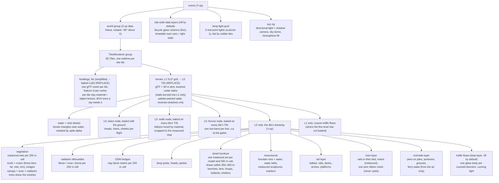
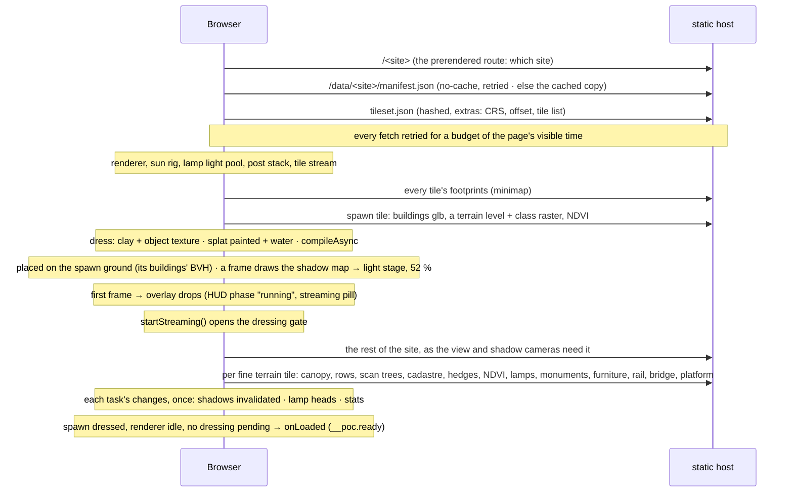

# Rendering — how the data becomes pixels

The developer map of the frame: what is in the scene graph, which dataset
attribute drives which visual variable, how light and post-processing are
layered, and where the frame budget goes. The *recipes* (the shadow setup
and its dead ends, the vegetation shaders, the QA harness) live in the
[city-walker skill](../.claude/skills/city-walker/SKILL.md); the *ledger*
of every transformation and its status is [transformations.md](./transformations.md).
This page is the overview that ties them together.

## Scene graph

Source data is projected (EPSG:25833 for Dresden; the site config names the
CRS, [ADR 0037](./adr/0037-sites-providers-and-per-site-data.md)) and Z-up. A
`world` group is rotated −90° about X so data-Z (elevation) becomes scene-Y
(up). The site streams into `world` as an OGC 3D Tiles tileset through
3DTilesRendererJS ([ADR 0024](./adr/0024-site-streams-as-3d-tiles.md)):
the tileset's frame *is* the recentered data frame, and the renderer turns
each Y-up glTF into it. That turn cancels the `world` group's, so a tile's
content root sits, in effect, in the scene's Y-up frame — which is why the
Y-up dressing (vegetation, lamps, monuments, street furniture, rails, trams) hangs directly under the
fine terrain's content root and leaves with its tile. Mixing the frames up
applies the rotation twice (the classic "trees shoot skyward" bug).



Every tile's buildings get their **own clay material**: it binds that
tile's object texture, while the live look uniforms are shared nodes
(`visual-style.ts` `StyleResources`). What carries no per-tile data —
crowns, trunks, hedges, fountains, furniture, wires — is one node material
for the whole scene (`three-utils.ts` `sceneMaterial`), and instanced layers
draw through `Instances` (`instancing.ts`) so every set with the same
material shares one node build. Everything a tile adds —
material, object texture, BVH, splat, water, dressing — is disposed with it
(`disposeTile` in `tile-stream.ts`).

**The ground draws after every other opaque thing.** three sorts the
opaque by `renderOrder`, then front to back by each object's origin; a
terrain tile's origin often sorted it before the buildings standing on it.
The terrain takes `renderOrder` 1 (`TERRAIN_RENDER_ORDER`, terrain-layer.ts)
so its fragment pass — the scene's dearest per pixel: the splat, kerbs,
lawn edges, markings, sports lines — runs only where the buildings, crowns
and walls left the ground uncovered; the early depth test rejects the rest
before the shader runs (not under Modell's Ausschnitt, whose clipping is
per fragment; an Apple GPU removes hidden fragments itself, the others do
not). The price is the other way round: what a hill hides is now shaded
before the hill covers it — in this valley city rarer than ground under
houses and trees, and fogged far off. The transparent — the water and mist
sheets among them — are a list of their own, drawn after every opaque
thing whatever their `renderOrder`.

`x = epsgX − cx`, `z = −(epsgY − cy)`, `y = elevation`, with `(cx, cy)` the
recenter offset captured from the spawn tile's CityJSON at bake time, carried
in the tileset's root `extras` (`lib/city/tileset.ts`) and shared by every
tile (`lib/city/recenter.ts`, `lib/city/ground-clamp.ts`).

**Materials derive data-frame positions from world space.** The streamed
glTF positions are quantised (the dequantisation sits on the node), so
`position` is not in metres; but `world` only rotates, so world (x, y, z)
is data (x, −z, y) exactly. Every material is a TSL node material on
`WebGPURenderer` ([ADR 0027](./adr/0027-webgpu-renderer-and-tsl.md)); the
terrain, water, clay and ground-light nodes read their elevation and
data-frame XY through one helper (`app/_components/shader-chunks.ts`
`dataXY`, `dataPosition`, `rasterUv`).

## Visual encoding — which data drives which pixel

The scene is a data visualisation as much as a game level: nearly every
visual variable is bound to an attribute of one of the datasets. This table
is the codebook.

| Visual variable | Driven by | Source | Where |
|---|---|---|---|
| Ground height + mesh density | fine level: an error-bounded TIN of the native 1 m DGM1 — vertices where the ground bends, within ±0.15 m everywhere; heights read from its triangles through a bucket index. Coarse level: the DGM resampled to 512², heights read back from the grid | DGM1 | `scripts/bake-tiles.ts`, `scripts/bake-terrain-tin.ts`, `lib/city/terrain-tin.ts` (`TinIndex`), `terrain-layer.ts`, `lib/city/terrain-geometry.ts` |
| Ground where no tile has streamed yet | the ground plate: the fine ground's height at a 62.5 m grid over the whole site (33² per tile, the edges shared), its inner vertices 1.5 m under it, each vertex the commonest land-cover class around it (read across tile edges) in the palette, matte; shown per tile only while that tile has no terrain level on screen | DGM1 + Basis-DLM | `lib/city/ground-plate.ts`, `ground-plate-layer.ts`, `scripts/prepare/plate.ts` `bakePlate` |
| Wall ribbon placement | earth-retaining walls — and the quays the bake measures where the water meets a steep bank (`kind: "quay"`) — snap to the step the fine TIN measures (face at the ramp foot, a coping cap back to where the ground reaches its level, per column; medians only over the vertices that found the same step, one run per cap level — no slab across two terraces); other walls on the OSM line | DGM1 + OSM walls + the class raster's water | `lib/city/walls.ts`, `lib/city/wall-snap.ts` (at build) |
| Ground shading | the grid's normals, pulled to straight up below ~12° of tilt (the DGM's micro-relief and the 8-bit normals lit as blotches); real slopes keep their shading | DGM1 | `terrain-layer.ts` (`terrainNormal()`) |
| Ground step at walls (coarse level only) | wall line + `kind` ∈ retaining/city/embankment/cliff/quay, height ≥ 1.5 m, burned into the 512² grid at build time | OSM | `lib/city/terrain-conflate.ts` (probe 11 m each side, feather 11 m, clamp 18 m) |
| Contour lines | data-frame elevation (`dataPosition`, `shader-chunks.ts`), 2 m minor / 10 m major; each set fades once its lines crowd closer than a few pixels, and on near-flat ground (< ~3 % grade) and under water, where the DGM's noise only drew squiggles | DGM1 | `terrain-layer.ts` (`contourInk()`) |
| Ground colour | land-cover class → the one palette, painted on the GPU into an sRGB, mipmapped, anisotropy-16 splat (a desktop's fine level at half its 4096² class raster's size: each texel the mean of the 2×2 classes under it — the full-size splat's first mip; `splatScaleFor`); the class PNG is decoded byte-exact by `lib/city/png-raster.ts`, never by the browser (WebKit colour-managed and dithered the ids into speckles) | Basis-DLM | `lib/city/landcover.ts`, `landcover-splat.ts`, `terrain-layer.ts` |
| Meadow lush ↔ dry | NDVI on class 1 only (`meadowNdvi`), read from a coarse mip (~10 m) so it drifts rather than flecks | DOP | `terrain-layer.ts` |
| Meadow relief | low-frequency colour + normal mottle on class 1 | — (synth) | `terrain-layer.ts`: `grassMottle()` (colour), `terrainNormal(true)` (normal) |
| Arable | class 9's loam turned toward a crop's green where the NDVI says something grows (read from a coarse mip, bias 2.5); faint furrows every 0.75 m along the field's long axis (the paving raster's frame), half as strong under a crop | Basis-DLM / OSM (the class), DOP (NDVI) | `terrain-layer.ts` `arableGround` |
| Kerb stone | a 12 × 24 cm stone band on the kerb lines (the smoothed road edge; none over a road tunnel, whose road is not painted; none along a road OSM marks as out of town — a motorway, a `DE:rural` zone, 70 km/h and up), its face toward the road, its top falling to the pavement's level at the back (no second step on the pavement side), in the fine terrain glTF, casting; 12 cm over the road, 3 cm or flush along its lowered stretches (`low`: crossings, `kerb=*` nodes, driveways), ramped over 0.5 m | Basis-DLM (+ OSM islands, crossings, `kerb=*`, service ways) | `lib/city/kerbs.ts` (`kerbHeightAt`), `pipeline/bake/kerb_drops.py`, `kerb-layer.ts` |
| Kerb shadow | the road strip out to 0.12 m · cot(sun elevation) across the kerb, when the sun stands behind it: −28 %; where the kerb band is drawn | Basis-DLM + sun | `ground-detail.ts` (`sunDirection`) |
| Kerb band | signed distance (m) to the road edge, baked and smoothed (`edges_<t>.png`; else the class texels box-smoothed): a pale band 0.25 m on the pavement side, a gutter 0.35 m on the road side; only round a baked kerb line (the road-markings raster's kerb bit, `LANE_BITS.kerb`: none out of town, beside water or rails, over a tunnel, or along a lowered stretch — the bake leaves its texels out; the coarse level: where the far side is ground, classes 0–4, 6); fades out past ~0.5 m/px (*Bodendetail*) | Basis-DLM + OSM (out-of-town roads) | `ground-detail.ts` (`kerbLines`), `pipeline/bake/markings.py` |
| Lawn edge | the same distance for the meadow (urban green included): a darker lip 0.25 m and a normal kink | Basis-DLM (+ DOP) | `ground-detail.ts` |
| Paving pattern | OSM `surface` on the road (class 7) and on the pavement (the rest), the way direction orienting slabs and sett rows; unknown → asphalt on the road, slabs on class 4, sand on class 6; joints fade out past ~5 cm/px, the material's tint stays | OSM (+ Basis-DLM class) | `ground-detail.ts`, `surface_<t>.png` |
| Parking bays | the paving raster's parking bits: on the carriageway a lane 2 m (parallel, bays every 5.5 m) or 5 m (perpendicular, every 2.5 m) from the kerb, its lines only where OSM marks the bays (A's bit 7), else a faint tint; half on the kerb straddles it by 1 m, on the kerb lies on the pavement (A's bits 5–6); in a car park bay lines every 2.5 m across the aisle direction, aisles left clear; pale paint, faded out past ~15 cm/px | OSM | `ground-detail.ts` |
| Sports ground surface | OSM `leisure=pitch` / `track`: its `surface`, else the one the orthophoto shows (grass where it grows, turf, tartan, clay or cinder, hard), else the sport's usual one, in pastels (`lib/city/sport.ts`) over an exact analytic outline (rotated rectangle, a track's capsule band, else the mapped outline) chosen from up to eight candidate rows of the index raster; mown stripes (~5.5 m) on grass, fine grain on the rest (*Bodendetail*) | OSM, DOP | `sport-ground.ts`, `sport_<t>.png` + `.json` |
| Road markings | OSM crossings where OSM says they are marked (zebra: 0.5 m bars across the carriageway, 4 m wide, only from a zebra tag or sign; *Furt*: two broken 12 cm lines, 3 m apart, for marked lines or a signalled crossing), stop lines (0.5 m, 3 m before a directed signal, the right half), cycle lanes on the tagged side (a *Radfahrstreifen* a solid 25 cm line 1.85 m from the kerb, a *Schutzstreifen* 12 cm dashes at 1.5 m; moved out past a parking lane; red where OSM says so), centre lines (12 cm, 3 m dashes in 8.25 m, two-way main roads with `lanes` ≥ 2; solid where overtaking is barred, none on a physical divider or within 2 m of a tram track; four lanes or more: a solid middle and dashed lane lines); a warm off-white, worn, box-filtered, clipped to the carriageway; fine level only (*Bodendetail*) | OSM + Basis-DLM (the carriageway) | `road-markings.ts`, `markings_<t>.png` + `.json` |
| Sports ground lines | the sport's lines at their standard dimensions (football, tennis, basketball, volleyball, handball / multi-sport court, running lanes 1.22 m, a chess board), scaled to fit a smaller ground; 12 cm, box-filtered over the pixel footprint (a steady hairline from afar), chalk white, blue tape on sand | OSM | `sport-ground.ts` |
| Goals, posts, nets | football / handball goals on the goal lines, basketball posts behind the baselines, nets across tennis and volleyball courts; pale-clay bars (casting), the nets a translucent lavender-grey — the street furniture's palette and matte material; fine level only | OSM (+ DGM1 ground) | `sport-fixtures.ts`, `lib/city/sport.ts` `sportFixtures` |
| Urban green | the edge raster's meadow side on classes 0 and 4 (NDVI > 0.3, not OSM-paved), the railway class off every track bed, and the road class beyond everything paved where it is green low ground or a wood (verges, embankments, islands) → painted exactly as meadow: colour, mottle, NDVI tint, lawn edge (*Stadtgrün*) | DOP + DOM1 + OSM | `ground-detail.ts` `urbanGreen`, `edges.py` |
| Water extent + shoreline | splat alpha (3×3 tent over class 8; at half size the four tents' mean, a (1,3,3,1)² box), `smoothstep`ed; no stream where piped (DLM `HDU_X`, `ver06` culverts; OSM covered, tunnel, underground); the dry shore re-classed at bake (meadow / sand / the bank's class) | Basis-DLM, DGM1, DOP | `landcover-splat.ts`, `water-layer.ts`, `pipeline/bake/water.py` |
| Water level | one surface per connected body: a lower DGM fill lifted into the larger fill it meets, never lowered; steps stay at weirs and locks and where the DGM measured a slope; the ground under a lifted cell raised on both terrain levels | DGM1, OSM weirs / locks / dams | `lib/city/water-bodies.ts` (`raiseWater`), `scripts/bake-tiles.ts` |
| Water tint | the body's DOP hue at the sheet's lightness, pooled over its tiles; the palette where the read is grey, dark or close to it; a 64² grid of which body is where, a texture per tile | DOP | `water-layer.ts` (`tintTexture`), `lib/city/water-bodies.ts` (`waterTint`, `siteWaterTints`) |
| Weir foam | ≤ 16 lines per fine tile (`[x0, y0, x1, y1, drop, dx, dy]` in the data frame): downstream 2 m + 3 m per metre of drop (≤ 12 m), upstream the crest's 0.8 m, churned by a drifting noise, near-white at ≤ 0.97 × the water's coverage; a line without a direction foams both ways | OSM weirs, DGM1 | `water-layer.ts` (`foamAt`) |
| Water waves, sun reflection | time, place, sun direction; matte water (the body's tint and depth tone, no sky mirrored; its specular, roughness 0.6, a soft shadowed path toward the sun) lit through the wind's wave field (two drifting layers of gradient noise stretched along the crest under drifting gusts, faded by the pixel's footprint) on a level normal, not the terrain grid's — the same on every tile, so no seam; the sun's glints emissive, and dashes on the crests' lee side | — (synth) | `water-layer.ts`, `water-waves.ts` |
| River mist | water mask blurred over ~20 m (coarse mip, five taps) so it thins out over the banks; two drifting fbm layers, no threshold; none within 120 m of the eye, full from 1.2 km, at most 24 % opaque and only a little whiter than the sky (30 % towards white by day, 3 % after dark with the lamps' night — `MIST_WHITE_NIGHT`: unlit, it drew the far river as a pale band across the night city), so it gathers far off and never lies as a veil over the near river; always on (no slider) | Basis-DLM (mask) | `createWaterMist` |
| Building silhouette | solid geometry; a flat top less than 1.5 m over a track that runs on it for 20 m lowered to the track's bed (the formation under it, at build time) | LoD2 · the track beds | `city-layer.ts`, `lib/city/track-formation.ts` |
| Rounded walls and roofs | a curve LoD2 draws as a ring of flat facets (an apse, a curved front, a drum, a dome: faces a few metres wide, each turned 5–20° from the next) shades round: each triangle corner takes the angle-weighted mean of the faces at its point within 30° of its own, per object and walls apart from roofs, both no wider than 8 m in plan and leaning to sides at most 60° apart; a corner turned further (a house's 90°, an octagon's 45°, the eave), a plain wall's slight kink and a low roof's ridge or hip stay sharp. Flat-shaded, the Kathedrale's apses read as light and dark stripes. Only the lit shading takes the rounded normal: the clay's wall frame (windows, relief, glow cells) is the facet's own flat plane from the view position's derivatives (`normalFlat`), and a facet turned from the sun takes no sun (its shadow-map depth is its own) | LoD2 | `lib/city/crease-normals.ts`, `bake-city-mesh.ts` `vertexNormals`, `visual-style.ts` |
| Roofs rebuilt from the scan | where a LoD2 roof misses DOM1 (> 40 % of its cells > 2 m off: free-form roofs of complex buildings, 3 m placeholders of new ones; > 20 % where the scan is level under most of the misses and does not confirm the LoD2's pitch: a low hip modelled over a store's flat roof), the object's triangles are replaced at bake time by what DOM1 measures inside its footprint — flat levels, and the measured surface where it slopes or curves (a pitched roof, a vault, a dome; an error-bounded TIN), no part narrower than 7 m unless a storey off its neighbours or merging it would miss the scan (a hall's monitor roofs), outlines smoothed off the 1 m grid — each part standing from the object's LoD2 base, same object id, so every row below applies unchanged; 1 081 objects on the site; a LoD2 roof whose form the scan confirms (the Frauenkirche's dome) is kept; faces shade with normals smoothed over them, creases > 30° kept (ADR 0036) | DOM1, LoD2 (+ DOP NDVI) | `scripts/measured-roofs.ts`, `bake-city-mesh.ts` `withMeasuredRoofs`; `pipeline/bake/roofs.py` |
| Small structures LoD2 lacks | a closed box per structure the laser scan measured (garden houses, sheds, container buildings): its rectangle, from the lowest ground under the rectangle (sunk 0.2 m) to the fitted top, flat or pent, no storey band; appended to the tile's building mesh as objects of their own (column `source` = 1), so the clay look, demolish, picking, collision and the minimap treat them as buildings; wall tint hashed from its first corner, its DOP roof colour where in sun (`roofcolor` `scan`, matched by index and `z`), else the flat-roof slate palette, no glow; the canopy and scan points in or within 0.5 m of one are dropped at build time (its roof, read as a tree) | LSC (+ OSM exclusions, DOP NDVI), DOP (roof colour) | `lib/city/small-buildings.ts`, `bake-city-mesh.ts` `appendScanStructures`, `appendedRoofColour`; `pipeline/bake/small_buildings.py` |
| Structures beyond LoD2 | what DOM1 stands above `max(DGM1, LoD2 roof)` where OSM names it (column `source` = 2): a chimney, tower, mast, water tower, communications tower or lighthouse as a 16-sided column lathed from its kind's ring profile (a chimney's head band, a TV tower's cabin, a water tower's tank), foot to the measured top, radius from the outline / `diameter` / the gap blob (a chimney at least h/24); a building LoD2 lacks as its OSM outline or building part extruded to the 60th percentile of the measured height, or to OSM's where DOM1 predates it (`src: "osm"`), from its floor (`base`) where OSM raises it, flat roof — or, measured and on the ground, the roof's shape DOM1 shows (`parts`: flat levels and measured faces, drawn as a measured roof, `shapedGap`) —, its DOP roof colour where in sun (`roofcolor` `gaps`), else the slate palette, no windows; a tower, lighthouse or water tower under a LoD2 roof is not drawn again (LoD2's own). Its own object and root (demolish, picking, collision, minimap); a column is not a `Building` (the HUD's count), and chimneys, towers and lighthouses take the brick palette with the roof tint = the wall's (no terracotta cap) | DOM1, DGM1, LoD2, OSM, DOP (roof colour) | `lib/city/structures.ts`, `bake-city-mesh.ts` `appendGapStructures`, `shapedGap`; `pipeline/bake/structures.py` |
| Roofs on posts | an OSM roof, carport or shelter LoD2 lacks: a slab `roofDepth` (0.04 × √area, 0.2–0.7 m) under the measured top on 0.3 m posts (`roofPosts`: a roof under 5 m wide on both long edges, a wider one on rows under its middle); a LoD2 Überdachung or carport (`51009_1610`/`1611`) opened the same way — walls cut to a fascia, floor dropped, underside and posts added — where ≥ 1.8 m stays clear; flat-roof palette, `building` false, no windows (`WINDOWLESS`) | DOM1, OSM, LoD2 | `lib/city/open-roofs.ts`, `structures.ts` `roofMesh`, `bake-city-mesh.ts` `withOpenRoofs` |
| Landmark roof relief | on a landmark only, where DOM1 rises ≥ 3 m above its highest LoD2 roof on ≥ 60 m² (and ≥ 2 % of its footprint): the excess as its measured height field (1 m grid, lightly smoothed: half the cell, half a σ = 1 cell Gaussian over the patch) built as one surface, each corner the mean of the patch cells around it, walls along the patch's edge down to the cell's `floor` — the lowest LoD2 roof in the 3 × 3 around it, sunk 0.3 m (a tower LoD2 folded into a pitched nave stands on the slope, not at the ridge; surface-model voids below the LoD2 roof filled from the nearest measured cell in the bake) —, no bottom face — a truncated spire rises to a point, the Elbphilharmonie's crests roll over its flat 96 m block; a relief is a row that copies its host object (`of`) — tint, roof, flags, root — so it looks like the building and demolish takes it along; no footprint of its own (`source` = 2) | DOM1, LoD2, Wikidata | `lib/city/structures.ts` `reliefMesh`, `appendGapStructures`; `structures.py` `relief` |
| Per-building attributes (the rows below) | `_FEATURE_ID_0` per vertex → `EXT_structural_metadata` property table → RGBA32F texture, three texels per object, read per vertex with `textureLoad` | LoD2 (+ DOP, OSM) | `city-layer.ts`, `lib/city/city-mesh.ts` `packObjectTexels`, `visual-style.ts` |
| Wall tint | OSM `building:colour` when mapped, brought into the clay's register (hue kept, saturation ≤ 0.45, lightness held in [0.45, 0.9] plus the palette's jitter: a red wall is a dusty terracotta, not a signal red); else the palette family of OSM's `building:material` (brick → brick, stone/glass/metal → cool, concrete → neutral, wood/plaster → warm; for a landmark Wikidata's material where OSM has none); else `hash(objectid)` + `function` family (a part's own value, else its root Building's) + `measuredHeight` nudge, palette by the building's facade context (in a brick context every building, civic ones too; structures that are no building keep cool stone) — brick or plaster as the mapped walls within 300 m vote (distance-weighted; the tile's vote where fewer than 6 are mapped; glass and metal do not vote; `osm_buildings.py` `context`) (column `tint`). A part's own tags win over its building's | LoD2, OSM, Wikidata (+ synth) | `lib/city/building-tint.ts` `buildingTint`, `osmColourTint` at bake time (*Farbvariation*) |
| Roof colour | DOP median of the roof's sunlit texels, the flight's colour cast taken out on its carriageways (`dop_balance.py`), each scaled by its face's slope to a flat roof in the flight's sun (`dop_light.py`; the sun searched along the flight day's path, the flight's pooled sun where the tile's own is unsure, no slope scaling under an overcast flight); a face that differs from its building carries its own in its roof vertices' `_FACADE` slots (x, y, w), and so does a part of a roof drawn as its measured parts, read part by part; else OSM `roof:colour` in the clay's register (lightness [0.3, 0.8], saturation ≤ 0.45); else palette from `roofType` / `Dachneigung` (column `roof`); the scan's sheds and DOM1's buildings beyond LoD2 by their outline's sunlit texels (`scan`, `gaps`), else the slate palette | DOP, OSM, LoD2 | `roofColor()`, `appendedRoofColour`, baked into the property table (*Dachfarbe*) |
| Roof chroma | hue-preserving vibrance lift, strongest on drab roofs; a grey roof mixed with the clay as a grey at its lightness, warmed only where its own colour is warm (*Dachwärme*) | — | `visual-style.ts` (*Dachsättigung*) |
| Storey bands | OSM `building:levels` → eave height ÷ storeys where that gives 2.4–5.5 m (`mappedStoreyHeight`); else the eave split into whole storeys of about its mapped neighbours' (`osmbuild` `storey`: the median over ≥ 3 mapped objects within 200 m of its roof form and about its eave, else the tile's; `neighbourStorey`, 2.5–4.5 m); else `storeyHeight(measuredHeight)`, whole ~3.2 m storeys (column `storeyH`; LoD2's storeys attribute is ~4 % populated); none on a facade of its own (flag 512, `OBJECT_FLAG_OWN_FACADE`: a church, a palace, a hall, a listed public building OSM counts no storeys of — `ownFacade`, `partFacade`), whose storeys are not the height's 3.2 m | LoD2, OSM | `visual-style.ts` (*Höhenlinien*), `lib/city/building-tint.ts` `mappedStoreyHeight`; `pipeline/bake/osm_buildings.py` |
| Plinth, cornices, shop zone (*Gliederung*) | painted in the clay's fragment pass from the table's heights, walls only, never on a door (flag 64) or on a facade that is its own (flag 16: a landmark, a monumental ALKIS use, OSM storeys over 5.5 m, a listed public building without OSM storeys — `ownFacade`, `partFacade`) or under a flat roof (flag 256, `markFlatRoofs`: three quarters of its LoD2 roof area within 10° of level — post-war and modern buildings, which LoD2 often types as a mixed roof; the `flags` column is UINT16): a stone plinth (the lowest 0.6 m darker and cooler, crisp top edge; from 3 m of wall — under the modelled plinth where the street side has one; a lit face and a soft shadow under it, fwidth-crisp, not sun-dependent; the ledges under the first storey line and the eave are modelled, see *Plinths*) and on an OSM shop (flag 1) the ground floor under the first storey line a shade darker and cooler, the recessed shop front; no panes. The ground floor's three only on a part standing on the ground (flag 128, `markGrounded`: within 3 m of its building tree's lowest base) | LoD2, OSM | `visual-style.ts` `articulation`, `lib/city/city-mesh.ts` `markGrounded` |
| Plinths | LoD2 footprint edges open to the street (no party wall), on the DGM1 in front of them: level pieces whose top stands 0.9 m over the ground, stepped down a slope; a stone band 7 cm proud of the host's LoD2 wall (found by rays and followed end to end, not the footprint line) whose front rolls over a 12 cm quarter-round shoulder into its top, shaded smooth, its ends square, the pieces round a corner mitred and given one top — a soft edge that takes the sun and throws a shadow line; one object per host (column `source` = 5, flag 64) a touch darker and cooler than its tint; a stretch another object's run already covers is left to it. Along the same stretches the Gurtgesims, level at the first storey line over the host's base (where the wall holds two storeys and the line stands 1 m over the plinth): a rounded nose 6 cm proud and 14 cm tall over a flat underside, washed 3 cm back on top, shaded smooth, pieces in line joined into one run and mitred round corners; a second object in a plaster shade barely off the wall's — the painted ledge there is gone. Along the same stretches the Traufgesims under the eave, where the host's roof runs level along the wall (its plane read just inside the wall at five points, four within 0.3 m — not along a gable; from 5 m of wall, 1.5 m over the band below): a quarter-round 16 cm proud rolling out of the wall from a 24 cm rise into a short lip, 32 cm tall, top flush with the eave — the painted ledge under the eave is gone too. Each band runs on from house to house along a row: a gap of up to 1.2 m between one stretch's end and the next's start, in line (within 20°, 0.4 m aside), is closed at its middle, and neighbours' levels within 0.6 m (Gurtgesims), 0.25 m (Traufgesims) or 0.2 m (plinth top) are made one, the nearest first, so a row on a slope still steps where its houses do; the Gurtgesims and Traufgesims only on a town house (storeys from 3.3 m, listed, or a flat-roofed town house: `carriesCornices`), the plinth on every house; not on a landmark, glass, metal or flat-roofed host (a flat-roofed town house excepted), nor a part on a roof, nor a structure that is no building | LoD2, DGM1, OSM `heritage` | `lib/city/plinths.ts`, `bake-city-mesh.ts` `appendPlinths`; `pipeline/bake/plinths.py` |
| Facade relief, tone, storey ledges (*Fassadenbild*) | what street photos say about a building (`facades_<t>.json`, read at runtime into the `flags` column from bit 1024 (`FACADE_UNIT`, above the baked flags; at 512 it once overwrote the own-facade flag): busy + 4 × dark + 16 × shop, busy and dark 0 unseen or 1–3; a shop sign joins OSM's shops in the shop zone and its dusk light, at this term's strength): on a mid or busy facade a fine plaster relief lit from above (the slope of a flat-lying value noise up the wall, two octaves of 0.3 and 0.13 m, ±10 % at busy, above the plinth and under the eave, each octave faded once it is a few pixels: no blotch darker than the wall); dark 3 an 8 % darker, slightly cooler tone, dark 2 2 % darker, dark 1 3 % lighter; on a busy front under a pitched roof a ledge at every storey line up to the eave (on *Gliederung* too). Walls only, never on a door (64), a landmark (16), glass (4) or metal (8); unseen facades unchanged | Mapillary | `visual-style.ts` `facadeReading`, `lib/city/facade-reading.ts` |
| Doors | OSM `entrance=*` on the ground floor, snapped onto the nearest LoD2 footprint edge (≤ 3 m) and laid onto the host's own wall triangles at build time (`wallShift`: LoD2 walls stand up to ±0.15 m off the footprint line): a surround a little paler than its wall (two jambs and a lintel, 0.14 m wide, 6 cm proud) and a leaf a shade darker set 4 cm back — as calm as the painted plinth and cornices; size by kind (`main` 1.8 × 3.0 m, `garage` 2.6 × 2.2, `service` 1.1 × 2.3, else 1.2 × 2.5) or from `width`/`height`; two objects per door in the host's building tree (column `source` = 3, flag 64 *own colour*: the tint at full strength, not mixed by *Farbvariation*), no storey band, no eave stroke; no panes, no glass, no handle; none on a facade that is its own (flag 16, a landmark or a church: its portal is its own) | OSM, LoD2, DGM1 | `lib/city/doors.ts`, `bake-city-mesh.ts` `appendDoors`; `pipeline/bake/doors.py` |
| Passages (*Durchgänge*) | OSM `tunnel=building_passage` ways on the ground floor through LoD2 (the axis run 0.6 m past either wall, its width from `width` or 3.5 m a drive, 4.5 m a track, 2.5 m a walk): the walls and floor of every building tree it runs through cut open at build time (a prism per segment, mitred at a bend, from 0.4 m under the ground to the clear height over it, falling with the ground), lined with two walls and a ceiling facing in, in the host's own clay (column `source` = 7, flag 64, no windows, no storey band, no eave stroke) — every LoD2 object whose footprint the passage's strip reaches is lined, a part beside the way too; one that ends inside its building (more than 0.6 m from the outline) is shut there by a wall across it; where two cross or run side by side, each one's lining is cut out of the other's opening; the clear height OSM's `maxheight`, else 3.8 m a drive, 5 m a track, 3 m a walk or the ground storey less 0.6 m, the taller, at least 1 m under the lowest eave, none under 2.2 m; rectangular, no arch; the ground floor's windows keep off a portal as off a door, no OSM door drawn in an opening; walkable (the collider takes the ceiling for a balcony) | OSM, LoD2, DGM1 | `lib/city/building-passages.ts`, `bake-city-mesh.ts` `withPassages`; `pipeline/bake/passages.py` |
| Shopfronts (*Schaufenster*) | the ground floor's bays and store signs measured per LoD2 wall in Mapillary's street panoramas (`shopfronts_<t>.json`; a glazed row — the seen bins 75 % open — runs its glass from pier to pier; a wall no photo shows as a shopfront gets none), and the canopy over them where DOM1 shows a level roof 2.6–6.5 m up running 1.5–8 m out of the wall (under it the glass runs the canopy's length), laid onto the host's own wall triangles at build time (`wallShiftAt`), **soft and abstract** (*Weiche Nische*): per run of bays (bays with less than two piers and 0.4 m of wall between them share one) a **surround** 15 cm proud — its outer edge rolling over a 6 cm quarter round into its flat front, its foot in the ground, piers 0.25 m (at least 0.2 m between two bays), a head 18 cm over the glass — with a **niche** per bay: the front turns into it over a 7 cm quarter round (smooth per-vertex normals, no edge where reveal and front meet), and the **glass** at its back, 6 cm out of the wall, from 0.5 m above the ground (a glazed row: 0.3 m) to the measured ground-floor top (else 3 m; under the first storey line, under a measured sign, under a canopy's slab, into which the head reaches where less than 0.25 m of wall would be left between them). **No mullions**, no frame boards. A fascia band 10 cm proud at the measured sign band, rounded the same way (at most 1 m tall; reaching down into the head; none under a canopy); a bay is cut where an OSM door stands. Every face along the wall stands at least two of the building glTF's position quanta off it (16 bits over the tile's buildings ≈ 3.4 cm), and no two faces lie on one another — the earlier 2 cm pane, 6 cm mullions and coincident frame and canopy faces flickered while walking (`lib/city/shopfronts.test.ts` holds both). A **canopy** is a slab 0.3 m thick under its measured top from the wall out to its measured depth, with a fascia 0.2 m deep and at most 1 m tall at its edge (2.6 m headroom), its outer edges rounded (9 cm), its foot rounded too, in the host's own clay and tint (its shop flag off); it shades the glass, and its columns are not drawn (not measured). Per wall in the host's building tree (column `source` = 6): one glass object per run (flags 64 + 4: own colour, glass — a **muted tone a little darker and cooler than its wall**, the wall as shown at ×0.4 drawn 45 % towards a cool slate, not black; its `rough` column read as the pane's roughness, 0.2, so the sun glints calmly in it; its `eaveH` the glass's top, under which the head's **soft shadow** darkens its upper 0.6 m — `paneShade`, a gradient — and no eave stroke; in place of the rim and the glass sheen its own sky, `paneSky`: the pane a little brighter upwards, as if the sky were mirrored, and a Schlick Fresnel lift at grazing angles — at most about a seventh of the sky, dimmed at night; a glass facade, flag 4 without 64, keeps its sheen), the surrounds and fascias (flag 64, the wall as shown a shade darker and a touch cooler; their faces that look up are half as bright and take no Streiflicht rim, faded in over the rounds) and the canopy. None on a glass or metal facade, none on a part standing more than 2 m above the ground in front. The one exception to the glass veto: shop windows on a shop's ground floor only; none where an OSM passage (`tunnel=building_passage`, `covered=arcade`) crosses the bay | Mapillary, DOM1, LoD2, DGM1, OSM doors and passages | `lib/city/shopfronts.ts`, `bake-city-mesh.ts` `appendShopfronts`; `pipeline/bake/shopfronts.py` |
| Windows (*Fenster*) | every house's window rhythm (per building, one band of the object table: axis spacing, width, height and a style word — `lib/city/windows.ts` `windowSpecs`), best first: its own walls' rhythm measured in street photos (`windows_<t>.json`, `model`: each feature only where two sequences agree at Spearman ρ ≥ 0.6), another part of its building, the nearest measured building within 30 m of its roof form and about its eave, its type (town house, walk-up, house, block, low; a flat-roofed house from 9 m of wall with 3.4 m storeys or listed as a town house, type `tall` — numbers calibrated to the photos' medians), a measured rhythm drawn towards its type's (`TOWARD_TYPE`); a window's height follows its storey (head a type's distance under the next floor), the storey snapped to a whole number of floors under the eave. Per wall vertex its place (`_FACADE`, snorm16 vec4: metres from the wall's middle, the wall's length — negative where the ground floor has no windows (over a shopfront, or with more than two doors), 0 on a party wall — and up to two OSM doors, each its place and width — the second slot, where it holds no door, the wall's own eave over its object's (`WALL_EAVE`, 0.1 m steps), so the top row sits under its own eave —; on a wall without ground-floor windows the first slot the ground's height in front over the base instead, under which no row of windows is drawn; a roof vertex −1 in the first door's slot, the clay's roof flag). Drawn in the clay's fragment pass, walls only, no geometry: a **recess** per window, the eye looking into its box (back, side reveal, head or sill reveal, each with its normal, 9–18 cm deep by type), the reveals the plaster ×0.93, the back the wall's colour ×(0.40, 0.43, 0.50) lit by a quarter of the sun, the sun reaching in only through the opening (`receivedShadowNode`); a sill 6 cm tall, 4.5 cm proud, with its drop shadow; a town house's Fasche (11 cm, 1.5 cm proud, 3.5 % lighter; a type's only on a rendered wall, never on brick) and raised ground floor (0.45 m); the storeys counted from the street (each LoD2 base moved up to the street its building's plinths stand on, from at most 1.5 m under it — `liftToStreet`); every ground floor's windows at least 0.2 m over the plinth's highest top and over the fine terrain in front of every wall (read 0.5 m out, every 2 m along it, also on a wall standing on a step of its building, `wallRises`; a lift in classes of 0.05 m up to 1.55 m; a wall whose ground rises past 2.2 m over the base, `GROUND_REACH_M`, or higher than leaves the windows 0.8 of their width tall, `overGround`, has no ground-floor windows, signed like a shopfront's; none past it, or where it leaves them lower than 0.8 of their width); a top floor's windows end 0.5 m under the eave; measured ornament's Verdachung (9 cm, 5 cm proud); the wall rolling in over a 3 cm quarter round (normals). Every edge anti-aliased by the pixel's footprint along the wall and up; under 6 px wide the windows hand over to the facade's mean tone, under 2.5 px only that tone. At night 25 % glow warm, at 0.6 of the dusk glow (`NIGHT_WINDOWS`; far off the facade's mean of them) × night. **No glass, no panes, no mullions.** None on a party wall (a house of at most 9 m of wall: none only up to its neighbour's top, where it rises 2 m over it, `PARTY_LOW_EAVE_M`), within 0.6 m of a door's opening (its place and width in the `_FACADE` slot), over a shopfront's ground floor, past the eave's clearance, on a church, a hall or another facade of its own (`ownFacade`, `partFacade`) — except a palace's: a Schloss, museum, theatre, parliament, court, school or hospital (ALKIS 31001_3010–3072 but the churches' 3038–3048 — no barracks, bunker or prison, no station, no sports hall; `palatialFacade`) gets windows of its own type `palace` (3.6 m axis, 1.45 m wide, a Fasche, deep reveals), storeys from OSM's count where it gives 2.4–7.5 m, else the eave split into ~5.5 m storeys (`palaceStorey`), and only its own measured rhythm, never a town house's nearby —, glass or metal (flags 4, 8), own colour (64), a garage, shed or plant, a structure that is no building (ALKIS function outside `31001`: a tank, a crane, a canopy — no doors, plinth or shop band either), a wall under 3.2 m, or a part the bake adds (ADR 0010) | Mapillary, LoD2, OSM levels and doors, ALKIS function, the plinths | `lib/city/windows.ts`, `bake-city-mesh.ts` `assignWindows`, `app/_components/clay-windows.ts` (*Fenster*); `pipeline/bake/facade_traits.py`, `pipeline/bake/windows.py` |
| Dormers | DOM1 over the pitched LoD2 roofs (25–62°): the excess over the roof's own 9 m median, a blob of 3–30 m² standing 0.9–3.5 m over it, under the ridge and clear of every tree point → a front down the slope, two cheeks and a roof running back into the main roof: flat at the measured top, or a shed dormer's falling `tf` from where it meets the main roof to its front, ≥ 0.6 m over the roof; one object per host (column `source` = 4) in the host's tint and roof colour, roof vertices flagged in `_FACADE`; no storey band, eave stroke, plinth or shop zone; no window | DOM1, LoD2 | `lib/city/dormers.ts`, `bake-city-mesh.ts` `appendDormers`; `pipeline/bake/dormers.py` |
| Eave line | min RoofSurface Z per building (column `eaveH`) | LoD2 geometry | (*Traufkante*) |
| Ground darkening on walls | height above the building's own base (column `baseZ`: the street its plinths stand on, from at most 1.5 m over the lowest ground round its footprint — `liftToStreet` —, else that lowest ground) | LoD2 geometry, the plinths | (*Boden-Verlauf*) |
| Rim light | view/normal/sun geometry | — | (*Streiflicht*) |
| Night light on facades | `function` ∈ commerce/public (`31001_2xxx`/`3xxx`; structures that are no building stay dark) (column `glow`; a BuildingPart takes its Building's `function` through `root`) → *Lichtkegel*: soft cones of light from the wall's foot, every 6 m, about half on, gone by a storey and a half (`GROUND_LIGHT`); the landmarks (flag 16) the city floodlights, three in five and whole buildings at once (the named outline's OSM id, else the ensemble, hashed; runtime flag 32768 beside the column, `isFloodlit`, `FLOODLIT_SHARE`), whatever their use, → *Anstrahlung* in place of the cones: cones every 7 m up to the eave over a faint wash, seven in ten on, each a little off its slot and of its own strength (`FLOODLIGHT`, `FLOOD_ON`); × `nightFactor`, walls only. The walls never glow themselves; *Streiflicht* drops to a tenth at night (`NIGHT_RIM`) | LoD2, Wikidata, ALKIS, sun | `visual-style.ts` `nightLight` (*Abendlicht*) |
| Shop fronts | OSM shop / café on the ground floor (column `flags`, bit 1) → a low warm band under the first storey line, soft top edge, walls only, in 3.5 m cells about two in three lit, each at its own strength (`shopCell`, `SHOP_LIGHT` × dusk glow); none on a landmark (flag 16: a palace's or a terrace's café lit its low walls all round); a shopfront's pane its own light (`PANE_LIGHT`); × `nightFactor`; no window structure | OSM, LoD2, sun | `visual-style.ts` `nightLight` (*Abendlicht*) |
| Listed facades | OSM `heritage=*` (column `flags`, bit 2) → a barely-there warm lift of the wall tint and a finer second cornice 0.45 m under the eave | OSM, LoD2 | `visual-style.ts` `osmColour` (*Farbvariation*, *Traufkante*) |
| Glass facades | OSM `building:material=glass` (or Wikidata's, on a landmark; column `flags`, bit 4) → walls a little cooler (×(0.93, 0.99, 1.07)) and smoother (roughness 0.42), and the sky mirrored in them (*Spiegelung*: 10 % face on → all of it at a grazing view, the clay's colour giving way by 60 % of that; metal a third as much; at full strength, so the old stand-in — a pale sky sheen at *Streiflicht*'s strength, below full Spiegelung only — is not drawn). No panes, no mullions (the window grid stays 🗃️) | OSM, Wikidata | `visual-style.ts` `osmColour` / `clayGlow` / `facadeMirror`, `sky-reflection.ts` (*Streiflicht*, *Spiegelung*) |
| Metal cladding | `building:material` metal / steel / aluminium / copper / zinc (column `flags`, bit 8) → a cooler wall at 60 % of the glass tint, roughness 0.5, no sheen | OSM, Wikidata | `visual-style.ts` `osmColour` / `clayGlow` |
| Landmark | a Wikidata landmark's objects (column `flags`, bit 16): no look of its own — the roof relief is measured on these objects only, and the HUD's *Wahrzeichen* list glides to the landmark | Wikidata, OSM `wikidata=` | `scripts/prepare/city.ts` `withLandmarks`, `lib/city/landmarks.ts` |
| Roughness jitter | `hash(objectid)` (column `rough`) → [0.55, 1.0] | — | (*Materialstreuung*) |
| The asked building | the probe's pick on a click, a long press or `I` — the first solid thing on the ray, a tree's crown only with nothing solid behind it; the rest of the ray's things a strip of candidates (`inquiry-strip.tsx`) — (the whole building tree, or its ensemble's trees — `lib/city/ensembles.ts`) → flag 32 in the packed texture at runtime: lifted 40 % towards paper white with a faint paper light of its own; a pencil hatch every 0.9 m on the building near (up the facade at 45°, across the roof), 45° strokes every 7 px in screen space where those would crowd; and the outline (below); no slider, the hatch not in *Papier* | the viewer's question | `inquiry-probe.ts`, `city-layer.ts` `mark`, `visual-style.ts` `askedColour` |
| The asked tree, monument, bridge, hedge, lamp, street furniture, tram stop, landing stage or a loaded design's part | the probe's pick among the tile's askable things (ray vs. data solids; bridges vs. their drawn meshes; a design vs. its mesh, by part — `design-layer.ts` `asks`; an instance a design folded away is not found) → the outline (next row) alone | the viewer's question | `inquiry-probe.ts`, `lib/city/ask-items.ts`, `lib/city/ask-more.ts`, `bridge-ask.ts` |
| The asked traffic flow or bicycle counter | while its layer shows: a ray on the flow's drawn bodies (the vertex names its section) or on the counter's columns as tall as they stand → the outline alone, a flow's with the layer's own grown and widened positions, tested only against what stands in front of the glass | the viewer's question | `traffic-ask.ts`, `bike-ask.ts`, `lib/city/inquiry-traffic.ts` |
| The outline of the asked element | its triangles (a building's or bridge's own; a tree's crown and trunk, a monument's cylinder, a basin's prism as stand-ins) → a two-byte mask, red the whole element, green where the scene's depth shows it (MAX blending), blurred at half resolution by its own two-byte blur (GaussianBlurNode's kernel, `outlineKernel`) → the band 0.07–0.66 of red's blur: one rounded line round the element's whole silhouette, never along what stands in front, 4.5 CSS px of the HUD's accent pink (`SELECTION_ACCENT`, the hatch's too) on a hair of its pale, flashing wider and in the accent for 650 ms on a new question (`OUTLINE_PULSE`), fwidth-smoothed, at 42 % of its ink where green says the element is hidden (`OUTLINE_HIDDEN`, the hidden edge); over the finished frame and everything in it, in every picture style; mask and blur drawn only while something is asked | the viewer's question | `selection-outline.ts`, `selection-shape.ts`, `lib/city/outline.ts`, `post-stack.ts` |
| The inquiry card (HUD, not the scene; a bottom sheet on touch) | the fact columns (`buildingId`, ALKIS use, roof form and pitch, height, area, OSM name, address, storeys, and `drawn`: where each drawn value came from — its *Daten* section lists them with the object's style row, `lib/city/drawn-lines.ts`), a tree's register facts (`treefacts_<tile>.json`), a monument's or bridge's feature, and the provenance manifest (each source's edition and licence), on demand only | LoD2, OSM, `data/<site>/provenance.json` | `lib/city/object-facts.ts`, `lib/city/inquiry.ts`, `lib/city/provenance.ts`, `inquiry-card.tsx` (ADR 0042) |
| Tree position and height | canopy point + `h` (3–45 m): as tall as measured, crown 0.58 × h wide (the cadastre's measured median; a scan crown 2r within 0.4–0.75 × h, r its watershed share of the scan's crown mass); rows: DOM1's crown peaks along `veg04_l`, as tall as measured, every 9 m only without DOM1; crown base clamp(0.15 + 0.012 · h, 0.22, 0.6) · h, at least 3 m over a carriageway (`c: 1`) | DOM1−DGM1, LSC, Basis-DLM | `vegetation-layer.ts`, `lib/city/tree-placement.ts` |
| Tree gate | none on a path or water (classes 6, 8), a carriageway or a track bed, near a bridge or on a building's roof; on road/rail land no bare plane (a heap, a shed roof: 3 × 3 plane residual ≤ 0.25 m, index < 0.1) | Basis-DLM, OSM ways and building outlines | `pipeline/bake/canopy.py`, `pipeline/bake/ways.py` |
| Crown colour | NDVI 5×5 footprint max, recentred on the median; where the DOP has no near-IR (Munich) the GLI from its RGB, mapped onto the NDVI's scale | DOP | `crownColor` (+ hash sage fallback) |
| Crown motion | wind sway (vertex), full within 120 m of the eye and gone by 260 m (a fraction of a pixel far off is no motion, only a shimmer), times the picture style's `sway` share; the crown brightens leaning into the gust and dims rocking back (× (1 ± 0.09 · gust), fixed) | — | `crownSway`, `crownSwayShare`, `crownLight` |
| Crown silhouette | every tree its own crown: the shared geometry pushed in and out by three broad waves over the direction from the crown's centre, their phases from where the tree stands, and its top leaned a little — in the vertex stage, the cast shadow too; no draw call or build added | where the tree stands | `vegetation-layer.ts` `crownShape` |
| Crown detail | three tiers per 250 m chunk, decided over the whole site on the 10 Hz pose tick (and in the frame the tiles in view or the crown switch change, or the eye jumps more than 25 m): rich multi-tuft crown near (in 220 m / out 300 m) while the site's rich trees fit a budget of 2 500 (nearest chunks first), mid crown + trunk, far crown (80 tris, no trunk, dense chunks thinned to every other tree drawn 1.35× wider) past 650 m / back at 550 m | — | `lib/city/vegetation-lod.ts`, `createVegetationLod` (*Multi-Tuft-Kronen (nah)*) |
| Conifer crown | a canopy evergreen (`l: "e"`) or a register conifer → a three-tier lathe cone in the lobed crown's box; a canopy evergreen read as a pine (`pine: 1`) or a register pine → the pine's high, flat-topped crown (the lobed crown reshaped, starting at 0.55 h; a chunk set of its own, the same node build); a yew → the lobed crown down to the ground (on the same trunk; the coarse level a six-sided cone of one skirt), its own chunk set sharing the broad crowns' node build, an evergreen in the blue-green (`evergreenColor`), no season (a register larch keeps its leaf type's year); asked, outlined as its cone | Basis-DLM forest kind (`VEG`) / OSM `leaf_type`, DOP (leaf-off), cadastre | `conifer-crown.ts`, `vegetation-layer.ts`, `tree-inventory-layer.ts`, `coarse-crowns-layer.ts` |
| Coarse-level trees | a fixed third of the fine level's trees (a hash of where each stands), as tall, crowns √3 wider, in their colours and season, no trunks; conifers (a register cone or a canopy evergreen) as a six-sided cone, cones and pines as their own sets (`coarseForm`), each crown from its own base — wherever the tile renderer shows the coarse terrain: far off, from the air, in Modell past 2.5 m/px or wherever a coarsened stream or a load leaves the fine level out, at any scale; the fine level draws every tree | where each tree stands (`drawnCoarse`) | `coarse-crowns-layer.ts`, `lib/city/coarse-crowns.ts`, `scripts/coarse-crowns.ts`, `crowns_<t>.crw.gz` |
| Inventory tree | surveyed position, height `h`, crown diameter `d` → non-uniform instance scale; genus/cultivar → archetype (clear stem + crown shape: broadleaf / flame / tiered cone / pine / weeping dome; a yew a bush down to the ground); Hamburg's heights from genus and trunk (its register has none); leaf type + `Blut-`/gold cultivars → crown colour; trunk diameter `t` → trunk girth (fitted to the drawn trunk's radius at 1.3 m, flared foot included, × 1.3; else from the height); drops row/canopy trees inside its crown, except in DLM forest/copse (`f`); trunks + broadleaf crowns drawn in the canopy's chunk meshes; OSM `natural=tree` (`s: "osm"`) fills in where the register has no tree within max(3 m, its crown's radius); a city without a register shows all its OSM trees, as tall as DOM1 measures | Stadtbaumkataster Dresden, OSM | `tree-inventory-layer.ts`, `lib/city/tree-inventory.ts` |
| Tree family | genus `gn` → family (`lib/city/tree-family.ts`): a lean of the summer green (HSL offsets on the NDVI colour, not on cultivars or evergreens), bark colour as the trunk's per-instance tint (`TreeInstance.bark`); eight genera flower (`Phenology.bloom`: cherries pink in April, pears/apples/hawthorn white, …), the crown mixed toward the blossom and kept full while in flower | Stadtbaumkataster (genus) | `tree-family.ts`, `tree-inventory-layer.ts` `inventoryColor`/`barkTint`, `crown-season.ts` `bloomTargets` |
| Tree age | planting year `y` → age (`lib/city/tree-age.ts`): under 15 years (unmeasured) a thinner trunk, under 5 years three stakes and two rails (`tree-stakes.ts`), past 80 years (unmeasured) a thicker trunk; the crown lighter when young, deeper when old (fine level); height and crown size as measured | Stadtbaumkataster (age / planting year) | `tree-age.ts`, `tree-inventory-layer.ts`, `tree-stakes.ts` |
| Plan trees | a register tree's crown width → a circle (line 8 % of the radius) with a stem dot, 0.4 m over its foot; shown only in the Schwarzplan's frames (`userData.planOnly`), drawn in the figure's black | Stadtbaumkataster | `tree-plan.ts`, `paper-scene.ts` |
| Crown season | scene date (calendar day) + genus `gn` (± 6 days per tree) → `{ leaf, autumn }` (`lib/city/tree-season.ts`); `autumn` mixes the per-instance colour toward the genus hue, `aBare` = 1 − leaf discards the crown down to a 25 % grey-brown twig stipple (a hashed alpha test in crown space, ~1.25 px cells at every distance; a crown under ~20 px across, or any in Comic, drawn whole in the stipple's mean — its leaf and twig colours over its cover, the gaps a pale veil (`VEIL_COLOR`) — where the cells would sparkle) and thins the shadow through the stipple's own discard (`maskShadowNode`: never drawn whole, so a crown drawn whole still casts its thin shadow); evergreens constant (the register's, and the canopy's crowns in a needle forest or green on a leaf-off mixed forest's photo, `l: "e"` in `canopy_<t>.geojson`), the other canopy/row trees a generic curve; the day warped by the city's climate (`climateDay`, DWD phenology) before the curves read it; written on a day change, never per frame | Stadtbaumkataster (genus), OSM | `crown-season.ts`, `vegetation-layer.ts` `buildCrownMaterial(…, bare)` |
| Hedge | box instances every 1.1 m along `veg04_l` where `BWS=1100`, minus where OSM maps one within 2 m | Basis-DLM (+ OSM) | `vegetation-layer.ts` |
| Allotment gardens | OSM `landuse=allotments`: a soft, slightly wandering edge (the baked distance to the garden land, LINEAR — paths, roads, rail and water cut out); inside, analytic plots ≈15 × 24 m (a jittered Voronoi in the colony's axis frame — the prevailing direction of its mapped paths, meandering borders drawn as thin soft paths), each a lawn in one of a few soft greens — a third with warm vegetable beds, some with sparse pastel flower dots, the rest with darker shrub mottles — and a faint hedge green inside the rim; box-filtered, fading to the plots' tones and then to one calm tone with distance (0.85 of *Bodendetail*; no colony maps its parcels, so the plots are invented) | OSM | `cultivated-layer.ts`, `cultivated_<t>.png` |
| Orchard tree | OSM `landuse=orchard`: DOM1's crown peaks 2–12 m up, as tall as measured, crown 0.85 × h; without DOM1 the mapped trees, else an 8 m grid along the long axis; genus from `trees=*` (a Christmas-tree plantation's conifers); less the spots a canopy, scan or inventory tree fills (4 m, or its crown), as the cadastre's "small" archetype | OSM, DOM1 | `tile-stream.ts` → `tree-inventory-layer.ts` |
| Vine row | OSM `landuse=vineyard`: rows in the orthophoto's direction and spacing, else down the fall line under 25 % slope and along the contour above, 2.3 m apart; 1.3 × 0.5 m boxes (Dresden's 252 rows on the Loschwitz slopes: 33414_5656, 33416_5654, 33416_5656) | OSM + DOP + DGM1 | `cultivated-layer.ts` |
| OSM hedge | polyline → ≤ 2.5 m superellipsoid pieces scaled to `h` × `w`; OSM line, LSC height where measured, else DOM1's (the median along the line of the nDOM maximum within 1 m, ≤ 3 m; dropped under 0.4 m), else the tag or 1.5 m | OSM, LSC, DOM1 | `low-vegetation-layer.ts` |
| Scan hedge | the laser scan's own hedges (`src: "lsc"`): ≥ 6 m, ≥ 4× as long as wide, clear of crowns, green; drawn like the OSM ones | LSC, NDVI | `low-vegetation-layer.ts`, `pipeline/bake/hedges.py` |
| Extra tree | LSC crown peak + `h` + `r` outside the canopy mask and away from any cadastre tree, appended to the canopy points | LSC | `tile-stream.ts` → `vegetation-layer.ts` |
| Lamp post | point, its post's height its street's median in DOM1 (else its kind of street's on the tile, else 5 m; `h`, `hs`), one set per height, its light pool in proportion; none on classes 5 and 8; on a bridge on its deck's top (`deck`), its pool on the deck; a lamp hung across the street (`wire`): its head 7 m up on a wire to the facades or to slim masts at the kerb (`masts`), no post; a lamp OSM puts on a wall (`wall`): its head 3.5 m up, 0.5 m out of the facade on a short bracket, no post; a lamp on a mapped wall (`on: "wall"`): as on a facade, at ≤ 3.5 m, on the wall's low face; a tall post (≥ 7 m, or `bent`): a pole, an arm of 0.2 · h (1.2–2.5 m) to its bearing (`arm`) rising 0.35 m to the head, a flat cap; the head, light and pool at its end; a post mapped in the lanes stands at the kerb (on a deck at its nearer side, 0.4 m in); OSM's, plus Mapillary's detected street lights where OSM has none within 8 m (Dresden, Grimma, Meißen, Unna: seen from within 25 m and by day, not over a road tunnel) | OSM, Mapillary, DOM1, DGM1 | `lamp-layer.ts`, `lib/city/lamps.ts`, `pipeline/bake/lamps.py`, `pipeline/bake/lamp_heights.py`, `pipeline/bake/mapillary.py` |
| Lamp light | nearest three heads of the visible tiles get a real point light (a phone: the nearest one, faded through zero over a 6 m band where the next head comes as near, so it never jumps lamps at full strength); the rest emissive + sprites, all × `nightFactor` | OSM, sun | `LAMP_LIGHTS` (`lamp-layer.ts`) |
| Lantern (*Laterne*) | the walker's own warm point light (1.6 cd, 14 m reach), held below the eye, 0.35 m right and 0.3 m ahead; on from −2° sun altitude, full from −6° (`lanternNight`), gone from 6 → 25 m over the ground (`lanternStrength`) and in Modell; a desktop casts shadows from it (512² cube, redrawn only when the hand moved 15 cm or a tile changed), a phone does not. The sun's own shadow terms that three hands every casting light (the ground's far horizon, the clay's window reveals) give way after dark (`nightShadowFree`) | sun, camera | `lantern.ts` |
| Street furniture | OSM point → one small abstracted model per kind (bench, backless bench, picnic table, bin, bicycle hoop, bollard — stone or metal, at its tagged height —, post box, stop shelter): softened blocks, capsules, tube strokes in the scene's pastels, vertex-coloured under one matte material; front turned to the bake's bearing `a` (OSM `direction`, else the nearest highway), a bench stretched to its mapped length `l`, a stand as `n` hoops 0.9 m apart; a bin in its colour `c` (five muted tones), else grey; a bench without a direction with water within 12 m beyond it faces the water; none on classes 5 and 8 or under a bridge deck, a piece on one on its top (`deck`; one mapped in its lanes at its nearer side); every model (and the tram stops' signs) one instanced set per 500 m cell of the site's grid, a cell drawn while the box of its pieces is within 350 m of the eye and hidden past 400 m (`showFurnitureNear`, on the tree tiers' tick; in Modell every cell: from 150 m up the whole tiles' furniture was 1.9 M triangles of a few pixels each) | OSM; the class raster (water) | `furniture-layer.ts`, `lib/city/furniture.ts`, `pipeline/bake/furniture.py` |
| Signs and fixtures | OSM point → advertising column (paper drum Ø 1.2 m, 2.7 m, a darker ring and dome, three pastel poster fields; `lit` ones emissive × `nightFactor`), traffic signal (3.2 m pole, a three-lamp head a shade deeper than the metal, facing `a`, unlit; with `arm` a 5.95 m mast, a 5 m arm over the lanes with a second head), pedestrian signal (`pedsignal`: a 2.5 m post, a two-lamp head looking across `a`, a push button) at each kerb end of a signalled crossing, pillar hydrant (0.8 m, red ochre), underground-hydrant sign plate on a post (one soft rose field, at 70 %), clock on a 3.5 m post (double face) or on a facade (one face, bracket to the wall), drinking fountain (1 m bronze column + basin), bus-stop "H" sign (2.6 m pole, a soft green disc in a yellow one — no letter —, timetable box); clock hands (soft slate) turned by the scene's time (`clockMinutes`, on the minute), never casting; on a bridge deck a signal stands at its carriageway's kerb (or the deck's edge, if nearer), a hydrant sign at the deck's nearer edge | OSM | `furniture-layer.ts` (`column`, `signal`, `signalArm`, `pedSignal`, `hydrant`, `hydrantSign`, `poleClock`, `wallClock`, `drinkingWater`, `stopSign`, `clockHands`), `pipeline/bake/furniture.py` |
| Playground | OSM outline → a pale sand floor 4 cm over the ground, skirted 0.2 m; the mapped equipment stands on it (on one mapped empty, the surface model's blobs, `src: "dom"`, as a swing or a climbing frame), each piece one soft single-coloured sculpture in a pastel from the scene at the buildings' brightness (swing = an arch with a pill seat, dusk blue; slide = an extruded wave, peach; climbing frame = a faceted dome, sage; springy = an egg on a stem, butter; seesaw = a plank on a half-round, lilac; roundabout = a rimmed disc; playhouse = an extruded house silhouette; sandpit = sand in a rounded sage frame); a sandpit area a sand slab 6 cm above | OSM; DOM1 − DGM1 (empty ones) | `furniture-layer.ts` (`addSlab`), `lib/city/furniture.ts` |
| Fountain basin | OSM outline → clay rim (+0.35 m over the highest ground; 0.2 m for `water=reflecting_pool`, none for `fountain=splash_pad`), water = the 0.35 m inset; a point → 2.2 m round basin, a drinking fountain or stone block (`r`) ~1 m | OSM, Basis-DLM | `monument-layer.ts`, `pipeline/bake/monuments.py` |
| Fountain jets | a translucent water bell (lathe, alpha fading along the falling curtain; breathes ±7 % on a per-jet phase, streaks run down the curtain; unlit, so after dark its colour dims to a faint warm white, `NIGHT_JET`, × `nightFactor`), `0.3·√area` tall, clamped 1.2–4.5 m; one centred, or four round a measured sculpture (only those on the water); running mid-April to October, off from November to mid-April (`fountainSeason`, one shared uniform) | OSM | `jetHeight`, `jetPlaces` (`lib/city/monuments.ts`), `unitBell` |
| Monument / fountain sculpture | `relief` (nDOM patch, 1 m) → ×4 bilinear, one [1 2 1] pass, fringe below 0.08 m sunk; heights over the terrain per sample; the buildings' clay; a fountain's sculpture uplit softly warm (`NIGHT_UPLIGHT`) × `nightFactor`, fading over its lowest 2.5 m above the water | DOM1 − DGM1, Basis-DLM | `reliefSurface`, `reliefMesh`, `uplight` |
| Monument marker (nothing measured) | its OSM form's parts in clay: statue = pillar on a 1.6 m pedestal, bust = small pillar on a 1.35 m plinth, sculpture = broad pillar, stele = upright slab, stone = low rounded block, obelisk = four-sided needle on a 0.7 m base, column = a round shaft on a pedestal under a capital; scaled whole to a tagged `height`, else the height measured in the open (`hm`) (×0.4–3; a column or obelisk up to 40 / 35 m in height alone, its girth ≤ ×3); facing `a` (its square's centre, else the nearest way); no form → the DLM kind's one pillar, slab or shaft; a fountain's figure under a winter housing (`cover`) → the free sculpture's marker | OSM `memorial`/`artwork_type`/`height`, Basis-DLM, DOM1 (`hm`) | `markerPieces`, `addMonument` |
| Monument tone | a monument's named material as one muted tone per part, in the clay's palette: sandstone warm beige, granite grey, bronze dark green-brown patina, copper verdigris, gold soft gold, steel cool grey; the figure the most striking metal, the pedestal the stone named (else clay); a marker's two pieces apart, a fountain's measured sculpture ≥ 3 m tall split at 55 % of its height (0.4 m blend); unnamed, glass, plastic, ceramic → clay | OSM `material`, else Wikidata `P186` | `markerTones`, `figureShare`, `clayTint` |
| Measured monument | its relief as composed clay solids, never a surface: a pedestal at the measured footprint and median height with the figure on it (a lying body with an upright pillar along the axis where the figure is long, else one pillar), else the OSM form at the measured height, else one block or pillar; turned to the cells' principal axis; a slim shaft named column or obelisk at its measured height with its pedestal (the laser scan's surface where on disk, `hs`) | DOM1 and DGM1 (`relief`), LSC, OSM form | `measuredMarker`, `addMonument` |
| Monument finish | a pedestal as coursed ashlar (plinth, shaft, cap; joints and block shades as on the bridges); a stone figure tooled; bronze or copper a streaked patina with verdigris spots and a faint mirrored sky; gilding smooth, mirroring the sky gold-tinted (*Spiegelung*); unnamed figures plain clay | OSM `material`, Wikidata `P186` | `partFinish`, `pedestalCourses`, `finishGrain` |
| Fountain water | the river's wave field at a basin's size (`BASIN_WAVES`) tilts the normal, the sky is mirrored off it and a shimmer brightens where it tilts most; after dark the shimmer down to a fifth and a faint cool glow from below (`NIGHT_SHIMMER`, `NIGHT_WATER`) × `nightFactor` — the water stays darker than the lamp-lit pavement | — | `monument-layer.ts` `waterMaterial`, `water-waves.ts` |
| Unmeasured statue / stone / column | abstract clay marker: rounded pillar 2.2 m · slab 1 m · shaft 4.5 m, a stable yaw from the position | Basis-DLM | `MARKER_SHAPE` |
| Canopy on a monument | a canopy point on a relief cell is dropped (the DOM1 "tree" was the monument) | DOM1, Basis-DLM | `onRelief` |
| Ballast surface | dissolved `ver03_f` polygons (and their holes) where a baked track's bed lies on them (none on a bridge or a paved track, gaps ≤ 4 m between beds closed) draped on the beds' profile within a bed's reach (to 2 cm, triangles down to 1 m; ADR 0041), elsewhere on the ground — split where it strays > 1 m from a triangle, down to 6 m — 0.03 m up, a 0.45 m fascia; none on a rail deck | Basis-DLM (OSM without one) + the tracks | `rail-layer.ts` |
| Rails | OSM's every track above ground (each its own way, gauge `g`), the DLM's `ver03_l` lines × `tracks` (1–3 pairs at `TRACK_PITCH`) only where OSM maps none within 6 m, on the level the whole line runs on (`lv`, ADR 0041): the ground, a rail deck, or a span over a gap the DGM leaves beside a bridge (or over a line a storey below); at the height of its profile (`lz`, ADR 0041: grade ≤ 4 %, vertical curves ≥ 2 000 m); the head 0.17 m over the ground's ballast or the deck's top, 0.02 m on paved track (`paved`); none covered for > 30 m, none buried under the ground, none in a tunnel (a DLM stretch > 15 m within 2 m of a DLM tunnel) and none of the DLM's trams | OSM (Basis-DLM where OSM maps none) | `buildRails` |
| Sleepers | a ribbon per track on its level, a concrete sleeper every 0.6 m drawn by its fragment pass over the ballast's colour, faded to their tone once a few pixels wide; timber over dark gaps on a truss's open floor; across a rail deck too, none on paved track | the tracks | `track-bed.ts` |
| Main-line catenary | over a track with a contact line (`electrified` 1; 2 is a third rail, none): the contact wire 5.5 m over the rail head, staggered ±0.3 m, the messenger 1.4 m above it sagging ≤ 0.9 m, droppers every 8 m; supports where the track crosses a site-wide 50 m grid line — a portal over three or more parallel tracks within 7 m, else a mast 3.2 m out with a cantilever — or a mapped mast (`m`) within 30 m in their place; none within 10 m of a bridge, the wires under its soffit (contact ≥ 4.95 m); masts within 15 m of a tram track left to the tram layer | OSM (`electrified`, `power=catenary_mast`), the DLM's `ELK` | `catenary-layer.ts`, `lib/city/catenary.ts` |
| Bridge deck | `ver06_f`/`ver06_l` ring with per-vertex `deck` height (the roadway DOM1 measures, held near the DGM abutment ramp and within 8 % grade, 4 % on rail), width as DOM1 measures the deck (3–40 m), else mapped, else by `kind`; a deck carrying rails and a road split per network, the top in its land-cover class colour (road, path, railway; stone otherwise) on its measured `line` (the ring's edges divided to ≤ 4.8 m, every vertex of the top and the soffit at the line's height at its station, never a chord between the ring's corners), laid out by its frame on the axis (`aDeck`, per vertex of a top split to triangles of ≤ 6 m so it holds on a curve: a road deck's footways along both sides in the pavement's colour with slabs, kerb stone and gutter, the carriageway's grain and, on two lanes, the centre dashes; a path deck sand with kerbs; a rail deck the bed with walkways; stone paving otherwise — `bridge-surface.ts`), its fascia, the parapets, piers and masonry ashlar (courses, running-bond joints, a shade per block, a weathering mottle; the fine detail fading by the pixel's footprint), parapets along the sides only (none where a frame stands on the edge): an ashlar wall on an arch, humpback or stone bridge without a steel arch, else an open steel railing 1.1 m high (a kerb, posts every 2.5 m, a top rail; `addRailing`); closed from below; the deck line a straight ramp plus one upward camber fitted to the measurement, never sagging; slab `depth` by what carries it (`deckDepth`: a beam span/20 within 0.8–2.5 m, an arch's deck 1 m, a truss's or cables' floor 1.2 m), the baked fairway depth only a cap; from each end ≥ 0.5 m above the ground an approach at the kind's grade (road 8 %, path 10 %, rail 3 %) down to where it meets it, ≤ 40 m, in the deck's colour, as deep as the deck (none onto another deck); drawn by the tile that owns its centre, on both terrain levels. Without a DLM the ring is OSM's `man_made=bridge` outline, else one bridge's ways buffered by `width` (or `lanes`) and merged per `layer`, the same drawing | Basis-DLM (OSM without one) + DGM1/DOM1 + OSM seamarks | `drawBridge` |
| Bridge superstructure | `ribs` (lateral `offset` + `rise` per 2 m): on an arch bridge the ribs that follow the tightest rib's parabola → steel arches carried below the deck to their springing, hangers/posts every 16 m (a rib that follows no arch: not drawn); cable-stayed → pylon + stays every 12 m fanned to the deck; else an open frame on each deck edge, its outer face flush with the deck's side, in a simple form (`ribProfile`: straight chords from the deck to the towers, a sag between them no lower than 2.6 m, a level girder without towers) — one 1.6 m chord, a post every 10 m, no diagonals — and a tower on a river pier + portal where it peaks ≥ 10 m (4 m prominent); two ribs snap to the two deck edges (`placeRibs`); pale matte steel `0xd9dde0` | DOM1 (+ Wikidata/OSM class) | `addSuperstructure`, `lib/city/bridge.ts` |
| Bridge underside | `structure` an arch or humpback and no steel arch → bays from DOM1's piers (no bay over 70 m or the main span × 1.2), else Wikidata's spans with the main span on the fairway, else ~26 m; piers a seventh of their span thick (1.5–7 m); segmental arches rising a fifth of their span to 0.2 m under the soffit, springing ≥ 0.5 m over the ground; the deck's own side edges carried down to them as spandrel walls (both faces), a vault across the deck under each arch; else box piers on the axis ≤ 26 m apart (none on a deck up to 40 m), the fairway kept clear (main span wide, else 40 m); a railway beam deck over 100 m a viaduct on paired columns under its edges ≤ 13 m apart with a crossbeam, over the water a pier on the axis at every other station; a frame's tower stands on its river pier | OSM / Wikidata / DOM1 | `addMasonry`, `masonryArches`, `beamSupports`, `addColumnPair`, `deckDepth` |
| Span deck | under a rail or tram span (a gap with no deck outline): a slab as wide as the tracks + 0.9 m (tram: 1.6 m either side), top in the deck colour, stone fascia and soffit 1.1 m deep, a pier every 26 m where it clears the ground by 2.5 m; drawn by the tile owning its middle | the line levels on DGM1 | `addSpanDeck` |
| Track bed in the terrain | under every baked line on the ground: the ground laid at its profile less 0.1 m (ballast, grass) or 3 cm (a street track) across the bed (ballast's width per track, a tram's 1.2–1.4 m half), graded at 1 : 1.5 for ≤ 4 m beside it, the nearest bed winning; under a deck, a span or a cut the ground ≤ 0.5 m over it (a trench) only lowered; the fine TIN to 3 cm there; at build time | the line profiles on DGM1 | `lib/city/track-beds.ts`, `shapeDgm` |
| Passage under a deck | where a line's level cuts through the fill under a drawn deck: the terrain along the line lowered to its level (2 m per track + 1.5 m either side), at build time | the line levels, the decks | `lib/city/passages.ts`, `shapeDgm` |
| Platform | `railway=platform` polygons, cut back to their edge distance from every drawn track (1.65 m rail, 1.35 m tram, `lib/city/platform-clearance.ts`), flat slabs at the edge height over the rail head of the nearest drawn track's level: OSM's `height` (`h`), else by the trains it serves (`k`: 0.76 m main line, 0.96 m S-Bahn, 1.0 m U-Bahn, 0.55 m narrow gauge, 0.25 m tram), never under the ground inside it; none below ground | OSM | `rail-layer.ts`, `lib/city/platform-level.ts` |
| Landing stage | OSM pier outline + `deck` → timber slab 0.3 m, instanced piles every 4 m round its edge over the water, railing (rail + posts 2 m) along the edges over the water | OSM + DOM1 (DGM1 without it) | `riverside-layer.ts` (`addPier`) |
| Pontoon | outline cut to the water → soft slate hull from 0.3 m under the water up to 0.15 m under the deck, and a pale deck 0.15 m thick at its freeboard `fb` over the lowest ground under it (= the drawn water; `fb` DOM1's, 0.4–1.5 m, else 0.9 m); clay hut + slate roof when `len` > 15 m; 1.4 m gangway to `bank`; a finger pier (`finger`) the same without hut or gangway | OSM + DOM1 + the terrain the water lies on | `riverside-layer.ts` (`addPontoon`) |
| Groyne | the stretch of the line the DGM shows over the water → stone ridge, crest 0.12 m over the DGM (which holds its stones), flanks 2.5 m out down to 0.3 m under the water beside it (`w`), else 1 m down | OSM + DGM1 | `riverside-layer.ts` (`addGroyne`) |
| Traffic flow (data layer) | the site's counted vehicles per day, per direction (a total split evenly where the source counts both ways together): a glass body on the right of travel, a soft dome 1.2–3.6 m wide and 0.6–6 m tall with the root, tapering to a point only where no counted section runs on (not at junctions, not at tile seams); built on both terrain levels (the coarse one coarser); tint over five stops (400 / 2 000 / 5 000 / 9 000 / 16 000 a day: sage, peach, coral, rose, wine, log-spaced between), slate mixed in with the heavy-goods share; **the scene's hour** scales the count on a measured daily curve (Hamburg's inner-city counters, per working day / Saturday / Sunday): colour from the hour's count, size √ of it (0.35–1.5× the daily body), comets lit one in eight at night to all at the average hour, running at 11 m/s and slowing to half at the evening peak, up to 3× as many on a busy lane; the glass refracts what is behind it (one frame copy, `glass.ts`), thickens into its colour from the air and far off; feet 0.2 m under the ground, on a bridge street the deck (`br`: decided by the deck geometry — ≥ 10 m inside a road deck within 30° of its axis — the name only on a tile without a bridge file); up to 5× wider from the air; never casts; only while switched on — built on the first switch-on per tile (like the bicycle columns and the trams; one tile after another, in the dressings' turns), kept hidden when switched off, freed with the tile | Landeshauptstadt Dresden (Verkehrsmengen); the daily curve Freie und Hansestadt Hamburg | `traffic-layer.ts`, `glass.ts`, `lib/city/traffic.ts`, `lib/city/traffic-hours.ts`, `traffic_<t>.geojson` |
| Bicycle counter (data layer) | the last full hour's bicycles per direction, read live from the city every 5 min while on (Dresden's WFS, Hamburg's SensorThings — `lib/city/bike-feeds.ts`): a glass column per direction either side of the street, 1.5 m + 1.6 × √count, a domed top, teal / lilac; rings of light rising at 0.18 m/s × √count; a soft pool of its colour on the ground; grey and still when older than 3 h; widened from the air; never casts | Landeshauptstadt Dresden (Rad-Dauerzählstellen) | `bike-layer.ts`, `glass.ts`, `lib/city/bike-counts.ts` |
| Tram car (data layer) | every scheduled tram of the site (DVB, LVB, MVG) at the scene's clock (running on in real time from the HUD's instant): sections along the OSM track path, standing at stops, easing between them, on bridge decks; the operator's livery and length (DVB yellow, 30–45 m; LVB silver with yellow and blue, 37.6–45 m; MVG blue and white, 36 m; BVG yellow; else pale) in round(length / 7.5) sections, at least two; slate window band; receives, never casts; a 140 m trail of light behind each car on its track, warm white fading to gold; not live positions | DELFI via gtfs.de + OSM tracks | `tram-cars.ts`, `lib/city/tram-timetable.ts`, `trams.json` |
| Ferry line | route over the water → 1.2 m dashed pale ribbon (14 m dashes) 6 cm over the water, alpha 0.55 × the map fade (camera 25 → 60 m over the ground), unlit, so after dark its white dims to 0.12 with the lamps' night (`WAKE_NIGHT`: at full white the routes drew bright lines on the night river), never casts | OSM | `riverside-layer.ts` (`ferryMesh`), `map-overlay.ts` |
| Tram track | OSM track line (none in a tunnel), bed per stretch from the class raster (+ NDVI; road and the paved built-up/path classes → street, a 20 m majority, no stretch under 20 m): rails in the road's lavender-grey a shade deeper; `street` → rail heads 2 cm over the road, no sleepers, no groove; `grass` → rails 15 cm up over a 2.6 m strip in the meadow colour, a double track ≤ 4.5 m apart sharing one lawn to the midpoint; `ballast` → rails 17 cm up over a 2.8 m ballast strip; rails ± half the track's gauge `g` (OSM `gauge`: Dresden 1.45 m, Leipzig 1.458 m, Munich 1.435 m; standard 1.435 m untagged); at its profile's height (`lz`, ADR 0041: grade ≤ 8 %, vertical curves ≥ 500 m), on the level the whole track runs on (`lv`, ADR 0041; OSM's `bridge: 1` prefers a deck, interpolated along its ramp; off the bridge an approach < 1.5 m over the ground; a span over a gap on its own deck); none cast | OSM, Basis-DLM, DOP | `tram-layer.ts`, `pipeline/bake/tram.py` |
| Contact wire | per track 5.6 m over the rail top, sagging 0.15 m (× span / 30 m) between the bake's support stations `s` and the line's ends; a light slate, fogged; drawn `max(12 mm, 0.8 px)` wide with alpha = 0.6 × true coverage (≥ 0.2), faded 150 → 350 m; never casts | OSM | `tram-layer.ts` (`wireMesh`), `lib/city/tram.ts` |
| Span wire / arm | a mast pair across the tracks (anchors 7 m up), facade rosettes (6.5 m), lifted to clear the wires by 0.5 m, a hanger to each wire; a cantilever arm 35 cm over the wire with a stay — the same wire ribbon | OSM (masts, building outlines) | `tram-layer.ts` (`addSpan`, `addArm`) |
| Catenary mast | 7.5 m tapered pole (pale green-grey), instanced, casts; the side and centre poles the bake places where no mast is mapped (`k: "pole"`) the same pole | OSM `power=catenary_mast`, the bake's poles | `tram-layer.ts` (`buildMasts`) |
| Tram stop sign | the bus stop's "H" sign model on the stop's platform, facing the track | OSM `railway=tram_stop` + platforms | `tram-layer.ts` (`buildStops` → `buildFurniture`) |
| Wall ribbon | line + `h`, base on every tile's shaped fine ground, top on the high shelf — a freestanding wall (`wall`, `city_wall`) at least `h` above the low side, with a cap and a back face over its thickness — baked into the fine terrain glTF; a freestanding wall is cut at its gates; an untagged wall's `h` measured in DOM1 (else its class's default); toned by `mat` (vertex colours: stone `0xc9bda4`, concrete `0xc6c4bd`, brick `0xb8927e`, metal `0x8e9092`, wood `0xa89074`; none: stone); a wall under 0.3 m not drawn, nor a stretch whose columns stand under 0.7 m top to foot (0.4 m of it below ground) | OSM + DOM1 (or the laser scan's 0.5 m surface) + NDVI | `lib/city/walls.ts` at build (`WALL_TONES`), `pipeline/bake/walls.py`, `wall-layer.ts` (material) |
| Fence band | line + `h` on the fine ground: one low, opaque, double-sided band — a quad per ≤ 2.5 m at ¾ of `h` (0.4–1.5 m; a handrail its top 15 cm; an untagged fence by a railway, pitch, school or industrial site `h` 2 m; the flights' handrails ride with the fences) — in one muted tone near the ground's (warm grey-sage; `picket` a warm stone), a breath deeper at the foot, lighter toward the top edge, fading toward the pale ground from 40 to 160 m, lit as the ground it stands on (its normal the world's up, so no face turns into a dark sheet), a touch of self-light by day only (`LIFT` × 1 − the lamps' night: kept at night it drew every quay railing as a pale line); no pattern, no holes, no dither (the drawn panels aliased, 🗃️) | OSM | `lib/city/fences.ts` at build, `fence-layer.ts` |
| Gate | a `w`-wide gap in its fence (or freestanding wall), a leaf of the band in a lighter stone — a boom at the band's top for a lift gate, swing gate or cycle barrier; a closed ring is cut across its closing vertex, a neighbour's gate over the seam cuts this tile's piece too | OSM | `lib/city/fences.ts` `cutGaps` |
| Fence shadow | none cast (an opaque band would cast a solid wall of shadow, a light one needs a dithered depth pass, which crawled); the band receives | OSM | `fence-layer.ts` |
| Raised terrace | a `layer` ≥ 1 OSM area a lifted flight lands on: the ground inside lifted to its level `z` at build | OSM (+ tagged steps) | `lib/city/stairs.ts` `raiseTerraces` |
| Ground under stairs | flight axis + `w` + landings `z`: under the flight set to 12 cm below the ramp (lifted where the DGM runs below — the walkable ground); beside it, out to `w`/2 + 1.5 cells, only lowered, never across a wall | OSM + DGM1 | `lib/city/stairs.ts` `burnStairs` |
| Steps | `n` treads at z0 + (k+1)·rise across `w`, cheeks down to z0 − 0.6 m; a side whose bank (3.2 m out) stands ≥ 0.4 m over the tread and that an OSM wall or building runs along (`walled`) a *Wange* instead: 3 m wide, topped at the bank (≤ 4 m over the tread), its outer edge on the ground there, a 0.5 m stone coping, the rest `0xe4dbcb`; cheeks down to the ground beside them, a face from the top landing to lower ground beyond; handrails (`rail`) as fence rails on the nosing line; base tone by `mat` (`STAIR_TONES`: stone `0xc4b090`, concrete `0xbdbab2`, brick `0xb08874`, metal `0x888a8d`, wood `0xa38a6c`), risers × 0.62, cheeks × 0.8 — baked into the fine terrain glTF (vertex colours) | OSM + DGM1 | `lib/city/stairs.ts` `stairGeometry`/`stairColors` at build, `stair-layer.ts` (material) |
| Sun direction | date + time + the site's lat/lng (suncalc 2, north-based azimuth) | — | `lib/city/sun.ts`, `sun-rig.ts` |
| Sun by night | the directional light stays in the scene below the horizon, at intensity 0, and its shadow map is not redrawn until sunrise: three keys every material's build by the lights it draws with, so a sun hidden at dusk rebuilt every material in view (some twenty pipelines inside the frame, at every dusk and dawn) | — | `sun-rig.ts` (`redrawShadow`) |
| Sun while the time is dragged | the shadow map (the heaviest pass) is redrawn at most ten times a second, the sky reflection four times; letting go redraws both at once | — | `sun-rig.ts` (`PREVIEW_SHADOW_MS`), `sky-reflection.ts` |
| Sky, fog and fill colours | sun altitude through palette stops at −18°, −4°, −2° (blue hour), +1°, +6° (golden hour), +12°, +60° | — | `lib/city/atmosphere.ts` |
| Valley fog | world height below a floor derived from the lowest terrain landed so far, fading out over a depth of 0.6 × the valley's depth (`extras.ground[2]`: per tile the lower side's rise from its low ground to the rim within 5 km in GLO-30, across its deepest axis; the site's deepest tile), else 0.6 × the site's ground relief (2nd–90th height percentile, `extras.ground`), 8–28 m: Dresden, Grimma, Meißen 28 m, Unna ≈ 12.4, Leipzig ≈ 12, Munich ≈ 10.9, Hamburg ≈ 9.6; setting in with distance from the camera, none within 40 m, all of it from 900 m (`VALLEY_NEAR_M`), so nearby surfaces keep their colour — one `scene.fogNode` for every material (additive light — lamp halos and pools — fades to black in it rather than toward the fog colour) | DGM1, GLO-30 | `height-fog.ts` (*Talnebel*), `lib/city/valley-fog.ts` |
| Distance fog | the HUD's one slider left; far plane clamped to ~1.1 km until the site has first loaded | — | `create-app.ts` (*Nebel*) |
| Site-edge haze | distance to the site's outer tile edge: everything fades into the fog colour over the last 450 m (never within ~60 m of the eye) | tile bounds | `height-fog.ts` (`SITE_EDGE_FADE_M`) |
| Horizon haze | the sky dome blends into the fog colour below the horizon and feathers up to ~16°, so the data's edge, the fog and the sky meet in one band | — | `sun-rig.ts` (the haze node) |
| Sky dome position | the dome (a ±2250 m box) is re-centred on the rendering camera every frame; fixed at the origin, the outer tiles (the Blaues Wunder is ~3 km out) stood outside it and saw the bare clear colour | — | `sun-rig.ts` (`onBeforeRender`) |
| Depth tint | screen depth → warm near / cool + desaturated far | — | `post-stack.ts` (*Tiefenfärbung*) |
| Contact shadows | GTAO at half resolution (normals from depth, 2 m radius, 0.15 m thickness), its 5×5 noise averaged out by a depth-aware box in its own half-resolution, one-byte pass; never motion-gated | — | `post-stack.ts` (*Kontaktschatten*) |
| Ambient (sky) light | the sky-view factor (1 − mean sin² of the horizon within 150 m, 16 azimuths, over the ground and LoD2 with its rebuilt roofs, the drawn crowns at half transmission, GLO-30 beyond the site; `svf_<t>.png`, ≈2 m) scales the indirect diffuse only: the terrain directly, a facade by the ground's value 2.5 m outside it, doubled, faded to 1 toward the eaves | DGM1 + LoD2, the crowns, GLO-30 | `sky-light.ts`, `terrain-layer.ts`, `visual-style.ts` (*Himmelslicht*) |
| Far shadow | the horizon (the skyline's angle in 16 azimuths, `horizon_<t>.png`, ≈8 m, two bands: 80 m–10 km — past 1 500 m the terrain alone, over GLO-30 beyond the site — and 8–80 m out): the sun's direct light on the ground fades across ±0.8° of it, joined to the shadow map by `min`; inside the shadow frustum only the far band, beyond it (faded in over its last 20 %) the higher of the two | DGM1 + LoD2, GLO-30 | `sky-light.ts`, `terrain-layer.ts`, `sun-rig.ts` (`shadowReach`) (*Ferne Schatten*) |
| Shadows from the air | above 30 m over the ground (back below 20 m) the sun's one map is warped over the view (LiSPSM along the view's heading as the sun sees it): fine near the camera, coarse far off, out to 80 % of the fog's end; redrawn when the view leaves it, not per frame | sun, camera | `shadow-warp.ts`, `sun-rig.ts` (`WarpedShadowCamera`) |
| Sky reflection | the sky dome alone, a second `SkyMesh` on the same sun and haze, rendered into a 64 px cube map whose mips are the blur (≈ 0.4 MB; not three's PMREM, which since r187 takes ≈ 10 MB) whenever the sun turns by 0.5° (while the time of day is dragged, at most four times a second, the last step after the wait) — never per frame, never `scene.environment` (that would light the matte clay with its irradiance too). Sampled only by glass and metal facades, gilding and patina and fountain water (the river is matte since 2026-10-25), weighted by a softened Schlick; mirrors the sky, never the city | the sky model | `sky-reflection.ts`, `sun-rig.ts` (*Spiegelung*) |
| Depth of field | crosshair raycast distance; only what lies beyond the focus blurs (nearer is read as at the focus; blurring the foreground had laid a veil over the lower half — three's node still runs its near-field passes, over an empty field), focus range 1.6 × distance (≥ 45 m), bokeh scale 0.5 — a hint of lens, not a tilt-shift; off while moving; always on otherwise (no switch, no manual focus); desktop only — a phone does not build it (ADR 0047) | — | `post-stack.ts` |
| Paper grain, vignette | screen-space; animated film grain and a heavier vignette under the monochrome picture styles | — | `post-stack.ts` (*Papierkorn*) |
| Picture style | the HUD's *Bildstil*: pastel (no pass), comic, film noir, Sin City, Papier, Strich, Schwarzplan — one post pass over the finished frame (below); Papier and Strich also swap every surface for one white paper material for the frame (Papier's ground keeps its paint and water as greys, Strich's turns plan-coloured), Sin City swaps them for a white card (foliage and water black, red roofs red), the Schwarzplan draws the buildings unlit black and hides everything but them and the white ground; light and shade from the sun's shadow map, the fog taken out before any cut, dots and hatching anchored to the world (ADR 0034); remembered per browser | sun altitude (noir's dusk exposure), the shadow map, the fog factor | `lib/city/render-style.ts`, `stylize-effect.ts`, `paper-scene.ts`, `style-memory.ts` |
| Modell's picture | a parallel camera (`model-camera.ts`, sheared for the Militärperspektive) at a scale (metres per CSS px ↔ 1 : n at 96 dpi); the post passes read it through the view lens; DoF, grading and vignette off, the distance fog open, the sky dome hidden, the background the style's paper; the shadow frustum fits the picture's footprint | the view (pivot, turn, tilt, scale) | `lib/city/model-view.ts`, `model-rig.ts`, `view-lens.ts`, ADR 0044 |
| Schnitt | the near plane through the pivot; the clay drawn two-sided with its back faces near-black (the poché, `clayPoche`), the ground's profile along the cut as a poché strip from the terrain heights | the terrain heights | `visual-style.ts` `setClaySection`, `model-cuts.ts`, `lib/city/section.ts` |
| Ausschnitt | the city's group in a `ClippingGroup` with the rectangle's four planes, shown once its programs are compiled and held off the frames (`holdCut`); shadows not clipped; a plinth of four poché strips from the ground down to a common base | the terrain heights | `model-cuts.ts`, `lib/city/section.ts`, `post-stack.ts` |
| Ink lines | the second difference of inverse view depth (`1/z` is affine across a plane): relative jump → silhouette, relative change of slope → crease; per style a pen: Papier and Film noir sway (±2 px over ~120 px) and tremble, swell and thin within a stroke, lift off now and then and sit a little off the fill, the other styles' pens hold still in a flight; detail falls away with distance (silhouette ramp widens, folds fade, the pen gets finer); no folds in open ground; a step under ~3 px tall well below the horizon (a rail, a kerb, a track's bed hiding the ground behind it) draws no line, measured as the height between the taps in pixels on every axis but the level one — such a step's raster flips in a move; faded towards a per-style floor (`farInk`) with the fog factor, so the far city keeps its outlines | depth buffer | `stylize-effect.ts` (*Tuschelinien*) |
| A loaded design | the visitor's glTF, IFC, OBJ or Rhino file, or a landscape plan (DXF, Shapefile, GeoPackage, LandXML: surfaces in the palette's colours on the ground, low-poly trees, blocks, a planned ground) (ADR 0054): one geometry, model-maker's white (`design-white`, one scene material, double-sided, matte) or the file's colours and textures; casts and takes the sun's shadows; the LoD2 objects whose footprints its plan covers for half or more drop out of their tile's index; its plan's hull drawn on the minimap as a building; in its site (the plan with its ground plate, one raster, `designSite`) the instanced sets fold their instances away (`instancePosition`) and the ground with its walls, kerbs, stairs and fences, the water and (within 4 m of the floor, `lineUnderDesign`) rails, ballast, platforms and tram tracks are pressed under its floor, the tiles under it cutting the ground above the floor (`maskNode`, there only: it costs the early depth test) | the visitor's file | `design-layer.ts`, `design-read.ts`, `design-ifc.ts`, `design-formats.ts`, `design-plan.ts`, `lib/city/plan-geometry.ts`, `design-site.ts`, `lib/city/design-cover.ts`, `lib/city/ifc-georef.ts` |
| Minimap | site tile bounds + 512² class raster in the palette + the bridge decks in the colour of the class they carry (hairline edge) + footprints of the visible tiles | DGM1, Basis-DLM, LoD2 | `minimap.tsx`, `lib/city/minimap.ts` |

The German label in parentheses above names the term as the guide does.
Its strength is fixed: a named constant beside the term in its owner,
at what its slider stood at by default until the sliders went (`TINT`,
`WINDOWS`, … in `visual-style.ts`; `GROUND_DETAIL`, `URBAN_GREEN` in
`ground-detail.ts`; `SKY_VIEW`, `HORIZON_SHADE` in `sky-light.ts`;
`VALLEY_HAZE` in `height-fog.ts`; `GRADING`, `GRAIN`, `INK`,
`AO_EXPONENT` in `post-stack.ts`; plan 073,
[ADR 0018](./adr/0018-lite-profile-for-headless-tests-real-gpu-for-visuals.md)).
The HUD's one slider left, *Nebel*, is the one row of
`lib/city/look-controls.ts`. The palette in `lib/city/landcover.ts` is
the only place a land-cover colour is spelled: changing one is a look
change, not a re-bake
([ADR 0010](./adr/0010-opaque-clay-buildings-only.md)).

## Light and shadow

- **Sun:** one `DirectionalLight` whose direction comes from suncalc for the
  chosen instant (2.x reports degrees with a north-based azimuth; the 1.x →
  2.x flip rotated the sun by 180° until the tests caught it). A physical
  sky dome (three's TSL `SkyMesh`, its fbm clouds drifting on TSL `time`)
  and a `HemisphereLight` take their colours from the altitude palette. The
  dome is tempered (a little less radiance and chroma — untouched, its lower
  third reads as paper white) and dissolves into the fog colour at and below
  the horizon: past the last tile there is no ground, only haze. The haze
  band also covers the low sky, where the cloud plane's projection crowds
  the clouds into one sunlit sheet (SkyMesh's own cloud fade sits inside its
  colour node, out of reach).
- **Shadow map:** `PCFShadowMap` with a raised `shadow.radius` (three's
  `ShadowFilterNode` spreads a 5-tap Vogel disk by radius × texel), 3072² on
  desktop, 2048² on phones, 512² in the lite profile (smaller at a raised
  safety level, [ADR 0047](./adr/0047-phone-memory-budget-in-true-bytes.md)).
  It has **no colour target**: three's shadow map draws into a colour
  texture beside the depth the filter reads, of the shadow's `mapType` —
  RGBA, as large again as the depth — though only coloured shadows sample
  it. `DepthOnlyShadowNode` (`sun-rig.ts`), installed as the light's
  `shadow.shadowNode` (the hook three's own CSM and tiled shadows use: no
  patch, ADR 0027), keeps three's depth texture in a render target of no
  colour attachment (`count: 0`, both backends since three r187; up to
  r186 the smallest it could draw into was one red byte): 16 MiB at
  2048², 36 at 3072² (`shadowMapBytesFor`), where three's default holds
  32 and 72. Keep `renderer.shadowMap.transmitted` off — coloured shadows
  would read a colour target there is none of. Terrain **receives
  only**. `normalBias = 0`, a small negative `bias`. The frustum follows the
  camera, half-size 121 m at eye level growing in octaves of 110 m to 880 m
  with altitude, centred on the ground and pushed ahead along the view
  (`lib/city/shadow-fit.ts`). It re-renders only when the centre leaves a
  dead zone (30 m on foot, 18 % of the half-size above eye level and in
  Modell), the size re-fits, the sun moves or a
  caster changes (`invalidateShadows()` — the crown LOD swap included, a
  season change that thins or fills crowns, and every tile that lands, leaves or changes visibility through the stream's
  change hook). Animated geometry (sway, clouds) deliberately does **not**
  update it. On foot the frustum was 110 m with a 19.8 m dead zone until
  2026-10-11: a redraw every ~20 m walked. Between two redraws the camera
  is never nearer an edge than the half-size less the dead zone (across
  the sun's azimuth; along it the footprint is longer by 1 / sin of the
  sun's elevation): 121 − 30 = 91 m against 90.2 before, so the shadows end
  no nearer in front of the walker, for texels 10 % coarser (0.079 m at
  3072², 0.118 at 2048²) and 17 redraws over a straight 500 m instead of
  26. The horizon's near band starts to fade in at 80 % of the half-size,
  at worst 66.8 m ahead (68.2 before).
- **From the air the map is warped over the view** (`shadow-warp.ts`,
  ADR 0009). The square above reached 275 m ahead from 100 m up and
  1265 m from 400 m; past it only the horizon cast, on the ground alone.
  Above 30 m over the ground (back below 20 m) the same map takes a
  light-space perspective (LiSPSM): the shadow camera's `up` is the view's
  heading as the sun sees it, and a warp matrix after its ortho box
  (`WarpedShadowCamera`, which three's `updateProjectionMatrix` keeps)
  puts a perspective along it, half LiSPSM's n_opt behind the nearest
  ground. Its box holds the view widened by 12° on every side, out to
  80 % of the fog's end (at most 2.5 km), cut to the site's receivers
  (its ground's 2nd percentile − 20 m to the 90th + 250 m), its depth
  stretched toward the sun to casters 120 m over that. Texels at 3072²
  from 100 m up: ~0.2–0.45 m at 100 m ahead, ~0.8–1.3 m at 800 m (the
  square: 0.14 m to 275 m, then none); from 200 m up the near texels are
  the square's, from 400 m up finer. The depth bias is 0.15 m at the
  nearest ground and grows with the distance, the PCF spread 3 texels
  (the square's 5). The map stands while the view, without the margin
  and to 85 % of its reach, lies on it and the nearest ground stays
  within a factor 1.6 (`warpCovers`); a turn of the sun fits it anew. A
  simulated flight redraws it 8 times over 2 km straight (the square:
  13–67 by altitude) and ~27 times over a full turn (the square: 1–14).
  The picture styles' own sun test reads the map's current bias
  (`shadowMap.bias`). The tile stream keeps streaming for the square
  (`shadowCamera`), so what loads and a phone's memory are unchanged; a
  caster outside both the view and the square casts nothing until a
  view loads its tile. The horizon's near band
  takes over at the warp's reach (`shadowReach`).
- **The shadow camera streams on a desktop, at a resolution of its
  own.** The sun's shadow camera is registered with the tiles renderer
  as a second camera, so a tile that casts into the view stays loaded
  even when it is behind the player — at a resolution of its own
  (`SHADOW_STREAM_PX` in `lib/city/shadow-fit.ts`, 128 px), not at the
  map's. The tile renderer measures an orthographic
  camera's error as a tile's geometric error over its pixel (the
  frustum's width over the resolution), whatever the distance: at the
  map's 2048 px the coarse terrain's 40 m came to 372, 186, 93 and 46.5 px
  at half-sizes of 110, 220, 440 and 880 m, against a target of 16, so every tile the
  frustum touched was refined to its fine level — up to four from the air
  (an iPhone flying at 228 m: 642 → 677 MB held). A desktop has the
  memory for the fine level under the eye-level frustum: at 128 px the
  coarse level's 21 px at 121 m still refine it (a neighbour behind the
  player casts its own trees' shadows, and the whole-site boot asks for
  the spawn tile's fine level as early as it did), but no longer from
  the air (11.6 px and less from 220 m on). **A phone's shadow camera
  streams nothing** (`shadowTilesStream`, plan 071; at the 64 px it
  streamed at until 2026-10-10 it refined no terrain, but kept every
  building tile and coarse level its frustum touched): those are tiles
  in use, which the memory governor cannot free, and the casters that
  matter stand on the tile the player is on, loaded for the view anyway.
  The price: at a seam with the sun behind the player, the neighbour's
  buildings cast no shadow into the view until the view loads that tile.
  By night the shadow camera streams nothing (`streamShadowTiles`); nor
  from safety level 2, nor for two minutes after a memory emergency
  ([ADR 0047](./adr/0047-phone-memory-budget-in-true-bytes.md)).
  `displayActiveTiles` keeps every loaded tile drawn
  (turning on the spot never blinks one); three's own frustum culling keeps
  the off-screen ones out of the main pass.
- **Lamps at night:** a `nightFactor = smoothstep(2°, −6°)` of sun altitude
  fans out to lamp heads, sprites and the building dusk glow. Real point
  lights are a fixed pool of three, allocated before the first frame and
  retargeted to the nearest heads of the visible tiles' dressings (re-fed on
  every stream change), because the light count is part of every lit node
  build.

- **Baked large-scale light** (plan 033): two rasters from the committed
  DGM1 + LoD2, the roofs rebuilt from DOM1 in place of theirs
  (`pipeline/bake/skyview.py`, ADR 0036), and beyond the site the
  Copernicus GLO-30 surface model (`glo30.py`, moved onto the DGM1's
  heights over the open ground both cover). The *sky-view factor* dims the
  hemisphere fill where the city hides the sky (courtyards, street
  canyons, the crowns at half transmission), on the terrain and the clay
  facades, and never touches the
  sun (the material's `aoNode`). The *horizon* answers "is the sun above
  the skyline here?" on the terrain, folded into the sun's shadow through
  the material's `receivedShadowNode` as `min(shadow map, horizon)` so one
  occluder never darkens twice. Its far
  band (occluders 80 m–10 km away; past 1.5 km the terrain alone) holds
  the long low-sun shadows and the hills on the far horizon the
  frustum above cuts off; its near band (8–80 m) the neighbours' shadows on
  ground past the frustum, faded in over the frustum's last 20 % and whole
  beyond it (inside, the shadow map has them with their shapes)
  ([ADR 0009](./adr/0009-shadow-recipe.md)). Both
  rows at 0 are the picture without them; the defaults (0.5, 0.8) are
  unjudged on a GPU.

The full recipe with its rejected alternatives (VSM rings, large
`normalBias`, 4096 maps, a bigger eye-level frustum) is in the skill and in
[ADR 0009](./adr/0009-shadow-recipe.md).

## Post-processing

The scene renders **top-level into its own half-float target** with a
depth texture (`post-stack.ts`), and three's node `RenderPipeline` reads
colour and depth from it: `GTAO (half resolution, normals from depth) ^
AO_EXPONENT → DepthOfFieldNode (desktop; skipped while moving; in motion
the camera's motion blur instead, pastel only) → the
picture style → SMAANode (FXAA on a phone) → depth grading + vignette +
paper grain + the outline → sRGB`. Rendering the scene outside the
pipeline lets the styles swap and dress the scene for exactly its render,
and a tile's `compileAsync` prepare the very build its frames use (a
build is keyed by the target's attachments and the kind of camera; up to
three r186 also by the call depth, which a scene pass nested in the
pipeline never matched). The target has no MSAA (`antialias: false`); SMAA or FXAA
carries the anti-aliasing. There is no tone mapping: the look was tuned
without it. The GTAO sample count is a construction-time setting (16;
8 on a phone and in the lite profile). 3DTilesRendererJS's fade and overlay plugins patch
GLSL and stay unused.

**The depth runs reversed** (three's `reversedDepthBuffer`,
`create-app.ts`): 1 at the near plane, 0 at the far one, stored as floats
(`depth32float`, the four bytes a pixel the 24-bit buffer takes). With a
0.3 m near plane and a 6 km far one, the plain buffer spent almost all its
precision on the first metres and let roofs, kerbs and decals fight
kilometres off; the float's exponent gives the far range back. three turns
the depth test, the clear, the polygon offsets, the shadow maps (their
compare function and bias) and its depth helpers (`getViewPosition`,
`perspectiveDepthToViewZ`, GTAO) round itself, and a camera it has drawn
into the buffer carries `reversedDepth` and a projection to match. What
reads raw depth on its own must ask: the styles' sky test and their
shadow lookup (`stylize-effect.ts`, `StylizeInputs.reversedDepth`), the
parallel view's pick ray (`view-ray.ts`), the scene target's depth type
(`post-stack.ts`). A WebGL2 without `EXT_clip_control` keeps the plain
buffer (three falls back and says so). `?depth=standard` draws with the
plain buffer, to compare.

**What the stack builds follows the device tier** (`postProfileFor` in
`scene-profile.ts`,
[ADR 0047](./adr/0047-phone-memory-budget-in-true-bytes.md)): its
screen-sized targets live in the GPU process for the whole session, and no
step of the memory governor can shrink them.

- **Desktop.** The pipelines before the antialiasing (with and without
  DoF, Modell's, the styles') are built once — swapping one pipeline's
  output node would re-translate the whole post graph every time a
  flight starts or stops — and a last pipeline antialiases and finishes
  the frame: one SMAA for all of them, not a copy of its input and three
  targets per pipeline (sixteen full-resolution targets, ~95 MB on an
  iPhone, once the styles were warmed). SMAA reads its input **where it
  lies** (since 2026-10-11): its input is a texture binding the frame
  switches (`Antialiasing.read`) — a bind group three caches per texture,
  no build, no new render context — between the lens blur's own
  composite (standing), the scene target with the contact shadows
  multiplied in after it (walking, as FXAA does on a phone) and the
  shared half-float `BeforeAA` (a picture style; Modell, whose still
  sheets keep the contact shadows under the antialiasing). The lens blur
  composites into a target of its own; a frame runs its passes by drawing
  one pixel of its output into a 1×1 target (`pixel`, where the
  pipelines also warm — its render context is `BeforeAA`'s: three keys a
  context by the target's attachments, the call depth and the kind of
  camera, not its size).
  Drawn into `BeforeAA`, both were copies of the whole frame: a standing
  frame is one full-resolution pass lighter (18 passes, as before, but one
  of them one pixel), a walking one 8 → 7, and `BeforeAA` (8 B a pixel:
  36 MiB at 1920×1080 × 1.5, 63 MiB at 2560×1440 × 1.5) is held only in
  Modell or a picture style. DoF reads its input from a target of its own
  without a depth buffer (the one `dof()` makes has one, a third more
  memory, and nothing reads it).
- **Phone.** No DoF is built: its six targets and its copy of the input
  held 23 MiB at an iPhone's 603×1311 drawing buffer from the first frame,
  standing still or not, for a lens hint a six-inch screen barely shows.
  FXAA replaces SMAA's three half-float targets and the frame copy before
  them (24 MiB): `fxaa.ts` is three's FXAANode ported with a **perceptual
  luma** — the square root of the linear luma, since three's expects sRGB
  and this frame is linear half-float, above 1 in the sun's glow — and
  explicit level-0 samples (no derivatives inside its branches). It runs
  inside the last pass, on the scene target itself, the contact shadows
  multiplied in after it (at half resolution and smoothed they carry no
  edge of their own). `BeforeAA` is drawn into, and held, only while a
  picture style is on, and freed on the first pastel frame. A still
  pastel frame is the scene, GTAO, the AO smoothing and the last pass:
  four passes, where it was about eighteen.
- **Both.** The AO smoothing (`aoSmoothed`) writes one byte, without a
  depth buffer (a half-float RGBA with depth was twelve bytes a texel for
  one value); the outline draws only while something is asked (below).

On the iPhone the post targets went from 68 to 9.6 MiB (+1.8 while
something is asked, +6 while a picture style is on); at 2560×1440 on a
desktop, from 316 to 251 MiB — and by `BeforeAA`'s 28 MiB more outside
Modell and the picture styles since SMAA reads in place (2026-10-11).

**The outline of the asked element** (`selection-outline.ts`) is a
two-byte mask at the drawing buffer's resolution — red the element's
triangles wherever they fall, green only where the scene's depth shows
them — blurred by its own two-pass blur into two-byte, half-resolution
targets with GaussianBlurNode's
kernel (`outlineKernel`; three's node copies its source's half-float type
onto its targets, which made them RGBA16F), and banded in the last pass,
over the antialiased frame: the line follows red, so it goes round the
whole element and over whatever stands in front of it, and is lighter
where green says that part is hidden. (It used to follow green alone and
so traced the edge of the tree or house in front.) The mask and the blur
are drawn only while something is asked; idle, the last pass reads the
cleared 0.38 MiB blur
target, and the mask and the first blur target are freed
`OUTLINE_KEEP_MS` (10 s) after the last question and made again by the
next. Their programs compile with the idle warm-up on every tier, so the
first question builds nothing (the outline is all that warm-up still
compiles). (The mask stays at full resolution: the
blur's taps step a fraction of a texel, and a half-resolution mask would
move the line's edge by up to two pixels.)


**Picture styles** ([ADR 0034](./adr/0034-picture-styles-as-one-post-pass.md))
redraw the finished frame; no material knows about them (the ground's
Papier tones aside, below). They are one node (`stylize-effect.ts`) in a
second pipeline pair — the default pastel draws the pair without it — and
its mode and pen are uniforms, so a switch between styles rebuilds
nothing. **No tier warms them** (`postProfileFor`: `warmStyles`
`"outline-only"`, `warmPaper` off; since 2026-10-10 on the desktop too):
the idle warm-up compiles only the outline's programs — no styled
pipelines, no style dressing, no Papier programs. On a desktop it used to
build all of them once the scene was idle, and from then on every tile
that landed compiled its Papier and figure-ground programs with its own,
for the rest of the session; on a phone those doubled the pipelines the
GPU process holds and took half a minute of main thread on an iPhone,
whose tab died of memory on a flight afterwards. The first switch to a
style builds its pipelines and its dressing in that frame — one hitch,
for a style most visits never pick (`PostStack.warmStyles` still prepares
them all where a profile asks for `"all"`). The viewer's last style is kept in local storage
(`style-memory.ts`). The table is `lib/city/render-style.ts`; per style it
sets the node's mode, a weight on the fixed *Tuschelinien*,
*Tiefenfärbung* and *Papierkorn* strengths, the vignette, animated film
grain and whether depth of field may run.

Since [ADR 0034](./adr/0034-picture-styles-as-one-post-pass.md)
the pass cuts on the colour with the height fog taken out again
(`fogFactorAt`, `unhaze`, up to `HAZE_CAP` 0.8; deeper haze is each
style's background), decides light and shade from the sun's shadow map
(`inSun`: the map and `shadow.matrix` handed over by `sun-rig.ts`; after
dusk lightness again) and lays its screens on the world (`surfaceScreen`:
45° on the dominant world plane, a cell ladder doubling by metres per
pixel, two rungs cross-faded, antialiased over the pixel's footprint
across the edge (`fwidth` of the distance), the mean tone at grazing
angles and wherever the pixel's long axis spans half a cell or more — an
under-sampled screen beats against the pixels and crawls in a move). The
pens of Comic, Sin City, Strich and the Schwarzplan hold still (`hand`
0). The crowns sway by the style's `sway` share (`crownSwayShare`): Strich
holds them still, since a swaying crown slides under its hatch. Every
change here is measured with the `flicker-probe` skill: still pairs and
sub-pixel steps on a held, fixed-step loop, diffed.

- *Comic* — pop art in six printing inks (`POP`: paper, black, red,
  yellow, blue, green). Each surface gets one ink from its colour under a
  3 px blur: pitched roofs red when warm, else slate blue; walls yellow
  when saturated, else the paper; the ground paper, grass green. In
  shade, Ben-Day dots on a ~4 px cell, larger the deeper the shade (16 to
  42 % of the cell): blue on the paper, black on an ink, printing lighter
  far off; a pitched roof in shade gets printed stripes instead of dots;
  near-black stays black. Foliage and water are cut-outs because their
  per-pixel shading shimmers in motion. The crowns wear marker inks for
  Comic's frames (`crownsPrinted`, `printedCrown` in
  `vegetation-layer.ts`: saturated as nothing else in the clay, one
  channel zero, so the light keeps them saturated); the pass prints a
  marked crown flat by the marker's hue — green, an autumn crown yellow,
  a mostly bare or blossoming one the paper — in two steps of its light, never dotted,
  inked at its silhouette only, and a bare crown is drawn whole, not as
  its twig stipple. Other green (hedges, lawns) is told on the colour, a
  wider blur (8 px) deciding its shade. The river flat blue, a deeper blue
  in a cast shadow, no dots and no black. The sky is one blue, printed
  lighter towards the horizon with pale dots on the view direction
  (`skyDots`: none above ~15°), the ink heavy and even. At night a navy city under black dots, the lamps' pools
  yellow, a lit window or a lamp the paper, the sky a deep blue.
- *Film noir* — luminance through an S-curve, crushed blacks, the distance
  lifted into grey smoke, a graduated sky; faint ink. From a sun altitude
  of ~12° down to civil dusk (−6°) the exposure opens (×1.6, ×1.25 on the
  sky, with a shoulder) and the curve pivots lower and flatter — a fixed
  curve crushed a darkening frame to black.
- *Sin City* — the swap's `ink` kind: every surface white card under the
  real light, foliage black, red roofs red (the face's colour, else its
  building's from the object table, read through the mesh's own
  material's slots, `ownSlotTexture`), the ground's water black
  (`paperGroundOn` = 4), the fog a smoke grey. The pass makes white what
  the sun reaches and the card shows bright, black the rest — the cast
  shadows as hard black masses —, red roofs lit or oxblood; the haze past
  the cap white smoke; rain as streaks on a grid of world directions in
  depth layers hidden behind nearer geometry; black ink on the white.
  Its masses are the sun's, so it always draws at its own instant (the
  style's `ownLight`: 15 September, 16:30 — a low afternoon sun from the
  south-west); the HUD rests its date and time with a note while it is
  on (`styleInstant`, `create-app.ts` `setSun`).

- *Scene dressing* (`style-dressing.ts`) — geometry a style draws with for
  its frames only: Comic's crowns are cartoon clouds of three balls (the
  far tier one ball), Papier's folded card polyhedra (icosahedron detail
  0/1), both built next to the scene's crowns (`buildStyleCrownGeo`) with
  the same anchor and size, as sibling sets on the originals' instance
  buffers and material, shown in their place for the frame (a visibility
  swap: same material and layout, so the same node build); Film noir hangs
  an additive light cone under every lamp head, sharing the heads' instance
  matrices, 0.22 strength by day rising with the lamps' night uniform to 1.
  A style change redraws the shadow map. The tagged sets are gathered once
  per change of the tile stream, not walked every frame.
- *Papier* — the city as a white card model. A post pass cannot do this
  (it sees a colour, not how much of it is surface and how much light), so
  for this style's frames `paper-scene.ts` sets `scene.overrideMaterial` to
  one flat-shaded, off-white `MeshStandardNodeMaterial` under the real
  sun, sky light, shadow map and AO (three carries each drawn material's
  `positionNode` over, so instanced sets stay put and crowns keep their
  sway); a layer's own colour survives as a 10 %
  whisper, a slow world-space drift keeps the sheets from being one white.
  Glows, sprites and every see-through sheet (the river's too) are hidden for
  the frame (the list, too, is gathered per stream change); the sky box's
  inside is culled, so a paper background shows. The ground is the
  exception: the terrain material sets `userData.paperOwn`, opts out of the
  override for these frames (`allowOverride`) and, under one shared
  uniform, draws itself as paper — its road markings, parking bays and
  sports lines in a light pencil grey, the water's extent (the splat's
  alpha) a cool, deeper paper — with its own light, sky view and contours.
  The pass lays the light out as a duotone (shade blue-grey, light paper)
  under a fine graphite pen. At night (the sun rig's night factor,
  `nightFactorAt`) the model stands on dark blue card: the swap's sky and
  haze darken to it (`paper-scene.ts` `begin`, through
  `PAPER_DUSK_SKY` to `PAPER_NIGHT_SKY`), the card's windows glow through it
  (`windowGlow`: the clay's lit windows, `clayWindows`, read through the
  mesh's own object table), and the pass opens the dim light up (×2) and
  sorts it into the card's own deep blue, a slate where the night sky
  reaches, and a warm glow where a lamp or a window lights it
  (`nightLight`: bright and warm); the sky the card, paler towards the
  horizon; the pen a white pencil.
- *Strich* — Papier's swap (the same card material and builds) with the
  ground's plan palette under the shared uniform (`paperGroundOn` = 2:
  the paved and built ground a light neutral, green a plan green, water a
  plan blue, paint grey); the pass keeps the cool plan hues (the sun's
  warmth on the card stays white), lays the sunlit side as the sheet and
  hatches the shade with a technical pen's lines on the world (`lines`):
  ±45° by the wall's side, a shallower angle on a roof or the ground, a
  cross layer only in deep shade, lighter on tops and thinning out from
  150 m to 1.2 km so an overview does not fill up; it draws with that pen — one CSS pixel, no wander, no
  lifts, its creases held into the distance. At night an etcher's
  nocturne: what no lamp or window lights is hatched — crossed where the
  night sky's light does not reach either —, the sky ruled with level
  lines of the view's elevation (`skyHatch`, denser towards the zenith,
  on a cell ladder like the sky dots), and what a lamp or a lit window
  lights left white under a warm yellow wash; the plan colours rest (the
  night's blue would be all the hue left). Modell's parallel view has no
  night: a plan stays an unshaded sheet with its lines (hatched whole, it
  read as a grey wash).
- *Schwarzplan* — the swap's third kind: an unlit black material for the
  clay (`userData.figure`, no fog), the ground white (`paperGroundOn` = 3,
  no contours), everything else hidden for its frames; one threshold in
  the pass cuts the remaining light away, and a white hairline parts two
  blocks where one stands in front of the other. It knows no light, so
  it draws at its own instant (21 June, 13:00): at night the lit ground
  fell under the threshold and the plan went black.
- *Data marks* — the data layers' traffic flows, bicycle columns and
  pools, and tram trails take the style's reading of a mark (the row's
  `dataMarks`, one shared uniform, `glass.ts` `dataMarkColour`): Pastell
  the glass; Comic a marker ink on hues clear of the crowns' (0.55–0.9),
  printed flat by the pass in blue, yellow or red by the mark's place on
  its scale (the traffic's load), its light white, its edge black (a
  blended mark — a pool, a trail — opaque or gone, `dataMarkAlpha`, here
  and in every style whose pass cuts by a threshold: a half-blended ink
  falls out of the print); Film noir a long exposure,
  dark glass with white streaks; Sin City oxblood with bright red light;
  Papier coloured tissue paper (the pass keeps more hue where the frame
  is saturated, by day), at night lit card on the dark card; Strich a plan colour (blue to
  violet) edged with the pen, at night a warm light the etching leaves
  white; the Schwarzplan white, edged in black (a pool a ring, a tram's
  trail one black line) — a fill would fall under its threshold. The
  marks draw themselves through a swap (`paperOwn`; `hiddenInPaper`
  keeps a see-through material that does), gathered again whenever a
  layer adds its marks.

The pass reads the depth buffer at **integer** texel radii around a texel
centre, blending two radii for the stroke weight: the buffer is sampled
NEAREST, and a fractional radius rounds its two taps unevenly, which on a
grazing street is as large a second difference as a fold — whole patches
inked over. The input is clamped to [0, 1] before any HSL maths (the sun's
halo is HDR). The only branch in the node is on the mode (a uniform);
per pixel it selects, so every derivative and texture read stays in
uniform control flow, as WGSL requires.

### The nameplate: the thing asked, named beside it

What the inquiry card's title says is also set in the scene while the
question stands ([ADR 0042](./adr/0042-inquiry-cards-on-demand-facts-in-the-tileset.md);
what it says and where it stands: transformations.md, *The nameplate*).
It is drawn **after the frame, onto the canvas** (`PostStack.setOverlay`,
`nameplate-layer.ts`): no screen-sized target of its own, and the post
pipelines, the picture styles and the outline stay as they were. For its
render the renderer's tone mapping is off and its output colour space
linear — the plate's colours are sRGB already — and both are restored
after; its programs are compiled in `warmView`/`warmStyles` after the
outline's, each in its turn (`compileInTurn`).

- **Lettering.** Signed distance fields of the glyphs the plate needs, no
  more: rasterised from the self-hosted faces (`app/[site]/nameplate-fonts.ts`,
  next/font, not preloaded: they load with the first question) at 64 px
  for the title and 40 px for the lines (40 and 26 on a phone), an exact
  Euclidean distance transform each (`lib/city/sdf.ts`, 8 px reach, 5 on a
  phone), packed into one R8 atlas ≤ 512 × 1024 (≤ 0.5 MB on the GPU; the
  CPU copies go after upload), freed when the question goes. A phone pays
  for it in its tile cache, 1 MiB less per safety level
  (`tileCacheBytesFor`, ADR 0047). Kerning from the
  canvas's own measure of each prefix; tracking per style.
- **One material, three kinds of quad** (`uvk`: atlas uv and a kind): a
  glyph (fill at 0.5, halo outward to a share of the reach, antialiased by
  `fwidth`), a solid (the comic box, its edge and shadow, the leader's
  strokes, antialiased by their uv), a disc (the leader's dot). Colour and
  halo ride per vertex (`ink`, `halo`), three vertex buffers and two
  varyings past position; a fade uniform carries the arrival and the
  cross-fades.
- **Occlusion** per pixel: the fragment's view depth against the scene's
  (the scene target's depth texture through `view-lens.ts`, whose
three helpers follow the reversed buffer); behind the
  city it keeps 0.45 of its outline only, so a plate the placing could
  not keep clear reads as a ghost, never as text over a facade. Depth
  test and write are off; it is no part of the shadow map.
- **The plate** is one mesh placed by a matrix (right, up and normal
  scaled by the capital height, the block's corner as origin); the leader
  is a second small mesh rebuilt in world space per frame.
- **Choosing** runs every 250 ms on the CPU (`lib/city/nameplate-place.ts`):
  per candidate 9 points against the buildings' BVHs (`cityHides` in
  `nameplate-ask.ts`, `nearestCityHit` with `build = false`) and the
  HUD's panels marked `data-scene-cover`. While an image is exported the
  place is held.

## Modell: the parallel camera

Modell ([ADR 0044](./adr/0044-modell-parallel-projections.md), plan 055)
draws the city with a parallel camera: three's `OrthographicCamera`,
subclassed to multiply a shear onto the projection for the
Militärperspektive (`model-camera.ts`). It stands 20 km back along the
view (`MODEL_STANDOFF`): a parallel picture does not change with the
distance, and from there the scene's build-time camera branches
(`positionViewDirection`, the points' size attenuation), which keep the
perspective camera's builds, are within a fraction of a degree of right —
except in a Militärperspektive, whose shear tilts the true view 45° off
the camera's forward. So what the scene's own materials read of the view
(the clay's rim, windows and mirrors, the crowns' backlight, the water's
glitter, the data layers' glass, the monuments' gilding and
noir's lamp cones) comes from `viewDirection()` (`view-direction.ts`;
`eyeDirectionView()` is the same in view space): from the camera's place
in perspective, one direction for every pixel in a parallel projection,
set each frame with the lens. Nothing is built for Modell.

- **The view lens** (`view-lens.ts`). No post pass holds the real camera;
  they read a stand-in whose near, far, projection and world matrices are
  copied from the camera drawing the frame, every frame, plus `ortho`
  (which depth formula: a per-pixel select) and `equivalent` (the distance
  a 55° camera would show the same picture from — what the far-field fades
  read). GTAO takes the lens as its camera.
- **Rays** (`view-ray.ts`) unproject the near and far plane, so the sheared
  camera picks right; a parallel ray starts at the scene's top.
- **Scale, not distance.** The shadow frustum fits the footprint in
  half-octave steps (110–1600 m; 880 m on phones); vegetation tiers, lamp
  lights and the map overlay read an eye over the pivot at the equivalent
  distance.
- **Trees at every scale.** The picture loads one terrain level across
  the sheet (the tile renderer's error for a parallel camera is the
  geometric error over the pixel size): fine below 2.5 m/px, coarse
  above — and below it too wherever the memory governor has raised the
  error target (×4: from ≈ 1 : 2 400) or the fine tiles are still on
  their way. Each level carries its own trees: the fine one every tree,
  the coarse one a fixed third of them, √3 wider, baked by the build
  from the same placement (`crowns_<t>.crw.gz`). So whichever level the
  renderer shows has its trees, and Modell has no tree rule of its own.
  The bridges ride on both levels as well (the coarse one draws its
  decks too), so no river crossing goes with the level.
- **The Ausschnitt compiles ahead.** A `ClippingGroup` changes the build
  of every drawable under it, and three keeps one render object per
  drawable for both sides: switching it rebuilds the whole city's
  programs in the frame, both ways, and frees the side it leaves. So a
  cut shows once `PostStack.holdCut` has compiled both sides on
  stand-ins (pipeline-anchors.ts, every material) — the clipped ones
  under the group itself (`aloneUnder`: the stand-in its only visible
  child for the call's synchronous half), where three makes the very
  render context the frames use — and holds them while it shows; a tile
  landing meanwhile is held as it compiles. The shadow pass is left
  unclipped: nothing compiles ahead for it.
- **The dolly zoom.** Entering, the perspective camera backs away while
  its field of view closes to 2°, keeping the pivot's framing, and tilts to
  the view; the fog opens as it goes; at the end the parallel camera takes
  over with a matched frustum. Leaving runs it backwards.
- **The export** (`image-export.ts`, `lib/city/image-export.ts`) renders a
  parallel view larger than the canvas by sliding the frustum
  (`setViewOffset`) over overlapping tiles of the canvas's size, **one
  tile per animation frame** — three's SMAA and GTAO render once per frame
  (`NodeUpdateType.FRAME`), so a second render in the same frame reused
  the first one's antialiased picture — each tile's margin cut away. The
  view holds still meanwhile and a veil covers the canvas. The legend
  strip is drawn on a 2D canvas under the picture.

## The frame budget

The bottleneck is **fill-rate** (post FX and the shadow depth pass), not
draw calls: buildings are one mesh per tile, vegetation one instanced mesh
per 250 m cell (the cadastre's trunks and broadleaf crowns ride in the
canopy's cell meshes; only its flame/cone/dome silhouettes add meshes —
`scripts/eval/kataster-cost.ts` models the calls per view). Three
orthogonal switches size the work (`app/_components/scene-profile.ts`):
the profile (full or lite), the device tier (desktop or phone) and the
device's safety level (0–3,
[ADR 0047](./adr/0047-phone-memory-budget-in-true-bytes.md): a
device that lost its GPU lately gets a lighter page, one level lower every
three days). The tiles renderer decides how much of the site is loaded
(screen-space error target 16 px, an LRU cache). Values in parentheses are
the safety levels 1, 2 and 3:

| Knob | full · desktop | full · mobile | lite (tests) |
|---|---|---|---|
| Tiles | the whole site streams (`tileset.json`), out to the fog's end × 1.1 (`streamFarFor`) | same, but to 2.2 km at most | spawn tile only (`tileset-spawn.json`; `&block=1` streams the site) |
| Terrain | L0 TIN (±0.15 m) near, L1 512² grid beyond (the switch at ≈ 2.6 km from a tile for a viewport 1080 CSS px high; ≈ 2.1 km on an iPhone in portrait) | same | same |
| Shadow map | 3072² (2048², 2048², 1024²) | 2048² (2048², 1024², 1024²) | 512² |
| Shadow camera streams at | 128 px, by day; from level 2 never | never | as the tier |
| Rasters decoding at once (`RASTER_TURNS`) | 5 | 1 | as the tier |
| Pixel ratio | ≤ 1.5 (1.25, 1.0, 1.0; ≤ 2 until 2026-10-10: a retina laptop's 5.2 MP of post stack, 1.5 is 56 % of it), × 0.85 / 0.72 / 0.6 while the GPU misses 50 fps (`lib/city/resolution-scale.ts`) | ≤ 1.5 (1.25, 1.0, 0.85), × 0.85 / 0.72 while it misses 40 fps | 0.5, never scaled |
| Post (`postProfileFor`) | DoF, SMAA, only the outline warmed | no DoF, FXAA, only the outline warmed | as the tier |
| Land-cover rasters | L0 4096², its splat 2048² (85 → 21 MiB with mips, since 2026-10-10), L1 1024² | L0 2048², L1 1024²; no sports raster | as the tier |
| GTAO samples | 16 | 8 | 8 |
| Frames behind the sidebar (`lib/city/frame-pace.ts`) | every frame (the panel floats beside the scene) | 12 fps while its sheet covers the scene, none while it scrolls and 250 ms after (the scene shared the GPU with the compositor drawing the scroll, and the scroll lagged the finger); the sheet's backdrop is not blurred | as the tier |
| Frames while the scene stands still (`frame-pace.ts`, `createStillness`) | 30 fps once the camera has not moved for 1 s, everything is loaded and neither the traffic nor the trams run; any input on the page (a pointer moving over the canvas only), a look change, a resize or a stream wakes it for the next frame (a resize to a container without area is skipped: the canvas keeps its last size, `canvas-size.ts`, since WebGPU fails a 0 × 0 swap chain). The resolution scale steps up there by the GPU's time alone, and the HUD's fps readout keeps the last moving rate | same | as the tier (a SwiftShader frame takes longer than the pace's interval, so it holds none) |
| Rich crowns at most (`vegetation-lod.ts`) | 2 500 (≈ 3.6 M triangles) | 800 | as the tier |
| Real lamp lights (`LAMP_LIGHTS`, every lit fragment shades each, by day too) | 3 | 1 | as the tier |
| The walker's lantern (`lantern.ts`, one more light) | with a 512² cube shadow | no shadow | as the tier |
| Tile contents at once | 5 parses, 25 downloads per origin | 2 parses, 4 downloads per origin | as the tier |
| Tile cache (GPU bytes: glTF + a tile's rasters and dressing) | 1.2–1.6 GB (1.0–1.4, 0.8–1.2, 0.6–1.0) | 168–336 MiB (148–296, 136–272, 96–232) | as the tier |
| Memory governor (`lib/city/memory-governor.ts`) | steps at 2 / 2.5 GB (a last one 10 s past 2.5); lines × 0.9 a level, starting at step 0 (0, 1, 2) | steps at 480 / 560 MB (a last one 10 s past 560); lines × 0.9 a level, starting at step 0 (1, 2, 3) | as the tier |

**The resolution follows the frame rate** (`lib/city/resolution-scale.ts`,
wired in `create-app.ts`). The scene is fill-bound, so a page whose GPU
cannot hold the tier's floor (50 fps on a desktop, 40 on a phone) draws
fewer pixels: after two one-second windows whose median frame is slower —
and only while the main thread takes under 60 % of the interval, since
fewer pixels do not speed up JavaScript — the pixel ratio drops a step
(× 0.85, 0.72, 0.6; a phone stops at 0.72), and the browser scales the
canvas up, the HUD staying sharp. A step that did not make the frames a
tenth faster goes back and none is tried for 30 s (doubling to five
minutes): that rate is capped by the browser — an iPhone's Low Power Mode
— not drawn by the GPU. It steps back up only while the rate holds, never
within 4 s of a step down, where the GPU's timestamp queries say for two
windows that the finer step fits under 75 % of the floor; Safari has none,
so there it tries a step up after 8 s of calm and waits twice as long each
time it had to come back (up to two minutes). The window after a change is
not judged. Each step resizes the post stack's targets, hence the windows;
the trail notes every step (`resolution`), and *Bild speichern* draws at
the tier's full resolution, the scale taken back after it.

The fine level's reach is the tile renderer's formula: a tile refines when
its 40 m error exceeds 16 px, at a distance of 40 m × H / (16 px × 2 tan
27.5°) for a viewport H CSS px high and the 55° field of view — 2.6 km at
1080 px, 2.1 km at an iPhone's 874; each governor step halves it.

What one site tile costs (Dresden, as published; the `.glb.gz` are
pre-gzipped glTF with meshopt compression and quantised positions):

| Content | Wire size per tile | Triangles |
|---|---|---|
| buildings `city_<tile>.glb.gz` | up to 2.0 MB (the laser scan's small structures add 1–12 %, +3.3 % over the site) | ≈143 k on the spawn tile (+2.4 k for its 204 scan structures, 12 each) |
| fine terrain `terrain_<tile>_l0.glb.gz` (TIN, ADR 0030) | 1.3–3.6 MB | 0.30–0.49 M (TIN + skirt; the 1024² grid it replaced: ≈2.1 M, 2.15–2.45 MB) |
| coarse terrain `terrain_<tile>_l1.glb.gz` | 0.4–0.55 MB | ≈0.53 M (512² grid + skirt) |
| footprints (minimap) | 0.23–0.33 MB | — |
| class raster 4096² / 2048² | 0.22–0.25 / ≈0.08 MB | — |
| NDVI raster | 0.3–0.45 MB | — |
| paving raster (fine level) | 0.6–0.86 MB | — |
| edge raster (fine level) | 0.34–0.46 MB | — |
| kerb stones (in the fine terrain) | ≈ 0.2–0.4 MB | ≈ 130–200 k |
| canopy points (fine level) | 0.6–9.5 MB raw (forest tiles top) | up to 81 k trees: ≈ 9 MB of instance data once built (trunks, mid and rich crowns share one matrix buffer) |
| cadastre trees, scan trees, hedges (fine level) | 0.4–0.8 / 0.65 (spawn only) / ≤ 0.03 MB raw | — |
| coarse crowns (coarse level) | 0.04–0.29 MB (0.07–0.56 MB raw) | 3 700–27 900 crowns, 20 tris each: ≈ 90 B of instance data a crown once built (matrix, tint, season) |

Before the tileset a tile was ≈1.0 MB of buildings plus a 1.1 MB
heightfield; quantised meshes cost more on the wire than a height blob,
the price of a standard format
([ADR 0024](./adr/0024-site-streams-as-3d-tiles.md)). The terrain is the
triangle-heavy layer, but it never casts, so it stays out of the shadow
depth pass.

**GPU memory on a phone** ([ADR 0047](./adr/0047-phone-memory-budget-in-true-bytes.md)).
On an iPhone (Sentry CITY-WALK-1…8: Safari, WebGPU, a 603×1311 drawing
buffer) the GPU process lost the page's device at 495–761 MB held (three's
`info.memory.total`) — "GPUCommandEncoder.finish: Unable to finish",
"createCommandEncoder: Unable to make command encoder", a
`mappedAtCreation` buffer that came back too short in `createAttribute` —
and the page's own process was killed right after its first frame at only
277–312 MB held: Safari charges WebGPU allocations to the page, and three
keeps every attribute's CPU array. The loss line moves with the system's
pressure; a recovered page lost its GPU lower than the first one. *Held*
runs high where it counts: three charges an interleaved buffer once per
attribute view, so an instanced set's matrices count four times, and again
for every set sharing them; it counts no pipeline objects and no swap
chain. The governor's lines were measured on the phone against it, so it
stays their measure; the tile cache counts true bytes.

- **Fixed costs.** On that iPhone the post stack's screen targets and the
  shadow map held ~100 MiB before a single tile: 68 MiB of targets
  (SMAA's, DoF's, the outline's, the frame copies) and a 32 MiB shadow
  map, half of it the colour target three draws beside the depth. With the
  phone's post profile and the one-byte shadow colour target (above) they
  are ~30 MiB: 9.6 of targets, 20 of shadow map — +0.9 while something is
  asked, +6 while a picture style is on.
- **Per tile.** A coarse terrain level holds, on every tier, its 1024²
  class raster (1 MiB) and the splat painted from it with its mips (5.3),
  NDVI (1.3), sky view (1) and horizon (2): ~11 MiB (~30 at 2048², before
  2026-10-10: the coarse level is a 40 m-error mesh 2.1–2.6 km out, where
  2 m texels are about a pixel). A phone's tile showing its fine level
  holds its 2048² class raster and splat (25.3), the NDVI, sky view and
  horizon shared by file with the coarse level (`shared-rasters.ts`; the
  cache weighs a shared raster half by each level) and its own surface
  (16), edges (8), markings (4) and allotments (≤ 2) rasters: ~60 MiB.
  The sports raster (2048² RGBA, 16 MiB for a PNG of a few dozen kB) is
  read by a desktop's fine level only (`readsSportGrounds`): a phone draws
  its pitches in their land-cover green without lines, the goals and nets
  stay (14 of Dresden's 15 tiles have grounds). The coarse level is lean
  besides: its grid index is one copy for the site (`createGridShare`,
  kept only where a tile's numbers equal the site's: −6 MiB per coarse
  tile after the first, on the GPU and the CPU), and it carries only its
  coarse crowns, traffic and bridges.
- **The water sheets cover the water, not the tile**
  (`lib/city/water-mask.ts`, terrain-layer.ts `waterSheetsOf`). The water
  and mist sheets drape the terrain mesh and mask themselves to the water
  class per fragment; until 2026-10-24 they draped the whole level, so
  every ground pixel on screen was shaded twice more, blended, to be
  thrown away by `discard` — and Dresden's tiles are at most 8 % water
  (3.9 % on average). In the start view they were 4.0 M of the frame's
  21.6 M triangles. The class raster's water cells (256² a tile, read
  before its bytes go) now choose each sheet's triangles: the water's
  within 100 m of water (its mips blur the bank far off), the mist's
  within 600 m (it reads a mip five levels further down, whose texels are
  256–512 m where the mist is full — cut nearer, its haze would end at
  triangle edges); on the river's spawn tile 0.31 M → 0.09 M and 0.27 M
  triangles, and a tile without water hangs no sheet. Each sheet is
  bounded by its own triangles, so it is culled while the view looks
  across the dry rest of its tile. Each sheet's index is the tile's own (the site's
  shared water index is left only for a raster the browser decoded,
  whose bytes cannot be read).
- **A level's ground arithmetic runs in a worker**
  (`lib/city/ground-prep.ts`, `app/_components/ground-worker.ts`). Its
  heights in the data frame (a grid's elevations, a TIN's projected
  vertices and its height index's buckets — `TinIndex`, 0.3–0.6 s a
  fine level on the phone profile when it was built on the page) and
  the sheets' triangles and boxes are worked out off the main thread from the positions as stored; the
  level waits for them inside its dressing, as it waited for its
  rasters. A coarse level's job goes ahead of the fine ones queued
  before it, as its dressing does. Read through three's per-vertex accessors on the main thread
  they were the longest task of a flight: 0.2–0.7 s per terrain level on
  a desktop, 0.5–1.4 s on the phone profile (4× throttled CPU; a fine
  level's 1 M index entries, twice). The input is copied (the level
  still draws from its buffers, the coarse levels share their index):
  a few MB on the worker's heap for the job's length; the results come
  back without a copy. Without a worker the same code runs on the main
  thread.
- **A dressing's builders run in slices** (`lib/city/build-steps.ts`).
  The trees (canopy, register, coarse crowns), the rails with their
  bridges and ballast, the tram, the street furniture and the ask sets
  are generators that `yield` between features, cells, draped triangles
  and runs of copied floats; the dressing runs each in slices of 8 ms
  (`inSlices`) and gives the main thread back between them, so input
  and frames go on while a tile dresses. Each pause costs a frame — on
  a phone 30 ms and more — so while nothing on screen moves (the camera
  300 ms unmoved, no data layer moving, no export) the slices are 30 ms (`setSliceBudget`, create-app.ts): the picture
  holds still, and the tile under way lands in less than half the
  time. As one task each they were the
  stutter left once the ground and the BVH had left the thread: on the
  phone profile the rails 1.3 s (a yard's ballast draped at 1 m), the
  trees 0.8–1.3 s, the tram 0.7 s, the ask sets 0.4–0.7 s; after it no
  builder step is longer than ≈ 0.15 s there. A tile that leaves stops
  its build at the next pause (the signal; what it had built is CPU
  only, nothing uploaded). A question that comes while the ask sets
  build finishes them at once (`finished`); tests and other callers use
  the same builders whole through their old names. The cross-tile
  builders (rails, monuments, tram, riverside) read the ground pinned at
  the build's start (`Ground.pinned`, lib/city/ground.ts): a neighbour's
  level that lands between two slices is not read by the later ones, so
  one line, one yard's ballast is laid on one ground. A build that stops
  (its tile left) frees what it had built. On the desktop profile the
  flight's longest task went from 733 ms to 186 ms and the dressings'
  wall time did not grow (the 1.5 s hand-over wait timed out once in the
  flight, before and after). `?trace=1`'s dressing spans are wall time,
  the pauses and the frames between the slices included.
- **The stream camera.** The tile renderer streams for a twin of the
  walk/fly camera whose far plane ends where the fog does — the larger of
  the fog applied now and the look's own, × 1.1
  (`lib/city/atmosphere.ts` `streamFarFor`, synced every frame before the
  stream's update in `create-app.ts`). Three's range fog runs on view
  depth, the far plane's measure, and the sky's horizon band takes the
  fog colour, so a tile wholly past the fog's end shows nothing; with the
  camera's own 6 km far plane every building tile out to the site's edge
  in that direction was loaded, compiled, given a BVH and drawn as fog
  colour (≈ 2.85 km at the default *Nebel*; 4.4 km at none). **A
  phone's stream ends at 2.2 km at the latest** (`PHONE_STREAM_FAR_M`,
  plan 071): the fine level's reach on an iPhone, past which it would
  only have streamed coarse levels and building tiles it draws at ~90 %
  fog at the default *Nebel*. A tile any part of which is inside still
  loads whole, so the ground runs on to 2.2–4.2 km; at *Nebel* 0 (the fog
  ends at 4 km, a tile at 2.2 km is ~30 % fogged) a phone shows the
  loaded world's edge there — the accepted price. Not through Modell's
  dolly zooms, which still stream for this twin while they back the
  camera kilometres away and open the fog with it: capped there, a
  phone's whole city dropped out of the picture mid-zoom. The camera
  keeps 6 km for the sky dome; Modell's parallel view streams for its own
  camera; the sun's shadow camera streams as before (on a desktop). At Dresden's spawn view the
  site's edge lies inside that reach anyway — the saving is in the views
  across the city and from the air.
- **The tile cache** weighs a tile as the GPU holds it: the glTF (by
  count, so a buffer whose CPU copy is gone weighs what it did), the
  terrain's rasters and the dressing's geometry, less the buffers the
  site shares (`DressingPlugin.calculateBytesUsed`). A phone's bounds are
  derived (`tileCacheBytesFor`): `max` = the governor's soft line − the
  fixed costs (24 bytes per drawn pixel and the shadow map: 38 MiB at
  level 0 on a 402×874 iPhone) − 100 MiB (~40 for the scene-wide sets —
  sky, lamp pool, data layers, uniform buffers, shader text — and ~60 of
  headroom: tiles in flight weigh nothing, the cache can run a tile over
  `max` before it unloads, three counts a tree set's matrices once per
  view) = **336 MiB** at level 0 (296, 272, 232 at levels 1–3), `min`
  about half (168, 148, 136, 96), and `max − min` above the largest tile
  (`LARGEST_TILE_BYTES`, 128 MiB on a phone). The 320–600 MB before were
  wrong the other way: `max` sat above the governor's own hard line
  (560), so with the fixed costs and three's count on top — ~750 MB held —
  the cache never held anything back before Safari took the GPU (at 614
  MB). A view that wants more than `max` (every city in the 6 km frustum
  and its coarse level stay wanted at every step; a portrait spawn view
  wanted ~380 MiB at the old raster sizes) loads its farthest tiles late,
  or once the governor's coarser target has let fine levels go.
- **The memory governor** (`lib/city/memory-governor.ts`) reads *held*
  once a second and, past each line, raises the tiles' error target (×2,
  ×4: coarser tiles in view) and lowers the cache's lower bound (tiles no
  longer in view leave sooner) — never its upper bound, at which the
  cache loads nothing, not even the coarser tiles it now wants. When the
  second step has held 10 s and the memory is still past the hard line, a
  last one follows (×8, the fine terrain and its dressing within about a
  quarter of a kilometre on a phone, an eighth of the cache's lower
  bound): an iPhone in Comic sat at the second step with 690–760 MB held
  for forty seconds before Safari took its GPU away (CITY-WALK-3). It
  steps back only well below the line, after 10 s, one step at a time,
  and not while the memory would cross the line again with what the step
  freed back (measured while it held; forgotten after two minutes) — a
  camera standing still used to give its fine tiles up and stream them
  back in every ten seconds. At a raised safety level both lines are
  × 0.9 per level (a phone's soft line 480, 432, 389, 350 MiB) and the
  governor starts at a **floor** it never leaves for a finer step: the
  level itself on a phone, one lower on a desktop — already for the
  stream's first update. A **memory emergency** (`memoryEmergency` in
  `create-app.ts`: an uncaptured `GPUOutOfMemoryError`, or a compile the
  stream reports out of memory) **forces** the last step at once, without
  a line or a hold, sheds every tile not in use, keeps the shadow camera
  from streaming for two minutes and raises the device's level once per
  page — in use only (hidden, or within 5 s of a return, an allocation
  refused is a reclaimed GPU's symptom), and as the page's own raise, so
  the loss it foretells renews it rather than adding a level; WebKit
  reports every failed allocation, so one emergency covers five seconds.
- **The page's own process.** After a content's compile has uploaded it,
  and while its tile is still there, an allowlist of its attributes give
  up their CPU arrays (`dropCpuCopies`; the lists are `cpuDroppable` and
  `cityCpuDroppable`): a city content 10.0 → 5.3 MiB on the CPU, a fine
  level 27.4 → 7.7, a coarse one 16.4 → 0.8 (with the shared index) —
  about 190 MiB in a view of five cities, four fine and six coarse
  levels. "Uploaded" is what the compile's resolving means: it resolves
  only once every drawable under the content has been through
  `compileAsync`, those another compile had started too — the boot's
  compile of the whole scene meets a slow tile's water mid-build, and the
  tile's own compile waits for that step at its end
  (`compile-lanes.ts`). The glTF loader's result (its parser, the binary
  chunk, the decoded buffers) goes at `load-model` (`dropLoaderResult`).
  Rasters decode **in a site-wide turn** (`raster-upload.ts`,
  `lib/city/task-gate.ts`, `setRasterTier`). A phone decodes **one at a
  time** and puts each on the GPU at once (`renderer.initTexture`), its
  bytes dropped at the upload — at most one decoded raster (16 MiB)
  waits, where a fine level held ~48 MiB of them until its compile, times
  five parses. A desktop keeps what it always did: five decodes at once,
  each raster uploaded by its level's compile. Through one turn the spawn
  tile's ground waited behind every neighbour's, and uploaded as they
  decoded, every neighbour's rasters took the main thread before the
  spawn tile's compile: the whole-site boot took 40 %, then 15 % longer,
  and is as fast as before since. A level whose tile leaves while it
  dresses — the camera wanted it and moved on, a memory emergency shed
  it — stops its raster loads where they are (`DressingPlugin`'s
  per-content abort): it decodes and uploads nothing more, and lets go
  of the shared rasters it waited for at once. And a phone parses two
  tile contents and downloads four per origin at once (`PHONE_STREAM`,
  the renderer's own queues replaced before its first update), where the
  boot asked for eleven contents in one millisecond.
  Two rules follow: an attribute read on the CPU after the dressing (the
  city's positions, index and feature ids; the TIN's index), or first
  read by a material the tile's own does not use, stays off the drop
  lists — met after the drop, three uploads an empty buffer and the draw
  fails; and a buffer the site shares (`markSceneShared`) is never on a
  geometry when that geometry is disposed — three would destroy it for
  every tile.
- **The ground comes before the buildings.** Both tiers' queues run in
  our order, not the renderer's (`lib/city/stream-order.ts`,
  `orderStreaming`): its own sorts by screen-space error, and a tile's
  buildings carry `TILE_ERROR` so that they always show — so every
  visible tile's full LoD2 (4 MB on average for Dresden, 7 MB at most)
  went ahead of any ground, and a flight showed roofs over holes. Now
  contents in view load nearest first, the coarse ground counted a tile
  (2 km) nearer than it is — every tile's ground near the camera before
  the buildings, but no far flight's worth of it before the buildings
  underfoot —, on one tile ground, far buildings, buildings, fine
  ground, and out of view last. Until the first frame the tile the boot
  waits on goes before all of it: its coarse ground and far buildings,
  half the bytes of its baked ones. A full cache admits in the same order
  (`keepOrder`: the renderer's own let a tile's buildings take the last
  room before its ground) and unloads the other way round.
- **Far buildings are the same buildings, simplified.** A tile's
  buildings come at two levels (`lib/city/tileset.ts`,
  `FAR_CITY_ERROR`): beyond ≈ 260 m of the tile (≈ 200 m on a portrait
  iPhone) and from the air, the baked LoD2 with every vertex its shape
  does not need dropped — 0.5 m at most, two pixels at the switch, a
  sixth of the triangles and half the bytes; near, as baked. What the far
  level lacks is small roof detail and per-vertex facade detail (the
  ground samples every 2 m along the walls the windows clear, the
  doors), so the switch shows next to no jump. Both are `kind: "city"` with the same object table: picking,
  demolish (on both levels at once), the inquiry and the BVH work on
  whichever is shown. The phone's memory is what pays for it: only the
  tiles within reach carry the baked LoD2, the rest a third of its
  vertices.
- **Trees before all trees.** The dressings build one at a time after
  the boot's gate, a coarse level's (its third of the trees, its bridges)
  ahead of any fine level's (`COARSE_DRESSING_RANK`; at most four of
  them ahead of one fine level's, `MAX_DRESSING_OVERTAKES`, so a long
  flight's stream of coarse levels cannot hold back the tile underfoot),
  so every tile in view has trees before the nearest has all of them. A fine level that
  shows before its own trees hang — a phone shows it the moment it loads
  — borrows its coarse level's crowns until they do
  (`DressingPlugin.standInCrowns`, `coarseCrownsStandIn`): they are
  loaded under it anyway, and move back when its own arrive.
- **A failed allocation costs a dressing, not the page.** A compile the
  GPU had no room for (`lib/city/gpu-allocation.ts`: the
  `createAttribute` RangeError, WebKit's "Unable to …", an
  `OperationError`, `GPUOutOfMemoryError`) leaves its dressing off, notes
  `alloc-failed <part> <message>` (`content`, `dressing`, `crowns` or
  `dispose` — never the tile: its id names where the player was) and
  calls the memory emergency (a half-made attribute met again at a
  release is only noted). Disposal steps past such an attribute
  (`disposeGeometry`), and a leaving tile whose dressing still compiles
  has its content freed by the plugin, so the tile renderer's own
  dispose never meets one. A compile that throws
  inside three's `compileAsync` leaves three's private pre-compile state
  set (`_precompilationState` since r187) until the next compile that
  succeeds (only `ShadowNode.updateBefore` reads it): the shadow map can
  pause until the next tile compiles.

**Reading the heartbeat.** The crash trail takes a beat every 2 s; the
crash card, every report's breadcrumbs and `crashTrail.current()` (in a
cabled Web Inspector) print it as one line:

```text
12.3s  f360 30fps  gpu 180MB rast 98MB held 512MB 5482a 274MB 120t 339MB 31rt 120p 300u  90dc 1200k▲  cpu 9.1/32ms render 5.3ms gpu 14.2ms 120Hz 1.23MP  tiles 3/6 terr 2f/4c  cache 290MB 168-336  net 4d 2p 0f offline  pastel walk 2m
```

- the seconds since the page started, frames drawn and the frame rate;
- `gpu`: the scene's own estimate — every geometry by count, the tracked
  textures and the shadow map; `rast`: the tracked textures alone (the
  rasters, splats and object tables), so the geometry is `gpu − rast −`
  the shadow map;
- `held`: three's count, the governor's measure, and its parts:
  attributes (count, MB with the indices), textures (count, MB — the post
  targets and the shadow map with the rasters), render targets, programs,
  uniform buffers; `heap` only where the browser has `performance.memory`
  (never on Safari);
- the last frame's draw calls and triangles;
- where the beat's frames spent their time (`lib/city/frame-timing.ts`):
  the frame callback on the main thread (mean / slowest), the render call
  inside it (three encoding and submitting the passes), the GPU's time per
  frame from timestamp queries (`trackTimestamp`; only where the adapter
  offers `timestamp-query` — Chromium's WebGPU, not Safari, not WebGL2),
  the fastest rate the loop ran (the 10th percentile of its frame
  intervals: 120 on a ProMotion display that it keeps up with) and the
  pixels drawn per frame (millions). A slow page with a short `cpu` and a
  long `gpu` is fill-bound; one whose `cpu` fills the frame is held up by
  its JavaScript. The page reports send the means as `frame_cpu_ms`,
  `frame_render_ms` and `frame_gpu_ms`, and the last beat's as context;
- `tiles`: the cities in view and the dressings built (every one,
  coarse and hidden ones too); `terr`: the terrain levels loaded with
  their rasters, fine and coarse;
- `cache`: the tile cache's bytes and its bounds (min–max), MB — a cache
  at `max` with the GPU short is a view that wants more than fits;
- `net`: tile contents downloading, parsing and failed; `offline` when
  the browser thinks so;
- the picture style, walking or flying, the camera's height above the
  ground.

An older record prints as it was.

A beat is cheap: the two figures that walk the whole scene — `gpu`'s
geometry and `cpu`, the tiles' typed arrays — are counted again only once
what they count may have changed (`createRecount`, `lib/city/recount.ts`:
a tile, a level or a dressing came or went, a demolish, a data layer, a
question, the CPU copies a compile let go of, a building tile's BVH),
shared with the HUD's stats; everything else is read live. The record
itself is one JSON value under one key, bounded by its rings (40 events,
12 beats), so each beat writes it whole — ≈ 8 KB a few minutes into the
spawn tile, 0.05 ms to serialise and store on a desktop.

**If the GPU is lost anyway**, or a frame throws, the render stops and the
page reloads where the player stood, **a safety level lighter**
(`gpu-recovery.ts`, `lib/city/gpu-safety.ts`,
[ADR 0047](./adr/0047-phone-memory-budget-in-true-bytes.md)). The
decisions — what a lost device, a failed frame, an allocation failure, a
hidden or shown page lead to — are one pure machine,
`lib/city/page-lifecycle.ts`, tested by the incident sequences in its
test; `create-app.ts` binds its signals and effects. The
snapshot waits in session storage, the raised level in local storage
(`gpu-safety`). One automatic reload per level (0 → 1 → 2 → 3); none from
level 3, and none where the raise cannot be stored — the next page would
be no lighter; a tab-wide net of three in ten minutes covers a
`?safety=N` page, whose level cannot rise. One incident raises the level
once: the loss after the page's own memory emergency renews that raise
(`raisedBy`), and a page killed after one raises nothing more on the next
load. Before every reload `renderer.dispose()` runs (raced against
300 ms): it unhooks the geometries' dispose listeners and destroys the
device, which WebKit otherwise frees only once the old document is
collected — after the new page has started allocating in the same
process. A page hidden at that moment reloads once it is visible. The
recovered page sets its pose before the stream's first update (its start
tile is the one under the camera, `startTileOf`), **looking straight
down** onto that tile — a pose that looks at the sky or out past the
site's edge from the air sees no tile, and by night, on a phone or
from level 2 no shadow camera streams one, so nothing would load; and it
stands no higher above the tile's top than half the boot's stream reach
(`bootingPose`), past which the tile lies beyond the stream camera's far
plane — and
puts the player's own aim back once the tile has landed; its first frame waits for that
tile, or for any shown tile once the renderer is idle without it. From
level 2 it puts back neither the picture style nor Modell. A page lost
before its first frame leaves the snapshot it booted with for the next;
a boot that fails takes it, so the next load starts at the spawn. Past
the caps the HUD shows a card (`gpu-failure-card.tsx`): *Die Grafik ist
ausgefallen*, one sentence, *Leichter weiter* (a level lighter, back where
the player stood, past every cap) and *Neu laden*, the browser's own
words under *Details*. A frame that throws stops the render too: three's
render does not unwind (its call depth stays a level deep, or the shadow
pass's override stays on), and no later frame draws right. It is a loss
only with a sign of the GPU running out — an allocation error, a memory
emergency before it, a GPU the probe finds gone (`frameLoss`); otherwise
it is a bug (`failed`, and every throw on WebGL2, which has nothing to
probe): the page reloads at the same level, at most twice in ten
minutes. Before the first frame the message fails the boot instead.

**A GPU taken in the background is not the page's failure** (the resume
guard in `create-app.ts`). Hidden, a phone's page lets go of every tile
not in use at once (`shedUnusedTiles`: `unloadPercent` 1 for that call —
it frees 5 % of its excess a call and the rest in later frames, and a
hidden page runs none) and keeps none while hidden (the cache's lower
bound 0, whatever step the governor takes). Shown again, it gets its
lower bound back and probes the device — an empty command buffer
encoded, finished and submitted, where WebKit throws "Unable to make
command encoder" before any device-lost arrives. A failed probe, a device
lost while hidden, or a frame that fails within 5 s of a return after at
least 10 s away (by the wall clock: iOS stops `performance.now()` while
the device sleeps) is noted `gpu reclaimed`: the page reloads at the same
level, at most three times in 30 minutes.

**Crashes and slow pages are reported** where the build has a DSN
(`NEXT_PUBLIC_SENTRY_DSN`, ADR 0043). A page the browser kills runs no
handler, so the crash trail (`lib/city/crash-trail.ts`: events, a beat
every 2 s, and the whole page's frame-rate buckets and memory peaks) is
read by the next load, which sends it as a fatal event grouped by
renderer and phase (`boot after <stage>`, `streaming`, `running`); the
problems the viewer catches itself (a lost device, a GPU error, a failed
frame, allocation or load, a GPU the page could not recover from) go out
as they happen, and each page's numbers (first frame, loaded, mean fps,
the share of time below 10/20/30 fps, the most memory held) as a
transaction each time it leaves view, for the stretch since the last
one, and each page is a session (`ok` → `exited`, or `crashed` by the
next load) for Sentry's crash-free rate per release. A page reports at
most five of the problems it goes on after (one `alloc-failed` for a
whole out-of-memory episode, whatever the parts it failed on), and past
that cap the first problem that ends it (`device-lost`, `frame failed`,
`boot failed`, `gpu failed`) — the first only, so a failure card is one
report. A record whose page is still open in another tab is not a crash
(`pageStillOpen`); nor is one that started in a hidden document (it starts
`hidden`, and a kill in the background is no crash). After a GPU recovery
only a record with nothing but its start is passed over; a recovery page
that dies, in its boot or later, comes in as *Recovery page died (phase,
backend)* with a fingerprint of its own. What a page notes after `render
stopped`, `reloading` or `gpu reclaimed`, or once it ended clean
(pagehide, the viewer's end), a failed load or boot while it is hidden,
and a reclaim's own word — a `device-lost` or `alloc-failed` while hidden
or within 5 s of a return, noted before the page knows to say `gpu
reclaimed` — is its **aftermath** (`isAftermath`): a breadcrumb, no
event, no session error — the rejection from freeing what the dead
device held, the fetches a reload cancels. A page that does not reload
notes `gpu failed`, reported even past saving: after a reclaim, the
failure card's only word. Levels: a lost device, `gpu failed` and a
failed boot are fatal, a boot that gave up on the network (`network: …`)
an error, a failed allocation the page survived (`alloc-failed`) a
warning, the rest errors; `gpu reclaimed`, `memory emergency`,
`net-retry`, `net-wait` and `safety` are breadcrumbs only. Every report
is tagged `safety` (the device's level), `resumed_s` (seconds since the
page came back after at least 10 s hidden, when under a minute) and, on
a crash, `restart_gap_s` (how soon the next page started after the
record's last write: under ~2 s is Safari reloading a page whose process
it killed — the last beat may lie 2 s before the death); both by the
wall clock the trail keeps beside its own, which stops while the device
sleeps. Event text is scrubbed of places (`scrub`: the numbers in a URL,
in a bare tile id and in anything shaped like a coordinate). All of it
is Sentry envelopes in beacons (`lib/city/crash-reports.ts`), no SDK, to
the site's own `/r/e`, which `next.config.ts` forwards to the tracker
(blockers drop requests to Sentry's host). The release is
`bridge@<commit>`, derived once
(`reportBuild`) for the page and for `scripts/sentry-release.ts`, which
creates it after the build with its commit and deploy. To set it up: a
Sentry project (EU region, *Prevent Storing of IP Addresses* on), its DSN
as `NEXT_PUBLIC_SENTRY_DSN` and an organisation token as
`SENTRY_AUTH_TOKEN` with `SENTRY_ORG` and `SENTRY_PROJECT` in the
deploy's environment (Preview too, to try it there), a rebuild; the
console then says `[crash-reports] on → …`, and `crashReports.test()`
sends a test event. Sentry's releases show the crash-free sessions, its
issues the crashes by phase and device, its trace views the pages'
numbers (op `page`, named by the path) per release and device.

On a desktop, while the camera moves, DoF is dropped and restored after
250 ms of stillness (`lib/city/regression.ts`). That saves its passes,
not its memory — its targets are held either way, which was the cost on a
phone, so a phone does not build it. The contact shadows stay on because
gating them made them blink on every step.

**Motion blur** (`motion-blur.ts`, `lib/city/motion-blur.ts`, pastel
only, perspective only). Each pixel's point is rebuilt from depth,
taken into the last frame's view (`viewToPrev`, the last view matrix
times the camera's world matrix) and projected there; half the way
between (a 180° shutter), at most 32 px, is averaged in 8 reads of the
scene target, the contact shadows multiplied in once. The camera's
motion only: there is no velocity output (the clay is out of inter-stage
variables) and no history, only three matrices. The CPU measures the
frame's motion on a 3×3 grid at 3 m and 1 km and blurs only while the
lens blur is off (`regressed`): on a desktop once half the samples move
2 px (a smear of 1 px), on a phone once all of them do — there the blur
replaces the FXAA, and a far city that barely moves would keep neither.
So a walk straight ahead stays sharp and antialiased; a turn, a strafe
or a flight blurs. Above 600 px (a jump), after a new size or
projection and when the page comes back to the front, a frame is drawn
sharp. Where it draws, memory does not grow:

- **Phone:** in the last pass, **in place of the FXAA** (8 reads against
  FXAA's up to ~20); a smear of a pixel or more hides the stairs.
- **Desktop:** one full-resolution pass into the lens blur's own input
  copy, which lies idle while the camera moves, and SMAA reads it there.
  A moving frame is that one pass heavier than before, still well under
  a standing frame with its depth of field.

The graphic styles keep their crisp lines and draw without it; Modell
too.

## Boot sequence



The **first frame** waits on the spawn tile's buildings and *any* of its
terrain levels (`bootApp` in `create-app.ts`); the player is then placed
again on the spawn tile's ground, which did not exist when the pose was
first set. **The light stage is honest**: the bar reaches its 52 %
(*Licht und Schatten*, `WALKABLE_PERCENT`) only once a frame at that
pose has drawn the shadow map — three builds the shadow pass's
pipelines for its casters inside that frame, synchronously — or two
frames in a row found none to draw (by night the sun rig asks for none),
at most 3 s (`firstShadowFrame`). Before, that frame came after the
stage, with the bar at 52 % and the veil's timer held up behind it: a
load that looked frozen there. A page that recovers a lost GPU starts on the tile under the
player's camera instead, its pose set before the stream's first update,
looking straight down onto that tile until it has landed
([ADR 0047](./adr/0047-phone-memory-budget-in-true-bytes.md)).
The HUD does not wait for any of it: the panel mounts as soon as the
device's budget is made, before the manifest and before the scene's
chunk (`create-app.ts` and three.js load beside it, by dynamic import), and
the loading screen sits under it. The tileset's extras reach the HUD as
soon as they are read (`onSiteInfo`: places, minimap, sun readout). A
place, a map spot or a snapshot picked before the first frame boots the
scene again from there (`initialView`, or `initialCamera` for a
snapshot), the same way a recovered page starts on its own tile — a
picked place from above the top of its tile's box, since its height is
over a ground not yet known (`lib/city/boot-start.ts`). Each boot waits
for the one before it to settle, so quick picks never hold two
renderers at once, and the page keeps one crash trail across them.
The data layers build nothing at boot: they start as one feature
(`data-layers-feature.ts`) on the first switch-on of any of them, and
from then on hear the spine through its hooks (`feature-seam.ts`: the
frame, the stream's changes, the look store, the scene's clock — read
first, since they may start long after it was set); a tile's traffic
slot waits for the same start before it builds its bodies, outside the
dressings' turn. Their code ships in the scene's chunk: loaded by
`import()` as a chunk of its own, it made the first-load JS 22.7 KB gz
larger while moving 10.1 KB out, three.js shared by both chunks losing
its scope hoisting with the scene's code ([ADR 0040](./adr/0040-data-layers-and-live-city-data.md)) — and the
picture styles and Modell, which import three as much, stay in the
scene's chunk for the same reason.
Everything else is the tiles renderer's call: it loads and
unloads by screen-space error from both cameras, and a `DressingPlugin`
(`tile-stream.ts`) dresses each landing tile inside the renderer's own
load, so no tile is shown half-dressed. Before a tile or a dressing shows,
its node materials are built and compiled with `compileAsync` against the
target the scene renders into (`PostStack.compile`, one drawable per
material and attribute layout, shown and unculled for the call), so a
landing tile never builds inside a frame. The shadow pass's pipelines for
new casters are the exception: they compile in the frame that first draws
them. The heavy dressing — vegetation,
lamps, monuments, rails — waits behind a gate the HUD opens after the handover
(`startStreaming`, [ADR 0024](./adr/0024-site-streams-as-3d-tiles.md)'s
second phase) and is built one tile at a time. A tile with nothing on
screen shows at once, bare, and is dressed after; a terrain level that
takes over from its tile's other level on screen — the fine one replacing
the coarse one as the view comes closer, or back — is loaded only once
its dressing is built and compiled too (`handsOver`), and
the dressing hangs on it in the task the renderer records it, before any
frame. The renderer keeps the old level drawn until the new one is loaded
(3D Tiles' REPLACE refinement, both ways), so one level's trees, lamps
and bridges leave in the frame the next level's arrive; the old way, the
new level showed bare first and its trees came after — a blink of no
trees at every change of level. **That wait is per tier**
(`handOverWaitMs`): it holds one of the renderer's parse slots — the
dressing is awaited inside the parse job — while dressings build one at
a time for the site, and with 10 s on every tier a phone's two slots
stood still behind it. A desktop waits up to 1.5 s, so most hand-overs
still swap the trees in one frame; a phone does not wait at all: the
fine level shows bare and its trees, lamps and rails arrive once its
dressing is built — on a phone that blink of no trees is back, the price
of a stream that keeps moving. A dressing's **ask sets** — what the
inquiry probe can ask of its trees, monuments, decks, hedges, lamps and
furniture — are built once it hangs, when the main thread is idle (at
most 2 s on, `buildAsksWhenIdle`), not inside its build: they place
every canopy tree a second time for a card nobody may open (0.3 s of a
dense tile's build in the local trace); a question that comes first
builds them at once (`asksOf`) — on a saturated page the idle time can be
minutes in coming (timers and idle callbacks wait behind three's compile
steps there; plan 069's Findings). **Ready** (`onLoaded`,
`__poc.ready`) is the first moment after the gate at which the spawn tile
is dressed, the renderer is idle and no dressing is pending; it also lifts
the fog clamp. A tile that fails to load for any reason but the network
leaves a hole and one `onError` message; a dressing that fails leaves its
tile bare — neither takes the scene down. Collision, demolish, autofocus and double-tap work on every
visible tile; the two ground rays (double-tap travel, autofocus) march the
terrain's height grid (`lib/city/ground-ray.ts`) — the terrain has no BVH.
**A building tile gets its BVH when a ray first needs it**, not as it
lands (`ensureCityBvh` in `city-layer.ts`): the build held a dense tile's
parse on the main thread (≈75 ms on a desktop, several times that on a
phone) and allocated six floats per triangle beside the node buffers it
keeps — on an iPhone, while the boot's other contents were still
parsing, the page's process ran out with three's GPU count at 257 MB. A
ray asks only the tiles whose box it reaches, nearest first: the
collider's rays (collision.ts) and a user's pick, double tap or question
build each such tile as they reach it — a pick only up to its first hit,
the probe and the double tap only up to the ground — while the autofocus
passes over a tile without one; none walks a tile's triangles one by one,
three-mesh-bvh's fallback on a mesh without a BVH. The tiles within 400 m
of the camera are built ahead, one at a time (`nearestWithoutBvh`, at the
10 Hz pose tick), so a walk into the next tile finds its BVH there —
**in the BVH worker** (`bvh-client.ts`, `bvh-worker.ts`): built in idle
time on the main thread, one dense tile was 0.2 s on a desktop and
0.8–1.6 s on the phone profile, the longest stall of a flight once the
ground had left it. The tile's positions and index are handed to the
worker, not copied (35 MB for a dense tile; a phone's memory must not
grow), and come back sorted with the BVH's nodes; meanwhile the GPU
draws from its own buffers, the tile counts as without a BVH and as
not to be built here (`bvhBuilding`): a step towards it waits (the
camera never walks through walls it cannot see yet), a pick through it
answers nothing rather than the building behind, a demolish and the
selection outline wait for it, and the autofocus passes it over. The spawn tile's is built by the placing on its
ground before the first frame (ADR 0032 needs it there): after its
terrain has landed, not inside the parse that landed its buildings. The
collider builds nothing before that placing — the frames before it stand
over a floor that is not there. Before a reload to a heavier page
(`disposeForReload`), once the stream is gone, this worker and the ground
worker are terminated, and their heaps go with them rather than with the
old document (create-app.ts `stopWorkers`); the reloads after a lost GPU
keep them, since their stream still sends jobs.
Whatever moves the camera — walking, flying, a glide on its way, a double
tap, a snapshot, a GPS fix, a tile landing — it ends up neither below the
ground nor inside a building: `camera-pose.ts` sets a walker out beside a
building and lifts a flyer over its roof, and a glide plans its path over
what lies between ([ADR 0032](./adr/0032-camera-never-inside-a-building.md)).

**The network fails, and is tried again**
([ADR 0048](./adr/0048-network-failures-are-retried.md)). Every tile and
tileset request goes through one retrying fetch (`fetchBytes` in
`fetch-optional.ts`; for tile content `ContentFetchPlugin`, which inflates
the `.gz` once its body is read whole — one that does not inflate is a
corrupt file, not a blip, and is not retried), and so do the terrain,
sky-view and horizon rasters (`fetchRasterBytes`) and the trees' NDVI
sampler: an abort is never retried, a 404 means absent, a network error
or a 408/425/429/5xx is retried with jittered backoff (0.5 s doubling to
15 s, × 0.5–1.5, a `Retry-After` honoured), and so is an attempt that
goes 30 s without a byte, before its headers or between two chunks of
its body (`STALL_MS`: a browser leaves a request on a silent connection
pending for minutes, and the boot waited on it) — the first try at once, each
retry once the page is usable, visible and online, or visible and called
offline every 15 s (`net-gate.ts`). The budget counts the page's visible
time, offline or not — a phone in a pocket spends nothing, one in a
tunnel ends in a give-up: 20 s for a tile's content, 8 s for an optional
side file or a raster, 20 s for the manifest, 60 s for the tileset. A
tile that retries stays LOADING, so its coarse level stays drawn and the
boot keeps waiting. One that gives up is FAILED and healed
(`tile-retry.ts`): asked for again on `online`, on the page's return and
after 5, 15, 45, then every 120 s — by `lruCache.remove(tile)` and then
`resetFailedTiles()`, because 3d-tiles-renderer 0.5.3's
`resetFailedTiles()` alone never re-requests a tile still in its cache (an
upstream bug, to be reported: [Workarounds for upstream
bugs](#workarounds-for-upstream-bugs)). A tile the cache evicted meanwhile is left
alone: the renderer asks for it itself when it wants it. The HUD's pill
about the network goes once nothing it failed is outstanding — every
tile that gave up has landed, or the renderer's update after the heal
did not ask for it again (out of view). Before the first frame a network
give-up on the spawn tile or the tileset notes `net-wait` instead of
failing the boot: the boot fails only after 60 s of a visible page
without those tiles back, with a `network: …` message — the wait ends
when the last of them lands, and a later give-up waits afresh — and the
boot error says *Keine Verbindung zum Server* and offers *Erneut
versuchen* (`boot-error.tsx`).
The manifest is fetched `no-cache`, and once that gives up the copy the
browser cached last will do — never the unhashed `tileset.json`, which the
build does not publish. From `pagehide` on — a reload, the GPU recovery's
too — nothing is decided or reported (`pageLeaving`).

**The burst is paced.** A phone parses two tile contents and downloads
four per origin at once (`PHONE_STREAM` in `tile-stream.ts`; the tile
renderer's own 5 and 25 asked for the boot's eleven contents in one
millisecond), and its terrain, sky-view and horizon rasters decode and
upload one at a time for the whole site (`raster-upload.ts`,
`setRasterTier`; a desktop decodes five at once and uploads at the
compile, as before): a raster is on the GPU, its bytes gone, before the
next one decodes. The ground fills in a little
later for it. A level whose tile leaves meanwhile takes no more turns.
The *downloads* do not take turns: a terrain level asks for all of its
rasters at once (`loadTerrainRasters` in `terrain-layer.ts` — a fine
level names up to ten, which used to be ten round trips one after
another on the spawn tile's critical path); only their decodes and
uploads queue. A tile's meshopt buffers decode in the decoder's two
workers (`MeshoptDecoder.useWorkers`), not inside the parse on the main
thread (75 MB decoded for a dense building tile). three's async compiles
yield to the main thread between their steps with `scheduler.yield`, and
without it — every WebKit browser, so every iPhone — with
`requestAnimationFrame`: a node build waited nine frames whatever it
cost. `main-yield.ts` gives WebKit a message-channel `scheduler.yield`
before the renderer exists, so the compiles there run as in Chromium.

The HUD's five load stages and their weights are declared once in
`lib/city/load-stages.ts`; the scene passes a stage on only when its
value changes (the spawn wait polls every 50 ms), and the compile of the
scene's own objects before the first frame is bounded like a tile's (3 s,
`withinCompileWait`). The first three are the first frame; the other
two measure **what the cameras see**, not the whole site: *Umgebung* is
the tile renderer's own load progress, *Details* the dressings built
against those queued. Both only move forward. Once everything in view is
in, the pill leaves; later loads (a flight) show a small, late *Umgebung
lädt* hint instead (`onBusy`). The minimap loads every tile's footprints
up front (named in the tileset's root extras), so it is complete from the
start.

Everything the scene reports to the HUD — the stages, the busy flag, a
failed tile, the stats and the frame rate, the site, the mode, Modell's
view, the data layers' status, the inquiry, the pose — goes into one
store of slices (`app/_components/scene-status.ts` over
`lib/city/slice-store.ts`, plan 074 part D), and each widget reads the
slice it shows: a report re-renders the loading screen, the pill, the
counters or Modell's panel, not the whole HUD (`CityWalk` and the
sidebar render on the HUD's own state alone). A report equal to the
slice notifies no one (Modell's view or the counters rebuilt with the
same numbers, a frame rate that rounds the same), and a burst is heard
once, in the task after it — a report from inside a frame re-renders
after the frame. create-app.ts's callbacks are unchanged:
`sceneReports` writes them to the store.

**The boot and the stream time themselves** (`stream-timing.ts`, plan
069). Every span is counted by its category — `tile:city`, `tile:bvh`,
`tile:rasters`, `tile:compile`, `tile:handover-wait`,
`dressing:queue-wait`, `dressing:build`, `dressing:compile`,
`dressing:asks`, the boot's last steps before the light stage
(`boot:scene-compile`, `boot:place` — the spawn tile's BVH among it —
and `boot:light-wait`), `boot:frame` (the first 60 frames at the start
pose), `boot:first-shadow-frame`, `boot:light-to-veil`,
`boot:veil-to-loaded`. With `?trace=1` each span also lands on the
browser's own timeline (DevTools' and Web Inspector's *Timings* track)
with its tile id, the long tasks are counted where the browser reports
them (Chromium; Safari has none), and the page prints the table once
loaded and 20 s later (`console.table`). The names are a contract for
later perf work: add one rather than rename one. None of it reaches the
crash trail or the reports — a tile's id names where the player was.

**The renderer itself: `?inspect=1`** (`inspector.ts`) puts three's own
Inspector (`three/addons/inspector`) over the canvas: time per pass (GPU
timestamps where the adapter has them — Chromium; on Safari only CPU
time), memory by kind (geometries, textures, render targets), draw calls
and the node graphs. The module loads only on that knob, so no other page
carries it; it keeps its panel layout under `threejs-inspector` in local
storage (the privacy page names it). Use it beside `?trace=1`, which times
the stream, not the passes.

## Workarounds for upstream bugs

Each entry is a bug in a dependency, the code that works around it and
what to undo once a release fixes it. The comments at those sites say
*upstream workaround* (`grep -rni "upstream workaround" app lib`). On a
bump of the dependency, check each entry against its release notes, and
drop the entry with its workaround.

**three r187: `compileAsync` is not re-entrant.** Since
[#34506](https://github.com/mrdoob/three.js/pull/34506) the compile in
progress lives on the renderer (`_precompilationState`, the call depth,
the render context) across every await inside a build: a second compile
in flight resumes inside the first one's state, finishes it for it, and
the first then throws in `_finishPreCompile` (a null state) or builds
against the wrong context. *Worked around* by queueing every compile
behind those in flight (`compileInTurn`, compile-lanes.ts). *Once fixed:*
`compileInTurn` starts its compile at once; the post stack's
`releaseWhenSettled`, which lets a dropped view's and a lifted
Ausschnitt's stand-ins go behind that queue (`dropView`, `releaseCut`),
then waits for their own compiles instead; re-measure the boot and
Modell's warm-up. Upstream
plans to rework this code
([#35086](https://github.com/mrdoob/three.js/issues/35086), the review of
[#35092](https://github.com/mrdoob/three.js/pull/35092)); not reported
yet.

**three r187: a compile sets a stale render target.** Since
[#35191](https://github.com/mrdoob/three.js/pull/35191) each work item of
`compileAsync` ends by setting the target that was current when the call
was made — also when it resumes frames later — so a target set for the
call leaks into the frames drawn meanwhile. *Worked around* in
`PostStack.render`: the frame sets the scene target itself and ends on
the canvas, not on the target it found. *Once fixed:* nothing has to go
(naming the targets stays right); only the comment's reason. Not
reported yet.

**three r187: a `compileAsync` that throws leaves its state set** (no
`finally` around a work item): see *A failed allocation costs a
dressing* under [the frame budget](#the-frame-budget). Nothing works
around it; report it with the first entry.

**three r187 (likely a regression): a compile builds colourless
pipelines without a depth format.** Now and then — on a cold start, at
the boot or as Modell is entered, a run in three or so — `compileAsync`
builds a few casters' pipelines (crowns, ground plates, clay) for a
render context with no colour target whose depth has no GPU format, and
three logs `Async render pipeline creation failed …
GPUDepthStencilState: Required member is undefined`. It is the shadow
pass or a context like it, and not our depth-only shadow map: with
three's own map it happens as well. The frames draw on (whether the
failed pipeline costs a caster its shadow is not checked). Nothing works
around it; first seen after main's
motion blur came in (2026-10-30), never in the runs before. Not reported
yet: find the context first (a hook on `createRenderPipelineAsync` shows
the descriptor).

**three r187: an attribute whose GPU buffer failed to allocate stays
half made** — its entry without a buffer — and the dispose of its
geometry throws on it midway (`destroyAttribute`). *Worked around* in
`three-utils.ts` (`untilThrough`): the dispose is tried again past it.
*Once fixed:* one dispose. Not looked for upstream yet.

**three r187: SkyMesh ignores a reversed depth buffer.** Its vertex
node pins the dome to the far plane by `z = w`, which is depth 1, the
near plane of a reversed buffer. The dome draws after the opaque clay
without depth write, so it passed the depth test everywhere and painted
walls, kerbs and river walls sky-blue. *Worked around* in `sun-rig.ts`
(`createSkyDome`): under `reversedDepthBuffer` the dome's z is 0. *Once
fixed:* the vertex node stays SkyMesh's own. Not reported yet.

Changes in three r187 we adapted to and that are meant, not bugs: builds
are keyed by the kind of camera
([#35123](https://github.com/mrdoob/three.js/pull/35123); Modell's
warm-up, `PostStack.warmView`), and PMREMs are cube targets of at least
256 px a face (the sky reflection's own 64 px cube, `sky-reflection.ts`).

**three r187: `ClusteredLighting` assumes a centred perspective camera.**
`ClusteredLightsNode` bounds each cluster in view space by
`ndc · (−z) / projection[0][0]` and ignores the projection's off-centre
terms, so Modell's parallel camera and the image export's frustum slide
(`setViewOffset`) would shade lights in the wrong clusters or not at
all. The lamps therefore keep their fixed pool (ADR 0009) rather than
48 clustered lights on a desktop (tried 2026-10-31: the perspective view
was right). *Once fixed:* revisit, with the pool's lights fading by rank.
Not reported yet.

**3d-tiles-renderer 0.5.3: `resetFailedTiles()` alone never asks for a
cached tile again.** *Worked around* in `tile-retry.ts`: the heal removes
the tile from the LRU cache first (*The network fails, and is tried
again* under [the boot sequence](#boot-sequence)). *Once fixed:* the
heal calls `resetFailedTiles()` alone. Not reported yet.

## Verifying a change

Headless CI runs the lite profile under SwiftShader and asserts *presence*
(a per-layer scene census on `__poc.stats.layerStats`, frame counts,
shadow re-render counts), never looks. Anything visual is judged on a real
GPU with the snapshot harness: drop a Snapshot JSON into `shots/` and run
`bun run shots`. Judge from oblique angles. The streaming tuning (error
thresholds, cache budget, tile seams, the painted shoreline) is still
waiting for that look: [plan 019](./plans/019-gpu-verification.md).
